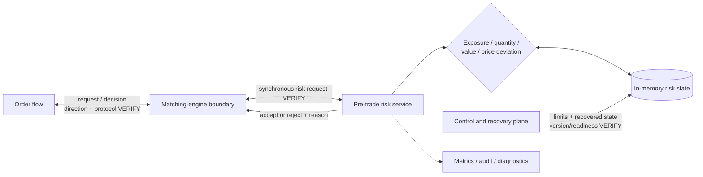
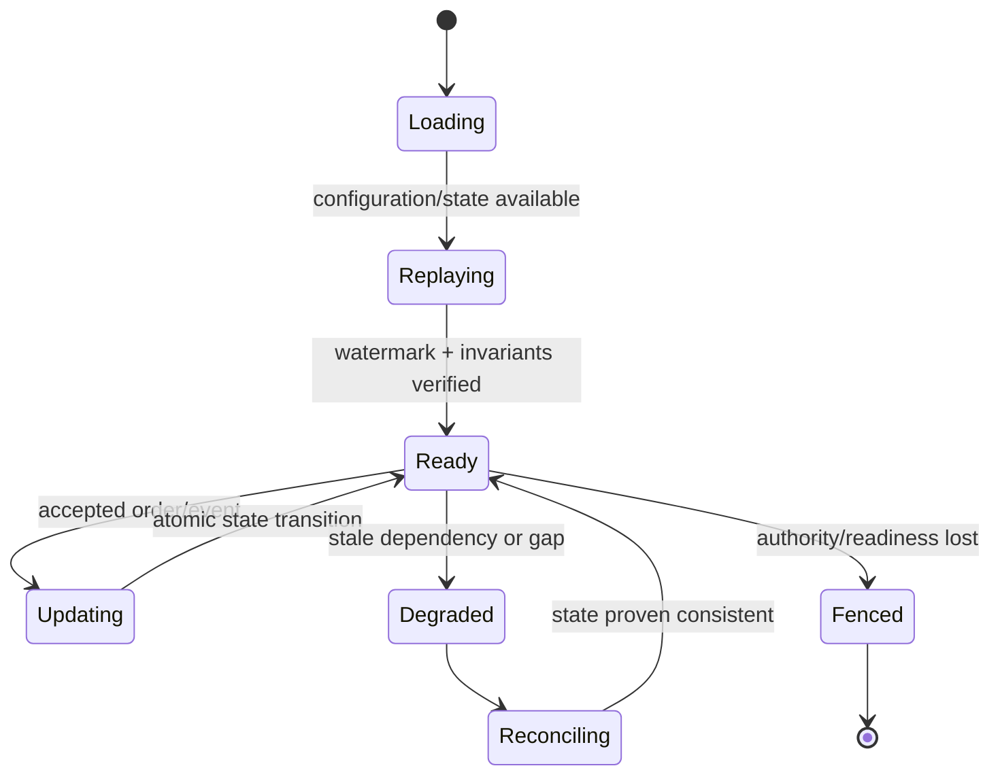
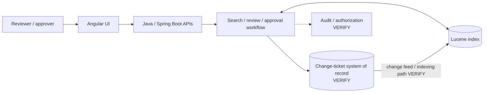
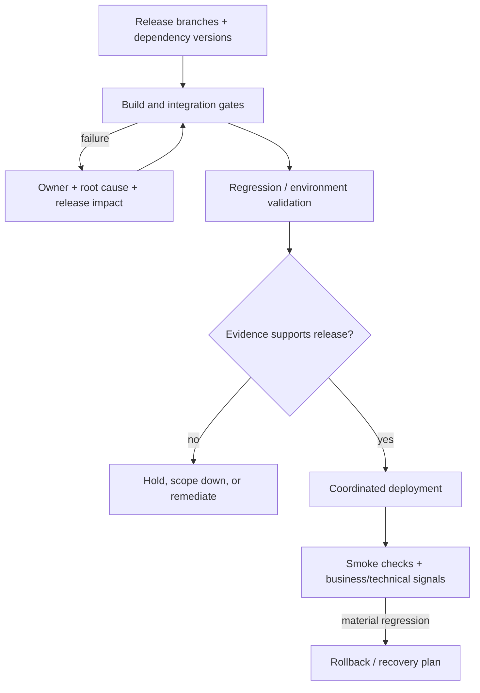

# Clear SDE3 - Master Interview Companion

> **Role:** Software Engineer III / SDE3 - Backend Development, Clear (formerly ClearTax)
> **JD stack:** Core Java, Spring Boot, NoSQL, DSA, multithreading, LLD, database design, HLD, distributed systems, CI/CD
> **JD source:** `C:\Users\Chiranjeev Jain\Downloads\JD_SDE3_ Clear.pdf`
> **Research snapshot:** 23 November 2026
> **Use:** Start at the top and keep scrolling. The highest-value material comes first.

---

## How this file is organized

Assume the paper can be snatched away at any moment. Therefore:

```text
top of file     = must know before entering
next section    = highest-probability technical gate
middle          = complete Clear-specific LLD/HLD and production depth
later           = broader senior-engineer and behavioral coverage
bottom          = mocks, scoring, and optional source index
```

Only official company context, canonical problem statements, code, and reusable project implementations are linked. All interview-ready explanations, answers, decisions, trade-offs, and rehearsal scripts remain inline.

Evidence discipline:

- **[JD]** means explicitly stated in the supplied role description.
- **[ROLE-DERIVED]** means relevant because of the JD, not a reported Clear question.
- **[DESIGN]** means hypothetical; say “I would,” never “Clear uses.”
- **[RESUME-STATED]** means present in the supplied resume; it still does not verify private architecture, metrics, or exact individual scope.
- **[ME/VERIFY]** means based on earlier personal rehearsal material but not necessarily stated in the resume; verify from memory/evidence or remove it from the spoken bank.

---

# 0. If the paper is snatched in ten minutes

## 0.1 The role in one sentence

Clear wants a hands-on senior Java backend engineer who can code, reason about multithreaded and distributed state, design databases and scalable services, own cross-functional customer outcomes, mentor engineers, and improve engineering practices across teams.

The bar is:

```text
coding correctness
+ Java/concurrency depth
+ backend/data judgment
+ failure-aware system design
+ ownership and influence
+ concise, truthful communication
```

## 0.2 Tell me about yourself - 60 seconds [ME/VERIFY]

> “I’m Chiranjeev Jain, a Java backend engineer with about eight years of experience in financial technology. At Nasdaq I work on pre-trade risk systems, where decisions depend on correct state, predictable latency, and reliable recovery. My scope has expanded from implementation into production debugging, customer-facing feature ownership, release coordination, and turning ambiguous requirements into deliverable engineering work. Earlier, I worked at Morgan Stanley on enterprise technology-risk platforms. I’m now looking for an SDE3 role where I can remain hands-on while taking broader ownership of architecture, engineering quality, mentoring, and customer outcomes. Clear is attractive because its financial platforms combine high-scale backend engineering with correctness, auditability, deadline spikes, and direct customer impact.”

Verify years, employers, and scope. Do not invent volumes, money protected, latency, headcount, or titles.

## 0.3 Why Clear? - 45 seconds

> “I’m drawn to Clear because the engineering problem is concrete and consequential: simplifying financial and compliance workflows that businesses depend on. The product surface spans invoices, tax and compliance, accounts payable, vendor workflows, and finance. Those systems must handle bursty document flows, external dependencies, auditability, and simple customer experiences. That fits my background in correct stateful Java systems and production ownership while giving me room to work across a broader SaaS and fintech platform.”

Current official value signal: put customers first, earn trust, think big, own the problem, and raise the bar. Connect one truthful example to these themes; do not merely recite them. [Official Clear careers and values](https://www.clear.in/s/careers)

## 0.4 Why this SDE3 role? - 45 seconds

> “The role combines the areas I want in one job: hands-on Java and backend design, scalable distributed systems, complete project ownership, product partnership, mentoring, and engineering-practice influence. I can contribute immediately through Java, concurrency, financial-system correctness, production debugging, and delivery experience. The growth opportunity is applying those strengths across a multi-tenant product platform and increasing my architectural and cross-team leverage.”

## 0.5 Why leave Nasdaq? - 40 seconds [ME/VERIFY]

> “I’ve learned a great deal at Nasdaq and I’m not moving away from a negative situation. I’m moving toward broader technical ownership in a product environment. I want to use my Java and correctness experience across a wider customer platform, influence architecture and engineering practices, mentor others, and remain hands-on. That combination is explicit in this SDE3 role.”

## 0.6 Coding loop

```text
contract
-> examples and edge semantics
-> correct baseline
-> repeated work / bottleneck
-> invariant
-> simple Java
-> normal + boundary + adversarial tests
-> time and auxiliary space
-> one follow-up trade-off
```

Opening:

> “I’ll restate the contract, clarify the important bounds and edge semantics, give a correct baseline, identify repeated work, state the optimized invariant, implement in small steps, and finish with tests and complexity.”

If stuck:

> “I do not see the optimal pattern yet, so I’ll establish a correct baseline and use the constraints to locate repeated work.”

If a test fails:

> “I expected __ and observed __. I’ll trace the first state divergence before changing the algorithm.”

If given a hint:

> “That suggests __. Let me connect it to the invariant: __.”

## 0.7 Ten technical truths to know cold

1. `volatile` gives visibility and ordering, not compound atomicity.
2. `ConcurrentHashMap` protects its own operations, not a multi-object business invariant.
3. An unbounded queue converts overload into growing latency and memory until failure.
4. More threads do not create CPU or downstream capacity and can worsen p99.
5. A timeout does not prove an external side effect failed.
6. At-least-once delivery requires stable identity and idempotent state transitions.
7. Partition by the smallest business aggregate that requires ordering; too coarse creates hotspots, too fine breaks invariants.
8. A successful deployment does not prove a correct customer outcome.
9. Readiness means the application can safely serve the workflow, not merely that the process is alive.
10. Every result in a compliance system should be tied to source data, rule/config version, time, tenant, and audit identity.

## 0.8 Clear-shaped invariants

```text
No financial document without tenant and business identity.
No money without currency and explicit precision/rounding.
No compliance outcome without source, rule version, timestamp, and audit.
No external retry without stable idempotency/correlation identity.
No partial batch presented as complete success.
No stale/incomplete result presented as authoritative.
No cross-tenant read, write, cache key, message, or log.
No rule/config rollout without versioning and rollback.
No deadline spike may turn an unbounded queue into silent failure.
Timeout does not mean external failure.
```

## 0.9 Three-minute HLD answer [DESIGN]

> “I would first clarify tenant count, invoice and file peak, deadline burst, completion SLO, partial-success semantics, audit retention, and the external authority’s quota and uncertain-outcome contract. The core invariant is that every invoice outcome is tenant-isolated, idempotent, tied to immutable source evidence and a rule version, and never reported as successful while incomplete or unknown.
>
> I would acknowledge only after durably accepting the upload or request and its idempotency record. Large files go to object storage and are parsed asynchronously. Transactional job, invoice, submission, and audit state belongs in a relational store. A durable log distributes bounded parsing, validation, and submission work. Workers are stateless; ordering is scoped to the smallest aggregate that needs it, while tenant-aware scheduling prevents one large customer from starving others.
>
> Submission uses a stable correlation ID and explicit rate control. A timeout becomes `UNKNOWN`, not failed; reconciliation checks provider status before retry. A transactional outbox closes the database/message gap, and consumers tolerate duplicate delivery.
>
> I would operate the system using time-to-result, queue age and tenant skew, rule-version failures, external unknown outcomes, reconciliation gaps, and tenant-isolation signals. I would test deadline bursts, provider failure, worker crash after commit, bad-rule rollback, and regional recovery.”

## 0.10 Ninety-second LLD frame [DESIGN]

> “For a bulk upload I would first clarify file limits, synchronous versus asynchronous completion, partial success, duplicate semantics, and whether external submission is in scope. The identities are tenant, job, idempotency key plus request fingerprint, source row, invoice, rule-set version, and external correlation ID. The job state moves from accepted through parsing and validation to success, partial success, or failure; external submission additionally needs an unknown/reconciling state. Row-result insertion must be idempotent, and job counters advance only when a new terminal row result is committed. Workers are bounded and fairly scheduled per tenant. I would test duplicate requests, crash after commit, malformed rows, huge files, rule-version changes, and cross-tenant access.”

## 0.11 Two questions to ask Clear

Choose two:

1. “Which product workflow and customer problem would this SDE3 own first?”
2. “What are the hardest current trade-offs between deadline-scale throughput, correctness, and product simplicity?”
3. “How does the team define complete ownership from product discovery through production operation?”
4. “How are compliance-rule changes versioned, tested, and rolled out safely?”
5. “What distinguishes an excellent SDE3 here after six months?”

## 0.12 Resume-defense activation [RESUME-STATED / VERIFY DEPTH]

The resume is a one-page claim contract. Every noun can become a question and every verb can become: **“What exactly did you do?”** The facts below are resume-stated; the architecture, scale, metrics, and individual contribution must still be recalled truthfully and may not be inferred from the wording.

### Sixty-second chronology

> “I have about eight years in financial technology. I currently work at Nasdaq on Java/Spring Boot pre-trade risk capabilities integrated with matching-engine systems. The latency-sensitive path uses synchronous in-memory checks for exposure, quantity, value, and price deviation, while database work stays off that hot path. My role also includes production issues and customer escalations, quarterly release coordination, and mentoring. Before Nasdaq, I worked at Morgan Stanley on change-risk-assessment tooling: a Java/Spring Boot, Lucene, and Angular application for search, review, and approval of change tickets, including an AngularJS-to-Angular migration. Earlier, I worked on an Alfresco-to-MongoDB comments migration and a real-time Angular pub/sub UI. I am now looking to apply that correctness and ownership experience to a broader customer-facing backend platform.”

Do not add traffic, latency, financial-impact, team-size, or improvement percentages unless you can state the measurement source and disclosure boundary.

### Claim-to-question map

| Resume claim | Expect this first probe | Evidence to have ready |
|---|---|---|
| Pre-trade risk integrated with matching engines | Where is the risk check in the order flow? | One safe architecture sketch; protocol and boundary marked `[VERIFY]` |
| Synchronous in-memory checks; no database on hot path | What state is held, who owns it, and how is it recovered? | State lifecycle, concurrency model, readiness, replay, stale-config policy |
| Exposure, quantity, value, price-deviation limits | Define each check and its atomic boundary. | Formula/example, reservation/commit semantics, cancel/fill effect, overflow/precision |
| Java/Spring Boot enhancements and production issues | What exact class/service/change did you own? | One feature and one incident from symptom through prevention |
| Customer escalations | How did you communicate uncertainty and restore trust? | Timeline, containment, updates, validation, follow-up control |
| Quarterly releases across branches | What made the release difficult and what did you personally decide? | Dependency map, gates, build issue, go/no-go criterion, rollback/validation |
| Mentoring and Scrum Champion | What changed because of your intervention? | One engineer outcome and one facilitation decision—not ceremony definitions |
| Change Risk Assessment tools | Who used them and what decision did the tool support? | Workflow, data ownership, audit/security, failure behavior |
| Java/Spring Boot/Lucene/Angular application | Why Lucene; how was indexing kept fresh? | Query/index model, consistency, reindex, permissions, operational failure |
| AngularJS-to-Angular migration | Why migrate and how did you reduce delivery risk? | Strangler/big-bang decision, compatibility, test/rollout, measurable result `[VERIFY]` |
| Alfresco-to-MongoDB migration and pub/sub chat | Why MongoDB; how did you prove completeness? | Mapping, ordering/duplicates, dual-run/cutover, reconciliation, rollback |
| Docker, Kubernetes/EKS, message bus, C/C++, Python, SQL | Where did you use each and at what depth? | Production / working / exposure-only classification; never bluff recency |

### Universal cross-question ladder

For every resume bullet, be able to answer in this order:

```text
What business/user problem existed?
What was the architecture before the change?
What exactly did I implement, decide, test, deploy, or operate?
What did other people already own?
What invariant could not be violated?
Where did state live and who could mutate it?
What concurrency, failure, recovery, and security cases mattered?
Which alternative did I reject, and under what constraint?
How did I test and roll out the change?
What result can I prove, and how was it measured?
What went wrong or remained imperfect?
What would I change now?
```

If a detail is confidential, state the safe abstraction and reasoning. Do not replace it with invented precision.

---

# 1. First technical hour - coding, Java, concurrency, Spring, data

## 1.1 DSA gate - attempt, then open only the linked Java

| Priority | Problem · canonical prompt · local Java | Recall trigger · target |
|:---:|---|---|
| A | **Group Anagrams** · [LeetCode](https://leetcode.com/problems/group-anagrams/) · [GroupAnagrams.java](../../src/main/java/org/chijai/day3/session3/GroupAnagrams.java) | Same immutable canonical key · 12m |
| A | **Longest Unique Substring** · [LeetCode](https://leetcode.com/problems/longest-substring-without-repeating-characters/) · [LongestSubString.java](../../src/main/java/org/chijai/day3/session1/LongestSubString.java) | Duplicate-free window; `left` never retreats · 15m |
| A | **Merge Intervals** · [LeetCode](https://leetcode.com/problems/merge-intervals/) · [IntervalSortByStart.java](../../src/main/java/org/chijai/day1/Arrays/session4/Intervals/IntervalSortByStart.java) | Sorted prefix merged; only last can overlap · 12m |
| A | **Top K Frequent** · [LeetCode](https://leetcode.com/problems/top-k-frequent-elements/) · [TopKFrequentElements.java](../../src/main/java/org/chijai/day7/session1/heap/TopKFrequentElements.java) | Size-k min-heap retains best seen · 12m |
| A | **Sliding Window Maximum** · [LeetCode](https://leetcode.com/problems/sliding-window-maximum/) · [SlidingWindowMaximum.java](../../src/main/java/org/chijai/day3/session1/SlidingWindowMaximum.java) | In-window decreasing-index deque · 18m |
| A | **Number of Islands** · [LeetCode](https://leetcode.com/problems/number-of-islands/) · [Islands.java](../../src/main/java/org/chijai/day8/graph/session1/Islands.java) | Each unseen land cell starts one traversal · 15m |
| A | **Course Schedule** · [LeetCode](https://leetcode.com/problems/course-schedule/) · [CourseSchedule.java](../../src/main/java/org/chijai/day8/graph/session2/CourseSchedule.java) | Zero-indegree frontier; processed count proves DAG · 18m |
| A | **Validate BST** · [LeetCode](https://leetcode.com/problems/validate-binary-search-tree/) · [ValidateBST.java](../../src/main/java/org/chijai/day6/trees/session3/ValidateBST.java) | Every node obeys inherited bounds · 12m |
| A | **Time-Based Key-Value Store** · [LeetCode](https://leetcode.com/problems/time-based-key-value-store/) · [TimeBasedKeyValueStore.java](../../src/main/java/org/chijai/day2/session3/TimeBasedKeyValueStore.java) | Greatest timestamp `<=` query · 18m |
| A | **LRU Cache** · [LeetCode](https://leetcode.com/problems/lru-cache/) · [LruCache.java](../../src/main/java/org/chijai/day4/LinkedList/session3/LruCache.java) | Map + doubly linked recency list · 22m |
| B | **Random Pick With Weight** · [LeetCode](https://leetcode.com/problems/random-pick-with-weight/) · [RandomPickWithWeight.java](../../src/main/java/org/chijai/day12/randomized/weightedsampling/RandomPickWithWeight.java) | Prefix intervals + binary-search sampled point · 18m |

For any problem, say the invariant before code, use overflow-safe arithmetic/comparators, and test empty/singleton, duplicate/tie, boundary, and adversarial cases.

## 1.2 Core Java rapid answers

### `==` versus `equals`

`==` compares primitive values or reference identity. `equals` expresses logical equality when overridden. Equal objects must have equal hash codes. Fields used by equality should remain stable while an object is a hash key.

### `HashMap` versus `ConcurrentHashMap`

`HashMap` is not safe for concurrent mutation. `ConcurrentHashMap` gives thread-safe map operations and atomic per-key methods, but an invariant spanning multiple keys, a map and a counter, or a map and a linked list still needs ownership, a lock, a transaction, or one atomic state transition.

### Immutability

Immutable objects simplify sharing, publication, caching, and reasoning. Use private final state, complete construction, defensive copies, no mutators, and no `this` escape. A final reference to a mutable collection is not deep immutability.

### `ArrayList` versus `LinkedList`

`ArrayList` is usually better for indexed access, iteration, memory locality, and append. `LinkedList` offers O(1) link mutation only after the node is already known and pays allocation and cache-locality costs.

### Streams versus loops

Streams are strong for declarative transformation and aggregation. Loops are often clearer for stateful algorithms, early exits, checked errors, or latency-sensitive code. Parallel streams use a shared pool by default and require explicit workload and blocking analysis.

### Exceptions

Use stable domain error contracts. Do not use exceptions for normal control flow. Keep the original cause, do not swallow failures, and distinguish validation, conflict, retryable dependency failure, and unexpected server error. On hot paths, exception creation and stack traces are costly, but correctness comes first.

### Money and time

Never use `double` for money. Use minor units with currency or `BigDecimal` with explicit scale and rounding. Use `Instant` for a moment, `LocalDate` for a date without time, and explicit `ZoneId` for business cutoffs; never rely on server default time zone.

### Records and `Optional`

Records are concise shallowly immutable data carriers with generated equality/hash/accessors. Components can still reference mutable objects. `Optional` is mainly a return-type absence contract; avoid `get()` without proof and avoid using it everywhere as a field or parameter.

## 1.3 JVM and performance rapid answers

### Heap, stack, metaspace

The heap is shared and generally contains objects. Each platform thread owns stack frames containing locals and execution state. Metaspace holds class metadata. Process memory also includes code cache, native allocations, direct buffers, and thread stacks.

### When is an object collectible?

When no strong path from a GC root reaches it. Unreachable cycles are collectible. Eligibility does not imply immediate collection. Java can leak memory when useless objects remain reachable through caches, listeners, queues, statics, `ThreadLocal`, or class loaders.

### G1, pauses, and evidence

G1 is a region-based collector aiming for bounded pauses through young and mixed collections. Concurrent work does not eliminate stop-the-world phases. Choose and tune collectors from allocation rate, live set, pause distribution, throughput, and SLO evidence using GC logs/JFR—not slogans.

### JIT and warm-up

The JVM profiles execution and compiles hot methods, applying optimizations such as inlining. Warm-up, tiered compilation, deoptimization, dead-code elimination, and constant folding can invalidate naive benchmarks. Use JMH for microbenchmarks.

### CPU high versus latency high

For CPU saturation, capture impact, recent changes, repeated thread dumps, JFR/profiler, allocation, and GC evidence. When latency rises with normal CPU, inspect queues, locks, I/O, DNS/network, database pools/queries, downstream timeouts, and traffic skew. Correlate p95/p99 with traces and saturation.

## 1.4 Concurrency rapid answers

### Java Memory Model and happens-before

The JMM defines legal visibility and ordering between threads. A happens-before relationship guarantees that earlier writes are visible and ordered before later reads. Locks, volatile reads/writes, thread start/join, static initialization, and concurrent utilities create these edges.

### `volatile`

A volatile write happens-before a later read of that variable, giving visibility and ordering. It does not make `count++`, check-then-act, or a multi-field invariant atomic.

### `synchronized` versus `ReentrantLock`

Both provide mutual exclusion and visibility. `ReentrantLock` adds timed and interruptible acquisition, multiple conditions, and optional fairness, but requires unlock in `finally`. State the protected invariant; choose the simplest correct mechanism.

### CAS, `AtomicLong`, and `LongAdder`

CAS updates only if state still equals the expected value; failure means retry or another policy. It is useful for a single-state atomic transition but not automatically for multi-variable invariants. `AtomicLong` exposes one linearizable value. `LongAdder` improves contended increment throughput, but `sum()` is not an atomic snapshot and is unsafe for strict limit enforcement.

### Thread pools and bounded queues

Define task type, worker count, queue capacity, rejection/backpressure, timeout/cancellation, observability, and shutdown. CPU-bound work is limited by cores; blocking work is limited by external capacity and resource pools. An unbounded queue hides overload until latency and memory collapse.

### `CompletableFuture`

It composes asynchronous work but can hide executors, blocking joins, context loss, exception handling, cancellation gaps, and unbounded fan-out. Use an explicit bounded executor, one end-to-end deadline, classified partial failures, and a clear required/optional dependency policy.

### Virtual threads

They reduce per-thread cost for many blocking waits, improving concurrency scalability. They do not make CPU work faster, remove races, expand database connections, or create downstream capacity. Watch pinning and resource pools.

### Safe publication

Publish through a happens-before edge: static initialization, final-field construction without escape, volatile/atomic reference, lock release, or concurrent collection. For configuration refresh, build and validate an immutable snapshot off-path, then atomically replace one reference; a request reads one version for its whole decision.

### Deadlock

Deadlock needs mutual exclusion, hold-and-wait, no preemption, and circular wait. Diagnose with thread dumps showing owned and waited monitors. Prevent using consistent lock order, smaller scope, ownership/partitioning, or timed acquisition where appropriate.

## 1.5 Spring Boot rapid answers

### Spring versus Spring Boot

Spring provides the application framework and container. Boot adds opinionated dependency management, conditional auto-configuration, executable packaging, and production integrations.

### Constructor injection

Required dependencies become explicit, final, and testable; the object is valid after construction. Too many constructor arguments expose excessive responsibility.

### Singleton bean thread safety

Singleton scope means one bean instance per definition/container, not automatic thread safety. Prefer stateless services. Shared mutable state needs a deliberate concurrency design.

### AOP and transaction self-invocation

Spring commonly applies transactions through a proxy. A method calling another annotated method on `this` bypasses the proxy, so the inner annotation may not take effect. Put the boundary in another bean or use an explicit transaction mechanism.

### Transaction boundary

Keep transactions short. Do not stream a large file or call a remote service while database locks are held. Commit local state and an outbox row together; perform external work asynchronously and idempotently.

### Validation and errors

Validate syntax/shape/size at the boundary and business invariants in the application/domain layer. Return a stable machine code, safe message, correlation ID, and field violations. Do not expose secrets or stack traces.

### Readiness, liveness, startup, shutdown

Readiness controls traffic, liveness requests restart, and startup protects slow initialization from premature liveness failure. On shutdown: stop readiness/admission, finish or checkpoint bounded in-flight work, stop consumers, flush state/telemetry, and terminate within a deadline.

### Production-ready API checklist

```text
authentication + resource/action authorization
trusted tenant resolution
schema/size validation
idempotency for retried commands
stable error contract + correlation
timeouts, cancellation, bounded concurrency
deterministic pagination
rate/quota policy
audit for sensitive state change
metrics, logs, traces, business counters
backward-compatible schema/API change
```

## 1.6 Database, NoSQL, and distributed-systems rapid answers

### Choosing a data store

Start with access pattern, business invariant, consistency, scale, retention, failure model, and team operations. Relational databases are strong for multi-row invariants, constraints, transactions, and joins. Key-value stores fit stable-key access, TTL, and atomic per-key operations. Document stores fit evolving document-shaped data but make cross-document invariants harder. Object storage fits large immutable files. Logs fit ordered event transport/replay, not arbitrary queries. Search and analytics stores are derived views, not authoritative transactional state.

### Partition key and hot keys

Partition by a key aligned with ownership and dominant access. Too coarse creates hotspots; too fine breaks ordering and invariants. Detect tenant skew. Options include per-tenant admission, dedicated partitions for large tenants, read caching, local aggregation, or sharding only when the invariant permits.

### Strong versus eventual consistency

Strong consistency coordinates an agreed order of operations at latency/availability cost. Eventual consistency permits temporary divergence. Decide from the action: invoice approval, money movement, and idempotency reservation may need strong local invariants; search, analytics, and notifications can often lag if freshness is explicit.

### Idempotency

Repeating one logical command produces no extra unintended effect. Use a stable scoped key, request fingerprint, atomic stored outcome, retention policy, and conflict behavior when the same key arrives with a different payload. In-memory duplicate checks alone do not survive failover.

### Retries, timeouts, and circuit breakers

Retries amplify outages and can duplicate work. Use an end-to-end deadline, bounded attempts, exponential backoff with jitter, retry budget, idempotency, and error classification. A circuit breaker prevents repeated calls to an unhealthy dependency but does not replace timeout, capacity limits, or correct fallback semantics.

### At-least-once and ordering

At-least-once delivery means duplicates can occur; consumers need stable event IDs and atomic idempotent transitions. Ordering exists only in a stated scope, commonly one partition/key. Choose the smallest aggregate whose events must serialize.

### Transactional outbox

Commit the domain change and outbox event in one local database transaction. A publisher sends the event later and records progress. Delivery may repeat, so consumers remain idempotent. Monitor outbox age/backlog and support replay. This closes the database/message gap without claiming global exactly-once behavior.

### Backpressure

When consumers or dependencies saturate, producers must slow, queue durably within bounds, reject, shed, or defer. Define which work is safe to reject and preserve fairness across tenants. Queue age is often a better customer-risk signal than queue depth.

### External timeout and `UNKNOWN`

A timeout means the result is unknown. Persist intent and stable correlation before the call. If the provider supports idempotency/status lookup, reconcile before retry. Model `UNKNOWN -> RECONCILING -> ACCEPTED/REJECTED/MANUAL_REVIEW`; do not collapse uncertainty into failure.

---

# 2. Clear-specific low-level design - inline answer, code linked

## 2.1 Bulk invoice upload and validation

### Clarify

- API request, file upload, or both?
- Maximum file size/rows and accepted formats?
- Synchronous acknowledgement or full completion?
- Partial success and failed-row retry?
- Duplicate identity: request, file, invoice, tenant, or business key?
- Are validation rules global, tenant-specific, effective-dated, and versioned?
- Is external submission in scope?

### Core identities

```text
TenantId
JobId
IdempotencyKey + RequestFingerprint
FileHash / ObjectVersion
RowId / SourceLine
InvoiceBusinessKey
RuleSetVersion
ExternalCorrelationId
AttemptId
```

### States

```text
Job:
ACCEPTED -> PARSING -> VALIDATING -> SUCCEEDED / PARTIAL_SUCCESS / FAILED

Row:
RECEIVED -> VALID / INVALID / FAILED_RETRYABLE

External submission:
QUEUED -> SUBMITTING -> ACCEPTED / REJECTED
                         |-> UNKNOWN -> RECONCILING
                                      -> ACCEPTED / REJECTED / MANUAL_REVIEW
```

### API

```text
POST /v1/uploads            -> 202 {jobId, statusUrl}
GET  /v1/uploads/{jobId}    -> state, counts, timestamps, error report
POST /v1/uploads/{jobId}/retry-failed
GET  /v1/uploads/{jobId}/errors?cursor=...
```

The tenant comes from trusted authentication context, not the body alone. The same idempotency key and fingerprint returns the stored outcome; same key with different fingerprint returns conflict.

### Responsibilities

| Component | Responsibility |
|---|---|
| Controller | authentication/authorization, metadata and size validation, stable error contract |
| Upload service | idempotency reservation, object-store intent, job creation, outbox |
| Parser | streaming parse, schema validation, stable source-row identity |
| Validation engine | deterministic versioned rules and explainable errors |
| Job coordinator | legal state transitions, progress, terminal result |
| Result repository | conditional insert of row outcome; no duplicate counter mutation |
| Submission adapter | provider protocol, stable correlation, rate/timeout policy |
| Reconciler | resolve unknown outcomes using provider status/evidence |
| Notification service | completion/failure/webhook delivery, separately retryable |

### Main sequence

```text
authenticate + authorize tenant
-> validate metadata/size/type
-> reserve idempotency key
-> stream file to object storage while hashing
-> commit job metadata + outbox
-> parser emits bounded row chunks
-> validators use pinned rule-set version
-> conditionally insert row outcome
-> advance job counters only for a newly inserted terminal outcome
-> derive terminal job state
-> submit valid invoices with provider rate control
-> reconcile UNKNOWN outcomes
-> expose status and notify
```

### Concurrency and correctness

- Validation workers are stateless and bounded.
- Partition ordering only by the aggregate that needs it; do not globally serialize all tenant work.
- Use tenant-aware admission and fair scheduling so one large customer cannot starve others.
- The row result and its contribution to progress must not double-apply on replay.
- Optimistic versioning or single ownership protects job state transitions.
- Periodically reconcile counters from child results because derived counters can drift after defects.
- Pin rule version to a job so one batch is reproducible even during rule rollout.

### Persistence boundary

Relational storage owns job/invoice/submission state, idempotency, versions, constraints, and audit. Object storage owns immutable raw files and generated reports. A durable log distributes work/replay. Cache/search/analytics are derived and rebuildable.

### Tests

1. Same idempotency key and same payload returns the same job.
2. Same key with different payload returns conflict.
3. Worker crash after result commit but before acknowledgement does not double-count.
4. Malformed row does not corrupt following row boundaries.
5. Rule version stays fixed during a job.
6. Cross-tenant request is denied even with a valid job ID.
7. Huge file remains within memory/queue limits.
8. External timeout enters `UNKNOWN`, not failed.
9. Retry/reconciliation does not duplicate external side effects.

Implementation references only:

- [Employee Document Upload System](../../../../SystemDesignProjects/employee-document-upload-system/docs/INTERVIEW_GUIDE.md)
- [Reliable Order Platform](../../../../SystemDesignProjects/reliable-order-platform/INTERVIEW_GUIDE.md)
- [Distributed Task Scheduler](../../../../SystemDesignProjects/distributed-task-scheduler/docs/INTERVIEW_GUIDE.md)

## 2.2 Token-bucket rate limiter

Contract: allow a burst up to capacity, then refill at a configured rate. Key by tenant/API/user according to the actual quota. Inject a monotonic clock for deterministic tests. Refill lazily under one atomic per-bucket transition; clamp tokens to capacity. Return allow/deny plus remaining budget or retry-after.

Process-local state protects one instance but multiplies effective allowance as instances scale. A strict global limit needs a shared atomic operation or gateway and an explicit policy when that coordinator fails. Clarify whether approximate protective limiting is sufficient before adding global coordination.

Implementation: [design](../../../../LLDProjects/token-bucket-rate-limiter/docs/LOW_LEVEL_DESIGN.md), [Java](../../../../LLDProjects/token-bucket-rate-limiter/src/main/java/com/example/ratelimiter/TokenBucket.java), and [tests](../../../../LLDProjects/token-bucket-rate-limiter/src/test/java/com/example/ratelimiter/InMemoryTokenBucketRateLimiterTest.java).

## 2.3 Pluggable validation engine

Separate orchestration from individual rules. Each rule has a stable code/version and returns a structured outcome, not an exception or free-form string. Clarify fail-fast versus collect-all, severity, dependencies, effective dates, tenant overrides, and deterministic order. Version the complete rule set. Keep pure rules isolated and testable; prepare external reference data once in a bounded validation context instead of hiding remote calls inside each rule.

## 2.4 LRU/configuration cache

Map provides O(1) lookup; a doubly linked list provides O(1) recency update and eviction. The invariant spans both structures, so a concurrent map alone is insufficient. First make single-threaded map/list mutation correct, then protect the compound invariant with one lock or use a proven cache library. For configuration, define source of truth, version, TTL/invalidation, stale policy, stampede protection, and cache-outage behavior.

Implementation: [design](../../../../LLDProjects/lru-cache/docs/LOW_LEVEL_DESIGN.md), [Java](../../../../LLDProjects/lru-cache/src/main/java/com/chiranjeev/lld/cache/LruCache.java), and [tests](../../../../LLDProjects/lru-cache/src/test/java/com/chiranjeev/lld/cache/LruCacheTest.java).

## 2.5 Notification intent versus delivery

Persist notification intent separately from provider delivery attempts. Use a stable dedup key such as `(tenant,eventId,channel,templateVersion)`. Apply consent, preference, locale, quiet hours, and frequency limits before delivery. Provider timeout follows provider-specific unknown/retry semantics. “Accepted by provider” is not “delivered to user.” Use bounded retries, DLQ/manual repair, and audit; minimize sensitive data in insecure channels.

Implementation: [Notification Platform](../../../../SystemDesignProjects/notification-platform/docs/INTERVIEW_GUIDE.md).

---

# 3. Clear-specific high-level design - complete inline walkthrough

## 3.1 Multi-tenant e-invoicing/compliance platform [DESIGN]

### Functional requirements

- Accept a single invoice API request and large batch files.
- Authenticate and authorize a tenant and business identity.
- Parse, normalize, and validate using an identifiable rule version.
- Persist explainable row/invoice results.
- Submit valid invoices to a rate-limited external authority.
- Support partial success, retries, reconciliation, and error reports.
- Expose job/invoice status and deliver notifications/webhooks.
- Preserve source, decision, actor, version, and external evidence for audit.

### Non-functional requirements to clarify

- Average, peak, and burst request/invoice/file rate.
- Maximum file size and completion deadline.
- API acknowledgement latency versus end-to-end completion SLO.
- Availability, RPO, RTO, data residency, retention, and deletion.
- Tenant fairness, quotas, and noisy-neighbor policy.
- External authority quota, timeout, idempotency, and status-query contract.
- Consistency and stale-data policy for each customer action.

### Capacity-estimation method

Do not guess Clear's real numbers. Ask for values and show the method:

```text
peak invoices/sec = average × deadline burst factor
raw ingress/sec = peak × average normalized payload
validation CPU/sec = peak × CPU time per invoice
backlog drain time = queued work / sustainable processing rate
storage/day = invoices/day × retained payload/index/audit multiplier
```

The purpose is to expose the actual bottleneck: parser CPU, database writes, external provider quota, queue age, or a hot tenant.

### Architecture

```text
Clients / ERP / UI
        |
   API Gateway / WAF
        |
Authentication -> Tenant/Action Authorization -> Quota
        |
 Ingestion API -----------------------> Object Storage
        |                             raw files / reports
        |
 Relational Metadata DB
 job + invoice + idempotency + submission + audit + outbox
        |
 Outbox Publisher -> Durable Event Log
                         |
                  Parser Workers
                         |
               Validation Workers <--- Versioned Rule Control Plane
                         |
                Result / Error Store
                         |
               Fair Submission Scheduler
                         |
                  Provider Adapter
                         |
            External Authority / IRP
               |                 |
         accepted/rejected    timeout/unknown
               |                 |
               +-------- Reconciliation Workers
                                  |
                         Status / Query API
                                  |
                       Notification / Webhook

Cross-cutting: tracing, safe structured logs, business metrics,
audit, encryption, secrets, tenant isolation, runbooks, alerts.
```

### Data ownership

| State | Owner / store | Reason |
|---|---|---|
| Raw uploaded file | Versioned object storage | immutable evidence, cheap large-object retention |
| Job/invoice/submission status | Relational DB | constraints, conditional transitions, transaction and query needs |
| Idempotency outcome | Relational DB or strongly consistent key store | atomic reservation and stable replay result |
| Work distribution | Durable event log | buffering, replay, consumer decoupling, partition order |
| Rule/config bundles | Versioned control-plane store | validation, approval, canary, rollback, reproducibility |
| Search/customer filters | Search index | derived flexible queries; not authoritative |
| Analytics/reports | Warehouse/lake | large scans and aggregation; explicit freshness |
| Short-lived hot reads | Cache | derived optimization with stale/outage policy |

### Important schema concepts

```text
Tenant(tenantId, status, plan, version)
BusinessIdentity(identityId, tenantId, GSTIN, status, version)
UploadJob(jobId, tenantId, idempotencyKey, fingerprint, objectVersion,
          ruleSetVersion, status, counts, version, createdAt)
Invoice(invoiceId, tenantId, jobId, businessKey, amount, currency,
        schemaVersion, status, version)
ValidationResult(invoiceId, ruleCode, ruleVersion, severity, outcome, message)
Submission(submissionId, invoiceId, externalRequestId, status, attempt,
           responseReference, version, updatedAt)
AuditEvent(eventId, tenantId, aggregateId, actor, action,
           fromState, toState, correlationId, occurredAt)
Outbox(eventId, aggregateId, type, payload, createdAt, publishedAt)
```

Exact money uses minor units plus currency or decimal with explicit scale/rounding. Every tenant-owned lookup and uniqueness rule must enforce tenant scope. Use optimistic versions or single ownership for concurrent transitions.

### Request and batch flows

#### Single invoice

```text
authenticate/authorize
-> reserve idempotency
-> validate schema/business identity
-> pin rule version and validate
-> persist invoice + result + outbox
-> enqueue provider submission
-> return accepted/status identity
-> update from provider or reconciliation
```

#### File batch

```text
validate metadata and reserve job identity
-> stream to object storage
-> commit job + outbox
-> parse bounded chunks
-> validate using one pinned rule set
-> conditionally persist row outcomes
-> update progress without double-apply
-> schedule valid rows fairly
-> derive partial/success/failure
-> produce error report and notify
```

### Partitioning and ordering

- Preserve order only for the smallest aggregate requiring it, such as invoice/submission or business identity.
- Do not use tenant as the only queue partition if one enterprise can create a hotspot.
- Keep tenant identity in every message for authorization, quota, tracing, and fair scheduling.
- Use per-tenant concurrency/admission plus global bounds.
- Large tenants may require dedicated lanes or weighted fair scheduling.
- Repartitioning changes order/ownership and must be planned.

### Consistency choices

- Idempotency reservation and state transition: strong local consistency.
- Job counters: derived; update idempotently and reconcile from child records.
- Search index and analytics: eventual consistency with freshness exposed.
- Notifications: eventual, deduplicated, separately retryable.
- Rule distribution: workers activate one complete immutable version atomically.
- Cross-region authoritative writes: require explicit ownership/fencing; do not default to active-active.

### External authority call

Before calling, persist intent and stable external correlation. Use rate limits, deadline-derived timeouts, and classified retries. On timeout, mark `UNKNOWN`; query provider status or reconcile external evidence before retrying. Reuse provider idempotency identity where supported. Never assume disconnection means rejection.

### Backpressure and deadline spikes

- Bound in-memory queues and executors.
- Accept work only after durable capacity/admission decision.
- Monitor queue age and estimated deadline miss, not depth alone.
- Shed/defer only according to explicit business priority.
- Preserve capacity for reconciliation and control operations.
- Scale a measured bottleneck; more validators do not expand provider quota or database capacity.
- Communicate delayed/processing/unknown status honestly to customers.

### Tenant isolation

```text
authenticated principal
-> authorized tenant/action
-> tenant-scoped repository/partition/cache/message/object prefix
-> tenant-safe log/metric/audit
```

Never trust tenant ID from request body alone. Avoid unscoped repository methods. Include tenant in cache keys, object prefixes, quotas, and message context. Test cross-tenant negative cases, support tooling, backfills, exports, and logs.

### Observability and SLOs

Technical signals:

- request latency/error/throughput;
- executor/connection saturation;
- queue age/depth and partition skew;
- consumer lag and rebalance;
- provider latency, quota responses, timeouts;
- database plan/pool/lock behavior;
- JVM allocation, GC, CPU, thread state.

Business signals:

- jobs accepted, first-result time, terminal completion time;
- valid/invalid/error count by rule version;
- submissions accepted/rejected/unknown;
- age of unresolved unknown outcomes;
- duplicate suppression and idempotency conflict;
- reconciliation gaps;
- stale rule/config adoption;
- tenant-isolation/security events.

### Failure deep dive 1 - provider outage near a deadline

```text
detect: provider latency/error/quota + oldest job age + deadline risk
contain: stop retry storm; circuit/rate/admission controls
protect: durable accepted work, bounded memory, fair tenant lanes
communicate: delayed/unknown state, affected scope, next checkpoint
recover: paced idempotent retry or reconciliation/status query
prove: backlog drained, no duplicate submissions, outcomes reconciled
prevent: load/failure drill, capacity model, retry budget, runbook
```

### Failure deep dive 2 - bad validation rule

Halt rollout and pin new work to last known-good version if safe. Identify all decisions produced by the bad version. Preserve old results and raw evidence; create a new versioned recalculation instead of rewriting history. Reconcile downstream submissions with domain/compliance owners. Add golden cases, shadow comparison, tenant canary, divergence thresholds, and automated halt/rollback.

### Failure deep dive 3 - worker crash after database commit

The message is redelivered. Conditional/idempotent result insertion detects the committed outcome. Counters advance only for a newly committed result. The consumer acknowledges after durable completion. Duplicate processing may occur, but duplicate state effect does not.

### Failure deep dive 4 - one huge tenant

Enforce file/row limits; stream and chunk rather than load into JVM heap. Apply per-tenant admission/concurrency, weighted fair scheduling, and global bounds. Expose progress and deadline estimate. Consider an isolated lane only after measured skew; do not random-shard if it breaks ordering/invariants.

### Regional failure

RTO/RPO drive topology. Restore durable metadata, object evidence, and event position. Fence the old writer before promoting another. Rebuild or replay state to a known consistency point, reconcile external outcomes, and only then declare readiness. Multi-region active-active needs an ownership/conflict model, not merely duplicate deployments.

### Key trade-offs

- Async processing adds state-machine and support complexity but safely absorbs burst and external slowness.
- Relational authoritative state plus derived search/analytics is simpler than forcing all workloads into one database.
- At-least-once delivery plus idempotent transitions is more defensible than vague end-to-end exactly once.
- Strong consistency is localized to business invariants; global coordination is avoided unless required.
- Per-tenant fairness can slightly reduce maximum throughput but protects platform/customer outcomes.

Implementation analogues only:

- [Employee Document Upload System](../../../../SystemDesignProjects/employee-document-upload-system/README.md)
- [Reliable Order Platform](../../../../SystemDesignProjects/reliable-order-platform/INTERVIEW_GUIDE.md)
- [Distributed Task Scheduler](../../../../SystemDesignProjects/distributed-task-scheduler/README.md)
- [Notification Platform](../../../../SystemDesignProjects/notification-platform/README.md)
- [Multi-Service Aggregator](../../../../SystemDesignProjects/multi-service-aggregator/INTERVIEW_GUIDE.md)
- [Distributed Database](../../../../SystemDesignProjects/distributed-database/README.md)

## 3.2 Reconciliation-platform variation

Ingest immutable snapshots from customer ERP, Clear, and external authority. Validate and normalize identities while preserving source facts. Partition by tenant, business identity, and period. Exact matching can use keys and hash/sort joins; fuzzy matching first blocks candidates to avoid O(n²), then applies a versioned score. Separate raw fact, normalized fact, candidate, automated decision, and human decision.

Every result identifies input snapshots and normalization/rule/scoring versions. Late data triggers an idempotent incremental run or versioned recomputation. Do not auto-resolve below an approved threshold. Human overrides require authorization, reason, audit, and possibly maker/checker approval. Metrics include source freshness, exact/ambiguous/unmatched rate, unresolved amount/count/age, sampled false-match rate, and rerun divergence.

## 3.3 Notification/webhook variation

Domain transaction writes an outbox event. Consumers filter consent/preferences, render a versioned template, and route to per-channel delivery. Stable notification identity prevents duplicates. Per-tenant/channel quotas and bounded retries prevent provider failure from consuming all capacity. Provider acceptance and user delivery are separate states. Sign webhooks, rotate secrets, minimize PII, preserve attempt audit, and provide DLQ/manual replay with authorization.

---

# 4. Production engineering, CI/CD, testing, and incidents

## 4.1 CI/CD pipeline

```text
commit
-> formatting/static analysis/secret/dependency scan
-> unit/property/concurrency tests
-> build immutable signed artifact + SBOM
-> database migration compatibility check
-> integration and consumer/provider contract tests
-> deploy to production-like environment
-> load/resilience/security tests proportional to risk
-> progressive production rollout
-> SLO + business-invariant gates
-> rollback or roll-forward + reconciliation
```

Promote the same artifact; vary external configuration. Use expand-migrate-contract for schemas. Feature flags require owner, expiry, audit, and safe default. Canary is meaningful only with representative traffic and automated stop criteria. Rollback may be unsafe after irreversible schema/external effects; rehearse roll-forward and reconciliation too.

## 4.2 Testing strategy

| Layer | What it proves |
|---|---|
| Unit/property | rules, parsing, money boundaries, state transitions, invariants |
| Concurrency | atomic outcome under controlled interleavings; use barriers/latches, not sleeps |
| Repository/integration | constraints, transactions, migrations, queries, serialization |
| Contract | stable client/provider schemas and compatibility |
| End-to-end | a small number of critical workflows and audit evidence |
| Load/soak | capacity, queues, fairness, p99, memory/GC, leaks |
| Resilience | timeout, duplicate delivery, crash after commit, provider outage, failover |
| Security | tenant isolation, authorization, injection, sensitive logs, dependency/image risk |

## 4.3 Production incident sequence

```text
1. Establish customer/business impact, deadline, and affected scope.
2. Assign incident owner and communication cadence.
3. Stop harmful propagation and freeze risky changes.
4. Preserve evidence; identify first failing boundary.
5. Apply the safest tested mitigation/degraded mode/rollback.
6. Reconcile correctness and UNKNOWN outcomes after service recovery.
7. Find root cause plus contributing control/observability gaps.
8. Add the smallest durable prevention and test recovery.
```

### Stale compliance result before deadline

> “I would identify affected tenants, workflows, and deadlines and whether unsafe automation depends on the stale result. I would stop or mark affected actions rather than present incomplete data as current. Then I would compare source freshness, queue age, consumer lag, configuration/rule versions, recent rollout, and traces. I would preserve raw inputs and recover through idempotent replay or reconciliation, communicate the next checkpoint, and verify business completeness rather than only process availability. Prevention could include freshness SLOs, invariant alerts, replay tests, and a deadline-capacity drill.”

## 4.4 Observability answer

> “I start from the customer workflow, then connect logs, metrics, and traces through stable correlation and business IDs. Infrastructure health is necessary but insufficient. For invoice processing I need accepted, parsed, validated, submitted, unknown, and reconciled counts; time-to-result; oldest queue age; rule/config version; tenant skew; provider freshness; and reconciliation gaps. Alerts should represent an actionable SLO or invariant breach and link to ownership and a runbook.”

Never place invoice contents, tax identifiers, tokens, or sensitive personal data in ordinary logs.

---

# 5. Senior ownership and behavioral answers

## 5.1 Hardest technical issue - negative exposure [ME/VERIFY]

> “One difficult issue involved incorrect and sometimes negative exposure after startup. Because it was intermittent, I did not assume the arithmetic was wrong. I increased observability, replayed the customer event sequence, and reconstructed initialization order. Some recovered long-lived orders could be processed before the corresponding risk configuration had completed initialization. Their initial exposure increment was skipped because required state did not yet exist; a later cancellation followed the normal path and decremented exposure from zero. I widened the suspected timing window using a larger startup state and slower staged initialization, which made the issue reproducible. The corrective direction was to move the readiness boundary so required risk state existed before replay. We validated with the synthetic reproduction and original sequence. The lesson was that the arithmetic was correct but the state was incomplete.”

Follow-ups:

- Invariant: required risk state exists before any recovered order affects exposure.
- Not a classic data race: primarily an initialization/event-ordering contract defect.
- Reproduction: change one timing factor to widen the vulnerable window without changing event semantics.
- Clear connection: readiness, versioned configuration, replay correctness, and observable state completeness.

## 5.2 Something you owned - API protection [ME/VERIFY]

> “A customer needed controlled external API access to pre-trade risk functionality. The real requirement included routing, authentication, load balancing, and protecting the backend from excessive traffic. I investigated an NGINX gateway approach and built a proof of concept, then helped break the work into routing, scaling, connectivity, rate limiting, and operational documentation. Given delivery constraints, the team selected a smaller application-level limiter instead of the full gateway design. I documented and coordinated the delivery. My learning was that ownership is not defending the most elegant first design; it is delivering an appropriate, understood solution within the constraints.”

Follow-up: a process-local limiter protects one instance, not a strict global quota. Clarify business strictness before adding shared coordination.

## 5.3 Split brain and fencing [ME/VERIFY]

> “Leader election at startup is not enough; authority must be continuously proven. A partitioned primary can remain alive while another instance gains leadership. For authoritative financial state, loss of lease or coordinator proof should fence or stop primary operations rather than trust remembered leadership. That trades temporary availability for correctness. I would rather have no writer briefly than two writers.”

## 5.4 Operational ownership [ME/VERIFY]

> “I acted as release manager across quarterly release branches, coordinating dependencies, build and integration issues, branch readiness, validation, and stakeholders through delivery. It reinforced that development complete is not release ready. The unit of ownership is the delivered and observable outcome, not the merged pull request.”

## 5.5 Mentoring [ME]

> “I start with the engineer’s current mental model and the outcome they need. I ask questions that expose assumptions, review the invariant and failure modes with them, and let them own the implementation. I give specific feedback and gradually widen ownership. Solving it for someone is faster once; teaching the reasoning creates lasting team leverage.”

## 5.6 Cross-functional disagreement [DESIGN]

> “I first identify whether we disagree on the user outcome, facts, assumptions, risk tolerance, or schedule. I make examples and decision criteria visible, quantify impact where possible, and offer options with consequences. If a small reversible experiment can settle the question, I prefer that to opinion. Once the accountable owner decides, I support the outcome while preserving any material risk and review trigger.”

## 5.7 Customer-first and data-driven [DESIGN]

> “Customer-first does not mean implementing every request literally. I identify the customer decision or pain, segment who is affected, and connect it to product and operational evidence. Then I choose the smallest safe change that moves a measurable outcome without violating security, compliance, reliability, or maintainability. I define success and rollback signals before rollout.”

## 5.8 Prioritization when everything is urgent [DESIGN]

> “I rank by customer and business impact, production/compliance risk, reversibility, dependencies, and deadline. I make the ordering and deferred work visible and ask the accountable product/business owner to resolve remaining business conflicts. Invisible prioritization creates surprise.”

## 5.9 Speed versus quality [DESIGN]

> “The engineering bar follows consequence. I will not trade correctness, tenant isolation, security, or auditability in a financial decision for speed. For a reversible internal workflow, I may accept documented debt to learn sooner, but it needs an owner and removal condition.”

## 5.10 Failure answer [ME - PERSONALIZE]

Use a real incident only:

> “The outcome was __. My decision or contribution was __. The signal I missed was __. I contained and corrected __, then added __ so the same class of failure became observable or impossible. It changed how I now __.”

## 5.11 Security judgment [ME/VERIFY]

> “A container-security scan flagged redundant credential-related configuration. Before deleting it, I traced runtime usage and confirmed the effective configuration came from the approved source. I removed only redundant entries, reran the scan, deployed in a test Kubernetes environment, and checked compatibility. The lesson was to remove the security condition without optimizing blindly for a green scanner.”

## 5.12 Error already sent to customers [DESIGN]

> “I would quantify impact and stop further propagation. I would promptly tell the owner and affected consumers what is known, uncertain, and when a correction will arrive. I would issue a clearly versioned correction, preserve the audit trail, identify the failed control, and add the smallest durable prevention. Transparent correction is safer than hiding uncertainty.”

## 5.13 Asked for data I cannot access [DESIGN]

> “I would state the access limitation immediately rather than guess or bypass controls. I would clarify the decision needed, provide what I can verify, identify the data owner, request the minimum approved access, and give a concrete follow-up time.”

## 5.14 First 90 days [DESIGN]

> “I would first learn the people, customers, product workflows, architecture, incident history, delivery flow, and informal ownership boundaries. I would map the highest customer and operational risks, then deliver one small visible improvement tied to real pain. Only after that evidence would I propose larger architectural or process priorities.”

## 5.15 Resume STAR bank and evidence contract

Prepare these as spoken stories, not essays. Each must fit a 90-second first answer and survive a ten-minute drill-down. Resume text proves only that the area is claimed; fill every bracket from memory, tickets, code, test evidence, release artifacts, or feedback you can truthfully discuss.

| Story | Best questions it can answer | Missing evidence to fill |
|---|---|---|
| Negative-exposure/startup defect | hardest problem, debugging, ambiguity, production ownership | exact symptom, your actions, validation, prevention `[VERIFY]` |
| API protection decision | ownership, trade-off, influence, changing a design | exact customer need, POC scope, chosen limiter, result `[VERIFY]` |
| Quarterly release | leadership, prioritization, cross-team delivery, risk | branch count/shape, hardest dependency, go/no-go, outcome `[VERIFY]` |
| Customer escalation | customer focus, incident communication, calm under pressure | impact, update cadence, technical fix, trust-restoring action `[PERSONALIZE]` |
| CRA search/review/approval feature | end-to-end design, regulated systems, product partnership | your component, users, audit/security boundary, result `[PERSONALIZE]` |
| AngularJS-to-Angular migration | modernization, technical debt, planning, disagreement | migration strategy, compatibility, rollout, result `[PERSONALIZE]` |
| Alfresco-to-MongoDB migration | data migration, correctness, recovery | mapping, counts/checksums, cutover, reconciliation, rollback `[PERSONALIZE]` |
| Mentoring | influence, raising the bar, delegation | engineer starting point, intervention, observable independence `[PERSONALIZE]` |
| Failure/changed behavior | self-awareness, accountability, learning | a real decision you owned; signal missed; durable behavior change `[PERSONALIZE]` |

STAR is the outer frame; technical reasoning belongs inside `Action`:

```text
Situation: one sentence of context.
Task/stakes: the decision, invariant, customer, or deadline at risk.
Action: “I” verbs, investigation/decision sequence, alternative and reason.
Result: observable evidence; no invented number.
Reflection: what changed in the system and in my later behavior.
```

### Adversarial probes for the Nasdaq risk story

Answer each independently:

1. What is pre-trade risk, and what is the consequence of a false accept versus false reject?
2. Where does the risk component sit relative to the matching engine? Which direction/protocol is actually true?
3. Why synchronous? What is the latency budget and timeout/fail-open/fail-closed policy `[VERIFY]`?
4. What does “no database on the hot path” remove, and what consistency/recovery work does it create?
5. What are the exact inputs and outputs of exposure, quantity, value, and price-deviation checks?
6. Is exposure reserved before acceptance, committed later, or derived from events? What happens on reject, cancel, partial fill, bust, and replay `[VERIFY]`?
7. Who owns mutable state: one thread, partition owner, locks, atomics, or another model? Why?
8. How are limits/configuration versioned and published? Can an order observe a mixed version?
9. How does startup know recovered state and configuration are complete before serving traffic?
10. What prevents duplicate events from double-changing exposure?
11. What happens when market data is stale or absent for price-deviation checks?
12. How did you test races, replay, overflow/precision, and latency—not merely happy-path rules?
13. Which code and production actions were yours, and which belonged to the matching-engine/risk/platform teams?
14. What result can you safely substantiate? If no public number is available, what evidence proves correctness?

### Adversarial probes for Morgan Stanley work

1. What qualifies a technology change for risk assessment, and who consumes the decision?
2. What did the CRA application own versus upstream ticket systems and approval authorities?
3. Why microservices for that scope? What were the service and transaction boundaries?
4. Why Lucene instead of database full-text search or a managed search product?
5. What was indexed, how were permissions enforced, and how did an update reach the index?
6. What happened when the system of record changed but indexing failed? How did you reindex or reconcile?
7. What exactly did you build in Java/Spring Boot versus Angular?
8. Why migrate AngularJS, and why the chosen migration strategy? How did both versions coexist `[VERIFY]`?
9. How did you prove route, behavior, accessibility, and browser compatibility during migration?
10. For Alfresco-to-MongoDB, how did you map IDs, preserve timestamps/authors, handle malformed comments, and verify counts?
11. Was migration online or offline? What was the cutover and rollback plan?
12. In real-time pub/sub chat, how were ordering, duplicates, reconnect, authorization, and retained history handled `[VERIFY]`?

## 5.16 Resume diagrams to draw and defend

These are **rehearsal models**, not employer architecture disclosures. Redraw only the diagram relevant to the question, replace every `[VERIFY]` boundary with the truth, and remove any component that was not actually present.

### Diagram A — pre-trade risk context [REHEARSAL MODEL]



Narration order: order boundary → synchronous decision → state owner → control/recovery plane → readiness → audit. State plainly that the resume does not disclose the exact protocol, topology, or latency number.

### Diagram B — in-memory state lifecycle [REHEARSAL MODEL]



Defend: which states were real, who sets readiness, what watermark/completeness proof existed, and whether fail-closed behavior is accurate `[VERIFY]`.

### Diagram C — Change Risk Assessment platform [REHEARSAL MODEL]



Defend: source of truth, index freshness, authorization, audit, reindex, partial failure, and your exact service/UI contribution.

### Diagram D — quarterly release decision flow [REHEARSAL MODEL]



Defend: the actual branch model, decision owner, your authority, evidence used, one concrete build/dependency problem, and the difference between “merged,” “built,” “deployed,” and “validated.”

## 5.17 Skill-keyword truth gate

Before interview day, label every resume skill:

```text
P = production depth: can explain design, code, failure, test, operation, and trade-off.
W = working depth: can implement/use it, but did not own the surrounding production design.
E = exposure: encountered it; should not imply recent hands-on mastery.
```

Be ready for these direct probes:

- Java: concurrency model, collections, memory, exceptions, profiling, testing, recent language features.
- Spring Boot: bean/thread safety, transactions, configuration, Actuator/readiness, API errors, testing.
- Lucene: inverted index, analyzers, refresh/commit, reindex, query behavior, permissions.
- SQL: joins/windows/indexes/transactions and one schema you used.
- MongoDB: document/key/index choice, consistency, migration validation, when not to use it.
- Message bus/pub-sub: delivery, ordering, duplicate, slow consumer, reconnect, observability.
- Docker/Kubernetes/EKS: image/config/secrets, probes, resources, rollout, logs, failure you diagnosed.
- Angular/JavaScript: component/state/API boundary, migration/testing, enough depth for your claimed work.
- Python/C/C++: exactly where used, recency, and level; “listed” is not permission to invent production ownership.

## 5.18 Resume-defense completion gate

Do not call the resume prepared until you can, without notes:

- deliver the chronology in 60 seconds and the Nasdaq project in three minutes;
- draw and narrate Diagrams A and C in under five minutes each;
- answer the twelve universal questions for every resume bullet;
- tell at least six distinct truthful STAR stories, including one failure and one conflict;
- distinguish personal work, team work, and pre-existing architecture;
- state one rejected alternative and one present-day improvement for each major project;
- give evidence without inventing confidential metrics;
- downgrade a skill honestly when your depth is exposure-only.

---

# 6. Lower-priority depth - continue only after Sections 0-5

## 6.1 SQL reasoning

Before typing a query, state:

```text
output grain: one row per ____
business key: ____
join cardinality: one-to-one / one-to-many / optional
unmatched rows: keep / drop
tie and null behavior: ____
tests: duplicates, ties, nulls, empty groups, missing relation
```

Key answers:

- `WHERE` filters rows before grouping; `HAVING` filters groups afterward.
- `INNER JOIN` keeps matches; `LEFT JOIN` preserves all left rows. A right-table predicate in `WHERE` can accidentally destroy outer semantics.
- `ROW_NUMBER` gives a unique sequence; `RANK` leaves gaps after ties; `DENSE_RANK` does not.
- Composite index order follows equality/range/sort/access pattern and the leftmost usable prefix.
- A covering index avoids lookups but increases write/storage cost.
- SARGable predicates allow useful seeks; avoid wrapping indexed filter columns in functions or implicit conversions.
- Keyset pagination uses a stable unique sort key and avoids deep-offset scan instability.

Slow-query sequence:

```text
reproduce with representative parameters
-> capture duration, reads, CPU, waits
-> inspect actual plan
-> compare estimated and actual rows
-> find scans, repeated lookups, spills, sorts, locks
-> check SARGability/conversions
-> inspect index key order and statistics
-> change one hypothesis
-> retest read benefit and write/storage cost
```

## 6.2 NoSQL follow-ups

### Denormalization

Denormalize to serve known reads without distributed joins. Accept write amplification and define how copies converge, rebuild, and expose stale state.

### Secondary indexes

They add another access path but cost writes/storage and may have different consistency/scaling behavior. Avoid unbounded fan-out indexes and design them from real queries.

### TTL

TTL is an expiry/retention mechanism, not always immediate physical deletion. Consider legal audit retention, tombstones, backups, cache stampedes, and delayed cleanup.

### Cache-aside

Read source on miss and populate cache. Define TTL/invalidation, negative caching, stampede protection, stale policy, and behavior when cache is down. Never silently use stale compliance/risk configuration without an approved policy.

### Schema evolution

Version payloads; readers accept old/new; writers migrate gradually; backfills are idempotent; monitor version distribution. Pin rules/configuration to a job or decision for reproducibility.

## 6.3 Cloud/Kubernetes follow-ups

- Pod is the execution unit; Deployment manages replaceable stateless Pods; StatefulSet adds stable identity/ordered lifecycle for suitable workloads.
- Requests guide scheduling; limits cap use. CPU limits can throttle and memory limits can terminate; measure Java heap, native memory, GC, and throttling.
- Secret resources still require encryption, least privilege, rotation, audit, and safe mounting. Base64 is not encryption.
- Multi-AZ mainly protects an availability-zone failure within one region. Multi-region adds replication, routing, consistency, data residency, and failover complexity.
- RTO is acceptable restoration time; RPO is acceptable data loss measured in time. Business requirements drive topology and cost.
- Blue-green switches complete environments; canary limits traffic blast radius. Both need schema/side-effect compatibility and rollback criteria.

---

# 7. Full mocks and objective readiness

## 7.1 Mock A - coding and Java, 60 minutes

```text
0-3m    contract and examples
3-8m    baseline, bottleneck, invariant
8-35m   implement while narrating decisions
35-43m  normal, boundary, adversarial tests
43-48m  complexity and one mutation
48-55m  Java/JVM rapid questions
55-60m  one concurrency scenario
```

Use a Tier-A problem from Section 1.1 or a fresh problem from the [cold-attempt ledger](DSA_FULL_COLD_ATTEMPT_LEDGER.md).

## 7.2 Mock B - Clear backend/LLD, 60 minutes

```text
0-5m    bulk-upload requirements and invariants
5-12m   API, identity, state machine
12-27m  objects/responsibilities and critical path
27-37m  data model, transaction, idempotency/outbox
37-47m  concurrency, retry, unknown outcome
47-54m  tests, errors, observability
54-60m  ownership/trade-off follow-up
```

## 7.3 Mock C - Clear HLD, 60 minutes

```text
0-8m    requirements, burst scale, SLO, partial success
8-22m   critical path and architecture
22-32m  data, identity, partitioning, consistency
32-43m  provider timeout, backpressure, recovery
43-50m  tenant isolation, audit, security
50-55m  business metrics and rollout
55-60m  one failure deep dive
```

## 7.4 Failure record

```text
Question: _____________________________________________
Outcome: complete / partial / incorrect
First causal failure: _________________________________
Code: P / DS / I / C / E / T / X / API / DB / CON / FR / SEC / OBS / OWN
One repair: ___________________________________________
Cold retry result and time: ___________________________
```

Green evidence:

- Coding: correct, compiled, tested, complexity defended.
- Java/concurrency: explains the business invariant, not only the API name.
- LLD: state/failure, concurrency, persistence, and tests are explicit.
- HLD: requirements/SLO, ownership, failure/recovery, security, and business observability are explicit.
- Behavioral: truthful, specific, concise, and personal contribution is visible.

---

# 8. Final hour and stop rule

## 8.1 One hour before interview

```text
00-08  introduction + why Clear + why role
08-18  one easy coding warm-up; stop after correct test
18-27  pattern triggers + Java collections/comparator recall
27-35  volatile, lock, atomic, pool, backpressure
35-43  bulk-upload LLD identities/states/invariants
43-50  e-invoicing HLD critical path + UNKNOWN outcome
50-55  incident + ownership + mentoring
55-58  choose two questions for Clear
58-60  water, breathing, audio/link check; stop studying
```

## 8.2 Stop rule

```text
GO when:
- one unseen coding attempt is green;
- bulk-upload LLD and e-invoicing HLD were reconstructed from blank;
- Tier-A stories are truthful and within time;
- logistics are checked;
- sleep improves performance more than another topic.

STOP NEW LEARNING even if:
- one optional algorithm remains;
- an exotic JVM/NoSQL question is unknown;
- every reference has not been opened;
- preparation does not feel perfect.
```

---

# 9. Implementation and deep-reference links - optional after inline study

These links are for implementation review, verification, or deeper study. They are not additional required reading before the inline material above.

## Company context

- [Official Clear company overview](https://www.clear.in/s/about-us)
- [Official Clear product page](https://www.clear.in/)
- [Official Clear careers and values](https://www.clear.in/s/careers)

## DSA and coding

- [21 Pattern Cards](DSA_21_Pattern_Cards_One_Page_Recall_FINAL.md)
- [DSA Pattern OS](DSA_MUST_MEMORIZE_PATTERN_OS_FINAL_AUDITED.md)
- [Master Articulation Table](12_MASTER_DSA_INTERVIEW_ARTICULATION_TABLE.md)
- [Master Complexity Table](13_MASTER_TIME_SPACE_COMPLEXITY_TABLE.md)
- [Java Recall Ledger](JAVA_RECALL_LEDGER_v1.md)
- [One Hour Before Interview](14_ONE_HOUR_BEFORE_INTERVIEW_MASTER_TABLE.md)

## Java, JVM, concurrency, Spring, production

- [Core Java 8+](../../../../company-specific/11-core-java-8.md)
- [JVM/GC/Performance](../../../../company-specific/05-jvm-internals-gc-performance-engineering.md)
- [Java Concurrency and JMM](../../../../company-specific/04-java-concurrency-and-java-memory-model.md)
- [Java Concurrency Lab](../../../../SystemDesignProjects/java-concurrency-lab/README.md)
- [Spring/Infrastructure Editorial](../../../../MocksPractice/sessions/session-0002/solutions/10_SPRING_INFRA_EDITORIAL.md)
- [Testing and CI/CD](../../../../company-specific/14-testing-ci-cd-engineering-practices.md)
- [Production Troubleshooting](../../../../company-specific/13-production-troubleshooting-and-performance-diagnosis.md)

## Data and distributed systems

- [Distributed Systems](../../../../company-specific/12-distributed-systems.md)
- [Point72 SQL Appendix](Point72_Master_Revision_HackerRank_SQL_DSA_LLD_HLD.md#sql-safety-appendix--maximum-45-minutes)
- [Distributed Database](../../../../SystemDesignProjects/distributed-database/README.md)
- [Mini KV Storage Engine](../../../../SystemDesignProjects/mini-kv-storage-engine/README.md)
- [NoSQL Reference](../../../../Notes/SystemDesign/GKCSInterviewReadySystemDesignPDFs/nosql.pdf)

## LLD/HLD implementations

- [LRU Cache](../../../../LLDProjects/lru-cache/docs/LOW_LEVEL_DESIGN.md)
- [Token Bucket Rate Limiter](../../../../LLDProjects/token-bucket-rate-limiter/docs/LOW_LEVEL_DESIGN.md)
- [Order Management State Machine](../../../../LLDProjects/order-management-system/docs/LOW_LEVEL_DESIGN.md)
- [Employee Document Upload System](../../../../SystemDesignProjects/employee-document-upload-system/README.md)
- [Reliable Order Platform](../../../../SystemDesignProjects/reliable-order-platform/INTERVIEW_GUIDE.md)
- [Distributed Task Scheduler](../../../../SystemDesignProjects/distributed-task-scheduler/README.md)
- [Notification Platform](../../../../SystemDesignProjects/notification-platform/README.md)
- [Multi-Service Aggregator](../../../../SystemDesignProjects/multi-service-aggregator/INTERVIEW_GUIDE.md)

## Behavioral source bank

- [Senior Engineer Leadership](../../../../company-specific/15-behavioral-senior-engineer-leadership.md)
- [Goldman Final Rehearsal Script](GOLDMAN_SACHS_VP_FINAL_REHEARSAL_SCRIPT.md)

**Final memory line:** Everything needed to answer is inline. Links are for code and deeper verification only. Truth first. Contract first. State before computation. Evidence before claims.
