# Festo - Senior Semantic Software Engineer Master Interview Preparation

> **Role:** Senior Semantic Software Engineer  
> **Location stated in the JD:** Bommasandra, Bengaluru  
> **JD source:** one-page user-supplied Festo role description  
> **Research snapshot:** 4 November 2026  
> **Candidate context supplied by the user:** 8+ years across Java, Spring Boot, REST APIs, SQL, backend/full-stack work, AWS and DevOps, including Morgan Stanley and Nasdaq  
> **Purpose:** role decision, interview preparation, evidence-based gap analysis, and a practical proof project  
> **Control note:** this is a company-specific packet, not a replacement for the repository's authoritative daily preparation queue.

## First-principles preparation sequence

**Do not read this packet in numeric order.** It grew into a deep reference, so section numbers are now a retrieval system. Use the sequence below as the one interview-preparation path.

### The job reduced to one engineering problem

> Turn incomplete, inconsistent industrial source data into a governed semantic product: give entities stable identity, model their meaning, map source facts to RDF, validate and enrich them, publish a traceable graph version, serve bounded queries, and operate the whole pipeline safely.

Everything in the role—and in this packet—belongs to one of these eight layers:

```text
1. Business decision and role fit
2. Domain concepts and stable identity
3. RDF/RDFS/OWL semantic model
4. SPARQL query, SHACL validation, SWRL reasoning and RML mapping
5. Versioned ingestion, publication, provenance and recovery
6. Java/Spring/Jena, Python/pandas and SQL implementation
7. LLD/HLD, testing, security and operations
8. Interview communication: coding, stories, mocks and closing questions
```

### The one ordered path

| Order | Learn or decide | Use these sections | Exit condition before moving on |
|---:|---|---|---|
| 0 | **Decide whether this is worth preparing for.** Read the exact JD, hard gaps and role-risk score before investing heavily. | [JD extraction](#3-exact-jd-extraction), [skills matrix](#33-full-skills-matrix), [recommendation](#174-final-recommendation) | You can state the hard requirements, your honest gap, and the recruiter questions that determine whether the role is viable. |
| 1 | **Model the domain before learning tools.** Learn asset, machine, sensor, observation, unit, time, source, graph version and provenance. | [semantic mental model](#191-one-mental-model-for-the-whole-stack), [domain artifact](#201-domain-and-publication-lifecycle) | You can draw the industrial graph and justify stable IRIs versus literals/blank nodes. |
| 2 | **Learn semantics in dependency order.** RDF identity first, then RDFS/OWL meaning, then the open-world boundary. | [RDF and identity](#192-rdf-and-identity---questions-1-20), [RDFS/OWL and ontology](#193-rdfs-owl-and-ontology-engineering---questions-21-50) | You can explain graph versus serialization, OWA/UNA, class/property modeling and ontology versioning without notes. |
| 3 | **Make the graph useful and safe.** Query, validate, infer and map only after the model is clear. | [SPARQL](#194-sparql---questions-51-75), [SHACL/SWRL/RML](#195-shacl-swrl-rml-and-reasoning---questions-76-105), [worked artifacts](#20-worked-semantic-artifacts-and-solutions) | You can write one bounded query, one SHACL shape, one RML map, and explain why each belongs in its layer. |
| 4 | **Build the thin vertical slice.** Convert the worked artifacts into a role-shaped service and deterministic pipeline. | [practical project](#10-one-high-impact-practical-project), [Java/Jena template](#21-java-spring-boot-jena-and-fuseki-solution), [Python pipeline](#22-python-and-pandas-pipeline-solution), [SQL](#23-sql-and-database-solution-bank) | You can walk from CSV/SQL input to validated named graph to a safe API response, including failure and replay behavior. |
| 5 | **Defend production engineering.** Explain concurrency, transactions, testing, security, operations and recovery around the graph lifecycle. | [Java/Spring recall](#26-core-java-and-spring-answer-bank), [quality](#28-testing-and-quality-answer-bank), [operations/security](#29-devops-cloud-security-and-production-answer-bank) | You can name the invariant, timeout, limit, audit signal and recovery proof for each important boundary. |
| 6 | **Design at two levels.** Start with object contracts and state transitions, then expand to storage, scale and failure domains. | [LLD](#25-lld-model-answers-and-diagrams), [HLD](#27-hld-model-answers-and-diagrams) | You can whiteboard candidate → validated → published graph versions, then defend ingestion, query, recovery and governance at scale. |
| 7 | **Use generic coding only as a calibration check.** Do not let DSA displace the semantic core for this role. | [canonical DSA link bank](#24-dsa-problem-and-canonical-java-link-bank) | You can solve two linked Java problems cold and state invariant, tests and complexity. |
| 8 | **Make the story credible.** Use only truthful evidence; do not substitute vocabulary for experience. | [project stories](#12-project-and-experience-storytelling), [behavioral bank](#30-behavioral-managerial-and-hr-answer-bank) | You can state the semantic-experience gap, adjacent strength, learning proof and first-90-day plan plainly. |
| 9 | **Rehearse under interview conditions.** | [complete mocks](#31-complete-mock-interviews-with-answer-keys), [final-hour sheet](#32-final-hour-complete-recall-sheet) | You can complete one mock, score it, repair observed misses, and close with informed questions. |

### Time-boxed entry points

| If you have | Follow only this route | Stop when |
|---|---|---|
| **45 minutes** | Orders 0 → 1 → 2 → 8 → 9, using the final-hour sheet last | You have an honest role-fit answer, semantic opening, one artifact explanation and two questions for the interviewer. |
| **4 hours** | Orders 0 → 1 → 2 → 3 → 4 → 8 → 9 | You can explain and whiteboard one complete source-to-graph path, then run Mock A or B. |
| **7 days for a real interview** | Orders 0 → 9, one order at a time | You have observed practice evidence, not merely pages read. Use Section 14 only as a role-specific calendar overlay. |
| **No interview scheduled** | Do not activate this packet as a daily queue. Keep the V8 control surface authoritative; return here only for a booked Festo conversation or a directly relevant semantic project. | The packet stays a reference, not a competing commitment. |

### First-principles interview map

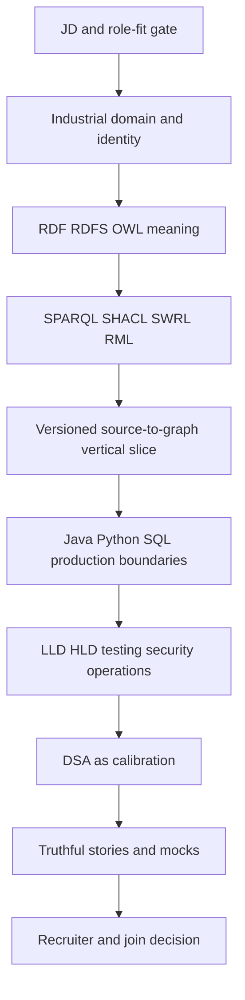

The rest of the document is deliberately split into two modes:

- **Use the ordered path above for preparation.**
- **Use the numbered sections below for lookup, evidence, drills and answer recovery.**

## Master-document contract

This is the **Festo master preparation document and navigation hub**. Festo-specific semantic answers, worked semantic artifacts, implementation templates, SQL, diagrams, behavioral answers, mocks, readiness gates and the join decision remain inline. Generic DSA implementations and reusable LLD/HLD implementations link to their existing canonical Java files and project READMEs instead of copying a second version here.

Use this file to decide **what** to prepare and to rehearse the Festo-specific answer. Follow a local link only when you want the authoritative implementation, tests or deeper reusable design. This keeps one source of truth for code while preserving an exhaustive Festo checklist.

No finite document can predict every sentence an interviewer may ask. Here, **complete** means every explicit JD requirement plus the highest-probability foundations, senior follow-ups, practical exercises and production trade-offs has a pre-populated answer or worked solution. Anything labeled **UNKNOWN** must be verified with Festo rather than invented.

### Reference map — not the study order

| Need | Go to |
|---|---|
| Decide whether to pursue/join | [Sections 2, 3, 16 and 17](#2-company-and-opportunity-analysis) |
| Learn semantic foundations with answers | [Sections 7, 19 and 20](#19-complete-semantic-concept-answer-bank) |
| See ontology, RDF, SPARQL, SHACL, SWRL and RML solutions | [Section 20](#20-worked-semantic-artifacts-and-solutions) |
| Prepare Java, Spring Boot, Jena and Fuseki | [Sections 11, 21 and 26](#21-java-spring-boot-jena-and-fuseki-solution) |
| Prepare Python/pandas pipelines | [Section 22](#22-python-and-pandas-pipeline-solution) |
| Prepare SQL and databases | [Section 23](#23-sql-and-database-solution-bank) |
| Prepare coding/DSA with canonical Java and LeetCode links | [Sections 8 and 24](#24-dsa-problem-and-canonical-java-link-bank) |
| Prepare LLD/HLD with diagrams and model answers | [Sections 9, 25 and 27](#25-lld-model-answers-and-diagrams) |
| Prepare testing, DevOps, cloud and security | [Sections 28 and 29](#28-testing-and-quality-answer-bank) |
| Prepare project/behavioral/HR answers | [Sections 12, 13 and 30](#30-behavioral-managerial-and-hr-answer-bank) |
| Run full mocks and check readiness | [Sections 15 and 31](#31-complete-mock-interviews-with-answer-keys) |
| Revise in the final hour | [Section 32](#32-final-hour-complete-recall-sheet) |

### Pre-populated coverage ledger

| Material contained in this file | Count / scope |
|---|---:|
| Semantic concepts with model answers | 125 questions |
| Java, JVM, concurrency and Spring with model answers | 75 questions |
| Testing, Linux, Docker/Kubernetes, cloud, security and AI answers | 68 questions/controls |
| DSA problems linked to canonical Java plus LeetCode drills | 18 problems; duplicate inline class removed |
| Worked SPARQL queries | 12 plus an optimization comparison |
| Worked SQL queries | 10 plus schema and database viva |
| Complete semantic artifacts | ontology, valid/invalid RDF, SHACL, SWRL rule and RML mapping |
| Implementation templates (not checked-in runnable modules) | Maven, Spring Boot/Jena services/tests and Python/pandas pipeline/tests |
| LLD model answers | 6 designs, including one full class/sequence/failure design |
| HLD model answers | 5 designs, including one full platform architecture |
| Mermaid diagrams | domain, lifecycle, class, sequence, platform, CI, incident and GraphRAG views |
| Behavioral/managerial/HR | 19 answer frameworks and diligence scripts |
| Full mock interviews | 5 mocks with answer keys/rubrics |

### Canonical reuse map

| Reusable material | Canonical source | Use from this Festo packet |
|---|---|---|
| DSA pattern selection, invariants, Java and LeetCode | [DSA master matrix](../horizontal/00_MASTER_MATRIX.md) and [solved LeetCode index](07_LEETCODE_SOLVED_INDEX.md) | Section 24 selects the 18 role-relevant drills and links each implementation directly. |
| Runnable LLD modules | [LLDProjects catalog](../../../../LLDProjects/README.md) | Section 25 keeps the semantic design delta inline and links matching reusable implementations. |
| Runnable HLD/system projects | [SystemDesignProjects catalog](../../../../SystemDesignProjects/README.md) and [learning order](../../../../SystemDesignProjects/LEARNING-ORDER.md) | Section 27 keeps the semantic-platform architecture inline and links matching systems. |
| General DSA/LLD/HLD answer contract | [Goldman Sachs master revision](GoldmanSachs_Master_Revision_DSA_LLD_HLD.md) | Reuse the timed explanation, edge-case and Definition-of-Done conventions. |
| SQL, Java live coding and production drills | [Point72 master revision](Point72_Master_Revision_HackerRank_SQL_DSA_LLD_HLD.md) | Reuse only the generic SQL/coding mechanics; Festo semantic questions remain here. |
| Java/JVM/Spring/distributed-systems speaking bank | [Goldman Sachs VP rehearsal](GOLDMAN_SACHS_VP_FINAL_REHEARSAL_SCRIPT.md) | Use for deeper generic follow-ups after the concise Festo bank in Section 26. |
| Additional DSA/LLD/HLD rehearsal | [Wells Fargo master revision](WellsFargo_Master_Revision_DSA_LLD_HLD.md) | Optional second-context transfer practice; it is not another Festo syllabus. |

The rule is: **do not copy generic code into another company sheet**. Keep the Festo-specific question, invariant, expected explanation and selection here; keep the executable implementation and its tests in the canonical project.

## Start here - the high-ROI conclusion

**Recommendation: Explore selectively.**

The role is attractive as a bridge from Java/backend engineering into knowledge graphs, semantic data platforms and AI/data architecture. It is not, however, a normal senior Java vacancy. The JD explicitly asks for **7+ years in semantic technologies** and **5+ years in Python data-pipeline automation**. Neither is established by the supplied background. Those are material screening risks, not minor keywords to revise over a weekend.

Use this decision sequence:

1. Ask the recruiter whether the semantic-years requirement is a hard filter or whether strong Java/data-platform engineers with demonstrated semantic depth are acceptable.
2. If it is a hard filter and there is no substantial unlisted RDF/OWL/SPARQL experience, treat the role as low-probability and do not overinvest.
3. If adjacent experience is acceptable, build the thin proof project in this file and prepare semantic fundamentals before broad DSA.
4. Verify compensation, working model, team mandate, on-call load and actual architecture ownership before considering a move.
5. Join only if the role offers real ontology/platform ownership and a credible compensation/career step; avoid a maintenance-only mapping role with a difficult commute and no portability plan.

### Preparation allocation if an interview is scheduled

```text
40%  RDF/RDFS/OWL + ontology modeling + reasoning boundaries
20%  SPARQL optimization + SHACL validation + SWRL rule reasoning
15%  RML + Python/pandas data pipelines + data quality
10%  Java/Spring Boot + Jena/Fuseki-style semantic backend design
 5%  SQL optimization
 5%  system design and production/DevOps
 5%  DSA, project stories and behavioral preparation
```

This weighting is role-derived, not a claim about Festo's exact interview format.

---

# 1. Evidence and claims discipline

## 1.1 Labels used throughout

| Label | Meaning |
|---|---|
| **JD-CONFIRMED** | Explicitly written in the supplied job description |
| **OFFICIAL-COMPANY** | Published by Festo on an official Festo page/report |
| **REPORTED** | Candidate or employee-generated material; useful but not authoritative |
| **INFERRED** | A reasonable preparation/design inference, not a stated company fact |
| **UNKNOWN** | Not established by the supplied JD or reliable current evidence |
| **USER-SUPPLIED** | Background supplied in the master prompt; not independently verified |

## 1.2 Source register

| ID | Source | Observed evidence | Reliability and use |
|---|---|---|---|
| **JD1** | User-supplied Festo PDF, captured 4 November 2026 | Exact title, location, duties, qualifications and benefits wording | **Controlling for role requirements**; no requisition ID, salary, working model or process |
| **F1** | [Festo facts and figures](https://www.festo.com/de/en/e/about-festo/company/festo-in-numbers-id_3756) | Founded 1925; family-owned; about 20,600 employees; EUR 3.33B turnover; Automation and Didactic divisions; 300,000+ industrial customers | **Official current company profile** |
| **F2** | [Festo Sustainability Report 2025](https://www.festo.com/PDF_Flip/corp/Festo_Sustainability_Report_2025/en/index.html) | 2025 revenue, workforce, regional mix, hiring/departure data, R&D investment and stated people practices | **Official group-level evidence**; not India-team-specific |
| **F3** | [Festo India locations/contact](https://www.festo.com/in/en/e/contact/sales-support-id_3770045) | Head office at 237B Hosur Road, Bommasandra Industrial Area; global production centre in Krishnagiri | **Official location evidence** |
| **F4** | [Festo 2026 company update](https://press.festo.com/it/node/5186) | Reports solid 2025 results, about 20,600 employees and continued structural development in 2026 | **Official directional signal**; not audited profitability detail |
| **R1** | [Indeed Festo India reviews](https://in.indeed.com/cmp/Festo-India-Pvt-Ltd/reviews) | At the research snapshot: 10 reviews, 3.6/5 overall, 3.3 work-life balance, 2.9 job security/advancement | **Small, self-selected sample**; employee opinion only |
| **R2** | [Glassdoor Festo interview reports](https://stage.glassdoor.com/Interview/Festo-Interview-Questions-E41156.htm) | Reported processes vary by role; examples include screening/assessment, technical/managerial discussion and HR | **Reported, role-mismatched evidence**; cannot confirm this role's rounds |
| **S1** | [W3C RDF 1.1 Concepts](https://www.w3.org/TR/rdf11-concepts/) | Stable RDF Recommendation; RDF 1.2 Concepts was a Candidate Recommendation at this snapshot | **Primary technical source**; learn 1.1 first and treat 1.2 additions as evolving |
| **S2** | [W3C RDF Schema 1.1](https://www.w3.org/TR/rdf-schema/) | RDFS vocabulary and entailment foundations | **Primary technical source** |
| **S3** | [W3C OWL 2 Primer](https://www.w3.org/TR/owl2-primer/) | OWL modeling and reasoning concepts | **Primary technical source** |
| **S4** | [W3C SPARQL 1.1 Query](https://www.w3.org/TR/sparql11-query/) | Stable query-language Recommendation; SPARQL 1.2 was a Working Draft at this snapshot | **Primary technical source**; use 1.1 for interview fundamentals |
| **S5** | [W3C SHACL Recommendation](https://www.w3.org/TR/shacl/) | Stable Shapes Constraint Language Recommendation; SHACL 1.2 was a Working Draft at this snapshot | **Primary technical source**; keep draft features separate |
| **S6** | [W3C SWRL submission](https://www.w3.org/Submission/SWRL/) | SWRL rule-language reference | **Primary historical specification**; engine support must be verified separately |
| **S7** | [RML documentation](https://rml.io/docs/) | RML specifications, examples and mapping tutorials | **Primary project documentation** |
| **S8** | [Apache Jena documentation](https://jena.apache.org/documentation/) | Java RDF API, SPARQL, inference, ontology, TDB2, SHACL and Fuseki integration | **Primary implementation documentation** |
| **S9** | [Apache Jena Fuseki](https://jena.apache.org/documentation/fuseki2/) | SPARQL server, query/update protocols and persistent TDB integration | **Primary implementation documentation** |
| **C1** | [Adecco India Salary Guide 2025](https://www.adecco.com/en-in/-/jssmedia/project/adecco/adeccoin/pdf/india_salary_guide2025.pdf) | Broad India software-engineering salary bands by experience | **Market context only**; not Festo- or semantic-role-specific |
| **O1** | [World Economic Forum Future of Jobs Report 2025](https://www.weforum.org/publications/the-future-of-jobs-report-2025) | AI/big data and technological literacy identified among fast-growing skill areas through 2030 | **Broad outlook**, not a guarantee for semantic-web roles |

## 1.3 Evidence gaps that must remain unknown

- Exact Festo team, reporting line, product, graph database, ontology tooling and data volumes.
- Whether Apache Jena, Fuseki, GraphDB, Stardog, Neptune or another graph stack is used.
- Exact interview rounds and whether DSA, machine coding or take-home work is used for this vacancy.
- Salary range, fixed/variable split, joining bonus, benefits and level mapping.
- Hybrid/on-site schedule, working hours, travel, on-call and cross-time-zone expectations.
- India engineering headcount, team attrition and role-specific work-life balance.
- Publicly verified layoffs affecting this Bengaluru software team.
- Whether the vacancy is new headcount, backfill or internal transfer.

---

# 2. Company and opportunity analysis

## 2.1 Verified company snapshot

| Area | Evidence-backed view | Classification |
|---|---|---|
| Company | Festo is an independent, family-owned industrial-automation and technical-education company | **OFFICIAL-COMPANY** |
| Founded / headquarters | Founded in 1925 in Esslingen, Germany | **OFFICIAL-COMPANY** |
| Scale | About 20,600 employees globally; operations/partners across 176 countries | **OFFICIAL-COMPANY** |
| 2025 revenue | EUR 3.33 billion | **OFFICIAL-COMPANY** |
| R&D intensity | The 2025 report states EUR 316M / 9.5% of revenue invested in R&D services | **OFFICIAL-COMPANY** |
| Business model | Automation components/solutions plus Didactic learning systems, training and consulting | **OFFICIAL-COMPANY** |
| Customers/industries | 300,000+ industrial customers; automotive, electronics, food/packaging, life sciences, intralogistics, process industries and more | **OFFICIAL-COMPANY** |
| India location | Head office at Bommasandra Industrial Area, Bengaluru; a production centre is listed in Krishnagiri | **OFFICIAL-COMPANY** |
| Ownership/profitability | Private family ownership is confirmed; detailed role-level budget and public profitability metrics are not available in the reviewed evidence | **OFFICIAL-COMPANY + UNKNOWN** |

## 2.2 Stability and risk reading

Festo's century-long history, private family ownership, global customer base, continued R&D spending and stable group headcount are positive signals. The 2025 sustainability report shows 1,469 hires and 1,608 departures and a broadly stable total workforce. That is **not evidence of a layoff program**, nor does it prove this team is insulated from restructuring.

The main business risks are industrial cycles, automotive/capital-spending slowdowns, global manufacturing exposure, currency/geopolitical shocks and the cost of transforming a hardware-led industrial company into a software/data-led one. The role may benefit from that transformation, but the team mandate must be verified.

## 2.3 Culture and work-life evidence

Festo states that it supports lifelong learning, AI/digital skills and flexible working hours at group level. Employee-review evidence is mixed and sparse. Indeed's Festo India page had only 10 reviews at the snapshot; its sub-ratings were not strong enough to assume excellent work-life balance or advancement. Individual reviews are contradictory and self-selected.

**Interview implication:** treat culture, management quality and work-life balance as diligence questions, not settled facts.

## 2.4 Compensation benchmark and commute

There is no credible public salary sample for this exact Festo semantic role. Broad 2025 India guides put experienced software engineers across wide bands, with senior brackets roughly spanning the mid-20s to 40+ lakh range depending on level and company. That is a market anchor only, not a forecast of Festo's offer.

Use total compensation, not headline CTC:

```text
fixed cash
+ target/realistic variable
+ retirement/insurance/allowances
+ joining or retention components
- commute and relocation cost
- forfeited bonus/equity
- role-risk discount for a narrow specialist title
```

Bommasandra is in south Bengaluru on Hosur Road. Commute impact varies dramatically by residence and working hours. Verify exact days in office, shuttle/cab policy, core hours and whether the software team is actually based at the stated site before pricing the move.

---

# 3. Exact JD extraction

## 3.1 Responsibilities explicitly stated

1. Knowledge-graph modeling, optimization and verification using semantic technologies such as RDF and OWL.
2. Definition and optimization of complex SPARQL queries, SHACL validation and SWRL rules.
3. Definition and optimization of complex SQL queries.
4. Test-concept design for semantic data.
5. Design and development of end-to-end data pipelines.
6. Maintenance and improvement of existing data pipelines using a DevOps approach.
7. Design and implementation of flexible backend architectures, including semantic backend applications.
8. Evaluation of new technologies and frameworks.
9. Work in an interdisciplinary and multinational team.

## 3.2 Qualifications explicitly stated

| Requirement | Exact bar in JD | Status against supplied background |
|---|---:|---|
| Relevant bachelor's or master's degree | Required | **UNKNOWN** - not supplied |
| Semantic technologies: OWL, RDF, SPARQL, SHACL, RML | 7+ years | **MAJOR UNKNOWN/GAP** - not present in supplied background |
| Relational databases / SQL | Included in the 7+ year line | **LIKELY STRONG**, but years/depth must be evidenced |
| Java software development | 5+ years | **LIKELY STRONG** from supplied 8+ year Java profile |
| REST and Spring Boot web-service design | 5+ years | **LIKELY STRONG** from supplied background |
| Python pipeline automation: pandas, Jupyter | 5+ years | **MAJOR UNKNOWN/GAP** - not present in supplied background |
| Linux and Bash | 2+ years | **LIKELY ADJACENT**, but examples must be prepared |
| Agentic coding / LLMs | Desirable | **UNKNOWN/POSSIBLE** |
| AWS or Azure | Desirable | **LIKELY STRONG** for AWS from supplied background |
| Software process, CI/CD, DevOps, Git | Strong expertise | **LIKELY STRONG**, but needs examples |
| Communication, independence, teamwork | Required | Must be demonstrated through stories |

## 3.3 Full skills matrix

| Skill | JD or inference | Why needed | Candidate starting point | Gap/risk | Interview importance | Priority | Proof exercise |
|---|---|---|---|---|:---:|:---:|---|
| RDF data model and serializations | **JD** | Canonical graph representation | Not established | High | Critical | P0 | Model equipment, sensors and observations in Turtle; explain IRI/literal/blank-node choices |
| RDFS | **Inferred foundation** | Schema hierarchy and entailment | Not established | High | High | P0 | Create class/property hierarchy and predict entailments |
| OWL 2 | **JD** | Expressive ontology and reasoning | Not established | High | Critical | P0 | Model restrictions; explain open-world and consistency limits |
| Ontology modeling/governance | **JD** | Maintain industrial semantics over time | Not established | High | Critical | P0 | Produce competency questions, naming rules and version/migration plan |
| SPARQL | **JD** | Query and update knowledge graphs | Not established | High | Critical | P0 | Write SELECT/CONSTRUCT/ASK, OPTIONAL, FILTER, aggregation and property-path queries |
| SPARQL optimization | **JD** | Keep graph queries production-viable | Not established | High | Critical | P0 | Compare query plans/cardinality; reduce intermediate bindings |
| SHACL | **JD** | Validate incoming graph data | Not established | High | Critical | P0 | Write NodeShape/PropertyShape constraints and interpret validation report |
| SWRL | **JD responsibility** | Express inference rules | Not established | High | High | P0 | Write two safe rules; explain monotonicity, DL-safety/engine limits and testing |
| RML / R2RML concepts | **JD** | Map heterogeneous sources into RDF | Not established | High | Critical | P0 | Map CSV/JSON/SQL rows to stable IRIs and triples; test duplicates and nulls |
| Complex SQL | **JD** | Source extraction, quality and operational queries | Likely strong | Need evidence | High | P1 | CTE/window query plus EXPLAIN/index discussion |
| Java | **JD** | Semantic backend implementation | Likely strong | Semantic APIs new | High | P1 | Use Jena Model/Dataset/Query APIs and write unit tests |
| Spring Boot / REST | **JD** | Production semantic services | Likely strong | Need graph-specific API design | High | P1 | Query/validation endpoints with timeouts, limits and error contracts |
| Apache Jena | **Inferred** | Natural Java RDF/SPARQL/SHACL option | New/unknown | Medium-high | High | P1 | Load Turtle, query dataset, run SHACL and expose one endpoint |
| Fuseki / triple store | **Inferred** | SPARQL server and persistence | New/unknown | Medium-high | High | P1 | Run container, load named graph, query and back up dataset |
| Python / pandas / Jupyter | **JD** | Ingestion and pipeline automation | Not established | High | Critical | P0 | Profile/clean source data; deterministic transform with tests |
| Pipeline reliability | **JD** | Maintain end-to-end production flow | Strong adjacent | Semantic-specific gaps | High | P1 | Idempotency, checkpoint, retry, DLQ, lineage and replay design |
| Data-quality test concepts | **JD** | Prevent invalid semantic data | Strong adjacent | Need semantic layers | High | P1 | Unit + mapping + SHACL + SPARQL regression + reconciliation test pyramid |
| Linux/Bash | **JD** | Operate pipelines and services | Likely adjacent | Demonstration needed | Medium | P2 | Shell commands for logs/process/network/disk plus safe deploy script explanation |
| CI/CD/Git/DevOps | **JD** | Safely evolve mappings, ontology and services | Likely strong | Need semantic gates | High | P1 | CI: lint mappings, validate shapes, regression queries, Java/Python tests, image scan |
| AWS/Azure | **Desirable** | Deploy storage/pipelines/services | AWS likely strong | Graph-specific architecture | Medium | P2 | Compare managed graph vs self-hosted store; backup/security design |
| Agentic coding/LLMs | **Desirable** | Modern development workflow | Unknown | Low-medium | Medium | P2 | Demonstrate guarded code generation with tests; explain data/privacy/evaluation risks |
| GraphRAG | **Inferred, not JD** | Possible future use of semantic assets | Unknown | Optional | Low | P3 | Explain entity grounding, retrieval and evaluation; do not overfocus before core semantics |
| Communication/collaboration | **JD** | Multinational interdisciplinary work | Must evidence | Medium | High | P1 | Prepare three STAR stories with stakeholder and disagreement detail |

---

# 4. What the work probably looks like

## 4.1 Likely day-to-day flow

The following is **INFERRED** from the JD:

```text
industrial/business source data
        |
        v
SQL / files / APIs / engineering systems
        |
        v
Python/pandas profiling and transformations
        |
        v
RML mappings -> RDF triples -> named/versioned graphs
        |
        +--> SHACL validation and quality reports
        +--> OWL/SWRL reasoning where justified
        |
        v
triple store / semantic platform
        |
        +--> optimized SPARQL queries
        +--> Java/Spring Boot semantic APIs
        +--> downstream applications, analytics or automation
```

Likely work includes ontology changes, source-to-graph mapping, data-quality triage, query tuning, backend/API changes, pipeline incidents, code reviews, CI/CD maintenance and discussions with domain experts who know industrial products but not necessarily semantic technology.

## 4.2 Senior-level expectations

- Turn ambiguous domain language into stable concepts, relationships and competency questions.
- Keep ontology expressiveness proportional to reasoning cost and operational need.
- Own backward compatibility, versioning, provenance and migration.
- Make mapping and validation deterministic, observable and replayable.
- Diagnose whether a failure belongs to source data, mapping, validation, inference, storage, query or API layers.
- Explain trade-offs to domain experts and engineers without hiding behind ontology jargon.
- Evaluate tools through small benchmarks and exit criteria, not enthusiasm.

---

# 5. Evidence-weighted interview process

No exact process for this vacancy was found. Public Festo reports vary by role and seniority. Use this as a preparation model, not as a schedule claim.

| Possible round | Evidence status | Likely evaluation | Preparation priority |
|---|---|---|:---:|
| Recruiter screen | **Common inference** | Semantic/Python years, location, notice period, compensation, motivation | High |
| Hiring-manager/domain screen | **Strong role inference** | Ontology/SPARQL/SHACL/RML depth and communication | Critical |
| Practical technical round | **Reported generally; role-specific format unknown** | Modeling, SPARQL/SQL, Java or Python exercise, pipeline debugging | Critical |
| Architecture/project deep dive | **Senior-role inference** | Backend/pipeline design, trade-offs, ownership, incidents | High |
| Team/cross-functional discussion | **JD-derived** | Collaboration with domain experts and multinational teams | High |
| HR/final discussion | **Reported generally** | Fit, logistics and compensation | Medium |

## 5.1 Do not assume

- Do not claim that Festo asks a specific LeetCode problem.
- Do not assume a full DSA round merely because other company sheets contain one.
- Do not assume Jena/Fuseki is Festo's stack.
- Do not assume the role is hybrid.
- Do not claim semantic production experience that does not exist.

---

# 6. Complete technical syllabus and priority

## 6.1 Priority legend

```text
P0 = must master before the first specialist round
P1 = must understand and demonstrate at senior level
P2 = quick revision / supporting breadth
P3 = defer unless the interviewer or recruiter signals it
```

## 6.2 Syllabus map

| Domain | Topics | Level |
|---|---|:---:|
| RDF | triples, terms, IRIs, literals, blank nodes, datasets, named graphs, Turtle/JSON-LD/RDF/XML, graph isomorphism | P0 |
| RDFS | classes, subclasses, subproperties, domain/range, entailment and their modeling consequences | P0 |
| OWL | open-world assumption, no unique-name assumption, restrictions, equivalence/disjointness, property characteristics, profiles, consistency | P0 |
| Ontology engineering | competency questions, reuse, naming, modularity, provenance, versioning, deprecation, alignment and governance | P0 |
| SPARQL | BGPs, joins, FILTER, OPTIONAL, UNION, MINUS, VALUES, BIND, aggregates, subqueries, property paths, named graphs, federated query basics | P0 |
| SPARQL optimization | cardinality/selectivity, join order, FILTER placement, OPTIONAL explosion, property-path cost, limits/pagination, indexes/statistics and query plans | P0 |
| SHACL | node/property shapes, targets, severity, closed shapes, cardinality, datatype/class constraints, SPARQL constraints, reports | P0 |
| SWRL | antecedent/consequent, built-ins, monotonic rules, safety/termination and engine support boundaries | P0 |
| RML | logical sources, reference formulations, triples maps, subject/predicate-object maps, joins, stable IDs, nulls, incremental mapping and tests | P0 |
| Java semantic stack | Jena Model/Dataset, RDF I/O, ARQ queries, transactions, TDB2, SHACL, inference and remote connections | P1 |
| Semantic API | query endpoints, parameterization, response contracts, limits, timeouts, content negotiation, caching and authorization | P1 |
| Python data engineering | pandas typing/nulls, vectorization, chunking, profiling, deterministic transforms, packaging, testing and notebooks vs production modules | P0 |
| Data pipelines | batch/stream boundary, orchestration, idempotency, checkpoints, retries, DLQ, lineage, schema drift, replay, backfills and reconciliation | P1 |
| SQL | joins, CTEs, windows, indexes, plans, isolation, deadlocks, pagination and source-extraction patterns | P1 |
| Java | collections, generics, streams, records, exceptions, concurrency, executors, CompletableFuture, JVM/GC and profiling | P1 |
| Spring Boot | DI/lifecycle, MVC, validation, exception mapping, transactions, security, testing and actuator/observability | P1 |
| HLD | scale, availability, storage, caching, messaging, consistency, idempotency, security, observability, recovery and cost | P1 |
| LLD | SOLID, strategy/pipeline, adapters, repositories, immutable values, versioned domain models and testability | P1 |
| DevOps | Git, Linux/Bash, Docker, Kubernetes basics, CI/CD, secrets, logs/metrics/traces, incident response | P2 |
| Cloud | AWS/Azure storage, compute, IAM, networking, managed graph options and backup/DR trade-offs | P2 |
| AI | agentic coding controls, RAG/GraphRAG concepts, evaluation, prompt/data security and hallucination boundaries | P2 |
| Advanced algorithms | hard DP, segment trees, competitive programming | P3 |

---

# 7. Semantic technology interview workbook

## 7.1 Core questions and answer contracts

| # | Question | Expected senior answer | Likely follow-up | Common mistake |
|---:|---|---|---|---|
| 1 | What is RDF? | A graph data model of subject-predicate-object statements; terms are IRIs, blank nodes and literals with precise position rules; serialization is separate from the model | Dataset vs graph; named graphs | Calling RDF an XML format |
| 2 | IRI vs literal vs blank node? | IRI identifies a resource, literal carries a lexical value/datatype/language, blank node is local existential identity without a global name | When to mint stable IRIs | Using blank nodes for entities that need cross-system identity |
| 3 | RDFS vs OWL? | RDFS supplies lightweight schema/entailment; OWL adds richer class/property axioms and decidable reasoning profiles | Expressiveness vs performance | Treating both as validation languages |
| 4 | Explain open-world assumption | Absence of a fact does not make it false; knowledge may be incomplete | How SHACL changes validation | Expecting database-style closed-world constraints from OWL |
| 5 | Does OWL assume different names mean different things? | No; OWL does not generally make a unique-name assumption | `owl:sameAs`, keys | Assuming two IRIs are automatically distinct |
| 6 | How do you design an ontology? | Start with scope and competency questions; reuse selectively; model stable concepts; test entailments; document naming/versioning; review with domain experts | Modularization and governance | Starting with a giant class hierarchy |
| 7 | SHACL vs OWL? | OWL describes logical meaning and supports inference/consistency; SHACL validates data against explicit shapes under operational targeting | Closed shapes; severity | Saying SHACL replaces OWL |
| 8 | What is a SHACL validation report? | A graph describing conformance and result details such as focus node, path, constraint component, value, severity and message | How to expose/aggregate errors | Returning only pass/fail and losing diagnostics |
| 9 | What is SWRL used for? | Horn-like rules over OWL individuals/properties; useful for domain inference but engine support, safety, termination and performance must be constrained | Built-ins; DL-safety | Treating rules as an unbounded procedural engine |
| 10 | What is RML? | A mapping language extending R2RML concepts to heterogeneous logical sources; triples maps define subject and predicate-object generation | Stable identity; joins | Confusing mapping rules with validation rules |
| 11 | Basic graph pattern in SPARQL? | A set of triple patterns joined by shared variables; solution mappings are combined according to query algebra | Join cardinality | Describing it as a text search |
| 12 | Why can OPTIONAL be dangerous? | It is a left join; multiple matches can multiply rows and misplaced filters can change semantics | `BOUND`, aggregation | Using OPTIONAL everywhere to avoid modeling decisions |
| 13 | How do you optimize SPARQL? | Measure first; inspect plans/statistics; begin with selective patterns; constrain variables; reduce intermediate bindings; control OPTIONAL/property paths; paginate carefully; maintain store indexes | Benchmark design | Applying SQL folklore without checking store behavior |
| 14 | Named graph use cases? | Provenance, tenancy, source/version isolation, access policy and lifecycle operations | Default vs union graph | Assuming graph name automatically proves trust |
| 15 | Materialization vs query-time reasoning? | Materialization improves reads but costs storage/update complexity; query-time inference preserves base data but increases latency; hybrid approaches depend on change/query patterns | Retraction and versioning | Giving a universal answer |
| 16 | How do you version an ontology? | Stable IRIs where semantics remain; explicit version metadata; deprecation rather than silent reuse; compatibility tests, migration rules and consumer communication | Breaking change example | Encoding every version in every entity IRI by default |
| 17 | How do you test semantic data? | Parser tests, mapping golden files, SHACL constraints, entailment tests, SPARQL regression queries, counts/reconciliation, performance and provenance checks | Negative tests | Testing only serialization syntax |
| 18 | How do you secure SPARQL? | Parameterize/construct queries safely, restrict endpoints/operations, authenticate/authorize, limit time/result size, protect federation, audit and rate-limit | SPARQL injection | Exposing unrestricted update/federation endpoints |

## 7.2 Whiteboard drills

1. Model `Machine -> Component -> Sensor -> Observation` with stable identifiers and provenance.
2. Write a SPARQL query for machines whose temperature exceeded a threshold three times in 24 hours.
3. Write SHACL shapes requiring serial number, one manufacturer and typed observation timestamps.
4. Add a rule that classifies an observation as critical; state whether SWRL is the right execution layer.
5. Map a CSV sensor export and a JSON product API into the same ontology using RML concepts.
6. Diagnose a query whose OPTIONAL patterns turn 10,000 entities into 8 million rows.
7. Design ontology version rollout without breaking a Java API consumer.

---

# 8. Local DSA10days evidence map

## 8.1 Repository audit result

The repository contains a broad Java interview corpus, generated pattern documentation, active-recall tools and company-specific master sheets. It is valuable for Java fluency, graph traversal, data structures, design reasoning and timed interview execution.

It does **not** currently provide implementation evidence for RDF, RDFS, OWL, SPARQL, SHACL, SWRL, RML, Python/pandas, Jupyter or Spring Boot. Those gaps are intentionally not disguised by generic graph algorithms.

## 8.2 Role-relevant coding anchors

These are coverage drills, not predictions of Festo questions.

| # | Drill | Local source | Transfer to this role | Time / stop |
|---:|---|---|---|---:|
| 1 | Group Anagrams | [GroupAnagrams.java](../../src/main/java/org/chijai/day3/session3/GroupAnagrams.java) | Canonical keys and deterministic grouping | 12m / 18m |
| 2 | Course Schedule | [CourseSchedule.java](../../src/main/java/org/chijai/day8/graph/session2/CourseSchedule.java) | Dependency DAG and cycle detection | 15m / 22m |
| 3 | Number of Islands | [Islands.java](../../src/main/java/org/chijai/day8/graph/session1/Islands.java) | Graph traversal and visited-state correctness | 12m / 18m |
| 4 | Graph BFS pattern | [GraphBfsPatternLab.java](../../src/main/java/org/chijai/patterns/graphbfs/GraphBfsPatternLab.java) | Shortest unweighted traversal and queue invariant | 12m / 18m |
| 5 | Top K Frequent | [TopKFrequentElements.java](../../src/main/java/org/chijai/day7/session1/heap/TopKFrequentElements.java) | Frequency aggregation and bounded ranking | 12m / 18m |
| 6 | Time-Based Key Value Store | [TimeBasedKeyValueStore.java](../../src/main/java/org/chijai/day2/session3/TimeBasedKeyValueStore.java) | Versioned facts and as-of lookup | 15m / 22m |
| 7 | LRU Cache | [LruCache.java](../../src/main/java/org/chijai/day4/LinkedList/session3/LruCache.java) | Cache invariants and O(1) mutation | 18m / 25m |
| 8 | Sliding Window Maximum | [SlidingWindowMaximum.java](../../src/main/java/org/chijai/day3/session1/SlidingWindowMaximum.java) | Streaming window state | 15m / 22m |
| 9 | Interval scheduling | [IntervalSortByStart.java](../../src/main/java/org/chijai/day1/Arrays/session4/Intervals/IntervalSortByStart.java) | Batch/time-range normalization | 12m / 18m |
| 10 | Binary Search | [BinarySearch.java](../../src/main/java/org/chijai/day2/session1/BinarySearch.java) | Boundary discipline | 7m / 10m |
| 11 | Flatten nested collections | [FlattenNestedCollections.java](../../src/main/java/org/chijai/java/FlattenNestedCollections.java) | Java streams and nested data transformation | 10m / 15m |
| 12 | Execution deduplication | [ExecutionDeduplication.java](../../src/main/java/org/chijai/java/ExecutionDeduplication.java) | Idempotent pipeline effects | 15m / 22m |

### DSA solve rhythm

```text
restate -> constraints -> baseline -> bottleneck -> pattern -> invariant -> code -> dry run -> complexity
```

Stop after these anchors. Do not spend specialist-preparation time on obscure algorithms unless Festo confirms a DSA-heavy round.

## 8.3 Reusable local design anchors

| Local source | Reusable idea | Boundary |
|---|---|---|
| [ApiIntegrationExample.java](../../src/main/java/org/chijai/design/lld/ApiIntegrationExample.java) | API adapter and retry discussion | Not a production semantic service |
| [DesignLldPatternLab.java](../../src/main/java/org/chijai/patterns/designlld/DesignLldPatternLab.java) | Small public APIs and stateful design | Generic LLD only |
| [RiskEngineExtensible.java](../../src/main/java/org/chijai/PTR/RiskEngineExtensible.java) | Composable rules, injected dependencies, validate-before-commit and rollback | Trading example, not semantic/SWRL experience |
| [PatternLabCatalog.java](../../src/main/java/org/chijai/patterns/PatternLabCatalog.java) | Pattern inventory and interview navigation | Algorithm catalog, not ontology |

---

# 9. LLD and HLD preparation

## 9.1 LLD drills

| # | Design | Core pattern | Definition of done |
|---:|---|---|---|
| 1 | RDF ingestion service | adapter -> normalize -> map -> validate -> publish | Immutable request IDs; source provenance; idempotency; failure report; no partial invisible commit |
| 2 | Semantic validation service | Strategy pipeline for syntax, SHACL, reasoning and business checks | Each validator has typed result; severity; deterministic ordering; timeout; test fixtures |
| 3 | SPARQL query API | query-template registry + parameter binding + result DTOs | No string concatenation; limits/timeouts; content negotiation; authorization; metrics |
| 4 | Ontology registry | versioned artifact repository + compatibility policy | Publish/deprecate/rollback; checksums; dependency graph; consumer compatibility |
| 5 | RML job runner | command/state machine + checkpoints | At-least-once execution, idempotent output, retry/DLQ, audit, cancel/replay |
| 6 | Semantic cache | explicit key/version/freshness policy | Cache invalidation tied to graph/ontology version; no claim that LRU solves correctness |

### LLD checklist

```text
[ ] Requirements and exclusions
[ ] Identity and version semantics
[ ] Public API and immutable value objects
[ ] Validation before mutation
[ ] State/transaction owner
[ ] Duplicate, out-of-order and partial-failure paths
[ ] Thread-safety boundary
[ ] Persistence and audit boundary
[ ] Tests and observability
[ ] Extension point without a class zoo
```

## 9.2 HLD drills

| # | System | Deep-dive focus | Definition of done |
|---:|---|---|---|
| 1 | Industrial knowledge-graph platform | source ingestion to query/API | Scale, graph partition, ontology version, lineage, validation, HA and recovery |
| 2 | Batch semantic-data pipeline | files/SQL/API -> RML -> graph | Idempotency, checkpoint, schema drift, replay, DLQ, backfill and reconciliation |
| 3 | Low-latency semantic query service | API -> query layer -> store/cache | Query budget, cache/version key, admission control, timeout, pagination and degraded behavior |
| 4 | Ontology governance platform | author/review/test/publish/migrate | Roles, approvals, compatibility gates, rollout, rollback and consumer notification |
| 5 | Multi-tenant semantic platform | shared control plane, isolated data planes | Tenant identity, graph isolation, quota, authorization, encryption, noisy-neighbor controls and cost |

### HLD interview order

```text
functional scope
-> scale and SLO
-> data/identity/version model
-> critical path
-> components and boundaries
-> storage/query choices
-> consistency and validation
-> failure/retry/idempotency
-> security
-> observability
-> HA/recovery
-> bottleneck and trade-off
```

---

# 10. One high-impact practical project

## 10.1 Project: Industrial Asset Semantic Quality Platform

Build a small but complete platform that ingests equipment and sensor data, maps it into an RDF knowledge graph, validates it, exposes queries through Java/Spring Boot and demonstrates production safeguards.

### Architecture

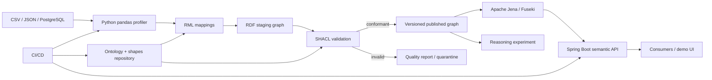

### Bounded stack

- Java 21 and Spring Boot for API/orchestration.
- Apache Jena and Fuseki/TDB2 for local semantic storage and SPARQL.
- Python, pandas and pytest for profiling/cleaning.
- RMLMapper or another explicitly documented RML implementation.
- Turtle for ontology/shapes/test fixtures.
- PostgreSQL for one relational source and optional job/audit metadata.
- Docker Compose for local reproducibility.
- JUnit, Testcontainers where useful, pytest and golden RDF/SPARQL fixtures.

Do not add Kubernetes, Kafka, a UI framework or GraphRAG until the end-to-end slice works and tests pass.

### Functional requirements

1. Ingest a small equipment catalogue plus sensor observations from two formats.
2. Generate stable IRIs and preserve source/provenance metadata.
3. Validate required identifiers, types, ranges and relationships with SHACL.
4. Quarantine invalid batches with a human-readable report.
5. Publish a conformant version to Fuseki/TDB2.
6. Expose three parameterized read APIs and one validation-status API.
7. Demonstrate five SPARQL queries and one query-optimization comparison.
8. Demonstrate one bounded reasoning/rule use case and document why it belongs there.
9. Re-run the same batch without duplicate logical facts.
10. Record counts, duration, validation failures and published graph version.

### Suggested repository structure

```text
industrial-semantic-quality-platform/
  README.md
  compose.yaml
  ontology/
    equipment.ttl
    shapes.ttl
    rules/
  mappings/
    equipment.rml.ttl
    observations.rml.ttl
  data/
    samples/
  pipeline-python/
    pyproject.toml
    src/
    tests/
  semantic-api/
    pom.xml
    src/main/java/
    src/test/java/
  sparql/
    competency-questions/
    regression/
  docs/
    architecture.md
    decisions/
    runbook.md
```

### Small implementation leaves

1. **10m:** write five competency questions.
2. **15m:** define 8-12 ontology terms and naming rules.
3. **15m:** create one valid Turtle fixture.
4. **15m:** create one invalid fixture.
5. **15m:** write the first SHACL property shape.
6. **15m:** run validation and save the report.
7. **15m:** profile one CSV with pandas.
8. **15m:** define stable IRI generation and null policy.
9. **15m:** write one RML triples map.
10. **15m:** verify expected triples with a golden test.
11. **15m:** start Fuseki and load a named graph.
12. **15m:** write a selective SPARQL query.
13. **15m:** add one Spring Boot read endpoint.
14. **15m:** add timeout/result-limit/error handling.
15. **15m:** add idempotent batch identity.
16. **15m:** add metrics and structured logs.
17. **15m:** create CI gates for Java, Python, SHACL and SPARQL regression.
18. **15m:** document one failed design choice and trade-off.

### Acceptance evidence

```text
[ ] Clean checkout starts locally with documented commands
[ ] Java and Python tests pass
[ ] Valid fixture conforms
[ ] Invalid fixture fails for the expected constraint
[ ] Replaying one batch does not duplicate logical facts
[ ] Five competency queries return asserted expected rows
[ ] API has limits, timeout and safe parameter binding
[ ] Graph/ontology version is visible in output
[ ] Logs/metrics identify batch, source, graph version and duration
[ ] Backup/export and restore are demonstrated locally
```

### Five-minute interview presentation

```text
Problem:
Industrial source data is heterogeneous and inconsistent, while consumers need
stable meaning and explainable quality gates.

Design:
I separated source profiling, declarative mapping, semantic validation,
published graph storage and API consumption. Invalid data never silently enters
the published graph.

Correctness:
Stable identity, provenance, graph versions, SHACL reports, idempotent batch IDs
and SPARQL regression queries make the pipeline reproducible.

Trade-off:
I used a batch-first architecture because it makes validation and replay easy.
For low-latency updates I would add incremental mapping only after defining
transaction and reasoning semantics.

Production next steps:
Load/performance tests, authorization, managed secret storage, HA/backup,
ontology approval workflow and source-specific SLOs.
```

---

# 11. Java, Spring, Python, SQL and production questions

| Area | Question | Strong answer shape |
|---|---|---|
| Java | How would you make a Jena Dataset operation safe? | Define transaction boundary, read/write mode, try/finally end, isolation expectations, timeout and test |
| Java | Streams or loops for a pipeline? | Prefer clarity and explicit failure/ordering semantics; use streams for bounded transformations, not hidden side effects |
| Java | CompletableFuture use? | Bounded executor, explicit deadlines, exception aggregation, cancellation and no blocking common-pool abuse |
| JVM | Graph workload memory issue? | Heap/object profile, allocation rate, GC logs, store/cache ownership, streaming results and cardinality limits |
| Spring | Semantic query API error model? | Validation error, unsupported query, timeout, result limit, store unavailable and correlation ID |
| Spring | Transaction boundary across DB and graph store? | No pretend distributed ACID; use staged state/outbox/saga, idempotency and reconciliation |
| Python | Notebook to production pipeline? | Move logic into versioned modules, typed config, tests, CLI/orchestrator entry point, deterministic environment and CI |
| pandas | Large dataset exceeds memory? | Project columns, chunk, vectorize, typed reads, push work to SQL, or use another engine after measuring |
| Pipeline | Retry policy? | Retry transient failures with bounded backoff/jitter; idempotent effects; classify poison data; DLQ and operator path |
| Pipeline | Schema drift? | Contract/version detection, quarantine, compatibility policy, metrics, replay after mapping update |
| SQL | Slow complex query? | Confirm grain/result, inspect actual plan and cardinality, indexes/statistics, join/filter shape, measure before/after |
| SQL | Isolation choice? | Start from anomaly/business invariant; choose weakest safe level; handle deadlocks/retries explicitly |
| Testing | Semantic test pyramid? | Parser/unit, mapping golden, SHACL negative, entailment, SPARQL regression, integration, performance and reconciliation |
| DevOps | Safe ontology deployment? | Versioned artifact, review, compatibility tests, canary/shadow validation, publish, consumer monitoring and rollback |
| Observability | Key metrics? | Source lag, batch duration, triples read/written, conformance rate, violations by shape, query latency/cardinality/timeouts, graph version |
| Security | Main risks? | Query injection, overbroad endpoint, federation/SSRF, data leakage through graphs, secrets, provenance tampering and denial-of-service queries |
| AI | Agentic coding in this role? | Use for bounded drafts; never expose private data; review diffs; tests/spec checks; dependency/security scan; human owns semantics |
| GraphRAG | When useful? | When relationship-aware retrieval and explainable entity grounding improve results; evaluate against simpler retrieval and cost/latency |

---

# 12. Project and experience storytelling

No metrics or personal ownership should be invented. Replace bracketed fields with facts that can be defended.

## 12.1 Two-minute project introduction

```text
Context:
At [Nasdaq/Morgan Stanley], the system supported [users/business process].

Problem:
The main engineering constraint was [latency/reliability/data quality/scale].

Architecture:
At a high level, [sources] flowed through [services/data stores/messaging] to
[consumers].

My ownership:
I personally owned [specific services, decisions, incidents or delivery].

Hard decision:
We chose [decision] over [alternative] because [measured/observed reason].

Outcome:
The verified result was [real metric, operational change or delivered scope].

Relevance:
That experience transfers here through [backend architecture, data pipelines,
quality gates, SQL, DevOps or domain modeling]. I would not claim production
semantic-web experience unless it is true.
```

## 12.2 Fifteen-minute deep dive order

```text
1. Business context and users
2. Functional and non-functional requirements
3. Architecture and data flow
4. Exact personal boundary
5. Data model and API contracts
6. Scale/latency/availability constraints
7. One design decision and rejected alternative
8. One failure/incident and diagnosis
9. Testing, release and observability
10. Verified outcome and current limitation
11. What would be changed now
12. Transfer to semantic/data-platform work
```

## 12.3 Follow-ups to prepare truthfully

- What did you personally design versus inherit?
- What was the peak volume and how was it measured?
- Which failure did your design not handle initially?
- How did you prevent duplicate or out-of-order effects?
- What transaction/consistency model applied?
- How did you debug the hardest production incident?
- What did you disagree about and how was the decision made?
- What tests would have caught the issue earlier?
- Which parts are transferable to a semantic-data pipeline?
- What semantic experience do you have today, exactly?

---

# 13. Behavioral and HR preparation

## 13.1 Tell me about yourself

```text
I am a backend-focused software engineer with more than eight years of experience,
primarily in Java, Spring Boot, REST services, SQL, cloud and production delivery.
My work at Morgan Stanley and Nasdaq has given me experience with business-critical
systems where correctness, reliability and clear ownership matter. I am now looking
to move deeper into data and architecture problems. This Festo role is interesting
because it combines a Java backend with semantic modeling, data quality and pipeline
engineering. My strongest immediate contribution is production backend engineering;
the specialist semantic stack is the area I am deliberately proving through focused
study and a hands-on project. I would rather be precise about that boundary than
overstate experience.
```

## 13.2 Why Festo and this role?

Use three evidence-backed points:

1. Industrial automation creates durable, complex domain semantics rather than a toy graph problem.
2. Festo's published R&D investment and global footprint make data/semantic standardization strategically plausible.
3. The role combines existing Java/backend strengths with the desired move toward data and AI architecture.

Then state the honest risk: the specialist semantic-years requirement must be discussed openly.

## 13.3 STAR stories to prepare

| Story | Evidence required |
|---|---|
| Production incident | Timeline, signal, diagnosis, mitigation, recovery, prevention and personal action |
| Performance improvement | Baseline, bottleneck evidence, change, verified before/after and trade-off |
| Ambiguous requirement | Stakeholders, ambiguity, questions, decision record and outcome |
| Disagreement | Competing views, evidence used, decision mechanism and relationship outcome |
| Failure | Your decision, impact, lesson and changed behavior |
| Mentoring/leadership | Person/team need, concrete intervention and observed outcome |
| Cross-team delivery | Dependencies, communication cadence, risk escalation and result |

## 13.4 Questions to ask the hiring manager

1. Is 7+ years of semantic-technology experience a strict screening requirement?
2. Which ontology, graph store, reasoning, RML and SHACL implementations are in production?
3. What percentage of the role is ontology/modeling, pipeline work, Java backend and support?
4. Is the team building a new platform, modernizing one, or maintaining existing mappings and queries?
5. What are the largest graphs, typical query latency targets and update frequencies?
6. Who owns ontology governance and approves breaking semantic changes?
7. How are SHACL violations, schema drift and failed mappings handled operationally?
8. What was the hardest incident in the last six months?
9. What would success at 30, 90 and 180 days look like?
10. What is the working model at Bommasandra, and are there on-call or Europe overlap expectations?
11. Why is the role open, and what is the team's attrition over the last year?
12. What is the level, compensation range and fixed/variable split?

---

# 14. Seven-day, fourteen-day and thirty-day execution plans

> **Calendar overlay only:** activate one of these sequences only after a real Festo interview is scheduled. It is not a second daily queue and never moves the repository's V8 control pointer. Follow the first-principles path above; this section only turns that same path into a dated calendar when a deadline exists.

## 14.1 Seven-day interview rescue plan

| Day | Focus | Hands-on output | Readiness check |
|---:|---|---|---|
| 1 | RDF/RDFS and graph modeling | Turtle model + 10 triples + five competency questions | Explain RDF terms and open-world implications without notes |
| 2 | OWL and ontology engineering | Restrictions, disjointness and two entailment tests | Distinguish schema, inference and validation |
| 3 | SPARQL | Ten queries across joins/OPTIONAL/aggregation/property paths | Explain cardinality and optimize one query |
| 4 | SHACL and SWRL | Five shapes, negative fixtures and two bounded rules | Interpret validation report and state rule-engine limits |
| 5 | RML + Python/pandas | One CSV/JSON mapping and tested cleaning module | Replay produces deterministic identities/triples |
| 6 | Jena/Fuseki + Spring Boot | Load/query/validate and expose one safe endpoint | Explain transactions, limits, timeout and error model |
| 7 | SQL + HLD + mock + company decision | One SQL exercise, one semantic-platform design and one 60m mock | Score against the readiness test below |

Daily structure:

```text
45m official concepts
60m build from blank
30m active recall/questions
30m role/project story
15m failure ledger and next-day repair
```

## 14.2 Fourteen-day plan

Days 1-7 follow the rescue plan at a calmer pace. Then:

| Day | Focus | Deliverable |
|---:|---|---|
| 8 | Identity, provenance and named graphs | Stable IRI policy + graph/version strategy |
| 9 | SPARQL performance | Benchmark two query shapes and document plan/cardinality |
| 10 | Pipeline reliability | Idempotency, checkpoint, retry, DLQ and replay implementation |
| 11 | Semantic test strategy | Golden mapping, SHACL negative and SPARQL regression tests |
| 12 | Production design | Security, observability, backup/restore and runbook |
| 13 | Interview simulations | One semantic deep dive + one Java/Python practical mock |
| 14 | Failure-only repair | Reattempt red topics; rehearse decision and questions |

## 14.3 Thirty-day capability plan

```text
Week 1: foundations and vocabulary
Week 2: thin vertical slice
Week 3: production reliability and performance
Week 4: portfolio polish, mocks and career decision
```

### Week 1

- RDF/RDFS/OWL mental model.
- SPARQL and SHACL from blank.
- RML concepts and Python/pandas refresh.

### Week 2

- Implement the full valid-data path.
- Add invalid-data quarantine.
- Add Java API and tests.

### Week 3

- Add replay/idempotency, lineage, metrics and failure handling.
- Benchmark queries and document optimization.
- Add CI and backup/restore proof.

### Week 4

- Record a five-minute demo.
- Complete two semantic mocks, one practical coding mock and one architecture mock.
- Repair only observed failures.
- Re-evaluate the opportunity with recruiter/team facts.

---

# 15. Mock interview and readiness test

## 15.1 Ninety-minute mock

```text
00-10  Explain RDF/RDFS/OWL, open world and SHACL boundary
10-25  Model an industrial asset domain
25-45  Write and optimize a SPARQL query
45-60  Design an RML + Python ingestion path
60-75  Design validation/publish transaction and failure recovery
75-85  Java/Spring API follow-ups
85-90  Candidate questions and summary
```

## 15.2 Scoring rubric

Score each 0, 1 or 2.

| Area | 0 | 1 | 2 |
|---|---|---|---|
| Semantic accuracy | Incorrect/confused | Mostly correct with gaps | Precise with boundaries/trade-offs |
| Modeling | Ad hoc nouns | Usable basic model | Competency-driven, governed and evolvable |
| SPARQL | Cannot complete | Correct but inefficient/fragile | Correct, tested and performance-aware |
| Validation/rules | Conflates tools | Basic SHACL/SWRL | Clear semantics, engine limits and tests |
| Mapping/pipeline | Happy path only | Mapping works | Identity, lineage, idempotency, drift and replay |
| Java/backend | Vague | Normal API | Safe query/API, transaction, timeout and observability |
| SQL/data | Weak | Correct query | Plan/index/isolation and correctness reasoning |
| Communication | Unstructured | Understandable | Assumptions, invariant, trade-off and summary |
| Personal claims | Inflated/unclear | Mostly bounded | Exact ownership/evidence boundary |
| Opportunity diligence | No questions | Generic questions | Role, team, culture, comp and career risks tested |

```text
17-20 = ready for a specialist senior round
13-16 = viable but repair the lowest two areas
 9-12 = ask whether the round can be rescheduled or narrow expectations
 0-8  = do not bluff specialist depth; reset scope with recruiter
```

Readiness requires observed mock performance. Reading this document or completing elapsed study time is not evidence.

---

# 16. Ten-year career outlook: 2026-2036

## 16.1 Evidence-based direction

The broad demand signal for AI, big data and technological literacy is strong through 2030. Knowledge graphs can support data integration, governed vocabularies, industrial digital twins, entity resolution and GraphRAG-style systems. That makes the combination of semantics + data engineering + production backend architecture more durable than ontology syntax alone.

## 16.2 Durable skills

- Domain modeling and translating expert knowledge into governed machine-readable contracts.
- Data identity, lineage, provenance, quality and versioning.
- Query/performance reasoning across graph and relational systems.
- Reliable pipelines, APIs, security, observability and recovery.
- Evaluation of AI systems against authoritative structured data.
- Communication across domain experts, data engineers and application teams.

## 16.3 Likely commoditization/automation exposure

- Boilerplate mappings, simple SPARQL queries, ontology drafts and CRUD APIs will become increasingly AI-assisted.
- Manual data cleaning and one-off notebook work are vulnerable to automation.
- Human accountability remains important for semantics, governance, model evolution, production correctness and consequential domain decisions.

## 16.4 Career portability

| Path | Upside | Risk |
|---|---|---|
| Stay Java/FinTech backend | Largest immediate fit and broad role market | Can remain incremental without architecture/data ownership |
| Risk/fraud technology | Strong alignment with existing background and durable decisioning problems | Domain concentration and regulatory/operational pressure |
| Semantic/knowledge platform | Differentiated bridge to data/AI architecture | Smaller job pool; some roles are tool-heavy or academic |
| AI/data architecture | High strategic relevance and portability | Requires real data-platform/evaluation depth, not only LLM vocabulary |

The best version of this opportunity is **not** becoming only an RDF specialist. It is becoming a senior data/knowledge-platform architect who can combine semantics, Java/Python delivery, cloud, governance and AI retrieval/evaluation.

Potential progression:

```text
Senior Semantic Software Engineer
-> Staff Knowledge/Data Platform Engineer
-> Principal Semantic/AI Platform Engineer
-> Data / Knowledge / AI Solutions Architect
-> Technical strategy or engineering leadership
```

---

# 17. Should you actually join?

## 17.1 Risk-reward scorecard before interviews

| Dimension | Preliminary view | What changes the score |
|---|---|---|
| Technical learning | High | Real ownership of ontology, platform and architecture |
| Fit with current strengths | Medium | Java/backend/SQL strong; semantic/Python years uncertain |
| Interview probability | Medium-low | Recruiter confirms adjacent profiles are acceptable |
| Career differentiation | High | Role connects semantics to production AI/data systems |
| Market portability | Medium | Strong if platform/data skills dominate; lower if tool-specific maintenance |
| Stability | Medium-positive at group level | Team budget, backfill reason and attrition must be verified |
| Work-life balance | Unknown | Manager/team/on-call and working model evidence |
| Compensation | Unknown | Written band and total-comp comparison |
| Commute | Potentially material | Residence, office days, shift and transport policy |
| AI resilience | Medium-high for governed architecture | Lower for repetitive mappings and manual query work |

## 17.2 Deal-breakers

- The company treats 7+ semantic years and 5+ Python years as hard requirements that cannot be bridged.
- The role is primarily ticket-based mapping/query maintenance with little architecture or product ownership.
- Compensation is flat/down relative to current total compensation without a clear career premium.
- Mandatory on-site schedule creates an unsustainable Bommasandra commute.
- Persistent off-hours Europe overlap or support expectations are not reflected in compensation/staffing.
- No ontology governance, testing discipline or production ownership exists, yet the role is accountable for failures.
- The title narrows future options without building portable data-platform/cloud/AI skills.

## 17.3 Negotiation points

- Level/title aligned to 8+ years and architecture contribution.
- Fixed-pay percentage, variable formula and joining/notice-period bridge.
- Hybrid schedule and transport support.
- Training/conference budget for semantic tooling.
- 90-day ramp plan that recognizes the Java/backend-to-semantic transition.
- Explicit scope for architecture, governance and technical leadership.

## 17.4 Final recommendation

**Explore selectively.**

Pursue the conversation because the role could create a valuable bridge into governed data and AI architecture. Do not yet pursue aggressively or accept based on the JD alone. The explicit experience mismatch, unknown compensation, unknown team culture/working model and niche specialization risk must be resolved first.

Upgrade to **Pursue aggressively** only if all are true:

```text
[ ] Adjacent senior engineers are genuinely acceptable
[ ] Team owns a strategic semantic platform, not only maintenance
[ ] Role includes architecture and production ownership
[ ] Compensation is a meaningful total-career step
[ ] Working model and commute are sustainable
[ ] Manager demonstrates healthy delivery/on-call practices
[ ] Skills remain portable into data/AI architecture
```

Downgrade to **Low priority** if the experience bars are rigid or the work is narrow. Use **Avoid** only if diligence reveals misleading scope, unsustainable conditions or a materially worse compensation/career outcome.

---

# 18. One-page final checklist

## Recruiter gate

```text
[ ] Confirm semantic-years flexibility
[ ] Confirm Python-years flexibility
[ ] Ask exact interview stages and practical format
[ ] Ask level and compensation band
[ ] Ask hybrid/on-site policy and team location
[ ] Ask why the role is open
```

## Technical gate

```text
[ ] RDF/RDFS/OWL boundaries from memory
[ ] Open-world and no-unique-name implications
[ ] Ten SPARQL queries and one optimization comparison
[ ] Five SHACL shapes with negative tests
[ ] SWRL use and engine limitations
[ ] One RML mapping with stable identity
[ ] Python/pandas deterministic pipeline
[ ] Jena/Fuseki/Spring thin slice
[ ] SQL plan/index explanation
[ ] Semantic HLD and failure recovery
[ ] Twelve bounded DSA/Java anchors only if format needs them
```

## Story gate

```text
[ ] Two-minute Nasdaq project story
[ ] Two-minute Morgan Stanley project story
[ ] Fifteen-minute architecture deep dive
[ ] Production incident STAR
[ ] Performance/correctness improvement STAR
[ ] Conflict/ambiguity/mentoring STAR
[ ] Exact ownership and metric evidence
[ ] Honest semantic-experience boundary
```

## Join gate

```text
[ ] Written compensation breakdown
[ ] Team mandate and success measures
[ ] Tool stack and data scale
[ ] Architecture versus maintenance ratio
[ ] Working model, commute and time-zone overlap
[ ] On-call/support load
[ ] Manager/culture evidence
[ ] Career portability after 2-3 years
```

## Final operating rule

```text
Do not memorize claims.
Derive the model, query, invariant or trade-off.
Do not bluff semantic production depth.
Use the interview to test both capability fit and opportunity quality.
```

---

# 19. Complete semantic concept answer bank

Use each row as a spoken answer. Start with the first sentence, add the example, then stop unless the interviewer asks for depth.

## 19.1 One mental model for the whole stack

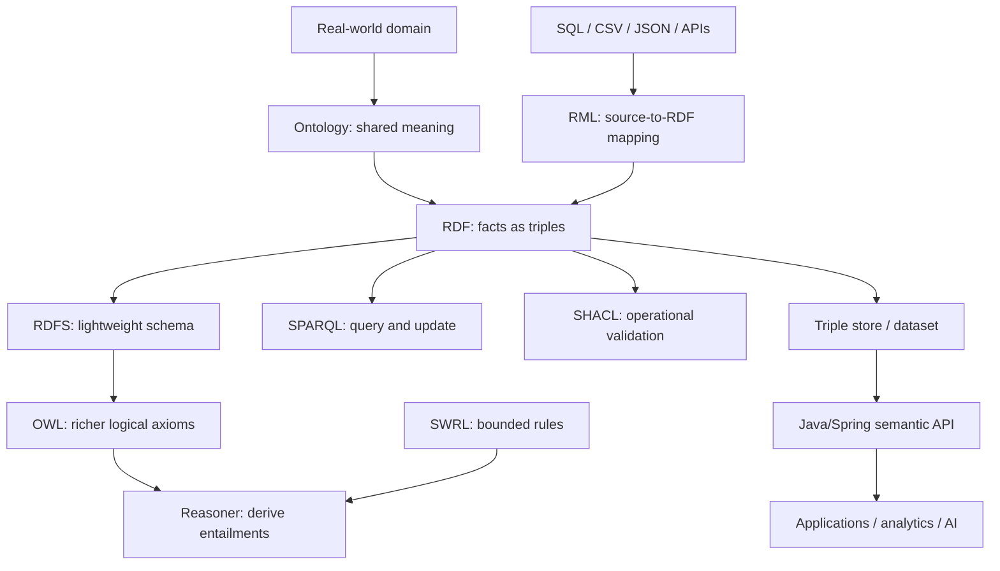

```text
Ontology says what concepts mean.
RDF records facts.
RDFS/OWL add formal semantics.
SPARQL asks questions.
SHACL checks operational conformance.
SWRL derives bounded rule-based facts when the chosen engine supports it.
RML maps heterogeneous sources into RDF.
Jena/Fuseki are implementation choices, not standards.
```

## 19.2 RDF and identity - questions 1-20

| # | Question | Interview-ready answer |
|---:|---|---|
| 1 | What is RDF? | RDF is a graph data model made of subject-predicate-object statements. It separates the abstract graph from serializations such as Turtle, JSON-LD and RDF/XML. |
| 2 | What can be an RDF subject? | An IRI, blank node, and in RDF 1.2 a triple term under the evolving specification. For the stable RDF 1.1 baseline, think IRI or blank node. |
| 3 | What can be a predicate? | An IRI identifying the relationship/property. A literal cannot be a predicate. |
| 4 | What can be an object? | An IRI, blank node or literal; it may therefore identify another resource or carry a typed/language-tagged value. |
| 5 | IRI versus URI? | IRI is the internationalized identifier term used by RDF. In practice, use globally stable, dereferenceable identifiers when beneficial, but dereferenceability is not required by the RDF model. |
| 6 | What is a literal? | A value represented by a lexical form plus datatype IRI or language tag. Equality and ordering depend on datatype semantics, so `"01"^^xsd:integer` and `"1"^^xsd:integer` can denote the same value despite different lexical forms. |
| 7 | What is a blank node? | A locally scoped existential resource without a global identifier. Use it for truly local structures; avoid it for business entities requiring reconciliation, updates or cross-dataset links. |
| 8 | What is an RDF graph? | A set of triples. Because it is a set, triple order is not meaningful and duplicate identical triples do not create additional facts. |
| 9 | What is an RDF dataset? | A default graph plus zero or more named graphs. Named graphs are useful for provenance, source/version separation, tenancy and lifecycle operations. |
| 10 | Are named-graph names semantically guaranteed provenance? | No. A graph IRI is an organizational key; trust and provenance require an explicit model, access controls and verified ingestion. |
| 11 | Turtle versus JSON-LD? | Turtle is compact and human-friendly for ontology/tests; JSON-LD fits JSON ecosystems and APIs. Choose by producer/consumer needs because both serialize RDF. |
| 12 | What is RDF/XML? | An XML serialization of RDF, not RDF itself. It remains interoperable but is usually harder for humans to author than Turtle. |
| 13 | What is N-Triples/N-Quads? | Line-oriented canonical-ish exchange formats. N-Triples represents a graph; N-Quads adds the graph name and is useful for bulk loading, diffing and streaming. |
| 14 | How do you design stable IRIs? | Base them on immutable domain identifiers, define normalization/escaping, avoid mutable labels and database row locations, document ownership and never silently reuse an IRI for a different meaning. |
| 15 | Hash-based or natural-key IRI? | Natural keys improve readability but may change or expose data. Hashes are stable only when their canonical input is stable. Decide from identity semantics, privacy, collision and migration requirements. |
| 16 | How do you model n-ary relationships? | Introduce a relationship/event resource. For example, a Measurement links sensor, value, unit and time; do not force all attributes onto a binary edge. |
| 17 | RDF graph versus property graph? | RDF uses standardized triples, global IRIs and formal semantics; property graphs attach properties to nodes/edges and often optimize traversal. The right choice depends on interoperability, reasoning, query and operational needs. |
| 18 | What is reification? | A way to make a statement itself addressable so metadata can be attached. Prefer named graphs, RDF-star/triple terms where supported, or explicit event resources based on the statement/provenance lifecycle. |
| 19 | What is graph isomorphism? | Two RDF graphs can be equivalent despite different blank-node labels. Tests comparing graphs must account for blank-node renaming rather than compare raw serialized text. |
| 20 | How do you delete/update blank-node data safely? | Prefer stable IRIs. If blank nodes exist, identify the connected structure through a deterministic pattern within a transaction; raw blank-node labels are parser-local and unsafe external IDs. |

## 19.3 RDFS, OWL and ontology engineering - questions 21-50

| # | Question | Interview-ready answer |
|---:|---|---|
| 21 | What does RDFS add? | A lightweight modeling vocabulary: classes, properties, subclass/subproperty relationships, domain, range and labels/comments, with associated entailments. |
| 22 | Meaning of `rdfs:domain`? | If a resource uses that property as subject, it can be inferred to be an instance of the domain class. It is not merely an input-validation rule. |
| 23 | Meaning of `rdfs:range`? | If a resource appears as that property's object, it can be inferred to belong to the range class. Again, this is entailment, not closed-world validation. |
| 24 | Why can domain/range surprise teams? | Reusing a broadly scoped property may infer unintended types. Use carefully scoped properties or unions where the semantics genuinely apply. |
| 25 | RDFS versus OWL? | RDFS covers simple hierarchies and domain/range semantics. OWL supports richer axioms such as equivalence, disjointness, restrictions, property characteristics and cardinality with formal reasoning. |
| 26 | What is the open-world assumption? | Missing information is unknown, not false. If no manufacturer is asserted, OWL does not conclude that the asset has no manufacturer. |
| 27 | What is the no-unique-name assumption? | Different IRIs are not automatically known to denote different individuals. State `owl:differentFrom`, disjointness or keys where required. |
| 28 | What is ontology consistency? | There must be at least one interpretation satisfying all axioms. A reasoner can detect contradictions such as an individual belonging to disjoint classes when those memberships are entailed. |
| 29 | Class versus individual? | A class represents a category; an individual is a domain entity. Avoid accidental metamodeling unless the chosen OWL profile and semantics are intentional. |
| 30 | `subClassOf` versus `equivalentClass`? | Subclass is one-way inclusion; equivalent class is two-way and can classify individuals from necessary-and-sufficient conditions. |
| 31 | Necessary versus sufficient conditions? | A subclass restriction is necessary for known members; an equivalent-class definition can also be sufficient to infer membership when conditions are met. |
| 32 | Existential restriction? | `someValuesFrom` says at least one relationship/value of the specified kind exists, possibly through an anonymous existential not explicitly named. |
| 33 | Universal restriction? | `allValuesFrom` constrains all known/possible values of a property to a class; under open world it does not prove that any value exists. |
| 34 | OWL cardinality under open world? | Cardinality is logical, not a database row count. Missing explicit values may be satisfied by unknown values, and apparently different values may be inferred equal unless distinctness is known. |
| 35 | Functional property? | A subject has at most one distinct value for the property. Multiple asserted values can cause equality inference rather than immediate validation failure. Use SHACL for operational error reporting. |
| 36 | Inverse functional property? | A given object identifies at most one subject, which can infer two subjects are the same. Use cautiously because dirty identifiers can merge entities. |
| 37 | Transitive property? | If A relates to B and B to C, A relates to C. It can be useful for containment/ancestry but expensive or semantically wrong for many physical relations. |
| 38 | Symmetric and asymmetric properties? | Symmetric means A-R-B implies B-R-A; asymmetric means A-R-B prevents B-R-A. Choose from domain semantics, not convenience. |
| 39 | What are OWL profiles? | OWL EL, QL and RL trade expressiveness for tractable reasoning styles: EL for large class hierarchies, QL for query rewriting over relational data and RL for rule-oriented implementations. |
| 40 | How do you choose expressiveness? | Start from competency questions and required inferences, choose the least expressive model that meets them, benchmark with real scale and document unsupported constructs. |
| 41 | What is ontology reuse? | Import or align established vocabularies where semantics and governance fit. Reuse is not automatic quality: check licensing, stability, term meaning and dependency risk. |
| 42 | What are competency questions? | Concrete questions the ontology must answer, such as “which machines contain a sensor calibrated after date X?” They drive scope and become SPARQL regression tests. |
| 43 | Top-down versus bottom-up modeling? | Top-down begins with domain concepts and standards; bottom-up begins with source data. A pragmatic process iterates between both while keeping domain meaning separate from source schema accidents. |
| 44 | How do you govern terms? | Assign owner, definition, examples, status, version, review history, source and deprecation replacement. Changes pass semantic and consumer compatibility tests. |
| 45 | How do you deprecate a term? | Mark it deprecated, provide replacement/migration guidance, keep meaning stable during a transition, measure usage and remove only under an explicit compatibility policy. |
| 46 | Ontology version IRI versus ontology IRI? | Keep a stable ontology identity and publish version metadata/version IRI for releases. Do not make every instance IRI version-specific unless instance identity truly changes. |
| 47 | What is ontology alignment? | Explicitly relating classes/properties/individuals across vocabularies. `owl:equivalentClass` and `owl:sameAs` are strong claims; prefer weaker mappings when equivalence is not proven. |
| 48 | Why is `owl:sameAs` risky? | It asserts full identity and propagates all properties. Use it only for genuine identity, not “similar to,” “same product family” or loose record matching. |
| 49 | How do you test an ontology? | Competency SPARQL queries, expected entailments/non-entailments, consistency checks, pitfall tests, SHACL operational checks and performance tests on representative data. |
| 50 | How do you explain an ontology to a domain expert? | Use their terms, examples and competency questions; show a small diagram and consequences; avoid starting with description-logic syntax. |

## 19.4 SPARQL - questions 51-75

| # | Question | Interview-ready answer |
|---:|---|---|
| 51 | What is a basic graph pattern? | A set of triple patterns joined through shared variables. Evaluation produces solution mappings that bind variables. |
| 52 | `SELECT` versus `CONSTRUCT`? | SELECT returns tabular bindings; CONSTRUCT returns an RDF graph and is ideal for transformations or API graph views. |
| 53 | `ASK` versus `DESCRIBE`? | ASK returns whether a pattern has any solution. DESCRIBE returns an implementation-dependent graph, so use explicit CONSTRUCT for stable contracts. |
| 54 | `OPTIONAL` semantics? | A left join: preserve the left solution and extend it when the optional pattern matches. Multiple matches can multiply rows. |
| 55 | FILTER inside versus outside OPTIONAL? | Placement changes which solutions survive. A filter inside constrains optional matches; outside may reject unbound rows. Test with missing values. |
| 56 | `UNION`? | Combines solutions from alternative graph patterns. Ensure branches bind compatible variables and consider duplicates. |
| 57 | `MINUS` versus `FILTER NOT EXISTS`? | Both express negation but have different variable-compatibility/correlation semantics. Prefer NOT EXISTS when correlation with the current solution is intentional and test edge cases. |
| 58 | `VALUES`? | Supplies an inline table of allowed bindings and often constrains a query early. It is also useful for safely passing a bounded ID set. |
| 59 | `BIND`? | Computes and binds an expression to a variable without adding a graph pattern. Handle expression errors and datatype semantics. |
| 60 | Aggregation trap? | Joins can multiply input rows before COUNT/SUM. Confirm the intended grain and use DISTINCT or pre-aggregation only when semantically correct. |
| 61 | `GROUP BY` rule? | Non-aggregated projected expressions must be grouped or derived appropriately. Choose grouping keys from the business result grain. |
| 62 | Property paths? | Concise path traversal such as `rdfs:subClassOf+`; powerful but potentially expensive and unable to expose every intermediate path directly. |
| 63 | Named graph query? | Use `GRAPH ?g { ... }` to match a named graph and optionally bind its name. Define whether the default graph is unioned by store configuration. |
| 64 | Federation risk? | `SERVICE` depends on remote latency, availability, trust and result size and may enable SSRF-like access. Restrict endpoints and bound requests. |
| 65 | SPARQL injection prevention? | Never concatenate user text into query syntax. Bind parameters through the library/query builder, whitelist structural choices and restrict expensive operations. |
| 66 | Pagination? | LIMIT/OFFSET is simple but degrades and can shift under concurrent updates. Prefer deterministic keyset pagination on stable ordered keys where possible. |
| 67 | How do you optimize joins? | Start with selective indexed patterns, constrain variables early, reduce intermediate results, avoid accidental Cartesian products and inspect the store's actual plan/statistics. |
| 68 | Why can OPTIONAL explode? | Each left solution can join several optional matches across several branches, multiplying cardinality. Pre-aggregate or split queries where semantics allow. |
| 69 | Query timeout strategy? | Server and client deadlines, result/row limits, cancellation, workload classes, metrics and a clear timeout response; never rely only on connection timeout. |
| 70 | What indexes do triple stores use? | Typically permutations of subject/predicate/object and sometimes graph, plus statistics; exact layouts are store-specific, so tune with implementation evidence. |
| 71 | SPARQL Update concern? | Update changes graph state and needs authentication, authorization, transaction scope, validation, audit and rollback/recovery. Do not expose arbitrary update publicly. |
| 72 | Blank nodes in query results? | Their labels are result-local and not stable API identifiers. Transform to stable domain IDs or keep them inside a bounded graph response. |
| 73 | Entailment regime impact? | Query answers depend on whether and how RDFS/OWL entailments are materialized or evaluated. State the regime in tests and API contracts. |
| 74 | How do you regression-test SPARQL? | Fixed dataset, named query, canonical expected bindings/graph, explicit ordering where needed, negative cases and performance budget. |
| 75 | First response to a slow query? | Reproduce with representative data, capture plan/cardinality/timing, confirm correctness grain, then change one factor and measure; do not guess from query text alone. |

## 19.5 SHACL, SWRL, RML and reasoning - questions 76-105

| # | Question | Interview-ready answer |
|---:|---|---|
| 76 | What is SHACL? | A W3C language for describing and validating RDF graph structure through shapes. It produces machine-readable validation results. |
| 77 | NodeShape versus PropertyShape? | A NodeShape constrains focus nodes; a PropertyShape constrains values reached by a path. Property shapes can be reusable or nested. |
| 78 | How are focus nodes selected? | Targets such as targetClass, targetNode, targetSubjectsOf and targetObjectsOf, or application-supplied focus nodes. Target design is part of validation semantics. |
| 79 | `sh:minCount` under validation? | It requires at least that many values for the path on each focus node, giving closed-world operational behavior for that check. |
| 80 | Closed shapes? | They reject properties not explicitly allowed, subject to ignored properties. Useful at controlled boundaries, brittle for extensible shared graphs. |
| 81 | Severity? | Violation, Warning and Info communicate policy. Define whether each severity blocks publication rather than assuming every result is fatal. |
| 82 | SHACL-SPARQL? | Custom constraints expressed with SPARQL when core components are insufficient. They are powerful but increase complexity, portability and performance risk. |
| 83 | Incremental SHACL? | Validate only affected focus nodes/constraints when the engine and dependency model support it; otherwise full validation is safest. Prove that incremental scope cannot miss cross-node constraints. |
| 84 | Validation transaction? | Write to staging, validate the exact candidate snapshot, publish atomically or by version pointer only on success, and retain the report for audit. |
| 85 | SHACL versus JSON Schema? | JSON Schema validates JSON tree syntax/structure; SHACL validates RDF graph paths and cross-node relationships. Use each at its boundary when both representations exist. |
| 86 | What is SWRL? | A W3C member-submission rule language combining OWL atoms in Horn-like antecedent-to-consequent rules. It is not itself a final W3C Recommendation. |
| 87 | Why can SWRL be risky? | Expressiveness can harm decidability/termination and implementation support differs. Constrain rules, benchmark, test and keep operational side effects outside logical inference. |
| 88 | What is DL-safety? | A common restriction requiring rule variables to range over explicitly named individuals, helping retain decidability for supported systems. Exact behavior is engine-specific. |
| 89 | SWRL versus application rule engine? | Use SWRL for ontology-linked monotonic inference when supported; use an application/rule engine for workflow, side effects, temporal state and operational control. |
| 90 | How do you test a rule? | Minimal positive and negative fixtures, expected inferred facts, no unintended inference, termination/performance budget and engine/version pinning. |
| 91 | Forward versus backward chaining? | Forward chaining materializes consequences when facts/rules change; backward chaining proves facts during a query. Trade update cost/storage against query latency. |
| 92 | Materialized inference retraction? | Track justifications/dependencies or rebuild affected closure. Naively deleting a source fact may leave stale derived facts. |
| 93 | What is R2RML? | A W3C language for mapping relational databases to RDF using logical tables and triples maps. |
| 94 | What is RML? | A mapping language that generalizes mapping concepts to heterogeneous logical sources such as CSV, JSON, XML and APIs. |
| 95 | Core triples-map parts? | Logical source, subject map and one or more predicate-object maps, plus referencing object maps for joins. |
| 96 | How do you create stable subjects? | Template from canonical immutable IDs after normalization; define behavior for missing/invalid keys and test collisions. |
| 97 | How do you handle nulls? | Define whether the triple is omitted, mapped to a controlled unknown resource or quarantined. Never convert null silently to the string `"null"`. |
| 98 | How do RML joins fail? | Type/format differences, duplicate keys, missing references and high cardinality. Profile both sides, normalize explicitly and reconcile unmatched counts. |
| 99 | Incremental mapping? | Identify changed source records and affected triples/subjects, preserve mapping/version lineage, and handle deletes; full reload is simpler when scale permits. |
| 100 | Mapping versioning? | Version mapping artifacts, input contracts and ontology dependency together; tag each output graph/batch and retain reproducible configuration. |
| 101 | Mapping tests? | Golden source fixture to graph, expected triple count/identity, negative/null cases, join reconciliation, SHACL validation and replay idempotency. |
| 102 | Data lineage in RDF? | Record source system, source record/batch, mapping version, timestamp and responsible process using a deliberate provenance model such as PROV-O where appropriate. |
| 103 | Error quarantine? | Keep invalid input and diagnostic metadata in access-controlled storage, publish no partial logical state, and provide replay after correction. |
| 104 | Why separate mapping and ontology? | Mapping describes source-to-model translation; ontology defines shared semantics. Coupling them tightly makes source changes redefine domain meaning. |
| 105 | End-to-end correctness invariant? | Every published graph version is reproducible from identified source snapshots plus versioned mappings/ontology, passed declared validation, and can be traced and rolled back. |

## 19.6 Graph database and semantic platform - questions 106-125

| # | Question | Interview-ready answer |
|---:|---|---|
| 106 | Triple store versus relational DB? | Triple stores optimize flexible graph patterns and semantic interoperability; relational DBs optimize structured tables, constraints and mature transactional workloads. Hybrid systems are common. |
| 107 | When not to use a graph database? | Stable tabular schema, simple joins, high-volume OLTP and no graph/semantic benefit. Do not adopt graph technology only because relationships exist. |
| 108 | Jena Model versus Dataset? | Model is a single RDF graph API; Dataset contains default/named graphs and transaction support. Use Dataset for production multi-graph work. |
| 109 | What is ARQ? | Apache Jena's SPARQL query engine and API layer. |
| 110 | What is TDB2? | Jena's persistent transactional RDF storage for datasets, commonly used with Fuseki. |
| 111 | What is Fuseki? | A SPARQL server from Apache Jena supporting query/update and graph-store protocols, deployable standalone or embedded. |
| 112 | Does Jena fully implement SWRL? | Do not assume it. Jena has its own rule/inference subsystem; if SWRL is required, verify the chosen SWRL-capable engine and interoperability. |
| 113 | Transaction pattern in Jena? | Begin read/write transaction, perform work, commit write on success, abort on failure and always end; keep transactions bounded. |
| 114 | Remote versus embedded Fuseki? | Embedded simplifies local deployment and transactions; remote isolates service/scaling and uses network protocols. Decide from ownership, HA and operational boundaries. |
| 115 | Backup strategy? | Consistent store-level backup/export, versioned ontology/mappings, off-host copies, encryption, tested restore and documented RPO/RTO. Export alone is not proof of restore. |
| 116 | Graph partitioning? | Partition by tenant/domain/source/time only when query locality supports it. Cross-partition joins and reasoning can erase the benefit. |
| 117 | Cache key for semantic query? | Query/template ID, normalized parameters, dataset/graph version, entailment regime, authorization scope and response format. |
| 118 | What invalidates cache? | Publishing a relevant graph/ontology/rule version, authorization change or time-dependent result. Prefer versioned keys over broad deletion where possible. |
| 119 | Query admission control? | Per-user/tenant quotas, maximum cost proxies, time/result limits, concurrency pools and cancellation to protect the store from pathological queries. |
| 120 | Multi-tenancy options? | Separate stores, datasets, named graphs or access-controlled partitions. Evaluate isolation, backup, query leakage, noisy neighbors and operational cost. |
| 121 | Observability correlation? | Carry request/batch/graph-version/query-template IDs through logs, metrics and traces without logging sensitive raw queries/data. |
| 122 | Store migration? | Export compatible data, validate counts/hashes/queries, compare entailment behavior, dual-read/shadow where possible, cut over by version and keep rollback. |
| 123 | Benchmark design? | Representative graph shape/cardinality, warm/cold runs, concurrent workloads, fixed versions, correctness check and p50/p95/p99 plus resource use. |
| 124 | Availability versus consistency? | Define the business operation. Read-only semantic discovery may tolerate a version lag; ontology publication and validated graph promotion require stronger atomic version semantics. |
| 125 | Disaster recovery proof? | A timed restore in an isolated environment, followed by validation queries and consumer/API smoke tests. A backup job's green status is insufficient. |

---

# 20. Worked semantic artifacts and solutions

This section is one coherent example. Copy each block into the indicated project file if you build the practical project.

## 20.1 Domain and publication lifecycle

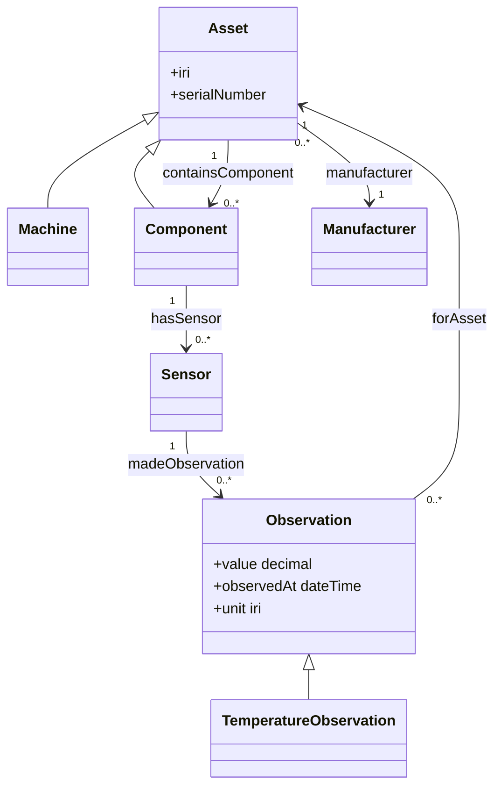

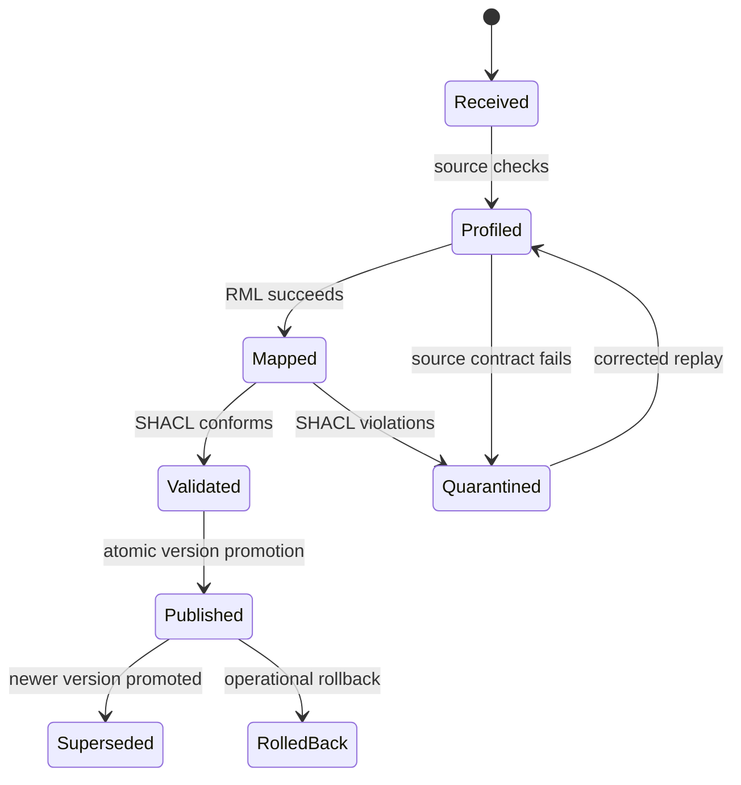

## 20.2 Ontology solution - `ontology/equipment.ttl`

```turtle
@prefix ex:   <https://example.festo-prep.invalid/ontology/> .
@prefix rdf:  <http://www.w3.org/1999/02/22-rdf-syntax-ns#> .
@prefix rdfs: <http://www.w3.org/2000/01/rdf-schema#> .
@prefix owl:  <http://www.w3.org/2002/07/owl#> .
@prefix xsd:  <http://www.w3.org/2001/XMLSchema#> .
@prefix dct:  <http://purl.org/dc/terms/> .

<https://example.festo-prep.invalid/ontology>
    a owl:Ontology ;
    owl:versionInfo "1.0.0" ;
    dct:title "Industrial asset demonstration ontology"@en ;
    dct:created "2026-11-04"^^xsd:date .

ex:Asset a owl:Class ;
    rdfs:label "Asset"@en .

ex:Machine a owl:Class ;
    rdfs:subClassOf ex:Asset ,
        [ a owl:Restriction ;
          owl:onProperty ex:hasSensor ;
          owl:someValuesFrom ex:Sensor
        ] ;
    rdfs:label "Machine"@en .

ex:Component a owl:Class ;
    rdfs:subClassOf ex:Asset ;
    rdfs:label "Component"@en .

ex:Sensor a owl:Class ;
    rdfs:subClassOf ex:Component ;
    rdfs:label "Sensor"@en .

ex:Observation a owl:Class ;
    rdfs:label "Observation"@en .

ex:TemperatureObservation a owl:Class ;
    rdfs:subClassOf ex:Observation ;
    rdfs:label "Temperature observation"@en .

ex:CriticalObservation a owl:Class ;
    rdfs:subClassOf ex:Observation ;
    rdfs:label "Critical observation"@en .

ex:Manufacturer a owl:Class ;
    rdfs:label "Manufacturer"@en .

ex:containsComponent a owl:ObjectProperty ;
    rdfs:domain ex:Machine ;
    rdfs:range ex:Component .

ex:hasSensor a owl:ObjectProperty ;
    rdfs:domain ex:Asset ;
    rdfs:range ex:Sensor .

ex:madeObservation a owl:ObjectProperty ;
    rdfs:domain ex:Sensor ;
    rdfs:range ex:Observation ;
    owl:inverseOf ex:observedBy .

ex:observedBy a owl:ObjectProperty ;
    rdfs:domain ex:Observation ;
    rdfs:range ex:Sensor .

ex:forAsset a owl:ObjectProperty ;
    rdfs:domain ex:Observation ;
    rdfs:range ex:Asset .

ex:manufacturer a owl:ObjectProperty ;
    rdfs:domain ex:Asset ;
    rdfs:range ex:Manufacturer .

ex:unit a owl:ObjectProperty ;
    rdfs:domain ex:Observation .

ex:serialNumber a owl:DatatypeProperty , owl:FunctionalProperty ;
    rdfs:domain ex:Asset ;
    rdfs:range xsd:string .

ex:numericValue a owl:DatatypeProperty ;
    rdfs:domain ex:Observation ;
    rdfs:range xsd:decimal .

ex:observedAt a owl:DatatypeProperty , owl:FunctionalProperty ;
    rdfs:domain ex:Observation ;
    rdfs:range xsd:dateTime .

ex:sourceBatch a owl:DatatypeProperty ;
    rdfs:range xsd:string .

ex:warningThreshold a owl:DatatypeProperty ;
    rdfs:domain ex:Sensor ;
    rdfs:range xsd:decimal .

ex:degreeCelsius a owl:NamedIndividual ;
    rdfs:label "degree Celsius"@en .
```

### Modeling explanation

- `Observation` is an explicit resource because value, unit, time, source and quality metadata belong to the relationship/event.
- Asset and observation IRIs should derive from immutable source IDs; labels are never identifiers.
- The OWL restriction says every Machine has at least one Sensor in every valid interpretation. It is a semantic statement, not a sufficient ingestion error message; SHACL supplies the operational check.
- `serialNumber` is functional in OWL, but SHACL still checks exact cardinality and reports violations.

## 20.3 Valid instance data - `data/samples/valid.ttl`

```turtle
@prefix ex:   <https://example.festo-prep.invalid/ontology/> .
@prefix id:   <https://example.festo-prep.invalid/id/> .
@prefix xsd:  <http://www.w3.org/2001/XMLSchema#> .

id:manufacturer-festo a ex:Manufacturer .

id:machine-M100 a ex:Machine ;
    ex:serialNumber "M100" ;
    ex:manufacturer id:manufacturer-festo ;
    ex:hasSensor id:sensor-S100 ;
    ex:sourceBatch "batch-2026-11-04-001" .

id:sensor-S100 a ex:Sensor ;
    ex:serialNumber "S100" ;
    ex:warningThreshold 80.0 ;
    ex:madeObservation id:observation-O100 , id:observation-O101 .

id:observation-O100 a ex:TemperatureObservation ;
    ex:observedBy id:sensor-S100 ;
    ex:forAsset id:machine-M100 ;
    ex:numericValue 72.5 ;
    ex:unit ex:degreeCelsius ;
    ex:observedAt "2026-11-04T08:00:00Z"^^xsd:dateTime ;
    ex:sourceBatch "batch-2026-11-04-001" .

id:observation-O101 a ex:TemperatureObservation ;
    ex:observedBy id:sensor-S100 ;
    ex:forAsset id:machine-M100 ;
    ex:numericValue 91.2 ;
    ex:unit ex:degreeCelsius ;
    ex:observedAt "2026-11-04T08:05:00Z"^^xsd:dateTime ;
    ex:sourceBatch "batch-2026-11-04-001" .
```

## 20.4 Invalid instance data - `data/samples/invalid.ttl`

```turtle
@prefix ex: <https://example.festo-prep.invalid/ontology/> .
@prefix id: <https://example.festo-prep.invalid/id/> .

# Missing manufacturer and sensor; serial number duplicated.
id:machine-BAD a ex:Machine ;
    ex:serialNumber "BAD-1", "BAD-2" .

# Wrong datatype, missing unit and timestamp.
id:observation-BAD a ex:TemperatureObservation ;
    ex:forAsset id:machine-BAD ;
    ex:numericValue "very hot" .
```

## 20.5 SHACL solution - `ontology/shapes.ttl`

```turtle
@prefix ex:   <https://example.festo-prep.invalid/ontology/> .
@prefix sh:   <http://www.w3.org/ns/shacl#> .
@prefix xsd:  <http://www.w3.org/2001/XMLSchema#> .

ex:AssetShape a sh:NodeShape ;
    sh:targetClass ex:Asset ;
    sh:property [
        sh:path ex:serialNumber ;
        sh:minCount 1 ;
        sh:maxCount 1 ;
        sh:datatype xsd:string ;
        sh:minLength 1 ;
        sh:message "Asset requires exactly one non-empty serial number"
    ] ;
    sh:property [
        sh:path ex:manufacturer ;
        sh:minCount 1 ;
        sh:maxCount 1 ;
        sh:class ex:Manufacturer ;
        sh:message "Asset requires exactly one manufacturer"
    ] .

ex:MachineShape a sh:NodeShape ;
    sh:targetClass ex:Machine ;
    sh:property [
        sh:path ex:hasSensor ;
        sh:minCount 1 ;
        sh:class ex:Sensor ;
        sh:message "Machine requires at least one sensor"
    ] .

ex:ObservationShape a sh:NodeShape ;
    sh:targetClass ex:Observation ;
    sh:property [
        sh:path ex:forAsset ;
        sh:minCount 1 ; sh:maxCount 1 ;
        sh:class ex:Asset
    ] ;
    sh:property [
        sh:path ex:numericValue ;
        sh:minCount 1 ; sh:maxCount 1 ;
        sh:datatype xsd:decimal
    ] ;
    sh:property [
        sh:path ex:unit ;
        sh:minCount 1 ; sh:maxCount 1 ;
        sh:nodeKind sh:IRI
    ] ;
    sh:property [
        sh:path ex:observedAt ;
        sh:minCount 1 ; sh:maxCount 1 ;
        sh:datatype xsd:dateTime
    ] .

ex:TemperatureRangeShape a sh:NodeShape ;
    sh:targetClass ex:TemperatureObservation ;
    sh:property [
        sh:path ex:numericValue ;
        sh:minInclusive -273.15 ;
        sh:maxInclusive 2000.0 ;
        sh:severity sh:Violation ;
        sh:message "Temperature is outside the supported physical/system range"
    ] .
```

### Expected validation results

```text
valid.ttl   -> conforms = true
invalid.ttl -> conforms = false
expected violations include:
- machine-BAD serialNumber maxCount
- machine-BAD manufacturer minCount
- machine-BAD hasSensor minCount
- observation-BAD numericValue datatype
- observation-BAD unit minCount
- observation-BAD observedAt minCount
```

## 20.6 SWRL solution and boundary

Human-readable rule:

```text
TemperatureObservation(?o)
and observedBy(?o, ?s)
and numericValue(?o, ?v)
and warningThreshold(?s, ?t)
and swrlb:greaterThan(?v, ?t)
-> CriticalObservation(?o)
```

Expected inference for the valid fixture:

```turtle
<https://example.festo-prep.invalid/id/observation-O101>
    a <https://example.festo-prep.invalid/ontology/CriticalObservation> .
```

Senior explanation:

> This is a monotonic classification rule. I would first verify that the selected reasoner supports the required SWRL subset and numeric built-ins. I would not use SWRL to send alerts or mutate external systems; the application consumes the inferred classification and owns side effects, retries and audit. Apache Jena's own rule engine is not automatically equivalent to SWRL support.

## 20.7 RML solution - `mappings/equipment.rml.ttl`

Input CSV:

```csv
machine_id,manufacturer_id,sensor_id,threshold
M100,festo,S100,80.0
```

Illustrative mapping:

```turtle
@prefix rr:  <http://www.w3.org/ns/r2rml#> .
@prefix rml: <https://w3id.org/rml/> .
@prefix ql:  <http://semweb.mmlab.be/ns/ql#> .
@prefix ex:  <https://example.festo-prep.invalid/ontology/> .

<#MachineMap>
    a rml:TriplesMap ;
    rml:logicalSource [
        rml:source "data/samples/machines.csv" ;
        rml:referenceFormulation ql:CSV
    ] ;
    rml:subjectMap [
        rr:template "https://example.festo-prep.invalid/id/machine-{machine_id}" ;
        rr:class ex:Machine
    ] ;
    rml:predicateObjectMap [
        rr:predicate ex:serialNumber ;
        rr:objectMap [ rml:reference "machine_id" ]
    ] ;
    rml:predicateObjectMap [
        rr:predicate ex:manufacturer ;
        rr:objectMap [
            rr:template "https://example.festo-prep.invalid/id/manufacturer-{manufacturer_id}" ;
            rr:termType rr:IRI
        ]
    ] ;
    rml:predicateObjectMap [
        rr:predicate ex:hasSensor ;
        rr:objectMap [
            rr:template "https://example.festo-prep.invalid/id/sensor-{sensor_id}" ;
            rr:termType rr:IRI
        ]
    ] .

<#SensorMap>
    a rml:TriplesMap ;
    rml:logicalSource [
        rml:source "data/samples/machines.csv" ;
        rml:referenceFormulation ql:CSV
    ] ;
    rml:subjectMap [
        rr:template "https://example.festo-prep.invalid/id/sensor-{sensor_id}" ;
        rr:class ex:Sensor
    ] ;
    rml:predicateObjectMap [
        rr:predicate ex:serialNumber ;
        rr:objectMap [ rml:reference "sensor_id" ]
    ] ;
    rml:predicateObjectMap [
        rr:predicate ex:warningThreshold ;
        rr:objectMap [
            rml:reference "threshold" ;
            rr:datatype <http://www.w3.org/2001/XMLSchema#decimal>
        ]
    ] .
```

The RML vocabulary has evolved; pin the chosen mapper/version and validate syntax against its documentation. The invariant is stable output identity and reproducibility, not allegiance to one mapper.

## 20.8 SPARQL solution bank

Prefixes used below:

```sparql
PREFIX ex:  <https://example.festo-prep.invalid/ontology/>
PREFIX id:  <https://example.festo-prep.invalid/id/>
PREFIX rdf: <http://www.w3.org/1999/02/22-rdf-syntax-ns#>
PREFIX rdfs: <http://www.w3.org/2000/01/rdf-schema#>
PREFIX xsd: <http://www.w3.org/2001/XMLSchema#>
```

### Q1. List machines and sensors

```sparql
SELECT ?machine ?serial ?sensor
WHERE {
  ?machine a ex:Machine ;
           ex:serialNumber ?serial ;
           ex:hasSensor ?sensor .
}
ORDER BY ?serial ?sensor
```

Expected row: `machine-M100`, `M100`, `sensor-S100`.

### Q2. Latest observation per sensor

```sparql
SELECT ?sensor ?observation ?time ?value
WHERE {
  ?sensor ex:madeObservation ?observation .
  ?observation ex:observedAt ?time ;
               ex:numericValue ?value .
  FILTER NOT EXISTS {
    ?sensor ex:madeObservation ?laterObservation .
    ?laterObservation ex:observedAt ?laterTime .
    FILTER (?laterTime > ?time)
  }
}
```

Expected result for S100: O101 at 08:05 with 91.2.

### Q3. Maximum temperature by machine

```sparql
SELECT ?machine (MAX(?value) AS ?maxTemperature)
WHERE {
  ?observation a ex:TemperatureObservation ;
               ex:forAsset ?machine ;
               ex:numericValue ?value .
}
GROUP BY ?machine
```

### Q4. Observations above the sensor threshold

```sparql
SELECT ?sensor ?observation ?value ?threshold
WHERE {
  ?sensor ex:warningThreshold ?threshold ;
          ex:madeObservation ?observation .
  ?observation ex:numericValue ?value .
  FILTER (?value > ?threshold)
}
ORDER BY DESC(?value)
```

### Q5. Machines with no sensor - operational audit

```sparql
SELECT ?machine
WHERE {
  ?machine a ex:Machine .
  FILTER NOT EXISTS { ?machine ex:hasSensor ?sensor }
}
```

This does not replace SHACL, but it is a useful audit query.

### Q6. Optional manufacturer label without losing machines

```sparql
SELECT ?machine ?manufacturer ?label
WHERE {
  ?machine a ex:Machine .
  OPTIONAL {
    ?machine ex:manufacturer ?manufacturer .
    OPTIONAL { ?manufacturer rdfs:label ?label }
  }
}
```

### Q7. Count observations by batch and conformance candidate

```sparql
SELECT ?batch (COUNT(DISTINCT ?observation) AS ?observationCount)
WHERE {
  ?observation a ex:Observation ;
               ex:sourceBatch ?batch .
}
GROUP BY ?batch
ORDER BY ?batch
```

### Q8. Construct a compact machine view

```sparql
CONSTRUCT {
  ?machine ex:serialNumber ?serial ;
           ex:hasSensor ?sensor .
}
WHERE {
  ?machine a ex:Machine ;
           ex:serialNumber ?serial ;
           ex:hasSensor ?sensor .
  VALUES ?machine { id:machine-M100 }
}
```

### Q9. Check whether a batch contains a critical observation

```sparql
ASK {
  ?observation a ex:CriticalObservation ;
               ex:sourceBatch "batch-2026-11-04-001" .
}
```

### Q10. Query a versioned named graph

```sparql
SELECT ?asset ?serial
FROM NAMED <https://example.festo-prep.invalid/graph/published/v1>
WHERE {
  GRAPH <https://example.festo-prep.invalid/graph/published/v1> {
    ?asset a ex:Asset ; ex:serialNumber ?serial .
  }
}
```

### Q11. Parameterized keyset pagination shape

```sparql
SELECT ?asset ?serial
WHERE {
  ?asset a ex:Asset ; ex:serialNumber ?serial .
  FILTER (?serial > ?afterSerial)
}
ORDER BY ?serial
LIMIT 100
```

Bind `?afterSerial` through the Java API. Add an IRI tie-breaker when serial is not globally unique.

### Q12. Subclass closure

```sparql
SELECT DISTINCT ?class
WHERE {
  ex:TemperatureObservation rdfs:subClassOf* ?class .
}
```

### Optimization comparison

Weak shape:

```sparql
SELECT * WHERE {
  ?s ?p ?o .
  OPTIONAL { ?s ex:serialNumber ?serial }
  FILTER (?serial = "M100")
}
```

Better shape:

```sparql
SELECT ?s ?p ?o WHERE {
  ?s ex:serialNumber "M100" ;
     ?p ?o .
}
```

Why: the second form constrains the subject through a selective predicate/object pattern before expanding its properties; the first risks scanning a very broad triple pattern and has problematic OPTIONAL/filter semantics. Confirm with the actual store plan and data statistics.

## 20.9 Semantic publication algorithm

```text
function publish(batchId, sourceSnapshot, mappingVersion, ontologyVersion):
    require batchId is globally idempotent
    if completedPublicationExists(batchId): return existingVersion

    normalized = profileAndNormalize(sourceSnapshot)
    stagingGraph = mapToRdf(normalized, mappingVersion)
    syntaxCheck(stagingGraph)
    report = shaclValidate(stagingGraph, ontologyVersion)

    if report.hasBlockingViolation:
        quarantine(batchId, sourceSnapshot, report)
        return REJECTED

    runRegressionQueries(stagingGraph)
    candidateVersion = persistImmutableGraph(stagingGraph, provenance)
    atomicallyMovePublishedPointer(candidateVersion)
    emitPublicationEvent(batchId, candidateVersion)
    return candidateVersion
```

Correctness properties:

```text
- Same batch ID cannot publish twice.
- Published pointer references only an immutable, validated graph version.
- A failed candidate cannot alter the current published version.
- Every published version identifies source, mapping, ontology and validator versions.
- Rollback changes the pointer; it does not rewrite history.
```

---

# 21. Java, Spring Boot, Jena and Fuseki solution

The versions below were current stable choices at the 4 November 2026 snapshot: Spring Boot 3.5.16 supports Java 21, and Apache Jena 6.2.0 requires Java 21. Recheck them when actually building because dependency versions are mutable. [Spring Boot requirements](https://docs.spring.io/spring-boot/3.5/system-requirements.html) and [Apache Jena releases](https://jena.apache.org/download/).

## 21.1 Request flow

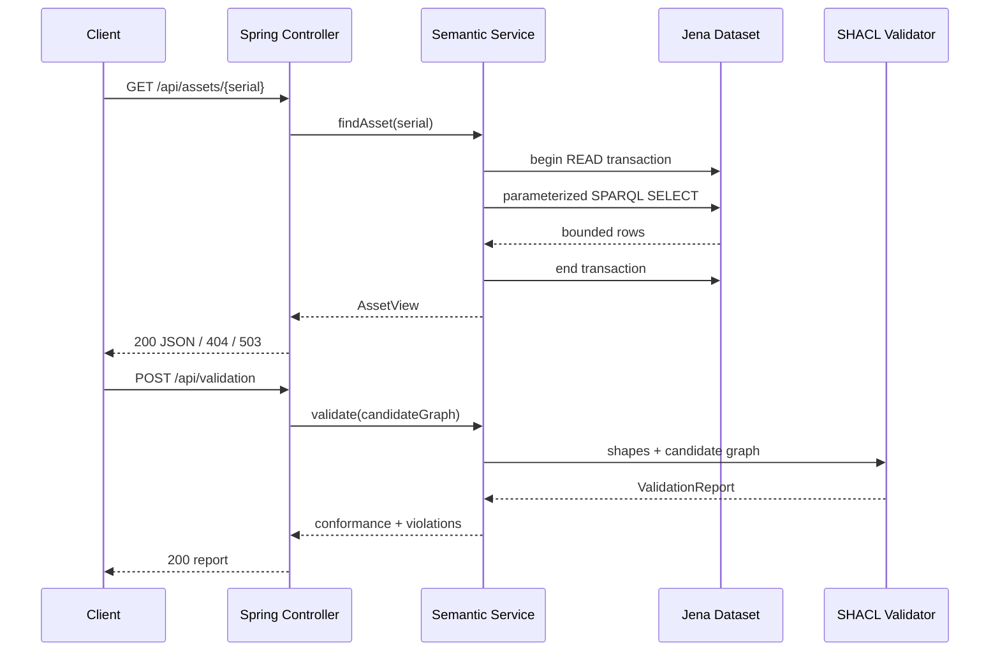

## 21.2 Maven template - `semantic-api/pom.xml`

> **Evidence boundary:** this is an interview-oriented multi-file template, not a checked-in `semantic-api` module. Copy the shown artifacts into a real project, add the referenced Turtle resources, and run the declared tests before claiming runtime proof.

```xml
<?xml version="1.0" encoding="UTF-8"?>
<project xmlns="http://maven.apache.org/POM/4.0.0"
         xmlns:xsi="http://www.w3.org/2001/XMLSchema-instance"
         xsi:schemaLocation="http://maven.apache.org/POM/4.0.0 https://maven.apache.org/xsd/maven-4.0.0.xsd">
  <modelVersion>4.0.0</modelVersion>

  <parent>
    <groupId>org.springframework.boot</groupId>
    <artifactId>spring-boot-starter-parent</artifactId>
    <version>3.5.16</version>
    <relativePath/>
  </parent>

  <groupId>org.chijai.festoprep</groupId>
  <artifactId>semantic-api</artifactId>
  <version>0.1.0-SNAPSHOT</version>

  <properties>
    <java.version>21</java.version>
    <jena.version>6.2.0</jena.version>
  </properties>

  <dependencies>
    <dependency>
      <groupId>org.springframework.boot</groupId>
      <artifactId>spring-boot-starter-web</artifactId>
    </dependency>
    <dependency>
      <groupId>org.springframework.boot</groupId>
      <artifactId>spring-boot-starter-validation</artifactId>
    </dependency>
    <dependency>
      <groupId>org.springframework.boot</groupId>
      <artifactId>spring-boot-starter-actuator</artifactId>
    </dependency>
    <dependency>
      <groupId>org.apache.jena</groupId>
      <artifactId>jena-arq</artifactId>
      <version>${jena.version}</version>
    </dependency>
    <dependency>
      <groupId>org.apache.jena</groupId>
      <artifactId>jena-tdb2</artifactId>
      <version>${jena.version}</version>
    </dependency>
    <dependency>
      <groupId>org.apache.jena</groupId>
      <artifactId>jena-shacl</artifactId>
      <version>${jena.version}</version>
    </dependency>
    <dependency>
      <groupId>org.springframework.boot</groupId>
      <artifactId>spring-boot-starter-test</artifactId>
      <scope>test</scope>
    </dependency>
  </dependencies>

  <build>
    <plugins>
      <plugin>
        <groupId>org.springframework.boot</groupId>
        <artifactId>spring-boot-maven-plugin</artifactId>
      </plugin>
    </plugins>
  </build>
</project>
```

## 21.3 Configuration and dataset ownership

```java
package org.chijai.festoprep.semantic;

import org.apache.jena.query.Dataset;
import org.apache.jena.tdb2.TDB2Factory;
import org.springframework.beans.factory.annotation.Value;
import org.springframework.context.annotation.Bean;
import org.springframework.context.annotation.Configuration;

@Configuration
public class DatasetConfiguration {

    @Bean(destroyMethod = "close")
    Dataset dataset(@Value("${semantic.tdb-directory:./data/tdb2}") String directory) {
        return TDB2Factory.connectDataset(directory);
    }
}
```

```yaml
# application.yml
semantic:
  tdb-directory: ${SEMANTIC_TDB_DIRECTORY:./data/tdb2}
  query-timeout-ms: 2000
  max-results: 100

management:
  endpoints:
    web:
      exposure:
        include: health,info,metrics,prometheus
```

Ownership answer:

> One Spring bean owns the Dataset lifecycle. Every operation establishes an explicit read or write transaction. Controllers never manipulate the Dataset directly; this keeps query policy, limits and audit in the service layer.

## 21.4 Safe query service

```java
package org.chijai.festoprep.semantic;

import org.apache.jena.query.Dataset;
import org.apache.jena.query.ParameterizedSparqlString;
import org.apache.jena.query.QueryExecution;
import org.apache.jena.query.QueryExecutionFactory;
import org.apache.jena.query.QuerySolution;
import org.apache.jena.query.ResultSet;
import org.apache.jena.system.Txn;
import org.springframework.beans.factory.annotation.Value;
import org.springframework.stereotype.Service;

import java.time.Duration;
import java.util.ArrayList;
import java.util.List;
import java.util.Objects;
import java.util.Optional;

@Service
public final class AssetQueryService {
    private static final String EX = "https://example.festo-prep.invalid/ontology/";

    private final Dataset dataset;
    private final Duration timeout;
    private final int maxResults;

    public AssetQueryService(
            Dataset dataset,
            @Value("${semantic.query-timeout-ms:2000}") long timeoutMs,
            @Value("${semantic.max-results:100}") int maxResults) {
        this.dataset = Objects.requireNonNull(dataset);
        this.timeout = Duration.ofMillis(timeoutMs);
        if (maxResults < 1 || maxResults > 1000) {
            throw new IllegalArgumentException("maxResults must be between 1 and 1000");
        }
        this.maxResults = maxResults;
    }

    public Optional<AssetView> findBySerial(String rawSerial) {
        String serial = requireSafeSerial(rawSerial);
        return Txn.calculateRead(dataset, () -> {
            ParameterizedSparqlString pss = new ParameterizedSparqlString("""
                    PREFIX ex: <https://example.festo-prep.invalid/ontology/>
                    SELECT ?asset ?manufacturer
                    WHERE {
                      ?asset a ex:Asset ;
                             ex:serialNumber ?serial .
                      OPTIONAL { ?asset ex:manufacturer ?manufacturer }
                    }
                    LIMIT 2
                    """);
            pss.setLiteral("serial", serial);

            try (QueryExecution execution = QueryExecutionFactory.create(pss.asQuery(), dataset)) {
                execution.setTimeout(timeout.toMillis());
                ResultSet rows = execution.execSelect();
                if (!rows.hasNext()) {
                    return Optional.empty();
                }
                QuerySolution first = rows.next();
                AssetView view = new AssetView(
                        first.getResource("asset").getURI(),
                        serial,
                        first.contains("manufacturer")
                                ? first.getResource("manufacturer").getURI()
                                : null);
                if (rows.hasNext()) {
                    throw new SemanticIntegrityException(
                            "serialNumber is not unique: " + serial);
                }
                return Optional.of(view);
            }
        });
    }

    public List<ObservationView> recentObservations(String assetIri, int requestedLimit) {
        if (assetIri == null || !assetIri.startsWith("https://example.festo-prep.invalid/id/")) {
            throw new IllegalArgumentException("Unsupported asset IRI");
        }
        int limit = Math.min(Math.max(requestedLimit, 1), maxResults);

        return Txn.calculateRead(dataset, () -> {
            ParameterizedSparqlString pss = new ParameterizedSparqlString("""
                    PREFIX ex: <https://example.festo-prep.invalid/ontology/>
                    SELECT ?observation ?value ?time
                    WHERE {
                      ?observation a ex:Observation ;
                                   ex:forAsset ?asset ;
                                   ex:numericValue ?value ;
                                   ex:observedAt ?time .
                    }
                    ORDER BY DESC(?time) ?observation
                    LIMIT %d
                    """.formatted(limit));
            pss.setIri("asset", assetIri);

            List<ObservationView> result = new ArrayList<>();
            try (QueryExecution execution = QueryExecutionFactory.create(pss.asQuery(), dataset)) {
                execution.setTimeout(timeout.toMillis());
                ResultSet rows = execution.execSelect();
                while (rows.hasNext()) {
                    QuerySolution row = rows.next();
                    result.add(new ObservationView(
                            row.getResource("observation").getURI(),
                            row.getLiteral("value").getBigDecimal(),
                            row.getLiteral("time").getString()));
                }
            }
            return List.copyOf(result);
        });
    }

    private static String requireSafeSerial(String value) {
        if (value == null || !value.matches("[A-Za-z0-9._-]{1,64}")) {
            throw new IllegalArgumentException("Invalid serial number");
        }
        return value;
    }
}
```

```java
package org.chijai.festoprep.semantic;

import java.math.BigDecimal;

public record AssetView(String iri, String serialNumber, String manufacturerIri) {}
public record ObservationView(String iri, BigDecimal value, String observedAt) {}
```

Why this is interview-strong:

- User data is bound as a literal or IRI; it is not concatenated into SPARQL syntax.
- The only interpolated number is a clamped application-controlled integer.
- Results, execution time and identifier namespace are bounded.
- Duplicate serials become an integrity error rather than silently selecting one row.
- Read transactions and query resources are always closed.

## 21.5 SHACL validation service

```java
package org.chijai.festoprep.semantic;

import org.apache.jena.graph.Graph;
import org.apache.jena.rdf.model.Model;
import org.apache.jena.rdf.model.ModelFactory;
import org.apache.jena.riot.RDFDataMgr;
import org.apache.jena.shacl.ShaclValidator;
import org.apache.jena.shacl.ValidationReport;
import org.springframework.beans.factory.annotation.Value;
import org.springframework.core.io.Resource;
import org.springframework.stereotype.Service;

import java.io.IOException;
import java.io.InputStream;
import java.util.Objects;

@Service
public final class SemanticValidationService {
    private final Graph shapesGraph;

    public SemanticValidationService(
            @Value("classpath:shapes.ttl") Resource shapesResource) {
        this.shapesGraph = loadGraph(shapesResource);
    }

    public ValidationResult validate(Model candidate) {
        Objects.requireNonNull(candidate);
        ValidationReport report = ShaclValidator.get()
                .validate(shapesGraph, candidate.getGraph());

        Model reportModel = ModelFactory.createModelForGraph(report.getGraph());
        String reportTurtle = modelAsTurtle(reportModel);
        return new ValidationResult(report.conforms(), reportTurtle);
    }

    private static Graph loadGraph(Resource resource) {
        try (InputStream input = resource.getInputStream()) {
            Model model = ModelFactory.createDefaultModel();
            RDFDataMgr.read(model, input, org.apache.jena.riot.Lang.TURTLE);
            return model.getGraph();
        } catch (IOException exception) {
            throw new IllegalStateException("Cannot load SHACL shapes", exception);
        }
    }

    private static String modelAsTurtle(Model model) {
        java.io.StringWriter writer = new java.io.StringWriter();
        RDFDataMgr.write(writer, model, org.apache.jena.riot.Lang.TURTLE);
        return writer.toString();
    }
}

record ValidationResult(boolean conforms, String reportTurtle) {}
```

Implementation note: when accepting uploaded RDF, cap request size, allow only required RDF languages, disable unexpected remote resolution and parse into a staging model.

## 21.6 Atomic graph publication service

```java
package org.chijai.festoprep.semantic;

import org.apache.jena.query.Dataset;
import org.apache.jena.rdf.model.Model;
import org.apache.jena.system.Txn;
import org.springframework.stereotype.Service;

import java.util.Objects;

@Service
public final class GraphPublicationService {
    private static final String GRAPH_BASE =
            "https://example.festo-prep.invalid/graph/published/";
    private final Dataset dataset;
    private final SemanticValidationService validator;

    public GraphPublicationService(Dataset dataset, SemanticValidationService validator) {
        this.dataset = Objects.requireNonNull(dataset);
        this.validator = Objects.requireNonNull(validator);
    }

    public PublicationResult publish(String version, Model candidate) {
        if (version == null || !version.matches("[A-Za-z0-9._-]{1,64}")) {
            throw new IllegalArgumentException("Invalid graph version");
        }

        ValidationResult validation = validator.validate(candidate);
        if (!validation.conforms()) {
            return PublicationResult.rejected(validation.reportTurtle());
        }

        String graphIri = GRAPH_BASE + version;
        Txn.executeWrite(dataset, () -> {
            if (dataset.containsNamedModel(graphIri)) {
                throw new DuplicatePublicationException(version);
            }
            dataset.addNamedModel(graphIri, candidate);
            // A production implementation also updates a small metadata graph
            // containing the current version pointer and provenance in this transaction.
        });
        return PublicationResult.published(graphIri);
    }
}
```

```java
package org.chijai.festoprep.semantic;

public record PublicationResult(Status status, String graphIri, String report) {
    public enum Status { PUBLISHED, REJECTED }

    static PublicationResult published(String iri) {
        return new PublicationResult(Status.PUBLISHED, iri, null);
    }

    static PublicationResult rejected(String report) {
        return new PublicationResult(Status.REJECTED, null, report);
    }
}
```

## 21.7 REST controller and errors

```java
package org.chijai.festoprep.semantic;

import jakarta.validation.constraints.Max;
import jakarta.validation.constraints.Min;
import org.springframework.http.ResponseEntity;
import org.springframework.web.bind.annotation.GetMapping;
import org.springframework.web.bind.annotation.PathVariable;
import org.springframework.web.bind.annotation.RequestMapping;
import org.springframework.web.bind.annotation.RequestParam;
import org.springframework.web.bind.annotation.RestController;

import java.util.List;

@RestController
@RequestMapping("/api")
public final class AssetController {
    private final AssetQueryService service;

    public AssetController(AssetQueryService service) {
        this.service = service;
    }

    @GetMapping("/assets/{serial}")
    ResponseEntity<AssetView> get(@PathVariable String serial) {
        return service.findBySerial(serial)
                .map(ResponseEntity::ok)
                .orElseGet(() -> ResponseEntity.notFound().build());
    }

    @GetMapping("/observations")
    List<ObservationView> recent(
            @RequestParam String assetIri,
            @RequestParam(defaultValue = "25") @Min(1) @Max(100) int limit) {
        return service.recentObservations(assetIri, limit);
    }
}
```

```java
package org.chijai.festoprep.semantic;

import org.springframework.http.HttpStatus;
import org.springframework.http.ProblemDetail;
import org.springframework.web.bind.annotation.ExceptionHandler;
import org.springframework.web.bind.annotation.RestControllerAdvice;

@RestControllerAdvice
public final class ApiExceptionHandler {
    @ExceptionHandler(IllegalArgumentException.class)
    ProblemDetail badRequest(IllegalArgumentException exception) {
        ProblemDetail detail = ProblemDetail.forStatus(HttpStatus.BAD_REQUEST);
        detail.setTitle("Invalid request");
        detail.setDetail(exception.getMessage());
        return detail;
    }

    @ExceptionHandler(SemanticIntegrityException.class)
    ProblemDetail integrity(SemanticIntegrityException exception) {
        ProblemDetail detail = ProblemDetail.forStatus(HttpStatus.CONFLICT);
        detail.setTitle("Semantic integrity conflict");
        detail.setDetail(exception.getMessage());
        return detail;
    }
}
```

## 21.8 Core tests

```java
package org.chijai.festoprep.semantic;

import org.apache.jena.query.Dataset;
import org.apache.jena.query.DatasetFactory;
import org.apache.jena.rdf.model.Model;
import org.apache.jena.rdf.model.ModelFactory;
import org.apache.jena.riot.RDFDataMgr;
import org.junit.jupiter.api.Test;

import static org.assertj.core.api.Assertions.assertThat;
import static org.assertj.core.api.Assertions.assertThatThrownBy;

class AssetQueryServiceTest {
    @Test
    void returnsExactlyOneAssetByBoundSerial() {
        Dataset dataset = DatasetFactory.createTxnMem();
        Model data = RDFDataMgr.loadModel("src/test/resources/valid.ttl");
        dataset.setDefaultModel(data);

        AssetQueryService service = new AssetQueryService(dataset, 2_000, 100);

        assertThat(service.findBySerial("M100"))
                .get()
                .extracting(AssetView::serialNumber)
                .isEqualTo("M100");
    }

    @Test
    void rejectsSerialThatCouldAlterQuerySyntax() {
        Dataset dataset = DatasetFactory.createTxnMem();
        AssetQueryService service = new AssetQueryService(dataset, 2_000, 100);

        assertThatThrownBy(() -> service.findBySerial("x\" } UNION { ?s ?p ?o"))
                .isInstanceOf(IllegalArgumentException.class);
    }
}
```

```java
package org.chijai.festoprep.semantic;

import org.apache.jena.rdf.model.Model;
import org.apache.jena.riot.RDFDataMgr;
import org.junit.jupiter.api.Test;
import org.springframework.core.io.ClassPathResource;

import static org.assertj.core.api.Assertions.assertThat;

class SemanticValidationServiceTest {
    @Test
    void validFixtureConformsAndInvalidFixtureDoesNot() {
        SemanticValidationService service = testServiceWithShapes();
        Model valid = RDFDataMgr.loadModel("src/test/resources/valid.ttl");
        Model invalid = RDFDataMgr.loadModel("src/test/resources/invalid.ttl");

        assertThat(service.validate(valid).conforms()).isTrue();
        assertThat(service.validate(invalid).conforms()).isFalse();
    }

    private static SemanticValidationService testServiceWithShapes() {
        return new SemanticValidationService(new ClassPathResource("shapes.ttl"));
    }
}
```

Test categories to name in the interview:

```text
unit: IRI/serial validation and DTO mapping
semantic: positive/negative SHACL fixtures
query: expected binding regression and injection attempts
transaction: failed publish leaves current graph unchanged
idempotency: repeated batch/version is rejected or returns prior result
integration: API -> Jena transaction -> response
performance: representative graph and p95 query/validation budget
recovery: backup -> isolated restore -> validation queries
```

## 21.9 Fuseki operational commands

```bash
# Development-only example; use authenticated/restricted endpoints in real environments.

# Load a graph.
curl --fail-with-body \
  -X PUT \
  -H 'Content-Type: text/turtle' \
  --data-binary @data/samples/valid.ttl \
  'http://localhost:3030/assets/data?graph=https%3A%2F%2Fexample.festo-prep.invalid%2Fgraph%2Fpublished%2Fv1'

# Execute a query from a file.
curl --fail-with-body \
  -H 'Accept: application/sparql-results+json' \
  --data-urlencode 'query@sparql/list-machines.rq' \
  'http://localhost:3030/assets/query'
```

Production answer:

> I would not expose Fuseki directly to arbitrary clients. A controlled service or gateway owns authentication, authorization, query templates, limits, timeouts, audit and tenant isolation. Administrative update endpoints remain private.

---

# 22. Python and pandas pipeline solution

## 22.1 Production boundary

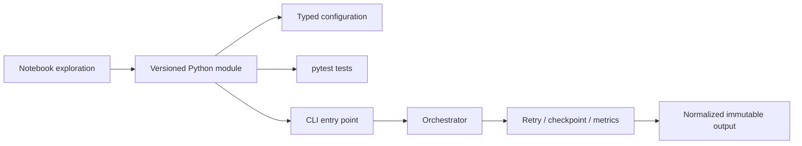

Notebook answer:

> A notebook is useful for profiling and explaining exploration. Production logic moves into importable modules with deterministic inputs, typed configuration, tests, dependency locking and a CLI/orchestrator entry point. The notebook calls the module rather than becoming the only executable artifact.

## 22.2 Package metadata - `pipeline-python/pyproject.toml`

```toml
[project]
name = "industrial-semantic-pipeline"
version = "0.1.0"
requires-python = ">=3.12"
dependencies = [
  "pandas>=2.2,<3",
]

[project.optional-dependencies]
test = ["pytest>=8,<9"]

[project.scripts]
normalize-equipment = "semantic_pipeline.cli:main"

[tool.pytest.ini_options]
testpaths = ["tests"]
```

Pin exact resolved versions in the lock file used by the chosen package manager; ranges alone are not reproducible deployment evidence.

## 22.3 Pipeline implementation

```python
# pipeline-python/src/semantic_pipeline/equipment.py
from __future__ import annotations

from dataclasses import dataclass
from hashlib import sha256
from pathlib import Path
import json
import re

import pandas as pd


ID_PATTERN = re.compile(r"^[A-Za-z0-9._-]{1,64}$")
REQUIRED_COLUMNS = {
    "machine_id",
    "manufacturer_id",
    "sensor_id",
    "threshold",
}


class SourceContractError(ValueError):
    pass


@dataclass(frozen=True)
class NormalizationResult:
    batch_id: str
    row_count: int
    output_path: Path
    manifest_path: Path


def canonical_file_hash(path: Path) -> str:
    digest = sha256()
    with path.open("rb") as source:
        for chunk in iter(lambda: source.read(1024 * 1024), b""):
            digest.update(chunk)
    return digest.hexdigest()


def _required_text(series: pd.Series, column: str) -> pd.Series:
    normalized = series.astype("string").str.strip()
    bad = normalized.isna() | ~normalized.str.match(ID_PATTERN, na=False)
    if bad.any():
        rows = [int(index) + 2 for index in normalized.index[bad][:10]]
        raise SourceContractError(f"invalid {column} at CSV rows {rows}")
    return normalized


def normalize_equipment_csv(
    source_path: Path,
    output_directory: Path,
    mapping_version: str,
    ontology_version: str,
) -> NormalizationResult:
    source_path = source_path.resolve(strict=True)
    output_directory.mkdir(parents=True, exist_ok=True)

    frame = pd.read_csv(
        source_path,
        dtype={
            "machine_id": "string",
            "manufacturer_id": "string",
            "sensor_id": "string",
            "threshold": "string",
        },
        keep_default_na=True,
    )

    missing = REQUIRED_COLUMNS - set(frame.columns)
    unexpected = set(frame.columns) - REQUIRED_COLUMNS
    if missing or unexpected:
        raise SourceContractError(
            f"schema mismatch missing={sorted(missing)} "
            f"unexpected={sorted(unexpected)}"
        )

    frame = frame[list(sorted(REQUIRED_COLUMNS))].copy()
    frame["machine_id"] = _required_text(frame["machine_id"], "machine_id")
    frame["manufacturer_id"] = _required_text(
        frame["manufacturer_id"], "manufacturer_id"
    ).str.lower()
    frame["sensor_id"] = _required_text(frame["sensor_id"], "sensor_id")
    frame["threshold"] = pd.to_numeric(frame["threshold"], errors="coerce")

    bad_threshold = frame["threshold"].isna() | ~frame["threshold"].between(
        -273.15, 2000.0, inclusive="both"
    )
    if bad_threshold.any():
        rows = [int(index) + 2 for index in frame.index[bad_threshold][:10]]
        raise SourceContractError(f"invalid threshold at CSV rows {rows}")

    duplicate_machine_sensor = frame.duplicated(
        subset=["machine_id", "sensor_id"], keep=False
    )
    if duplicate_machine_sensor.any():
        examples = frame.loc[
            duplicate_machine_sensor, ["machine_id", "sensor_id"]
        ].head(10)
        raise SourceContractError(
            "duplicate machine/sensor pairs: "
            + examples.to_dict(orient="records").__repr__()
        )

    # Stable ordering makes the normalized output and downstream graph reproducible.
    frame = frame.sort_values(
        ["machine_id", "sensor_id"], kind="mergesort"
    ).reset_index(drop=True)

    source_hash = canonical_file_hash(source_path)
    batch_material = "|".join(
        [source_hash, mapping_version, ontology_version]
    ).encode("utf-8")
    batch_id = sha256(batch_material).hexdigest()

    output_path = output_directory / f"equipment-{batch_id}.csv"
    manifest_path = output_directory / f"equipment-{batch_id}.manifest.json"

    # Exclusive creation prevents an accidental overwrite. A repeated identical
    # batch is idempotent because the expected output content is deterministic.
    csv_content = frame.to_csv(index=False, lineterminator="\n")
    if output_path.exists():
        if output_path.read_text(encoding="utf-8") != csv_content:
            raise RuntimeError("batch identity collision with different output")
    else:
        output_path.write_text(csv_content, encoding="utf-8", newline="\n")

    manifest = {
        "batch_id": batch_id,
        "source_sha256": source_hash,
        "mapping_version": mapping_version,
        "ontology_version": ontology_version,
        "row_count": int(len(frame)),
        "normalized_file": output_path.name,
    }
    manifest_content = json.dumps(manifest, indent=2, sort_keys=True) + "\n"
    if manifest_path.exists():
        if manifest_path.read_text(encoding="utf-8") != manifest_content:
            raise RuntimeError("manifest collision")
    else:
        manifest_path.write_text(manifest_content, encoding="utf-8")

    return NormalizationResult(
        batch_id=batch_id,
        row_count=len(frame),
        output_path=output_path,
        manifest_path=manifest_path,
    )
```

Production note: actual writes should use a same-filesystem temporary file plus atomic rename so process termination cannot expose a partial file. The sample emphasizes the semantic invariants; add a tested atomic-write helper before deployment.

## 22.4 CLI

```python
# pipeline-python/src/semantic_pipeline/cli.py
from argparse import ArgumentParser
from pathlib import Path

from semantic_pipeline.equipment import normalize_equipment_csv


def main() -> None:
    parser = ArgumentParser()
    parser.add_argument("source", type=Path)
    parser.add_argument("--output", type=Path, required=True)
    parser.add_argument("--mapping-version", required=True)
    parser.add_argument("--ontology-version", required=True)
    args = parser.parse_args()

    result = normalize_equipment_csv(
        source_path=args.source,
        output_directory=args.output,
        mapping_version=args.mapping_version,
        ontology_version=args.ontology_version,
    )
    print(
        f"batch_id={result.batch_id} rows={result.row_count} "
        f"output={result.output_path}"
    )


if __name__ == "__main__":
    main()
```

## 22.5 Tests

```python
# pipeline-python/tests/test_equipment.py
from pathlib import Path

import pytest

from semantic_pipeline.equipment import (
    SourceContractError,
    normalize_equipment_csv,
)


def write(path: Path, value: str) -> Path:
    path.write_text(value, encoding="utf-8", newline="\n")
    return path


def test_normalization_is_deterministic_and_idempotent(tmp_path: Path) -> None:
    source = write(
        tmp_path / "input.csv",
        "machine_id,manufacturer_id,sensor_id,threshold\n"
        "M100,FESTO,S100,80.0\n",
    )
    output = tmp_path / "out"

    first = normalize_equipment_csv(source, output, "map-1", "ont-1")
    second = normalize_equipment_csv(source, output, "map-1", "ont-1")

    assert first.batch_id == second.batch_id
    assert first.output_path.read_text(encoding="utf-8") == (
        "machine_id,manufacturer_id,sensor_id,threshold\n"
        "M100,festo,S100,80.0\n"
    )


def test_schema_drift_is_quarantinable_failure(tmp_path: Path) -> None:
    source = write(
        tmp_path / "input.csv",
        "machine_id,sensor_id,threshold,new_column\n"
        "M100,S100,80.0,x\n",
    )

    with pytest.raises(SourceContractError, match="schema mismatch"):
        normalize_equipment_csv(source, tmp_path / "out", "map-1", "ont-1")


def test_bad_numeric_value_reports_source_row(tmp_path: Path) -> None:
    source = write(
        tmp_path / "input.csv",
        "machine_id,manufacturer_id,sensor_id,threshold\n"
        "M100,FESTO,S100,not-a-number\n",
    )

    with pytest.raises(SourceContractError, match="CSV rows \\[2\\]"):
        normalize_equipment_csv(source, tmp_path / "out", "map-1", "ont-1")
```

## 22.6 Pipeline failure table

| Failure | Retry? | State/action |
|---|:---:|---|
| Network timeout reading remote source | Yes, bounded | Preserve checkpoint; exponential backoff + jitter |
| Missing required column | No automatic retry | Quarantine; schema-drift alert; mapping owner action |
| Invalid business value | No automatic retry | Quarantine row/batch according to atomicity policy; diagnostic report |
| RML mapper process crash | Yes if effect idempotent | Same batch ID and staging target; bounded retry |
| SHACL violation | No automatic retry | Preserve report and source lineage; correct source/mapping then replay |
| Triple store unavailable before publish | Yes | Candidate remains immutable staging; retry pointer/publish transaction |
| Timeout after publish response lost | Reconcile | Look up batch/version idempotency record; never blindly duplicate |
| Poison batch repeatedly fails | No | DLQ/quarantine plus operator runbook and alert |

## 22.7 Python/data-engineering answer bank

| Question | Model answer |
|---|---|
| Why pandas? | Excellent for moderate tabular profiling/transformation and broad team familiarity; measure memory and switch/push down work when scale exceeds a single process. |
| `apply` or vectorization? | Prefer vectorized operations for clarity/performance; use `apply` only when necessary and benchmark. |
| How handle large CSV? | Project columns, explicit dtypes, chunks, source-side filtering, streaming mapper or distributed engine only after measuring. |
| How handle timezone? | Parse explicitly, normalize instants to UTC, retain source zone/business timezone metadata and never use naive datetimes for cross-region events. |
| How handle decimal? | Avoid binary floating point for money/exact decimal semantics; use Decimal or fixed-point representation and explicit RDF/SQL decimal types. |
| How make pipeline deterministic? | Versioned inputs/config/code, stable ordering/identity, seeded randomness, controlled environment and canonical outputs. |
| ETL versus ELT? | ETL transforms before load; ELT loads raw then transforms in the target. Choose from governance, cost, target capability and replay needs. |
| Batch versus stream? | Choose from freshness/SLO and correction semantics. Batch is simpler for validation/replay; streaming adds event time, ordering, checkpoint and retraction complexity. |
| Exactly once? | Usually an end-to-end business property built from at-least-once delivery, idempotent effects, durable identity and reconciliation—not a broker checkbox. |
| Data-quality dimensions? | Completeness, validity, uniqueness, consistency, timeliness, accuracy and referential integrity, each tied to measurable rules and owners. |

---

# 23. SQL and database solution bank

## 23.1 Relational source schema

```sql
CREATE TABLE manufacturer (
    manufacturer_id VARCHAR(64) PRIMARY KEY,
    legal_name       VARCHAR(200) NOT NULL,
    updated_at       TIMESTAMP WITH TIME ZONE NOT NULL
);

CREATE TABLE machine (
    machine_id       VARCHAR(64) PRIMARY KEY,
    serial_number    VARCHAR(64) NOT NULL UNIQUE,
    manufacturer_id VARCHAR(64) NOT NULL
        REFERENCES manufacturer(manufacturer_id),
    updated_at       TIMESTAMP WITH TIME ZONE NOT NULL
);

CREATE TABLE sensor (
    sensor_id         VARCHAR(64) PRIMARY KEY,
    machine_id        VARCHAR(64) NOT NULL REFERENCES machine(machine_id),
    warning_threshold NUMERIC(12, 3) NOT NULL,
    updated_at        TIMESTAMP WITH TIME ZONE NOT NULL
);

CREATE TABLE observation (
    observation_id VARCHAR(64) PRIMARY KEY,
    sensor_id      VARCHAR(64) NOT NULL REFERENCES sensor(sensor_id),
    observed_at    TIMESTAMP WITH TIME ZONE NOT NULL,
    numeric_value  NUMERIC(18, 6) NOT NULL,
    unit_code      VARCHAR(32) NOT NULL,
    source_batch   VARCHAR(64) NOT NULL,
    updated_at     TIMESTAMP WITH TIME ZONE NOT NULL,
    UNIQUE (sensor_id, observed_at, source_batch)
);

CREATE TABLE component (
    component_id        VARCHAR(64) PRIMARY KEY,
    parent_component_id VARCHAR(64) NULL REFERENCES component(component_id),
    component_type      VARCHAR(64) NOT NULL
);

CREATE TABLE ingestion_batch (
    batch_id         VARCHAR(64) PRIMARY KEY,
    source_hash      CHAR(64) NOT NULL,
    mapping_version  VARCHAR(64) NOT NULL,
    ontology_version VARCHAR(64) NOT NULL,
    status           VARCHAR(32) NOT NULL,
    created_at       TIMESTAMP WITH TIME ZONE NOT NULL DEFAULT CURRENT_TIMESTAMP
);

CREATE TABLE graph_publication (
    publication_key      VARCHAR(64) PRIMARY KEY,
    current_graph_version VARCHAR(128) NOT NULL,
    updated_at           TIMESTAMP WITH TIME ZONE NOT NULL
);

CREATE TABLE outbox_event (
    event_id     VARCHAR(64) PRIMARY KEY,
    event_type   VARCHAR(64) NOT NULL,
    aggregate_id VARCHAR(64) NOT NULL,
    payload      JSON NOT NULL,
    created_at   TIMESTAMP WITH TIME ZONE NOT NULL,
    published_at TIMESTAMP WITH TIME ZONE NULL
);

CREATE INDEX observation_sensor_time_idx
    ON observation (sensor_id, observed_at DESC);

CREATE INDEX observation_batch_idx
    ON observation (source_batch);
```

## 23.2 Worked queries

### SQL 1. Latest observation per sensor

```sql
WITH ranked AS (
    SELECT
        o.*,
        ROW_NUMBER() OVER (
            PARTITION BY o.sensor_id
            ORDER BY o.observed_at DESC, o.observation_id DESC
        ) AS row_number
    FROM observation o
)
SELECT sensor_id, observation_id, observed_at, numeric_value, unit_code
FROM ranked
WHERE row_number = 1;
```

Why: deterministic tie-breaker avoids returning an arbitrary row. The `(sensor_id, observed_at DESC)` index supports partition-local latest lookups, but verify the actual plan.

### SQL 2. Sensors above threshold in the last hour

```sql
SELECT
    s.sensor_id,
    o.observation_id,
    o.observed_at,
    o.numeric_value,
    s.warning_threshold
FROM sensor s
JOIN observation o ON o.sensor_id = s.sensor_id
WHERE o.observed_at >= :from_instant
  AND o.numeric_value > s.warning_threshold
ORDER BY o.observed_at DESC, o.observation_id;
```

### SQL 3. Machines with no sensors

```sql
SELECT m.machine_id, m.serial_number
FROM machine m
LEFT JOIN sensor s ON s.machine_id = m.machine_id
WHERE s.sensor_id IS NULL;
```

Alternative:

```sql
SELECT m.machine_id, m.serial_number
FROM machine m
WHERE NOT EXISTS (
    SELECT 1
    FROM sensor s
    WHERE s.machine_id = m.machine_id
);
```

Explain that the optimizer may produce similar plans; choose clear semantics and inspect the plan/data distribution.

### SQL 4. Batch reconciliation

```sql
SELECT
    source_batch,
    COUNT(*) AS row_count,
    COUNT(DISTINCT observation_id) AS distinct_observation_count,
    MIN(observed_at) AS first_observed_at,
    MAX(observed_at) AS last_observed_at
FROM observation
WHERE source_batch = :batch_id
GROUP BY source_batch;
```

### SQL 5. Duplicate business key detection

```sql
SELECT sensor_id, observed_at, COUNT(*) AS duplicate_count
FROM observation
GROUP BY sensor_id, observed_at
HAVING COUNT(*) > 1;
```

### SQL 6. Rolling average

```sql
SELECT
    sensor_id,
    observed_at,
    numeric_value,
    AVG(numeric_value) OVER (
        PARTITION BY sensor_id
        ORDER BY observed_at
        ROWS BETWEEN 4 PRECEDING AND CURRENT ROW
    ) AS moving_average_5_rows
FROM observation;
```

Clarify row window versus time window. Five rows is not necessarily five minutes.

### SQL 7. Incremental extraction with a safe cursor

```sql
SELECT observation_id, sensor_id, observed_at, numeric_value, unit_code, source_batch
FROM observation
WHERE (updated_at, observation_id) > (:last_updated_at, :last_observation_id)
ORDER BY updated_at, observation_id
FETCH FIRST 1000 ROWS ONLY;
```

Use a composite cursor so equal timestamps are not skipped. Database syntax varies; the tuple comparison may need an equivalent predicate.

### SQL 8. Upsert idempotent batch metadata - PostgreSQL example

```sql
INSERT INTO ingestion_batch (
    batch_id, source_hash, mapping_version, ontology_version, status
) VALUES (
    :batch_id, :source_hash, :mapping_version, :ontology_version, 'RECEIVED'
)
ON CONFLICT (batch_id) DO NOTHING;
```

Then read the existing row and verify all identity fields match; `DO NOTHING` alone must not conceal a hash collision or client error.

### SQL 9. Recursive component hierarchy

```sql
WITH RECURSIVE hierarchy AS (
    SELECT component_id, parent_component_id, 0 AS depth
    FROM component
    WHERE component_id = :root_component_id

    UNION ALL

    SELECT child.component_id, child.parent_component_id, parent.depth + 1
    FROM component child
    JOIN hierarchy parent
      ON child.parent_component_id = parent.component_id
    WHERE parent.depth < 100
)
SELECT * FROM hierarchy;
```

Add cycle prevention or a path column according to database support; the depth cap is a guard, not proof the source is acyclic.

### SQL 10. Transactional outbox for publication

```sql
BEGIN;

UPDATE graph_publication
SET current_graph_version = :new_version,
    updated_at = CURRENT_TIMESTAMP
WHERE publication_key = 'equipment'
  AND current_graph_version = :expected_old_version;

-- Require exactly one updated row; otherwise concurrent update/conflict.

INSERT INTO outbox_event(event_id, event_type, aggregate_id, payload, created_at)
VALUES (:event_id, 'GRAPH_PUBLISHED', 'equipment', :payload_json, CURRENT_TIMESTAMP);

COMMIT;
```

The relay publishes outbox events at least once; consumers deduplicate by `event_id`.

## 23.3 SQL optimization answer

```text
1. Confirm the expected result grain and correctness.
2. Capture actual plan, runtime, rows, buffers/I/O and parameter values.
3. Compare estimated versus actual cardinality.
4. Find the first expensive or misestimated operator.
5. Check predicate selectivity, join order, implicit casts and functions on indexed columns.
6. Check existing indexes/statistics and write amplification before adding an index.
7. Reduce rows/columns early only when semantics permit.
8. Change one factor, rerun representative warm/cold tests and record regression risk.
9. Test worst/common parameter distributions; consider parameter-sensitive plans.
10. Monitor after release and retain rollback.
```

## 23.4 Database interview answers

| Question | Model answer |
|---|---|
| ACID? | Atomicity, consistency, isolation and durability are transaction properties; application invariants still require correct schema and code. |
| Isolation levels? | Read uncommitted, read committed, repeatable read and serializable are standard labels, but exact anomalies/implementation vary. Choose from business anomalies and test the target DB. |
| Lost update? | Two writers read the same state then overwrite. Prevent with locking, serializable isolation, atomic update or optimistic version check. |
| Deadlock? | Cyclic lock wait. Keep transactions short, lock in consistent order, index access paths and retry the whole transaction with a bound. |
| Normalization? | Reduce update anomalies through well-defined dependencies; denormalize deliberately for measured read needs with an ownership/refresh strategy. |
| B-tree index? | Good for equality, range and ordered prefix access. Composite index usefulness depends on leading columns, predicates and ordering. |
| Covering index? | Contains columns needed by a query so table lookup may be avoided; costs storage and write overhead. |
| NoSQL versus SQL? | Choose from access patterns, consistency/transaction needs, schema evolution, scale, operations and ecosystem—not fashion. |
| Graph versus SQL recursive CTE? | SQL can handle bounded hierarchies well; graph stores help when relationship patterns, flexible semantics and cross-domain linking are central. Benchmark representative queries. |
| Optimistic locking? | Store a version, update with `WHERE version = old`, require one affected row and retry/reject conflicts according to business semantics. |

---

# 24. DSA problem and canonical Java link bank

These 18 problems cover the coding families most defensible for this role. The interview contract stays here; the implementation stays in the existing DSA repository so fixes, tests and improvements have one canonical home. Open the Java file for reconstruction or review, and use the LeetCode link for the original problem statement and judge.

Canonical DSA hubs: [pattern master matrix](../horizontal/00_MASTER_MATRIX.md), [solved LeetCode index](07_LEETCODE_SOLVED_INDEX.md), [pattern cards](DSA_21_Pattern_Cards_CUSTOMER_READY_FINAL.md), and [Java source root](../../src/main/java/org/chijai/).

## 24.1 Problem, invariant, canonical Java and judge

| # | Problem | Pattern and invariant | Time / space | Canonical implementation | Original judge or closest drill |
|---:|---|---|---|---|---|
| 1 | Two Sum | A map stores each earlier value and its index; ask whether the complement has already appeared. | O(n) / O(n) | [Three3Sum2Sum.java](../../src/main/java/org/chijai/day1/Arrays/session2/Three3Sum2Sum.java) | [LeetCode 1](https://leetcode.com/problems/two-sum/) |
| 2 | Group Anagrams | Equivalent strings produce the same immutable canonical signature. | O(n k log k) / O(nk) | [GroupAnagrams.java](../../src/main/java/org/chijai/day3/session3/GroupAnagrams.java) | [LeetCode 49](https://leetcode.com/problems/group-anagrams/) |
| 3 | Longest Substring Without Repeating Characters | The active window contains no duplicate; `left` only moves forward. | O(n) / O(charset) | [LongestSubString.java](../../src/main/java/org/chijai/day3/session1/LongestSubString.java) | [LeetCode 3](https://leetcode.com/problems/longest-substring-without-repeating-characters/) |
| 4 | Binary Search | If the target exists, it remains inside the inclusive search interval. | O(log n) / O(1) | [BinarySearch.java](../../src/main/java/org/chijai/day2/session1/BinarySearch.java) | [LeetCode 704](https://leetcode.com/problems/binary-search/) |
| 5 | Merge Intervals | After sorting by start, every interval already emitted is final and disjoint from the active merged interval. | O(n log n) / O(n) output | [IntervalSortByStart.java](../../src/main/java/org/chijai/day1/Arrays/session4/Intervals/IntervalSortByStart.java) | [LeetCode 56](https://leetcode.com/problems/merge-intervals/) |
| 6 | Sliding Window Maximum | Deque indices stay inside the window and their values decrease from front to back. | O(n) / O(k) | [SlidingWindowMaximum.java](../../src/main/java/org/chijai/day3/session1/SlidingWindowMaximum.java) | [LeetCode 239](https://leetcode.com/problems/sliding-window-maximum/) |
| 7 | Top K Frequent Elements | The bounded min-heap retains the best `k` candidates seen so far. | O(n log k) / O(n) | [TopKFrequentElements.java](../../src/main/java/org/chijai/day7/session1/heap/TopKFrequentElements.java) | [LeetCode 347](https://leetcode.com/problems/top-k-frequent-elements/) |
| 8 | Reverse Linked List | `previous` is the fully reversed processed prefix; `current` owns the unprocessed suffix. | O(n) / O(1) | [ReverseLinkedList.java](../../src/main/java/org/chijai/day4/LinkedList/session1/ReverseLinkedList.java) | [LeetCode 206](https://leetcode.com/problems/reverse-linked-list/) |
| 9 | LRU Cache | The map and doubly linked list contain the same entries; list order represents recency. | O(1) expected / O(capacity) | [LruCache.java](../../src/main/java/org/chijai/day4/LinkedList/session3/LruCache.java) | [LeetCode 146](https://leetcode.com/problems/lru-cache/) |
| 10 | Validate Binary Search Tree | Every node satisfies strict lower and upper bounds inherited from all ancestors. | O(n) / O(height) | [ValidateBST.java](../../src/main/java/org/chijai/day6/trees/session3/ValidateBST.java) | [LeetCode 98](https://leetcode.com/problems/validate-binary-search-tree/) |
| 11 | Binary Tree Level Order Traversal | The queue-size snapshot identifies exactly the next tree level. | O(n) / O(width) | [BinaryTreeTraversal.java](../../src/main/java/org/chijai/day6/trees/session1/BinaryTreeTraversal.java) | [LeetCode 102](https://leetcode.com/problems/binary-tree-level-order-traversal/) |
| 12 | Number of Islands | Each unseen land cell begins exactly one traversal that marks its entire connected component. | O(rows*cols) / O(rows*cols) worst | [Islands.java](../../src/main/java/org/chijai/day8/graph/session1/Islands.java) | [LeetCode 200](https://leetcode.com/problems/number-of-islands/) |
| 13 | Shortest Path in an Unweighted Graph | The first BFS discovery of a node has the minimum edge count from the source. | O(V+E) / O(V) | [GraphBfsPatternLab.java](../../src/main/java/org/chijai/patterns/graphbfs/GraphBfsPatternLab.java) | [Closest grid drill: LeetCode 1091](https://leetcode.com/problems/shortest-path-in-binary-matrix/) |
| 14 | Course Schedule | A zero-indegree course has no unresolved prerequisites; processed-count mismatch proves a cycle. | O(V+E) / O(V+E) | [CourseSchedule.java](../../src/main/java/org/chijai/day8/graph/session2/CourseSchedule.java) | [LeetCode 207](https://leetcode.com/problems/course-schedule/) |
| 15 | Subsets | The current path is exactly the choices made from indices before `start`; copy it at each recursion state. | O(n*2^n) / O(n) excluding output | [Subsets.java](../../src/main/java/org/chijai/day11/backtracking/session1/Subsets.java) | [LeetCode 78](https://leetcode.com/problems/subsets/) |
| 16 | Coin Change | `dp[a]` is the fewest coins needed to construct exact amount `a`; unreachable states retain a safe sentinel. | O(amount*coins) / O(amount) | [CoinChange.java](../../src/main/java/org/chijai/day9/dp/session2/CoinChange.java) | [LeetCode 322](https://leetcode.com/problems/coin-change/) |
| 17 | Time-Based Key-Value Store | Each key owns timestamp-ordered history; query the greatest timestamp not exceeding the request. | set O(1), get O(log n) / O(n) | [TimeBasedKeyValueStore.java](../../src/main/java/org/chijai/day2/session3/TimeBasedKeyValueStore.java) | [LeetCode 981](https://leetcode.com/problems/time-based-key-value-store/) |
| 18 | Execution Deduplication | Validate first, then mutate the aggregate only when an event ID is accepted for the first time. | O(1) expected/event / O(unique IDs) | [ExecutionDeduplication.java](../../src/main/java/org/chijai/java/ExecutionDeduplication.java) | Local production-shaped drill; no exact LeetCode contract |

## 24.2 How to use the linked implementation

For each selected problem:

1. Read only the problem statement first; do not open the Java solution.
2. State the contract, edge cases, baseline, optimized pattern and invariant.
3. Implement it cold in an empty editor.
4. Run the repository's existing tests where present, then add the missing boundary case instead of copying a second solution into this document.
5. Compare with the linked canonical Java and explain any difference in correctness, complexity or maintainability.
6. Record actual attempt evidence in the authoritative Review OS; file presence alone is not completion evidence.

> **Validation snapshot — 5 November 2026:** all 18 Java sources linked above compiled individually with `javac 21.0.12`. The repository-root `mvn test` is not a clean narrow validation command: Maven currently runs on JDK 17, and unrelated uploaded/reference exchange-risk sources in the root source tree produce duplicate-class, filename/package and missing-test-dependency errors. No repo-wide green build is claimed here, and those unrelated sources were not changed.

The [Point72 30-item workbook](Point72_Master_Revision_HackerRank_SQL_DSA_LLD_HLD.md#round-1-gate-java-live-coding-dsa-items-118), [Goldman revision contract](GoldmanSachs_Master_Revision_DSA_LLD_HLD.md#dsa-revision), and [Wells Fargo revision contract](WellsFargo_Master_Revision_DSA_LLD_HLD.md#dsa-revision) provide alternate timed contexts for the same canonical implementations. They do not create additional Festo problems.

## 24.3 Test cases to speak before running

| Problem | Normal | Boundary | Adversarial |
|---|---|---|---|
| Two Sum | one valid pair | two elements | duplicates and no solution |
| Anagrams | mixed groups | empty string/list | repeated identical words |
| Unique substring | `abcabcbb` | empty/one char | all same, repeat before left |
| Binary search | target middle | empty/one element | absent below/above range |
| Intervals | overlapping | empty/one | nested, touching, integer extremes |
| Window max | mixed | k=1, k=n | duplicates and decreasing values |
| Top K | varied counts | k=0, k=unique | ties and deterministic result |
| Reverse list | 1-2-3 | null/one | verify no cycle/lost node |
| LRU | get and eviction | capacity 1 | overwrite existing key |
| BST | balanced valid | null/extreme int | deep descendant violates ancestor |
| Level order | three levels | null | skewed tree |
| Islands | several islands | all water/all land | rectangular grid |
| Shortest path | connected | source=target | disconnected/cycle |
| Course schedule | DAG | zero courses | cycle/disconnected components |
| Subsets | three values | empty | ensure path copies, not aliases |
| Coin change | reachable | amount 0 | impossible and invalid zero coin |
| Time map | exact/earlier | missing key | before first/after last/out-of-order set |
| Dedup | two unique events | zero delta | duplicate ID and overflow |

## 24.4 Live-coding communication script

```text
1. I will restate the contract and clarify null/empty/mutation behavior.
2. The simple baseline is ... and its bottleneck is ...
3. The optimized pattern is ... because ...
4. My invariant is ...
5. I will code the smallest correct version.
6. I will dry-run normal, boundary and adversarial cases.
7. Complexity is ... because ...
8. If constraints change, the first design change would be ...
```

---

# 25. LLD model answers and diagrams

The designs below are the **Festo semantic delta**: vocabulary, graph-version, validation, provenance and publication concerns stay inline because the generic projects do not contain them. Reusable mechanics are implemented once in `LLDProjects`:

| Festo design concern | Canonical runnable project | Reusable implementation idea |
|---|---|---|
| Validation rules and accumulated violations | [Pre-Trade Risk Engine](../../../../LLDProjects/pre-trade-risk-engine/README.md) · [RiskEngine.java](../../../../LLDProjects/pre-trade-risk-engine/src/main/java/com/chiranjeev/lld/risk/RiskEngine.java) | Ordered/composable rules, decision object and violation collection; replace risk rules with SHACL/domain validation adapters. |
| Version lifecycle and legal state transitions | [Order Management System](../../../../LLDProjects/order-management-system/README.md) · [OrderManagementSystem.java](../../../../LLDProjects/order-management-system/src/main/java/com/chiranjeev/lld/oms/OrderManagementSystem.java) | Explicit state machine, idempotent commands and immutable snapshots; map to candidate/validated/published/rejected graph versions. |
| SPARQL/API admission control | [Token Bucket Rate Limiter](../../../../LLDProjects/token-bucket-rate-limiter/README.md) · [InMemoryTokenBucketRateLimiter.java](../../../../LLDProjects/token-bucket-rate-limiter/src/main/java/com/example/ratelimiter/InMemoryTokenBucketRateLimiter.java) | Per-tenant/query-class limits and deterministic time-source testing. |
| Semantic result cache | [LRU Cache](../../../../LLDProjects/lru-cache/README.md) · [LruCache.java](../../../../LLDProjects/lru-cache/src/main/java/com/chiranjeev/lld/cache/LruCache.java) | O(1) recency mechanics; add graph-version and access-policy dimensions to the key. |
| Stable external identifier service | [URL Shortener](../../../../LLDProjects/url-shortener/README.md) · [ShortLinkService.java](../../../../LLDProjects/url-shortener/src/main/java/com/example/urlshortener/service/ShortLinkService.java) | Deterministic identifiers, repository boundary, collision/idempotency thinking and cache interaction. |
| Extensible rule engine | [Fraud Pattern Detection](../../../../LLDProjects/fraud-pattern-detection/README.md) · [FraudDetectionEngine.java](../../../../LLDProjects/fraud-pattern-detection/src/main/java/com/example/fraud/engine/FraudDetectionEngine.java) | Strategy/composite-style rules and explainable matches; useful for pre-SHACL domain checks. |

Do not copy these classes into this Markdown. In the interview, start from the semantic model below and cite the linked project only as evidence that you can implement the reusable mechanism.

## 25.1 Complete LLD: semantic validation and publication service

### Requirements

```text
Input: batch identity, source/mapping/ontology versions, candidate RDF graph.
Output: published immutable graph version or structured rejection report.
Must: prevent duplicate publication, validate before visibility, retain provenance,
      support rollback, expose status, remain testable and observable.
Exclude initially: ontology authoring UI, arbitrary user SPARQL updates, streaming inference.
```

### Core invariant

> A graph can become the current published version only if the exact immutable candidate passed the declared validation suite, and the publication pointer changes atomically.

### Class diagram

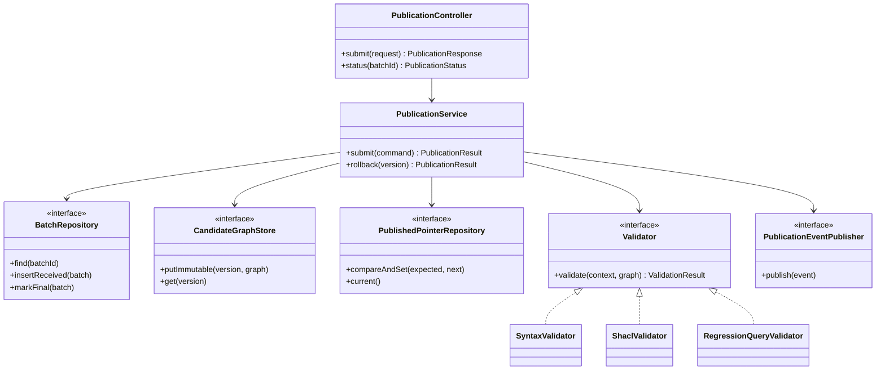

### Interfaces and value objects

```java
record PublicationCommand(
        String batchId,
        String sourceHash,
        String mappingVersion,
        String ontologyVersion,
        byte[] rdfPayload) {}

record ValidationContext(
        String batchId,
        String mappingVersion,
        String ontologyVersion) {}

record Violation(
        String code,
        Severity severity,
        String focusNode,
        String path,
        String message) {}

record ValidationResult(boolean conforms, List<Violation> violations) {}

sealed interface PublicationResult {
    record Published(String batchId, String graphVersion) implements PublicationResult {}
    record Rejected(String batchId, List<Violation> violations) implements PublicationResult {}
    record AlreadyCompleted(String batchId, String graphVersion) implements PublicationResult {}
}

interface Validator {
    ValidationResult validate(ValidationContext context, org.apache.jena.graph.Graph graph);
}
```

### Submission sequence

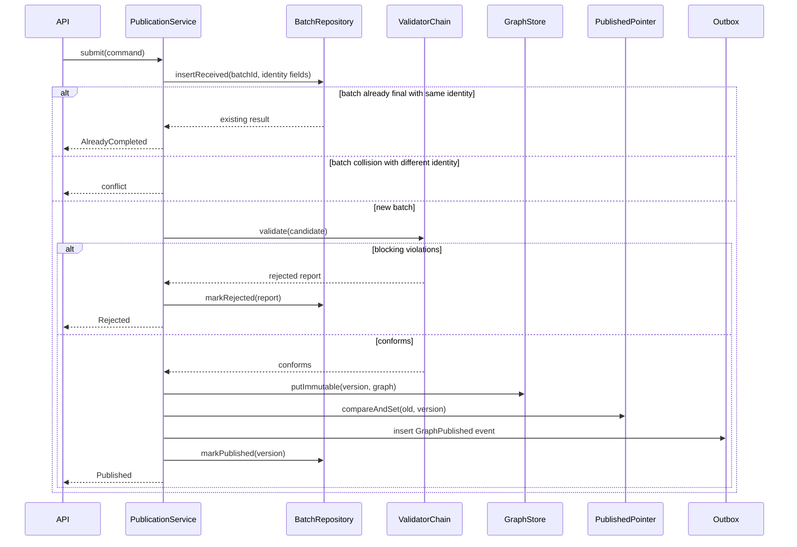

### Failure behavior

| Failure | Required behavior |
|---|---|
| Parser failure | Reject with syntax diagnostic; no staging/pointer change |
| SHACL violation | Store report and identity; no publication |
| Graph store fails before immutable write | Mark retryable; same batch resumes safely |
| Pointer compare-and-set conflict | Do not overwrite newer publication; re-evaluate or reject conflict |
| Outbox insert fails in same metadata transaction | Roll back pointer metadata transaction |
| HTTP response lost after success | Client retries same batch ID and receives prior result |
| Rollback requested | Validate target exists; atomically point to it; publish rollback event; retain history |

### Extension answers

- **New validator:** add a `Validator` implementation and configuration entry; orchestration does not change.
- **Streaming:** keep immutable micro-batch versions or define per-entity transaction semantics; do not merely call the batch method per event.
- **Concurrency:** serialize pointer changes through database compare-and-set/versioning; immutable graph writes can proceed independently.
- **Large payload:** upload to object storage, pass checksum/object reference, stream parse and preserve content hash.
- **Distributed transaction:** avoid pretending graph store + SQL are one ACID resource; use immutable graph then transactional metadata/outbox plus reconciliation/garbage collection.

## 25.2 LLD: parameterized SPARQL query service

```text
Classes:
QueryTemplate(id, text, allowedParameters, maxRows, timeoutClass)
QueryRegistry -> resolves reviewed templates only
ParameterBinder -> validates literal/IRI/datatype values
AuthorizationPolicy -> template + tenant + graph permission
QueryExecutor -> transaction, timeout, result limit, cancellation
ResultMapper -> stable API DTO
QueryAuditSink -> template ID, duration, row count, graph version, outcome

Invariant:
User input may bind values but cannot introduce query structure.

Tests:
valid literal/IRI, injection string, unauthorized graph, timeout, row limit,
store failure, duplicate rows, empty result and graph-version cache key.
```

## 25.3 LLD: ontology registry

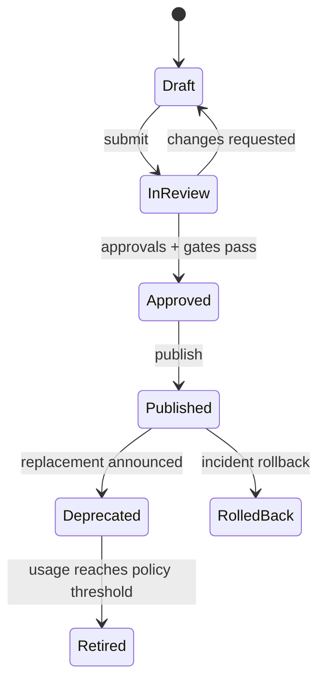

```text
Entities: OntologyArtifact, OntologyVersion, Dependency, Review, CompatibilityReport.
Commands: createDraft, submit, approve, publish, deprecate, rollback.
Rules: immutable published artifact; two-person approval if required; dependency
       versions explicit; no publish until syntax, consistency, competency and
       consumer compatibility gates pass.
```

## 25.4 LLD: RML job runner

```text
Job states: RECEIVED -> RUNNING -> MAPPED -> VALIDATED -> PUBLISHED
                         |            |           |
                         +----------> FAILED_RETRYABLE
                         +----------> QUARANTINED

Objects: MappingJob, Attempt, Checkpoint, SourceDescriptor, ArtifactVersion,
         JobCommand, JobResult, RetryPolicy.

Invariant: a job attempt writes only to a batch-scoped staging target; publication
is idempotent by batch ID and never exposes partial output.
```

## 25.5 LLD: semantic cache

```text
CacheKey = queryTemplateId + normalizedParameters + graphVersion
         + ontologyVersion + entailmentRegime + authorizationScope + format

CacheValue = immutable response + createdAt + sourceVersion

Never omit authorization scope or graph version.
Never use cache presence as proof that data is still authorized.
```

## 25.6 LLD: data-quality violation workflow

```text
Violation(id, batch, shape, focusNode, path, severity, message, status, owner)
Status: OPEN -> ACKNOWLEDGED -> FIX_IN_SOURCE | FIX_IN_MAPPING | WAIVED
     -> REPLAY_REQUESTED -> VERIFIED_CLOSED

Waiver requires reason, approver and expiry. Closing requires successful replay
or an explicit non-replay policy; manually changing status is not evidence.
```

---

# 26. Core Java and Spring answer bank

This section is the concise Festo-ready recall bank. For deeper generic follow-ups, use the existing [Goldman Java/JVM/concurrency bank](GOLDMAN_SACHS_VP_FINAL_REHEARSAL_SCRIPT.md#3-tier-c---javajvmconcurrency-rapid-bank), [Spring bank](GOLDMAN_SACHS_VP_FINAL_REHEARSAL_SCRIPT.md#4-tier-c---spring-and-spring-boot-rapid-bank), and [distributed-systems bank](GOLDMAN_SACHS_VP_FINAL_REHEARSAL_SCRIPT.md#5-tier-c---distributed-systems-and-risk-platform-design). The answers below retain only the compact wording and semantic-platform adaptations needed for this role.

## 26.1 Java language and collections - questions 1-25

| # | Question | Model answer |
|---:|---|---|
| 1 | `equals`/`hashCode` contract? | Equal objects must have equal hashes; equality is reflexive, symmetric, transitive, consistent and false for null. Keys must not mutate fields used by equality while in a hash map. |
| 2 | HashMap internals? | Hash spreads to bucket; collisions use nodes and may treeify at thresholds; expected O(1), worst-case higher. Capacity/load factor affect resizing and memory. |
| 3 | ConcurrentHashMap? | Thread-safe concurrent map with atomic compound APIs such as compute; iterators are weakly consistent. Individual method safety does not make multi-step business logic atomic. |
| 4 | ArrayList versus LinkedList? | ArrayList gives cache-friendly O(1) index and amortized append; LinkedList rarely wins except known-node link operations. Measure real access patterns. |
| 5 | ArrayDeque versus Stack? | ArrayDeque is the preferred non-thread-safe stack/queue, avoids legacy Stack synchronization and disallows null, which keeps empty semantics clear. |
| 6 | PriorityQueue? | Binary heap; O(log n) add/remove and O(1) peek. Iteration is not sorted. Comparator direction determines root. |
| 7 | TreeMap? | Red-black tree providing O(log n) ordered key operations, range views and navigation; comparator must be consistent with intended key identity. |
| 8 | Immutable collections? | `List.of` and `copyOf` prevent structural mutation but do not deep-freeze elements. Immutability simplifies sharing and reasoning. |
| 9 | Record? | Concise nominal data carrier with final components, generated accessors/equality/hash/toString; validate invariants in compact constructor. |
| 10 | Sealed class? | Restricts permitted implementations, improving exhaustiveness and domain modeling; use when the variant set is intentionally controlled. |
| 11 | Generics invariance? | `List<Dog>` is not `List<Animal>`. Use `? extends T` for producers and `? super T` for consumers (PECS). |
| 12 | Type erasure? | Most generic type information is removed at runtime, limiting generic arrays/instanceof and causing bridge methods; declared reflection metadata may remain. |
| 13 | Checked versus unchecked exceptions? | Checked can express recoverable boundary obligations but may pollute APIs; unchecked fit programming/invariant failures. Translate infrastructure exceptions into stable domain/API errors. |
| 14 | try-with-resources? | Closes `AutoCloseable` resources in reverse order and preserves close failures as suppressed exceptions. Essential for query executions/streams. |
| 15 | Optional? | Return type for possibly absent single value; avoid fields/parameters and `get()` without proof. It does not represent validation failure detail. |
| 16 | Streams lazy evaluation? | Intermediate operations build a pipeline; terminal operation evaluates. Avoid side effects and know encounter order/short-circuit behavior. |
| 17 | `map` versus `flatMap`? | map transforms one element to one result; flatMap transforms and flattens nested streams/optionals. |
| 18 | Parallel stream risk? | Common pool, splitting overhead, ordering, blocking I/O and unsafe side effects. Use only after measurement with suitable associative operations. |
| 19 | Comparator correctness? | Must be antisymmetric/transitive and consistent enough for sorted structures. Use chained comparators and avoid subtraction overflow. |
| 20 | String pool? | String literals are interned; `equals` compares content, `==` identity. Avoid manual interning of unbounded external data. |
| 21 | BigDecimal trap? | Construct decimal values from strings, define scale/rounding, and know `equals` includes scale while `compareTo` compares numeric value. |
| 22 | Defensive copying? | Copy mutable inputs/outputs at boundaries or expose immutable views; otherwise callers can break invariants after validation. |
| 23 | Fail-fast iterator? | Best-effort concurrent-modification detection, not a synchronization guarantee. |
| 24 | `computeIfAbsent` concern? | Mapping function should be short and side-effect controlled; recursion/contention/exceptions can surprise, and null result means no mapping. |
| 25 | Java 21 relevance? | Records, sealed classes, pattern matching and virtual threads can simplify models/concurrency, but use features where semantics/operations are understood. |

## 26.2 Concurrency and JVM - questions 26-50

| # | Question | Model answer |
|---:|---|---|
| 26 | Race condition? | Correctness depends on interleaving. Fix by establishing a state owner, immutability, atomic operation, lock or message serialization around the invariant. |
| 27 | `volatile`? | Provides visibility and ordering for reads/writes, not atomicity of compound actions such as increment. |
| 28 | `synchronized`? | Mutual exclusion plus happens-before visibility on monitor release/acquire; keep critical sections bounded and avoid external calls while locked. |
| 29 | ReentrantLock? | Explicit lock with timed/interruptible acquisition and conditions; must unlock in finally. Prefer only when features justify complexity. |
| 30 | AtomicInteger? | Lock-free atomic operations for one value; compound invariants across several variables still need a broader protocol. |
| 31 | Deadlock prevention? | Consistent lock ordering, short scopes, avoid nested external calls, timed acquisition where appropriate and diagnostics via thread dumps. |
| 32 | ExecutorService? | Separates task submission from thread management. Bound queue/pool, name threads, choose rejection policy and shut down gracefully. |
| 33 | CompletableFuture error handling? | Define executor, compose rather than block, set deadlines, preserve root causes, handle partial failure and cancellation, avoid common-pool blocking. |
| 34 | Virtual threads? | Cheap thread-per-task for blocking I/O; they do not make CPU faster or remove downstream/connection limits. Watch pinning and use concurrency limits. |
| 35 | Backpressure? | Producer must slow, buffer within a bound, shed or reject when consumer capacity is exceeded. An unbounded queue converts overload into memory failure and latency. |
| 36 | Happens-before? | JMM relation guaranteeing visibility/order across threads, established by locks, volatile, thread start/join and concurrent utilities. |
| 37 | Safe publication? | Make object reachable through final fields, static initialization, volatile, lock or concurrent container after construction; do not leak `this`. |
| 38 | ThreadLocal risk? | Values can leak across pooled tasks and retain memory. Remove in finally; prefer explicit context propagation. |
| 39 | Heap versus stack? | Heap stores objects shared across threads; each thread has stack frames/local references. JVM may optimize, so use this as conceptual model. |
| 40 | GC choice? | Start from latency/throughput/heap/SLO evidence. G1 is balanced; low-pause collectors trade resources differently. Measure with production-like allocation. |
| 41 | Memory leak in Java? | Reachable objects no longer useful: unbounded cache, listener, ThreadLocal, classloader or queue. Diagnose heap growth, dominators and allocation paths. |
| 42 | Stop-the-world? | Application threads pause for certain GC/runtime phases. Concurrent collectors reduce but do not remove every pause. |
| 43 | CPU spike diagnosis? | Correlate workload/metrics, capture profiles/thread dumps, distinguish GC, hot loop, contention, serialization and downstream retry storms. |
| 44 | High allocation diagnosis? | Allocation profile, object lifetime and request correlation; reduce unnecessary materialization only after identifying dominant allocations. |
| 45 | Class loading? | Loading, linking and initialization occur through classloaders; static initialization is thread-safe but failures and classloader leaks matter in containers. |
| 46 | JIT compilation? | Hot bytecode is compiled/optimized using runtime profiles; warm-up and deoptimization mean microbenchmarks need JMH. |
| 47 | Why JMH? | Handles warm-up, forks, dead-code elimination and measurement pitfalls. A loop around `nanoTime` is often misleading. |
| 48 | Graceful shutdown? | Stop accepting work, signal readiness false, drain within deadline, checkpoint/commit safely, close resources and make retries idempotent. |
| 49 | Structured concurrency idea? | Treat related concurrent tasks as one scope for lifetime, cancellation and failure; exact API availability/version must be checked. |
| 50 | Concurrency rule for graph writes? | Define transaction/state owner and graph-version invariant. Parallel mapping may be fine; visible publication must remain atomic and ordered. |

## 26.3 Spring Boot - questions 51-75

| # | Question | Model answer |
|---:|---|---|
| 51 | IoC/DI? | Container constructs/wires components so code depends on explicit abstractions; constructor injection makes required dependencies and tests clear. |
| 52 | Bean lifecycle? | Instantiate, inject, post-process, initialize, use, destroy; avoid heavy uncontrolled work in constructors and close owned resources. |
| 53 | Singleton thread safety? | Spring singleton means one instance per context, not thread-safe. Keep services stateless or synchronize/own mutable state deliberately. |
| 54 | `@Configuration` proxying? | Full configuration classes can proxy bean methods to preserve singleton semantics; prefer explicit parameter injection and understand lite mode differences. |
| 55 | `@Transactional` proxy trap? | Self-invocation bypasses proxy; method visibility/proxy type and checked-exception rollback rules matter. Put transaction boundary in an externally invoked service. |
| 56 | REST idempotency? | GET/PUT/DELETE semantics plus application idempotency keys for create/effectful requests. Persist key, request identity and result atomically. |
| 57 | Validation? | Bean Validation for transport shape, domain validation for business invariants, semantic validation for RDF graph; return stable problem details. |
| 58 | Exception handling? | Central advice maps known domain errors to stable status/code/detail/correlation; hide internal stack/implementation details. |
| 59 | Filter versus interceptor versus advice? | Filter is servlet boundary, interceptor wraps controller handling, advice handles controller concerns/errors. Choose the narrowest layer. |
| 60 | Configuration secrets? | Externalize through secret manager/environment injection, least privilege, rotation and no logging/source-control storage. |
| 61 | Profiles? | Coarse environment configuration tool; avoid branching business logic by profile and test effective production configuration. |
| 62 | Actuator? | Health, metrics and management endpoints; expose narrowly, secure separately and distinguish liveness from dependency readiness. |
| 63 | Liveness vs readiness? | Liveness says restart may help; readiness says stop routing traffic while unavailable/draining. Do not fail liveness for a transient downstream outage. |
| 64 | Timeout layers? | Client connect/read, server request, query execution and overall business deadline; propagate remaining budget and cancel work. |
| 65 | Retry? | Only transient/idempotent operations, bounded attempts/backoff/jitter, deadline-aware and observable. Do not retry validation errors. |
| 66 | Circuit breaker? | Stops repeated calls to an unhealthy dependency; not a substitute for timeouts/capacity and can create recovery spikes without careful half-open behavior. |
| 67 | Security filter chain? | Authenticate, authorize by resource/action, CSRF decision by client model, secure headers and separate admin endpoints. Default deny. |
| 68 | JWT risk? | Validate signature, issuer, audience, time and algorithm; keep tokens short-lived, avoid sensitive claims and plan revocation/rotation. |
| 69 | Controller test? | MockMvc/WebTestClient for transport contract and errors; service/unit tests for logic; integration test real serialization/security/config. |
| 70 | `@SpringBootTest` trade-off? | High-fidelity but slower/broader. Use slices/unit tests for fast feedback and a bounded number of context/integration tests. |
| 71 | Observability? | Micrometer metrics/tracing plus structured logs and domain IDs. Control cardinality; never tag metrics with raw IRIs/query text. |
| 72 | Database plus graph transaction? | Do not assume one transaction manager covers both. Use staged immutable artifacts, metadata/outbox and reconciliation. |
| 73 | API versioning? | Prefer compatible evolution; when breaking, version contract explicitly, measure consumers, support transition and document deprecation. |
| 74 | Content negotiation? | Explicit supported media types, deterministic error for unsupported input/accept, safe RDF parsing and bounded output. |
| 75 | Production startup? | Validate essential configuration/artifacts, fail fast on impossible invariants, avoid requiring every transient downstream for liveness and publish readiness only when safe. |

---

# 27. HLD model answers and diagrams

The architecture and Mermaid diagrams below remain inline because they are specific to an industrial semantic platform. Use the following projects for runnable implementations of the generic subsystems rather than creating duplicate code inside this document:

| Semantic-platform subsystem | Canonical project | What to transfer, not copy blindly |
|---|---|---|
| Industrial asset/catalog API | [Product Catalog API](../../../../SystemDesignProjects/product-catalog-api/README.md) · [ProductService.java](../../../../SystemDesignProjects/product-catalog-api/src/main/java/com/example/capstone/crud/product/ProductService.java) | API/domain/repository boundaries, validation and stable errors; replace product schema with ontology-backed asset views. |
| Graph-store distribution and recovery reasoning | [Distributed Database](../../../../SystemDesignProjects/distributed-database/README.md) · [ConsistentHashRing.java](../../../../SystemDesignProjects/distributed-database/src/main/java/com/example/distributeddb/ConsistentHashRing.java) | Partitioning, replication, append-only recovery and node membership; do not assume a graph store shares the same partition key. |
| RML/backfill job execution | [Distributed Task Scheduler](../../../../SystemDesignProjects/distributed-task-scheduler/README.md) · [JobWorker.java](../../../../SystemDesignProjects/distributed-task-scheduler/src/main/java/com/example/capstone/scheduler/worker/JobWorker.java) | Leases, retries, idempotent work, execution records and recovery. |
| Ingestion buffering and consumer ownership | [Message Queue Lab](../../../../SystemDesignProjects/message-queue-lab/README.md) · [MessageQueue.java](../../../../SystemDesignProjects/message-queue-lab/src/main/java/org/chijai/MessageQueue.java) | Bounded queues, delivery semantics and backpressure; add durable broker and replay requirements for production. |
| Version-aware semantic query caching | [Cache Lab](../../../../SystemDesignProjects/cache-lab/README.md) · [Cache.java](../../../../SystemDesignProjects/cache-lab/src/main/java/org/chijai/Cache.java) | Cache-aside, expiry and stampede concepts; key by graph version, query template and authorization scope. |
| Atomic metadata plus asynchronous publication | [Reliable Order Platform](../../../../SystemDesignProjects/reliable-order-platform/README.md) · [OutboxPublisher.java](../../../../SystemDesignProjects/reliable-order-platform/src/main/java/dev/interview/orders/outbox/OutboxPublisher.java) | Transactional outbox, idempotent consumer and reconciliation; map order events to graph-publication events. |
| Authentication and tenant boundaries | [Authentication Service](../../../../SystemDesignProjects/authentication-service/README.md) | Identity, authorization and security-filter boundaries; add graph/named-graph and ontology permissions. |
| Governed AI/GraphRAG extension | [Secure AI Risk Analyst Agent](../../../../SystemDesignProjects/ai-risk-fraud-investigation-assistant/README.md) · [AuditService.java](../../../../SystemDesignProjects/ai-risk-fraud-investigation-assistant/src/main/java/com/interview/fraud/platform/AuditService.java) | Retrieval/tool allowlists, audit, outbox and idempotency; replace fraud evidence with governed semantic evidence and citations. |

The [SystemDesignProjects learning order](../../../../SystemDesignProjects/LEARNING-ORDER.md) is the catalog, not an instruction to complete every project for this interview.

## 27.1 Complete HLD: industrial semantic data platform

### Requirement framing

```text
Functional:
- ingest SQL/files/APIs
- map to RDF with versioned mappings
- validate and quarantine
- publish immutable graph versions
- query through reviewed SPARQL/API contracts
- govern ontology versions and provenance
- replay/backfill/rollback

Non-functional questions to ask:
- source volume and update frequency?
- graph size and growth?
- query mix, result sizes and p95/p99 SLO?
- freshness target?
- availability, RPO and RTO?
- tenancy/data classification?
- reasoning regime and update cost?

Never invent numbers. Use symbols until Festo supplies them:
S sources, B batches/day, T triples/batch, G total triples,
Q queries/second, L p95 latency, R retention period.
```

### Component architecture

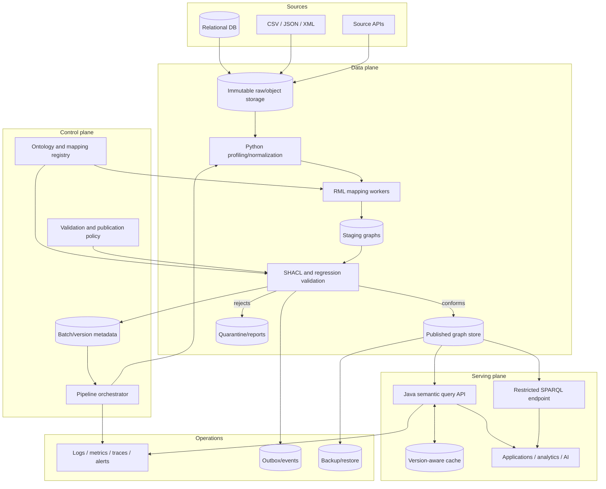

### Ingestion sequence

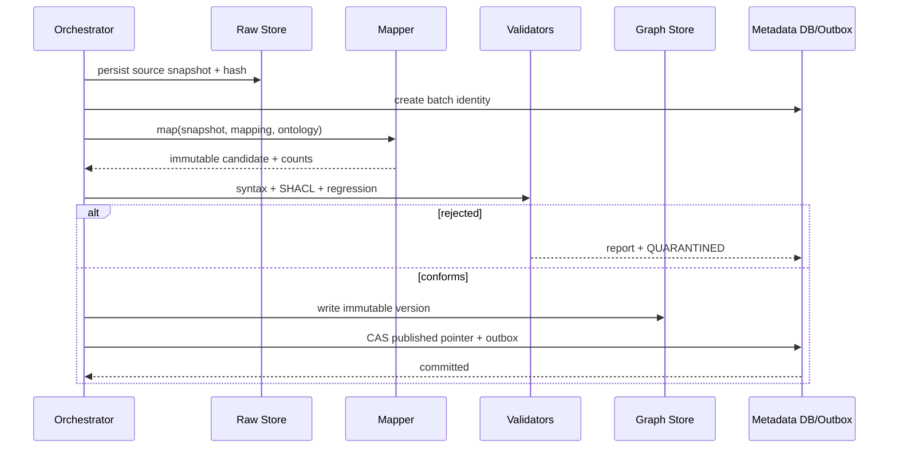

### Query path

```text
client -> authn/authz -> API template/parameter validation
       -> version-aware cache
       -> bounded read transaction/query execution
       -> DTO/content negotiation
       -> metrics/audit

Never place Python/RML/SHACL batch work on the synchronous query path.
```

### Storage choices

| Data | Store | Reason |
|---|---|---|
| Raw source snapshot | Object storage | Immutable, cheap, replayable, checksummed |
| Batch/version/status/outbox | Relational DB | Transactions, constraints, operational queries |
| Candidate/published RDF | Triple store/TDB2 or selected managed graph | SPARQL, named graphs, semantic tooling |
| Ontology/mapping/shapes | Versioned artifact registry + Git review | Reviewable, reproducible artifacts |
| Validation reports | Object storage + indexed metadata | Full diagnostics without bloating metadata DB |
| Cache | In-process/Redis only if measured | Bounded latency; keys include graph and auth versions |

### Consistency model

```text
- Raw and candidate artifacts are immutable.
- One metadata pointer identifies the current published graph version.
- Readers see either old or new complete version, never partial candidate.
- Publication event follows transactional outbox and is at-least-once.
- Consumers deduplicate by event ID and can query the version explicitly.
- Cross-store orphan artifacts are reconciled and garbage-collected after retention.
```

### Scaling plan

1. Partition ingestion workers by independent source/batch; cap concurrency by downstream capacity.
2. Stream parse/map large inputs to batch-scoped staging rather than materialize every triple in JVM/Python memory.
3. Maintain store statistics and workload-specific indexes.
4. Separate reviewed API queries from analyst/ad-hoc workload pools.
5. Add read replicas/caches only if the selected store and consistency contract support them.
6. Partition by tenant/domain only after analyzing cross-partition queries and reasoning.
7. Benchmark representative graph shape, not only triple count.

### Reliability and recovery matrix

| Failure | Detection | Automatic action | Human action/data proof |
|---|---|---|---|
| Source unavailable | fetch timeout/error rate | bounded retry | source owner escalation |
| Schema drift | contract mismatch | quarantine | approve mapping/source change |
| Mapper regression | golden/query count failure | block publication | rollback mapper and replay |
| SHACL violation spike | violations/batch metric | quarantine and alert | diagnose source vs mapping vs shapes |
| Triple-store write failure | transaction error | retry same immutable version | capacity/store incident if persistent |
| Query overload | queue/concurrency/latency | reject/shed/cancel | tune query/capacity after evidence |
| Bad ontology release | competency/production errors | pointer rollback | migration and consumer impact review |
| Region/site loss | health/availability | failover per DR design | restore validation and incident command |
| Corrupt backup | restore/check failure | use previous verified copy | root cause; backup chain repair |

### Security model

```text
identity: workload/user authentication with short-lived credentials
authorization: template/action/tenant/graph-level default deny
network: private store/admin endpoints and controlled egress/federation
data: classification, encryption at rest/in transit, least-privilege keys
input: size/type limits, safe RDF parser configuration, no arbitrary remote imports
query: parameter binding, time/result/concurrency limits, restricted SERVICE/update
secrets: managed store, rotation and no logs/Git
audit: actor, template/action, graph version, outcome and correlation ID
supply chain: pinned dependencies, SBOM, vulnerability/signature checks
```

### Observability

| Signal | Examples |
|---|---|
| Pipeline | source lag, batch duration, rows/triples, retry, quarantine, checkpoint age |
| Quality | conformance rate, violations by shape/severity/source, unmatched joins |
| Publication | current version, publish duration, CAS conflicts, outbox lag |
| Query | request rate, p50/p95/p99, timeout, rows, template ID, cache hit, store saturation |
| Runtime | CPU, heap, GC, threads, connection pool, disk and I/O |
| Business | assets/sensors/observations by source and freshness SLO |

Avoid high-cardinality metric labels such as raw IRI, batch ID or query text; keep those in controlled structured logs/traces.

### HA and disaster recovery

```text
RPO: ask how much published/raw data loss is tolerable.
RTO: ask how long query and publication can be unavailable.

Plan:
- immutable raw source and artifacts copied independently
- metadata DB backups/PITR
- graph-store supported consistent backup/snapshot
- versioned deployment/config/ontology/mapping artifacts
- isolated scheduled restore drill
- post-restore SHACL, count, hash, competency-query and API smoke checks
- documented failover and rollback ownership
```

## 27.2 HLD: low-latency semantic query service

```text
SLO first -> reviewed query templates -> parameter binding -> authorization
-> admission control -> graph-version cache -> bounded store execution
-> stable DTO -> metrics.

Deep dives:
- keyset pagination
- query cost and timeout
- cache/version invalidation
- separate interactive/ad-hoc pools
- partial/degraded responses only when contract permits
- protect store with concurrency quotas and result limits
```

## 27.3 HLD: ontology governance platform

```text
authoring branch -> syntax/consistency tests -> competency queries
-> consumer compatibility -> domain review -> approval -> immutable release
-> shadow validation -> publication -> usage monitoring -> deprecation/migration.

The platform stores decisions and provenance; it does not replace domain ownership.
```

## 27.4 HLD: multi-tenant knowledge platform

```text
Option A: store per tenant    strongest isolation, highest operations cost
Option B: dataset per tenant  good isolation, moderate cost
Option C: named graph         efficient sharing, greatest authorization/leak risk

Decision inputs: data classification, tenant count/size, cross-tenant queries,
backup/restore granularity, noisy-neighbor SLO and legal isolation.
```

## 27.5 HLD: GraphRAG extension

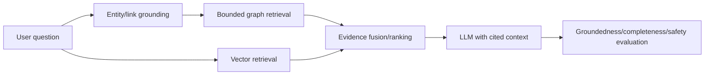

Model answer:

> I would add GraphRAG only after establishing authoritative identity, provenance and access control. I would compare it against a simpler vector/BM25 baseline using task-specific answer quality, groundedness, latency and cost. The LLM never becomes the source of truth; retrieved evidence and evaluation remain explicit.

---

# 28. Testing and quality answer bank

## 28.1 Semantic test pyramid

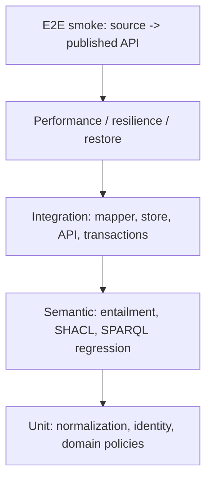

The diagram is not a count prescription. Keep many fast deterministic tests, fewer integration tests and a very small set of end-to-end proofs.

## 28.2 Complete quality-gate matrix

| Layer | Test | Passing evidence | Failure caught |
|---|---|---|---|
| Source contract | required/unexpected columns, types, nulls | deterministic parser result | schema drift |
| Normalization | IDs, units, timezones, decimals | golden normalized file | inconsistent identity/value |
| RML mapping | source fixture -> expected graph | graph isomorphism + counts | wrong predicate/IRI/join |
| RDF syntax | parse every generated artifact | zero parser errors | malformed RDF |
| Ontology | consistency and expected entailments | reasoner results | contradiction/model regression |
| SHACL | valid + one fixture per violation | exact conformance/results | missing/invalid graph data |
| SWRL/rules | positive, negative, boundary | exact inferred facts | over/under inference |
| SPARQL | competency/regression queries | canonical bindings/graphs | query semantic regression |
| Java unit | parameter validation/mapping | JUnit pass | local logic error |
| Python unit | transforms/contracts/idempotency | pytest pass | pipeline logic error |
| SQL | migration/query/integration | container DB assertions | dialect/constraint/plan issue |
| Store integration | transaction/publish/rollback | old/new version isolation | partial visibility |
| API contract | status/schema/security | MockMvc/contract assertions | breaking transport change |
| Performance | representative graph/workload | p95/p99 + resource budget | cardinality/GC/index issue |
| Resilience | store/network/disk fault | bounded failure/recovery | retry storm/data loss |
| Backup/restore | isolated restore | query/hash/API checks | unusable backup |
| Security | authz/injection/size/federation | negative tests | data leak/DoS/injection |

## 28.3 Testing questions and answers

| # | Question | Model answer |
|---:|---|---|
| 1 | Unit test or integration test? | Unit isolates deterministic policy; integration verifies real boundaries/config/protocol. Use both for different failure classes. |
| 2 | Mocking rule? | Mock owned abstraction boundaries, not every value object or third-party internal; excessive mocking tests implementation rather than behavior. |
| 3 | Golden RDF tests? | Small input maps to an expected graph compared semantically/isomorphically, not raw serialization order or blank-node labels. |
| 4 | Negative SHACL tests? | At least one focused fixture per constraint plus combinations to ensure reports remain diagnostic and target selection is correct. |
| 5 | Entailment test? | Assert expected inferred fact and important non-entailments on minimal ontology/data; pin reasoner/profile. |
| 6 | SPARQL result ordering? | Result sets are unordered unless `ORDER BY`; tests should compare sets or require explicit order. |
| 7 | Property-based testing? | Generate IDs/values/graphs within constraints to test invariants such as normalization idempotency and no duplicate publication. |
| 8 | Mutation testing? | Changes code operators to see whether tests fail; useful for critical policy, but cost and semantic artifact tooling must be evaluated. |
| 9 | Contract testing? | Verifies provider/consumer API expectations; it does not prove semantic meaning unless domain assertions are included. |
| 10 | Testcontainers? | Real disposable DB/store integration increases fidelity; pin image version, control startup/data and avoid making every unit test heavy. |
| 11 | Flaky test handling? | Quarantine only temporarily with owner/deadline; find nondeterminism, clocks, ordering, shared state or external dependency. Do not normalize reruns as success. |
| 12 | Performance test dataset? | Representative graph topology, selectivity, literals and inference—not only the same triple count. |
| 13 | Load versus stress versus soak? | Load validates expected traffic, stress finds limit/degradation, soak exposes leaks/drift over time. |
| 14 | Chaos test? | Controlled hypothesis about resilience under a fault, bounded blast radius, observable steady state and abort conditions. |
| 15 | CI quality gate? | Fast deterministic correctness first, then semantic/integration/security checks; block publication on declared critical failures. |
| 16 | Code coverage? | A navigation signal, not quality proof. Prioritize invariant, branch, boundary and failure behavior. |
| 17 | Test clock? | Inject Clock/time source so expiry/window logic is deterministic; do not sleep in unit tests. |
| 18 | Replay test? | Run the same batch twice and prove identical output/no duplicate visible state; run corrected version and prove lineage. |
| 19 | Migration test? | Upgrade a realistic prior schema/ontology/store snapshot, validate consumers and test rollback limits. |
| 20 | Definition of done? | Reviewed code/artifacts, passing declared gates, operational metrics/runbook, rollout/rollback plan and observed acceptance evidence. |

## 28.4 CI/CD gate diagram


---

# 29. DevOps, cloud, security and production answer bank

## 29.1 Linux and Bash

| Question | Model answer / command family |
|---|---|
| Process consuming CPU? | `ps`, `top`/`pidstat`, JVM process/thread mapping, then profile/thread dump; do not kill before collecting evidence unless impact demands it. |
| Port/listener check? | `ss -lntp` or platform equivalent; then service/process ownership and firewall/network path. |
| Disk issue? | `df -h`, `df -i`, `du` on bounded paths, open deleted files with `lsof`; preserve evidence and avoid blind deletion. |
| Log search? | Structured query by correlation/batch/version; `rg`/`grep`, `journalctl` with time/service bounds. Avoid secrets in command output/history. |
| HTTP diagnosis? | `curl --fail-with-body -v` for DNS/TLS/status/timing, then dependency metrics; do not disable certificate verification as a fix. |
| Bash safety? | `set -euo pipefail` with understood caveats, quote variables, validate paths, use arrays, trap cleanup, avoid parsing `ls`, return non-zero on failure. |
| Idempotent script? | Observe state, make only required change, verify postcondition; repeated execution has same safe result. |
| Signal handling? | Process should handle SIGTERM, stop readiness, drain/checkpoint within deadline and exit; SIGKILL gives no cleanup. |

## 29.2 Docker and Kubernetes

| Question | Model answer |
|---|---|
| Good container image? | Minimal trusted base, non-root, pinned dependencies, multi-stage build, no secrets, SBOM/scan/signature and immutable tag/digest. |
| Layer/cache concern? | Copy dependency descriptors before source when useful; keep secrets out because deleting later does not remove prior layers. |
| Liveness/readiness/startup probes? | Liveness for stuck process, readiness for safe traffic, startup for slow initialization. Wrong liveness can create restart loops. |
| Requests/limits? | Requests drive scheduling; limits cap resources. CPU throttling and memory OOM behavior must be tested against JVM/container settings. |
| ConfigMap versus Secret? | Both are configuration objects; Secret encoding is not encryption by itself. Use encryption/RBAC/external secret management and rotation. |
| Deployment strategy? | Rolling, blue/green or canary chosen by compatibility and rollback. Ontology/data changes require version compatibility beyond pod rollout. |
| Stateful graph store in Kubernetes? | Possible but operationally demanding: storage latency, backup consistency, quorum/failover and restore ownership. Managed or dedicated deployment may be safer. |
| Pod termination? | Readiness false, preStop only when needed, SIGTERM, drain, bounded grace period and idempotent in-flight recovery. |
| Horizontal scaling? | Stateless API can scale on workload signals; stateful store and batch workers need partition/capacity coordination, not replica count alone. |
| Network policy? | Default deny, allow required service/port flows and control egress so SPARQL federation/import cannot access arbitrary networks. |

## 29.3 AWS/Azure and architecture

| Question | Model answer |
|---|---|
| AWS deployment option? | API on ECS/EKS/EC2 or serverless where fit; raw/versioned artifacts in S3; metadata in RDS; graph in selected managed/self-hosted store. Decide from SLO, scale, skill and cost. |
| Managed graph database? | Reduces operations but creates capability/portability/cost constraints. Benchmark required SPARQL, reasoning, bulk load, backup and auth. |
| IAM design? | Workload roles, least privilege, short-lived credentials, separate read/publish/admin actions and explicit resource conditions. |
| S3 versioning enough for backup? | No. Add retention/immutability where required, cross-account/region strategy, encryption and restore verification. |
| Multi-AZ versus multi-region? | Multi-AZ handles zone failure; multi-region adds latency, consistency, cost and failover complexity. Derive from RTO/RPO. |
| Queue use? | Decouple bounded asynchronous work and absorb bursts; still need idempotency, visibility timeout, poison handling and DLQ replay policy. |
| Object event guarantee? | Treat notifications as at-least-once and potentially reordered; reconcile against source of truth. |
| Cloud portability? | Preserve portable domain/artifacts and isolate provider adapters, but do not pay for hypothetical portability everywhere. Document exit path for critical managed services. |
| Cost controls? | Storage growth/retention, query/compute classes, egress, batch scheduling, rightsizing and per-tenant/source attribution. |
| Azure equivalent? | Map capabilities—Blob Storage, Azure Database, AKS/Container Apps, Key Vault, Monitor—while checking service-specific behavior rather than claiming exact equivalence. |

## 29.4 Security

| # | Threat | Control answer |
|---:|---|---|
| 1 | SPARQL injection | Parameter binding, reviewed templates and structural whitelisting |
| 2 | Expensive query denial of service | Auth, quota, timeout, row limit, concurrency pool, cancellation and workload separation |
| 3 | Federated-query SSRF | Disable/restrict `SERVICE`, egress allowlist and network policy |
| 4 | Malicious RDF/parser input | Size/depth/type limits, patched parser, controlled remote resolution and sandboxed processing |
| 5 | Cross-tenant graph leak | Tenant-aware authorization, isolation tests and cache key scope |
| 6 | Sensitive literals in logs | Redaction, structured allowlisted fields and access/retention controls |
| 7 | Provenance tampering | Immutable artifacts, hashes/signatures, restricted publish path and audit |
| 8 | Secret leakage | Secret manager, short-lived roles, rotation, scans and never Git/logs/images |
| 9 | Dependency compromise | Pinning, trusted repositories, SBOM, signature/provenance and vulnerability response |
| 10 | Unauthorized ontology change | RBAC, review/approval, signed release, compatibility gates and audit |
| 11 | Backup exposure | Encryption, separate credentials/account, access logging, retention and restore environment controls |
| 12 | LLM data exfiltration | Approved model/tenant, minimize data, no raw confidential graph by default, policy filters and audit/evaluation |

## 29.5 Incident response model

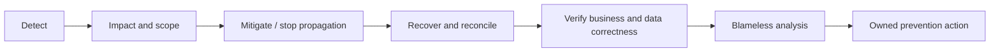

Spoken incident answer:

```text
1. State user/business impact and current safety risk.
2. Assign incident command and preserve a timeline.
3. Stop propagation: rollback, pause publication, shed query load or isolate source.
4. Recover service and then reconcile data; uptime alone is not correctness.
5. Verify with graph versions, counts, SHACL, competency queries and consumer smoke.
6. Identify contributing system conditions, not only the triggering person/action.
7. Create owned, prioritized prevention work and verify it closes the failure mode.
```

## 29.6 AI and agentic coding

| Question | Model answer |
|---|---|
| How would you use an agentic coder? | Give a bounded task, trusted context and acceptance tests; review diff, run tests/scans and keep human ownership of semantics/security. |
| Main risk with ontology generation? | Plausible but incorrect meanings, duplicate terms and overstrong equivalence. Require domain review and competency/entailment tests. |
| RAG versus GraphRAG? | RAG retrieves text/chunks; GraphRAG adds entity/relationship-aware retrieval. Compare against simple baselines on quality, latency and cost. |
| How evaluate? | Curated questions, expected evidence, correctness/groundedness/completeness, citation accuracy, refusal/safety, latency and cost. |
| Hallucination control? | Authoritative retrieval, constrained output, citations, validation and refusal; never claim it is eliminated. |
| Prompt injection from graph/text? | Treat retrieved content as data, not instructions; isolate tools, allowlist actions, enforce authorization and sanitize outputs. |
| LLM for SPARQL? | Generate candidate query only; parse, restrict, explain/estimate, bind parameters, run in bounded read-only environment and verify results. |
| AI resilience of role? | Routine query/mapping code will be assisted; domain semantics, governance, production correctness and accountable architecture remain differentiated. |

---

# 30. Behavioral, managerial and HR answer bank

These are complete **answer structures**, not fabricated autobiography. Replace every bracket with a fact you can prove. Never invent scale, money, latency, outage duration or ownership.

## 30.1 Tell me about yourself - 90 seconds

> I am a backend-focused software engineer with more than eight years of experience, primarily in Java, Spring Boot, REST APIs, SQL, cloud and production delivery. At Morgan Stanley and Nasdaq, I worked on business-critical systems where correctness, reliability and clear ownership mattered. My strongest contribution is turning ambiguous requirements into maintainable services and operating them responsibly. I am now deliberately moving deeper into data and architecture. This role interests me because it combines a Java backend with semantic modeling, data-quality validation and end-to-end pipelines in an industrial domain. I want to be precise about my current boundary: my production strength is backend/platform engineering; I am building demonstrable RDF, OWL, SPARQL, SHACL and RML depth rather than claiming years I do not have.

## 30.2 Why Festo?

> Three things stand out. First, industrial automation has complex, long-lived product and engineering semantics, so a knowledge graph can solve a real integration and governance problem. Second, Festo's published global scale and R&D investment suggest that digital platforms can have meaningful reach. Third, the role combines my existing Java, SQL, cloud and production strengths with the data/semantic architecture direction I want. I would use the interviews to understand whether the team owns a strategic platform and how it measures success.

## 30.3 Why this role despite the semantic-experience gap?

> I would not misrepresent the gap. The explicit semantic stack is newer than my core Java/backend experience. The reason the move is credible is that I already bring the adjacent senior engineering capabilities the platform needs: API and service design, SQL/data handling, reliability, CI/CD, cloud, incident ownership and technical communication. I am closing the technology-specific gap through a working vertical slice that maps data with RML concepts, validates with SHACL, queries with SPARQL and serves it through Java/Jena. The key hiring question is whether Festo needs an immediately established ontology specialist or values a senior platform engineer who can demonstrate the semantics and grow quickly.

## 30.4 Why are you leaving?

> I am grateful for [specific real learning/responsibility]. I am not leaving to escape one incident or person. I am looking for a role with deeper ownership of [data/platform/architecture], where I can combine production backend experience with governed data and AI-facing systems. I am evaluating Festo on that scope rather than changing only for a title.

## 30.5 Strongest technical contribution - STAR

```text
Situation: [business system and real constraint]
Task: [your explicit ownership]
Action:
- measured/observed [bottleneck or correctness risk]
- evaluated [alternatives]
- designed/implemented [specific component]
- added [tests, rollout, metrics, recovery]
Result: [verified metric or concrete operational/delivery result]
Learning: [trade-off or what you would change]
Festo bridge: [identity, data quality, pipeline, Java service or reliability]
```

## 30.6 Major failure

> I made/approved [specific decision] based on [assumption]. The assumption was wrong because [evidence]. The impact was [truthful impact]. I first [mitigation/recovery], then [reconciliation and stakeholder communication]. My part of the failure was [ownership without self-destruction]. We changed [test, review, telemetry, process or design], and the observed evidence was [real proof]. The lesson was [specific changed behavior], not simply “communicate more.”

## 30.7 Production incident

> The first signal was [alert/user report] and the business impact was [impact]. I separated service availability from data correctness, assigned/used a timeline and narrowed the first failing boundary through [metrics/logs/traces/query]. We mitigated by [bounded action], restored service and then reconciled [state/data]. The root cause involved [technical condition], with contributing factors [test/rollout/observability]. I owned [specific prevention], which was verified by [test/drill/metric].

## 30.8 Conflict with teammate or manager

> We disagreed about [decision], not personal intent. I first restated the shared outcome and the other view. I brought [benchmark/design note/customer constraint], identified which assumptions differed and proposed [experiment/decision criterion]. We chose [decision] through [owner/process]. I supported the decision even where my option was not selected, and the result was [truthful]. I learned [specific behavior].

## 30.9 Handling ambiguity

> I convert ambiguity into a small set of explicit questions: user, decision, input/output, invariants, failure behavior and success measure. For [real example], I wrote [API/ADR/prototype], separated reversible from irreversible decisions and delivered a thin slice. I kept unknowns visible rather than silently deciding domain semantics. The outcome was [truthful evidence].

## 30.10 Prioritization

> I rank by customer/business impact, risk, urgency, dependency and reversibility. I make capacity and trade-offs visible, protect correctness/security work and define what will not be done. In [example], this meant [choice], communicated to [stakeholders], with [outcome].

## 30.11 Mentoring

> I first diagnose whether the gap is context, concept, practice or confidence. In [example], I used [pairing/design review/small ownership], gave a clear quality bar and reduced support gradually. Evidence was [independent delivery/review quality/incident handling], not that I held training sessions.

## 30.12 Working independently

> Independence means progressing with explicit assumptions and checkpoints, not disappearing. I clarify the outcome and decision rights, make a small plan, surface risk early and bring evidence at agreed points. I escalate when authority or business meaning is missing.

## 30.13 Multinational team communication

> I use written decisions, explicit owners, timezone-aware handoffs and concise context. I avoid relying on meetings or idioms, confirm decisions asynchronously and distinguish urgency from timezone convenience. My example is [truthful cross-region delivery].

## 30.14 Salary expectation

> I would like to understand the level, scope and complete fixed/variable structure before anchoring. For a move, I am looking for a package that reflects my eight-plus years, the specialist expectations and the commute/working model. My decision will compare fixed cash, realistic variable, benefits and career scope—not only headline CTC. What range is approved for this level?

If forced to provide a number, use a researched range consistent with your current compensation and minimum acceptable move; do not copy a generic public band blindly.

## 30.15 Notice period

> My contractual notice period is [exact]. I will follow the formal process and can explore a responsible release with my employer, but I will not promise an early date until it is approved. I can complete interview and documentation steps during the notice period.

## 30.16 Strength and weakness

```text
Strength:
My strength is [specific capability], demonstrated when [evidence]. It matters here
because [role connection].

Weakness:
A real current gap is production depth in the semantic stack. I am addressing it
through [specific build/measure], while being clear about what is and is not proven.
Do not present a disguised strength.
```

## 30.17 First 30/60/90 days

```text
0-30 days:
- learn domain vocabulary, ontology governance, sources, consumers and SLOs
- run the platform locally and shadow incidents/reviews
- close one small documented defect or quality gap

31-60 days:
- own one mapping/query/service change end to end
- add a missing regression/observability gate
- document one architecture/operational decision

61-90 days:
- own a bounded production outcome
- propose an evidence-backed performance/reliability improvement
- agree the next skill/ownership milestone with manager
```

## 30.18 HR and managerial questions with short answers

| Question | Short answer direction |
|---|---|
| Why should we hire you? | Senior production backend depth + honest, demonstrated semantic ramp + ownership/communication. |
| Where in five years? | Staff/principal or architecture ownership across governed data/AI platforms; avoid title-only promise. |
| What motivates you? | Solving consequential ambiguous systems with visible correctness/learning; support with example. |
| What demotivates you? | Do not attack people; name a condition and how you constructively improve it. |
| Handling pressure? | Triage impact, reduce scope, communicate trade-offs, protect correctness and recover; give example. |
| Multiple deadlines? | Make priorities/dependencies visible, negotiate scope/order and provide checkpoints. |
| Difficult stakeholder? | Understand incentive/decision right, use evidence/options and document agreement. |
| Team player? | Specific cross-team outcome and behavior, not “I collaborate well.” |
| Leadership without authority? | Shared outcome, evidence, small coalition, decision mechanism and credit to team. |
| Ethical concern? | Stop/contain harm, preserve evidence, use policy/escalation and avoid retaliatory/public disclosure. |

## 30.19 Questions you must ask before joining

```text
ROLE
- What exact production system and business outcomes does this role own?
- What percentage is ontology, mapping, Java, Python, support and stakeholder work?
- Is 7+ semantic years a hard bar or an ideal profile?

TECHNOLOGY
- Which graph store, reasoner, SHACL/RML/SWRL implementations and versions?
- Graph size, update frequency, query SLO and largest current bottleneck?
- How are ontology compatibility, provenance and rollback governed?

TEAM
- Team size, reporting line, locations, attrition and why the role is open?
- On-call, incident frequency, Europe overlap and engineering decision process?

SUCCESS
- What must be independently delivered at 30, 90 and 180 days?
- What distinguishes a strong senior engineer from an average one here?

OFFER
- Level, fixed/variable, benefits, review cycle, notice handling?
- Exact office days, core hours, transport and Bommasandra location expectation?
```

---

# 31. Complete mock interviews with answer keys

Do not read the answer key during an attempt. Record actual evidence and repair only the misses.

## 31.1 Mock A - semantic specialist screen, 60 minutes

### Questions

```text
00-04  1. Explain RDF to a senior relational-data engineer.
04-08  2. RDFS domain/range: constraint or inference? Give a failure example.
08-12  3. Explain open world and no-unique-name assumptions.
12-17  4. Model Machine, Sensor and Observation. Why is Observation a node?
17-22  5. OWL versus SHACL: which catches a missing serial number and why?
22-27  6. Write SPARQL for the latest observation per sensor.
27-31  7. Why might several OPTIONAL patterns explode row counts?
31-35  8. Design a stable IRI policy for data from three source systems.
35-39  9. Explain an RML triples map and how joins/nulls fail.
39-43 10. What is SWRL, and where would you refuse to use it?
43-47 11. Materialization versus query-time reasoning.
47-51 12. How do you version and roll back an ontology?
51-54 13. How do you test the whole semantic pipeline?
54-57 14. Secure a SPARQL endpoint.
57-60 15. State your real experience boundary and 90-day ramp.
```

### Answer key

| # | Must contain for full credit |
|---:|---|
| 1 | Graph/triples/term types; model vs serialization; one identity benefit and one trade-off |
| 2 | Entailment semantics; unintended typing example; SHACL for operational validation |
| 3 | Missing != false; different names may denote same entity; effect on cardinality/validation |
| 4 | Observation carries value/unit/time/provenance; stable IDs and relationships |
| 5 | OWL meaning/inference/consistency; SHACL target/path/cardinality/report; missing serial -> SHACL |
| 6 | Correct anti-join/subquery pattern, deterministic ties, indexes/plan follow-up |
| 7 | Left-join multiplicity and filters/unbound semantics; pre-aggregate/split if valid |
| 8 | Immutable canonical keys, source mapping, collision/migration/privacy and governance |
| 9 | logical source + subject map + predicate-object maps; normalization, duplicate/missing join and tests |
| 10 | Horn-like ontology inference; engine/safety/termination; no workflow/side effects |
| 11 | read latency/storage/update/retraction vs query cost; workload-driven hybrid |
| 12 | immutable artifact/version metadata, compatibility gates, deprecation/migration, pointer rollback |
| 13 | source, mapping golden, syntax, OWL, SHACL, rule, SPARQL, integration, performance, restore |
| 14 | authn/authz, template/bind, update/federation restriction, timeout/result/concurrency, audit |
| 15 | honest gap, adjacent senior value, working proof, measurable first 30/60/90 outcomes |

### Scoring

```text
2 = accurate, concise, example/trade-off and boundary
1 = generally correct but shallow or missing operational consequence
0 = incorrect, conflates technologies or bluffs

24-30: strong specialist screen
18-23: viable; repair every zero and the weakest ones
12-17: foundational gaps remain
 0-11: reset recruiter expectation; do not bluff
```

## 31.2 Mock B - practical semantic exercise, 90 minutes

### Mock B prompt

You receive this data:

```csv
machine_id,sensor_id,value,unit,observed_at
M1,S1,75.0,C,2026-11-04T10:00:00Z
M1,S1,95.0,C,2026-11-04T10:05:00Z
M2,,42.0,C,2026-11-04T10:02:00Z
```

Deliver:

1. Identity policy and RDF model.
2. Mapping outline.
3. SHACL constraints.
4. SPARQL query returning latest temperature per machine.
5. Handling of the invalid third row.
6. Java/Python service boundary.
7. Idempotency, monitoring and replay design.

### Model solution

```text
Identity:
machine IRI = .../machine/{normalized machine_id}
sensor IRI  = .../sensor/{normalized sensor_id}
observation IRI = .../observation/{source-system}/{stable source event id}
If the source lacks an event ID, use a documented canonical hash of source identity,
not row position alone.

Model:
Machine --hasSensor--> Sensor --madeObservation--> TemperatureObservation
Observation has numericValue decimal, unit IRI, observedAt dateTime and sourceBatch.

Invalid row:
Missing sensor_id violates the source contract and SHACL relationship/cardinality.
Quarantine the row or entire batch according to declared atomicity; do not mint
"sensor-null" or publish partial data silently.

Boundary:
Python profiles/normalizes and writes an immutable normalized artifact.
RML maps it. Java/Jena validates, publishes and serves bounded queries.
Both share versioned contracts and batch identity, not in-memory coupling.
```

SHACL core:

```turtle
ex:TemperatureObservationShape a sh:NodeShape ;
    sh:targetClass ex:TemperatureObservation ;
    sh:property [ sh:path ex:observedBy ; sh:minCount 1 ; sh:maxCount 1 ; sh:class ex:Sensor ] ;
    sh:property [ sh:path ex:numericValue ; sh:minCount 1 ; sh:maxCount 1 ; sh:datatype xsd:decimal ] ;
    sh:property [ sh:path ex:unit ; sh:minCount 1 ; sh:maxCount 1 ; sh:nodeKind sh:IRI ] ;
    sh:property [ sh:path ex:observedAt ; sh:minCount 1 ; sh:maxCount 1 ; sh:datatype xsd:dateTime ] .
```

Latest per machine:

```sparql
PREFIX ex: <https://example.festo-prep.invalid/ontology/>
SELECT ?machine ?observation ?time ?value
WHERE {
  ?observation a ex:TemperatureObservation ;
               ex:forAsset ?machine ;
               ex:observedAt ?time ;
               ex:numericValue ?value .
  FILTER NOT EXISTS {
    ?later a ex:TemperatureObservation ;
           ex:forAsset ?machine ;
           ex:observedAt ?laterTime .
    FILTER (?laterTime > ?time)
  }
}
ORDER BY ?machine ?observation
```

Operational answer:

```text
batch ID = hash(source snapshot + mapping version + ontology version)
staging graph is immutable
validation blocks pointer promotion
metrics = rows, triples, violations, duration, lag, publish version
retry only transient stages; semantic errors quarantine
replay uses same raw snapshot and new declared artifact versions
```

### Rubric

| Area | Points |
|---|---:|
| Identity and model are stable/explainable | 4 |
| Mapping/null policy | 3 |
| SHACL correctness | 4 |
| SPARQL correctness/tie discussion | 4 |
| Java/Python boundaries | 3 |
| Idempotency/failure/replay | 4 |
| Communication and assumptions | 3 |
| **Total** | **25** |

## 31.3 Mock C - Java live coding, 60 minutes

### Mock C prompt

Implement a bounded in-memory cache for semantic query results. Requirements:

```text
- key includes query template, normalized parameters and graph version
- fixed capacity
- get/put O(1) expected
- LRU eviction
- updating a key refreshes recency
- no concurrency required initially
- explain TTL and distributed follow-ups without implementing them
```

### Expected solution

Use the `LruCache` solution in Section 24, but replace integer key with:

```java
record QueryCacheKey(
        String templateId,
        String normalizedParameters,
        String graphVersion,
        String authorizationScope,
        String responseFormat) {}
```

Full-credit follow-up:

```text
- graph version in key makes publication naturally miss old cache entries
- authorization scope prevents cross-user/tenant data leak
- TTL is separate from LRU capacity and needs an injected Clock
- distributed cache needs serialization, size limits, invalidation/version strategy
- cache stampede can use single-flight/request coalescing with bounded waits
- do not cache arbitrary huge query results
```

Failure codes:

```text
P pattern miss       I invariant miss      C coding/syntax
E edge case          T time                X complexity/trade-off
SEC auth/cache leak  V unclear narration
```

## 31.4 Mock D - HLD, 60 minutes

### Mock D prompt

Design a platform that ingests industrial product data from 20 sources, converts it to a governed knowledge graph, validates every publication and serves low-latency search/query APIs globally.

### Interview order and answer key

```text
00-05 Clarify volume/freshness/query/SLO/tenancy/reasoning/RPO/RTO.
05-10 Define immutable version + atomic published pointer invariant.
10-18 Draw sources, raw store, orchestrator, mapper, validator, graph store, API.
18-25 Explain identity, ontology/mapping versions, named graphs and provenance.
25-32 Deep dive validation/publish transaction and cross-store consistency.
32-38 Deep dive query path, limits, cache/version and admission control.
38-44 Scale ingestion/query separately; backpressure and workload pools.
44-50 Failure, replay, HA, backup and verified restore.
50-55 Security and tenant isolation.
55-60 Observability, bottleneck, cost and one explicit trade-off.
```

Red flags:

- drawing Kafka before clarifying freshness/volume;
- claiming exactly once without idempotency/reconciliation;
- exposing arbitrary SPARQL directly;
- treating SHACL and OWL as interchangeable;
- overwriting the live graph during validation;
- no graph/ontology version in cache or API;
- backup without restore proof;
- invented scale/SLO numbers presented as facts.

## 31.5 Mock E - project and behavior, 45 minutes

```text
1. Tell me about yourself.                         3m
2. Why Festo/semantic engineering?                 3m
3. Deep dive one Nasdaq/Morgan Stanley project.   12m
4. Hardest production incident.                    7m
5. Disagreement or ambiguous decision.             5m
6. Exact semantic-experience boundary.              4m
7. First 90 days.                                  4m
8. Your questions to the manager.                  7m
```

Full-credit standard:

```text
- personal ownership is explicit
- every metric is real or omitted
- architecture has one clear invariant and trade-off
- incident includes recovery plus data/business verification
- conflict uses evidence and decision mechanism
- gap is honest with concrete proof/ramp
- candidate questions test role quality, not perform curiosity
```

## 31.6 Master readiness score

| Domain | Weight | Evidence required |
|---|---:|---|
| RDF/RDFS/OWL/modeling | 15 | Mock A + whiteboard model |
| SPARQL/optimization | 15 | 10 queries from blank + plan reasoning |
| SHACL/SWRL/RML | 15 | valid/invalid fixtures + mapping/rule explanation |
| Java/Spring/Jena | 10 | working thin slice or timed code review |
| Python/data pipeline | 10 | deterministic tested transform |
| SQL | 5 | window query + optimization viva |
| LLD/HLD | 10 | one timed design each |
| Testing/DevOps/security | 5 | failure and gate walkthrough |
| Project/behavior | 10 | recorded answers with truthful evidence |
| Opportunity diligence | 5 | recruiter/manager facts captured |

```text
85-100: ready; repair only observed misses
70-84: interview viable; repair the lowest two domains
55-69: material specialist gaps; clarify expectations before scheduling
<55: do not bluff; negotiate scope/time or deprioritize
```

---

# 32. Final-hour complete recall sheet

## 32.1 Ten definitions

```text
RDF     = graph facts as triples
RDFS    = lightweight class/property schema and entailment
OWL     = formal ontology axioms and richer reasoning
SPARQL  = RDF query/update language
SHACL   = targeted operational graph validation and reports
SWRL    = Horn-like OWL-linked rule proposal; engine/safety limits matter
RML     = heterogeneous source-to-RDF mapping language
Jena    = Java semantic-web framework
Fuseki  = Jena SPARQL server
TDB2    = Jena persistent transactional dataset store
```

## 32.2 Ten boundaries

```text
model != serialization
missing != false under open world
different IRIs != automatically different individuals
OWL meaning/inference != SHACL validation
SHACL validation != source correction workflow
SWRL inference != operational side effects
RML mapping != ontology definition
graph algorithm != knowledge graph expertise
backup success != restore success
plan/file presence != completion evidence
```

## 32.3 Ten production invariants

```text
1. Stable business identity never depends on mutable labels.
2. Every published graph identifies source, mapping, ontology and validation versions.
3. Candidate data is invisible until validation succeeds.
4. Publication is an atomic version-pointer change.
5. Same batch ID cannot create a second logical publication.
6. User values are bound, never concatenated into SPARQL syntax.
7. Query time, rows, concurrency and graph access are bounded.
8. Cache key includes graph version and authorization scope.
9. Replay is deterministic and observable.
10. Recovery ends with semantic/business verification, not process uptime.
```

## 32.4 Ten query reminders

```text
start selective
state result grain
OPTIONAL is left join
FILTER placement changes meaning
joins multiply before aggregation
ORDER BY is required for order
property paths can be expensive
LIMIT/OFFSET is not stable keyset pagination
inspect actual plan/statistics
test expected bindings and performance
```

## 32.5 Ten design reminders

```text
requirements before components
identity/version before storage
invariant before classes
source of truth before cache
state owner before concurrency
timeout before retry
idempotency before at-least-once delivery
failure/recovery before happy-path polish
authorization before endpoint exposure
trade-off and rejected alternative before closing
```

## 32.6 Last 60-minute sequence

| Minute | Action |
|---:|---|
| 00-10 | Speak RDF/RDFS/OWL/open-world/SHACL boundaries |
| 10-20 | Write one latest-per-group SPARQL and one optimization explanation |
| 20-28 | Write one SHACL NodeShape and explain report fields |
| 28-36 | Explain RML stable identity, nulls, joins and replay |
| 36-44 | Draw source -> map -> validate -> publish -> query architecture |
| 44-50 | Speak Java/Jena transaction and API security controls |
| 50-55 | Tell two-minute project story and semantic gap answer |
| 55-58 | Select five manager questions |
| 58-60 | Stop studying; water, breathing, setup |

## 32.7 Opening and closing scripts

Opening:

> I will first clarify the domain and correctness contract, then state the simplest baseline and the invariant before I code or draw. I will keep explicit what the JD confirms, what I am assuming and what I would measure.

Honest gap:

> My deepest production experience is Java/backend, SQL, cloud and reliable delivery. I will not claim seven years of semantic production work. I can demonstrate the concepts and a working vertical slice, and I would like to understand whether Festo needs an immediately established ontology specialist or a senior platform engineer who can ramp rapidly.

Design close:

> The design's core is immutable, traceable candidates and atomic promotion of a validated graph version. The main risks are identity/model evolution, query cardinality, cross-store publication failure and governance. I would validate the design with representative graph shape, competency queries, failure injection and a restore drill.

Interview close:

> Based on our discussion, the role seems strongest where semantic governance meets production platform engineering. Before deciding, I would like to confirm the exact stack, the architecture-versus-maintenance split, success measures, on-call/working model and whether the stated semantic-years requirement is flexible for demonstrated adjacent senior experience.

## 32.8 Final no-bluff rule

```text
If you know it: answer, example, trade-off, stop.
If partly known: state the boundary, derive from fundamentals, verify.
If unknown: say what is unknown and how you would determine it.
Never replace missing production experience with confident vocabulary.
```
