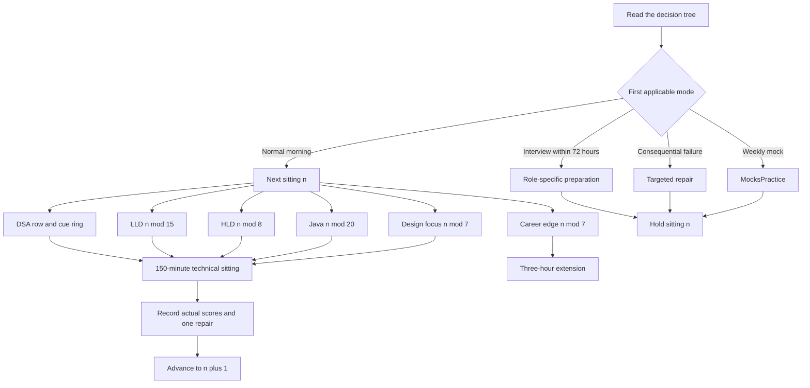
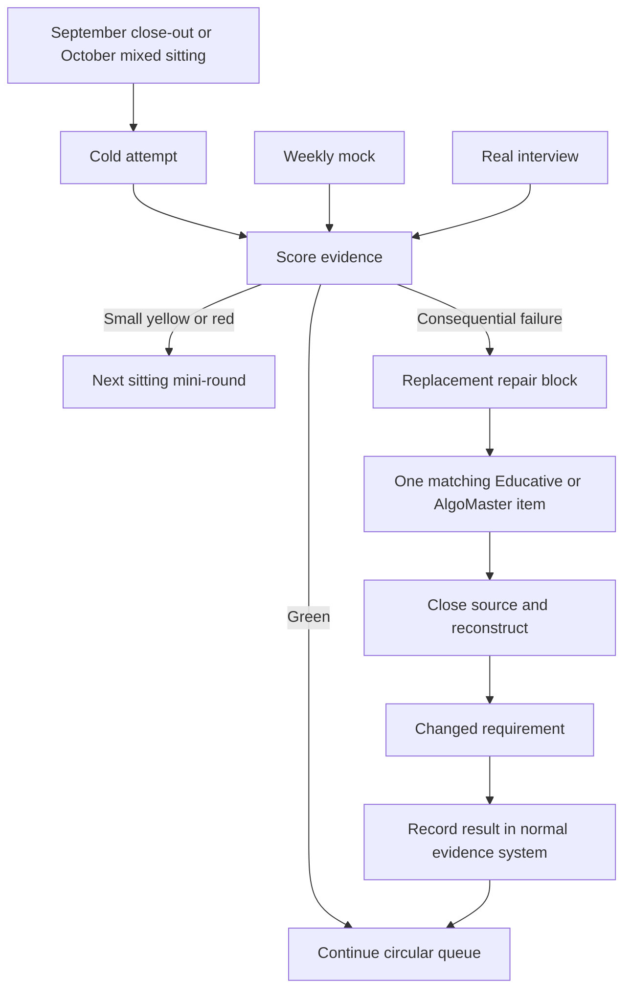

# Start here — one interview preparation operating system

**Current as of 20 September 2026.** This page is the front door for the files created and revised in this conversation. Its job is to end broad preparation by 30 September, keep interview skills retrievable afterward, protect recovery, and turn applications and real interview evidence into offers. The stop date ends the *syllabus sprint*; it does not mean every question is mastered or that an offer is due.

## What “coach” means here

The **mixed-sitting coach** is a local Node script at [mixed-sitting.mjs](../../../../review-os/coach/mixed-sitting.mjs). It reads the existing DSA/design/Java source lists, prints the next 150-minute card, records your *actual* scores in `G:\TechStudyNotes\review-os\coach\mixed-sitting-state.json`, and advances a session pointer only after you run `done`. It is a scheduler and score log, not a tutor, interviewer, FSRS engine, or proof of readiness. Its [user-facing workout and first 88 rows](OCTOBER_150_MIN_MIXED_INTERVIEW_CIRCUIT.md) are the main October artifact.

The **scheduled Codex task** named **Daily interview coach and job links** runs at 06:45 IST in this conversation. From 5 October it reads the next mixed-sitting card and shares it here, and it searches for fresh verified jobs. It never completes a sitting or applies to a job for you. If the computer or app is unavailable, run `plan` yourself. Email delivery is not active.

**MocksPractice** is a separate adaptive mock-interview system. It generates and freezes an unseen question paper, runs the candidate attempt, viva and scoring, and sends corrections to Review OS. It is the readiness *test*. The mixed-sitting coach is the repeated training *workout*. [Review OS](../../../../review-os/README.md) owns spaced-review dates for cards that have recorded attempts. Do not count a quick cue as a solved problem or record one attempt as multiple independent proofs.

## The only daily decision tree

Read top to bottom; the first applicable row wins. A replacement activity never adds a second technical quota that day.

| Situation | Do exactly this | Advance the 150-minute queue? |
| --- | --- | --- |
| **20–30 September** | Follow the dated [September hourly wins](SEP_20_30_2026_INTERVIEW_READY_HOURLY_WINS.md). At 09:00 IST on 30 September, record actual evidence and write `PREP CLOSED`; carry at most three exact gaps. | Not started. |
| **1–4 October bridge** | Use the short bridge blocks in the September file. | No. |
| **Real interview within 72 hours** | Use the September file's interview override: format-specific mock or question, one targeted repair, company/project story, logistics, sleep. Open the relevant [Goldman](GoldmanSachs_Master_Revision_DSA_LLD_HLD.md), [Point72](Point72_Master_Revision_HackerRank_SQL_DSA_LLD_HLD.md), or [Wells Fargo](WellsFargo_Master_Revision_DSA_LLD_HLD.md) sheet only for that confirmed format. | No; resume the held row afterward. |
| **Weekly mock day** | In the **MocksPractice project chat**, send `START MOCK Compressed` as the bounded default. Attempt cold, then send `DONE` and complete the viva. Review its scorecard and choose at most one consequential repair. | No; the mock replaces the sitting. |
| **Normal morning with 180 minutes** | Run the 150-minute mixed-sitting `plan`, then use the fixed 30-minute career edge below. | Yes, after a real completed sitting only. |
| **Normal day with 150 minutes** | Run the mixed-sitting `plan`; follow its exact clock; score once with `done`. | Yes, after a real completed sitting only. |
| **Office, low-energy, or recovery day** | Do the 20-minute minimum in the [mixed circuit](OCTOBER_150_MIN_MIXED_INTERVIEW_CIRCUIT.md) using the **same next row**. | No. |
| **A consequential real/mock failure** | Use the next available 150-minute block for the *exact* failed code move or design requirement. This repair replaces that day's numbered sitting. If the issue is small, use the next card's built-in mini-round instead. | No for a replacement repair block. |
| **Three unproductive days or a rejection stall** | Apply the seven-day lighter recovery protocol in the September file, keep one small retrieval and one job action, then resume the held row. | No until a full sitting is completed. |

**Week structure:** Use one mock in each calendar week. The first three weeks of a four-week cycle are build weeks; the fourth is lighter with brief retrieval and `START MOCK Micro` instead of a full new-coverage quota. A full sitting is available on any day you truly have 150 minutes; Mon/Tue office days may use the 20-minute minimum. Applications/referrals take a separate 10–20-minute action on up to five suitable days, with no poor-fit quota filling. These are capacity limits, not a command to make up missed rows at night.

## Default 180-minute morning — one command, one sitting, one career edge

Use this from **5 October** on a normal morning when three hours are genuinely available. It wraps the existing 150-minute circuit; it does not create another technical queue.

| Clock | Minutes | Do exactly this | Evidence / stop rule |
| --- | ---: | --- | --- |
| 00:00–02:30 | 150 | Run `node G:/TechStudyNotes/review-os/coach/mixed-sitting.mjs plan` and follow the printed [mixed-circuit clock](OCTOBER_150_MIN_MIXED_INTERVIEW_CIRCUIT.md). This already contains three DSA turns, five rapid DSA cues, LLD, HLD, Java/backend, spaced changed-constraint recall, scoring, and one repair. | Run `done` only after the full sitting with actual scores. Stop every lane at its boundary. |
| 02:30–02:45 | 15 | **Job-funnel action:** submit one relevant application, send one authorized referral request/follow-up, or record `zero suitable roles today` after checking the verified links. | A sent action or an honest zero-fit entry. Saving a link is not evidence. Maximum one action; no poor-fit quota filling. |
| 02:45–03:00 | 15 | Do the sitting's **E01–E07 career-edge prompt printed by `plan`** from memory, then inspect one source only if needed. | One dated answer, query, story outline, or diagram. Stop at 15 minutes; do not turn it into a course session. |

### Fifteen-minute career-edge circular queue

This queue uses the same absolute sitting number as the technical circuit, so a missed weekday cannot repeatedly starve one area. After E07, return to E01.

| Edge | Exact prompt | Green evidence |
| --- | --- | --- |
| **E01 Résumé impact story** | Give one 2-minute `context → problem → action → measurable result → lesson` story from Morgan Stanley, Nasdaq, or another real project. Answer two likely follow-ups. | Concrete ownership, scale/result, trade-off, and no invented metric. |
| **E02 SQL and database reasoning** | Write or explain one query/index/execution-plan problem: joins, aggregation/windowing, pagination, isolation, locking, indexing, or a slow-query diagnosis. | Correct query or plan reasoning, one edge case, and one performance consequence. |
| **E03 Project architecture** | Explain one local project end to end: entry point, request/data path, state, concurrency, failure, observability, and one production limitation. | Five-minute coherent walkthrough plus one changed requirement. |
| **E04 Behavioral and leadership** | Answer one senior-engineer prompt: disagreement, incident, mentoring, prioritization, failure, influence without authority, or ambiguous requirements. | Specific situation, your decision, consequence, learning, and concise follow-ups. |
| **E05 Trading and risk domain** | Explain one domain flow: order lifecycle, pre-trade control, market data, exposure/limits, venue connectivity, reconciliation, or failure recovery. | Correct actors/data path, invariant, latency/failure concern, and one business trade-off. |
| **E06 System communication** | Take today's LLD or HLD and deliver a clean 10-minute interviewer-style explanation without code or notes; spend five minutes answering interruptions. | Structured requirements, decisive choices, one rejected alternative, and clear trade-off. |
| **E07 Evidence and funnel control** | Run `status`, read the latest mock scorecard, count sent job actions/screens, and fill the weekly score line below. | One priority for the next seven sittings; no new syllabus or backlog creation. |

**Warmth coverage:** The 150-minute core touches DSA, LLD, HLD, and Java/backend every completed sitting. Its circular queues rotate 263 DSA URLs, 15 LLDs, 8 HLDs, and 20 Java questions. The E01–E07 ring keeps résumé evidence, SQL, project explanation, behavioral leadership, trading/risk language, communication, and weekly control active every seven completed sittings. The job-funnel block keeps preparation connected to real interviews.

The queues choose **what to retrieve**. Scores measure the attempt. Repair, mocks, recovery, and the 72-hour interview rule choose **whether the normal queue runs at all**. Keeping those controls outside the circular content rings prevents an urgent failure or booked interview from waiting for its turn.

**Replacement rules still win:** A mock replaces the 150-minute circuit; its generation, 60-minute Compressed attempt, grading, and viva have variable wall-clock time, so use the rest of the three-hour window for the mock and its feedback rather than promising another quota. A consequential repair replaces the numbered sitting. A live interview within 72 hours replaces the whole normal morning. The fourth lighter week and the three-bad-day protocol use their smaller prescribed load. A missed morning leaves the queue where it is and creates no catch-up debt.

## Exact course protocol — courses repair a named gap; dashboards never choose the day

Educative and AlgoMaster are **source libraries**, not parallel curricula and not completion goals. Never open a course because its dashboard says “continue,” because a progress bar is incomplete, or because today's mixed row felt uncomfortable. A course earns time only after a cold mixed sitting, mock, or real interview produces a named failure. The course block replaces the matching practice lane or a consequential-repair sitting; it is never added after the normal quota.

### The one repair loop

1. Write one sentence: `I failed ___ because I could not ___`.
2. Attempt the exact skill cold before opening a lesson. Save code, a diagram, or a spoken-answer note.
3. Open **one** matching lesson or problem for **at most 20 minutes**. Read only enough to identify the missing trigger, invariant, data path, trade-off, or Java rule.
4. Close the lesson. Reconstruct the same skill from blank for **20–30 minutes**, then handle one changed constraint.
5. Score the closed-book retry. Record one exact remaining miss through the normal mixed-sitting/Review OS evidence flow. Stop; do not continue to the next lesson.

The useful completion unit is a **closed-book retry**, not a watched/read lesson, solved example, chapter, certificate, course percentage, or streak.

| Resource | Open it only when | Exact bounded use | Required output / stop rule |
| --- | --- | --- | --- |
| [Educative system-design roadmap](https://www.educative.io/interview-prep/system-design?page=roadmap) | The HLD lane, a mock, or a real interview exposes one named gap such as partitioning, consistency, caching, queues, idempotency, capacity, or failure recovery. | Start with a 10–15-minute blank design. Read only the matching concept/example for up to 20 minutes. Close it and redraw the request/data path, state, failure handling, scale choice, and one trade-off in 20–30 minutes. | A fresh diagram and a 5-minute explanation that survives one changed requirement. Do not traverse the roadmap top to bottom. |
| [Educative Decode the Coding Interview in Java](https://www.educative.io/courses/decode-coding-interview-java) | A DSA pattern remains Y/R after a cold attempt, or a mock shows that a real-world statement could not be mapped to a known pattern. | Search the course for the failed move; use one feature or DIY challenge. Attempt it cold, inspect one explanation, then recode from blank. Prefer a problem whose implementation move is absent from today's three DSA prompts; deduplicate against the local 263-question ledger. | Runnable Java, edge tests, invariant, complexity, and a 60-second explanation. Do not work through its 389 lessons/195 challenges sequentially. |
| [AlgoMaster dashboard](https://algomaster.io/dashboard) | The mixed queue or a mock needs one unseen validation problem, or the 263-question ledger has a confirmed implementation-family gap. | Select one problem from the named weak pattern. Check whether it duplicates a local problem. If duplicate, add a changed constraint or choose a distinct implementation move. Use the normal 40-minute DSA standard and inspect its explanation only after scoring. | One cold score and one exact failure/repair. Do not run an independent AlgoMaster daily streak or second problem queue. The logged-in track inventory must be mapped before claiming unique coverage. |
| [Educative coding-pattern mock](https://www.educative.io/mock-interview?category_id=coding-interviews&interview_id=coding-patterns-general) | You want an external coding calibration, ideally once in a four-week cycle, or a booked round closely matches its format. | It **replaces** that week's `START MOCK Compressed`; use the platform timer and attempt cold. Do not run both mocks in the same week to satisfy a quota. | Save the asked question, where you broke, score/feedback, and at most one repair. It does not advance the mixed-sitting pointer. |

**Calendar rule:** Through 30 September, follow the dated September plan; use a course only inside its scheduled repair block for an observed miss. During the 1–4 October bridge, at most one 45-minute course repair may replace a bridge technical block. From 5 October onward, the mixed circuit chooses normal work; the table above activates only from evidence. A real interview within 72 hours may select one role-relevant module, but no broad course begins in that window.

**Name check:** the supplied dashboard URL is **AlgoMaster**. Earlier notes also say **AlgoMonster**, which is a different product. Do not merge their progress or inventories unless both subscriptions and their exact tracks are deliberately audited.

### How courses enter the operating loop

The course platforms do not select the next task. Evidence from a cold sitting, mock, or real interview selects a single repair; successful reconstruction returns the work to the same circular queue.

## Commands — which surface, what it changes

| Where | Exact command or message | What happens |
| --- | --- | --- |
| PowerShell, any directory | `node G:/TechStudyNotes/review-os/coach/mixed-sitting.mjs plan` | **Read-only.** Shows the next 150-minute card and local links. Starts at sitting 1. |
| PowerShell | `node G:/TechStudyNotes/review-os/coach/mixed-sitting.mjs status` | Shows next number and recorded coverage. A zero today means this new log has no evidence; it does not erase your earlier ~90 attempts. |
| PowerShell, **after** full work | `node G:/TechStudyNotes/review-os/coach/mixed-sitting.mjs done G G Y G Y G GGYGU "one exact repair"` | Replace example scores with your six lane results, five cue results (three on the short cue row), and exact repair or `none`. Records evidence and advances **one** sitting. On the two-DSA final row, use `-` for short DSA 2. Never run this for a skipped/minimum day. |
| PowerShell | `node G:/TechStudyNotes/review-os/coach/mixed-sitting.mjs plan 89` | Read-only preview of any absolute sitting number; LLD/HLD/Java rings continue past row 88. |
| **MocksPractice project chat**, not a terminal | `START MOCK Compressed` | Creates a blinded four-slot mock. **60 minutes is candidate attempt time**; generation, grading and viva add time. Use as the weekly default when the whole day is bounded. |
| MocksPractice project chat | `DONE` | Submit the completed attempt, answer the viva, then receive score/editorials and Review OS corrections. Do not run mixed-sitting `done` for this mock. |
| MocksPractice project chat | `START MOCK Standard` / `START MOCK Full` / `START MOCK Micro` | Candidate attempt budgets are **120 / 180 / ~20 minutes**, respectively, **plus** generation and DONE/viva time. Standard or Full is for a larger breadth checkpoint when that extra wall-clock time is available; Micro fits a recovery week. Shorter modes have less coverage, not higher difficulty. |
| Review OS project chat | `review` | Runs due mixed revision through Review OS. Use it for due corrections or a planned replacement block, not as extra work after a completed 150-minute sitting. |
| PowerShell | `G:\TechStudyNotes\review-os\scripts\review-all.cmd daily` | Read-only view of due Review OS work across decks. Rate a matching card only after the actual attempt, through the Review OS workflow. |

The earlier `G:\TechStudyNotes\review-os\coach\coach.cmd plan` generates a **different calendar-based cue schedule**. It is retained for historical comparison and diagnostics. **Do not run it as a second daily plan** alongside the mixed-sitting queue. Its `record-day`, `record`, and `status` write/read a different event log and do not advance the mixed-sitting pointer.

## Which file has which job

**One mission:** produce cold, explainable interview performance while keeping the application funnel active. The files are a library around that mission, not 42 parallel plans. The normal path is:

`this page → dated September plan (through 30 Sep) → next mixed circuit row (from 5 Oct) → score → one exact repair when needed → weekly blinded mock → applications and real interviews → repeat`

Only the **September plan** and then the **October circuit** choose a normal day's work. A mock, live-interview override, or consequential repair **replaces** the normal circuit for that day. Ledgers record evidence; reference files answer a specific question after a cold attempt. Neither a saved URL nor reading a solution counts as a solved interview problem.

| Artifact | Role in the system | When to open it |
| --- | --- | --- |
| [September hourly wins](SEP_20_30_2026_INTERVIEW_READY_HOURLY_WINS.md) | Closes the finite preparation sprint; contains rejection, three-bad-day, job-search, and interview-call overrides. Its older October calendar paragraphs are superseded by this page and the mixed circuit. | Now through 30 September; later only for overrides. |
| [150-minute mixed circuit](OCTOBER_150_MIN_MIXED_INTERVIEW_CIRCUIT.md) | **Primary October workout** with exact clock, 88-row table, prompt links, local Java references, and score rules. | Each normal full sitting from 5 October. |
| [263-question DSA ledger](DSA_FULL_COLD_ATTEMPT_LEDGER.md) | Source inventory and detailed DSA history. Its printed order is for lookup, not the practice sequence. Mark the earlier ~90 hands-on items only where you can identify them; do not invent green cold scores. | After a full DSA attempt or one-time history check, not as a second daily queue. |
| [24-anchor pattern wheel](DSA_PATTERN_WHEEL_24.md) and [seven-day v15 sheet](DSA_7-Day_Hourly_WIN_FINAL_v15_HighSignal_Pattern_Triggers.md) | High-signal pattern explanations and prior preparation provenance. | When a failed pattern needs a precise repair or a source example; no parallel A01 cursor. |
| [Four-domain warm-up](DAILY_FOUR_DOMAIN_WARMUP.md) and [earlier coach guide](../../../../review-os/coach/README.md) | Earlier calendar-cue design retained as reference. The current 20-minute minimum is in the mixed circuit. | Only to inspect the earlier model or diagnose its generated cues. |
| [Requirement audit snapshot](INTERVIEW_PREP_REQUIREMENTS_AND_DELIVERY_AUDIT_2026-09-20.md) | Records what was built and unproved before this single-entry-point correction. | For traceability; use the gap table below for current decisions. |
| [MocksPractice](../../../../MocksPractice/README.md) | Blinded interview assessment, feedback, changed constraints and correction scheduling. | Weekly mock day and role-specific interview practice. |
| [LLD learning order](../../../../LLDProjects/docs/LLD_LEARNING_ORDER_ROI_RANKING.md), [HLD catalog](../../../../SystemDesignProjects/LEARNING-ORDER.md), Java/deep company sheets, Educative, AlgoMaster (and AlgoMonster only if separately owned) | Source/reference libraries. The mixed card selects a bounded interview core; a confirmed gap can promote one distinct move. | After a cold attempt or for a booked format, never as blanket daily reading. |

### Complete map of this folder — every top-level Markdown file

The status in the middle column is the instruction: **Run** means it can select work; **Record** holds evidence; **Lookup** is opened for an exact gap; **Historical** is retained for provenance, not a second queue. The [22 pattern chapters and their index](patterns/README.md) sit under `patterns/` and are lookup pages, not 23 more daily tasks.

| Role / status | Files in this folder | How they connect |
| --- | --- | --- |
| **Control — Run** | [Current operating system](START_HERE_INTERVIEW_OPERATING_SYSTEM.md) · [September hourly wins](SEP_20_30_2026_INTERVIEW_READY_HOURLY_WINS.md) · [October mixed circuit](OCTOBER_150_MIN_MIXED_INTERVIEW_CIRCUIT.md) | Open this page first. Run September until its close-out; from 5 October use the circuit's **one next row**. |
| **Evidence — Record** | [263-item DSA cold-attempt ledger](DSA_FULL_COLD_ATTEMPT_LEDGER.md) · [DSA recall ledger](DSA_RECALL_LEDGER_v1.md) · [Java recall ledger](JAVA_RECALL_LEDGER_v1.md) · [active-recall failure ledger](ACTIVE_RECALL_FAILURE_LEDGER.md) · [review dashboard](06_REVIEW_DASHBOARD.md) | The mixed coach's `done` log is the daily sitting record. Use these for named historical attempts, exact misses, or their existing review workflows. Do not copy one attempt into several independent green scores. The dashboard is a read view over the older DSA review data, not the mixed pointer. |
| **Company / format — Lookup after a call** | [Goldman master](GoldmanSachs_Master_Revision_DSA_LLD_HLD.md) · [Goldman VP rehearsal](GOLDMAN_SACHS_VP_FINAL_REHEARSAL_SCRIPT.md) · [Point72 master](Point72_Master_Revision_HackerRank_SQL_DSA_LLD_HLD.md) · [Point72 morning order](POINT72_TREASURY_TOMORROW_MORNING_STUDY_ORDER.md) · [Wells Fargo master](WellsFargo_Master_Revision_DSA_LLD_HLD.md) | When a confirmed round matches the format, take only its relevant questions, stories and logistics into the 72-hour override. The dated morning order is historical. |
| **Fast DSA retrieval — Lookup** | [Pattern recognition 80/20](00_PATTERN_RECOGNITION_80_20.md) · [one-line recall](02_ONE_LINE_RECALL_ALL_PROBLEMS.md) · [crisp interview answers](03_CRISP_INTERVIEW_ANSWERS.md) · [one-hour table](14_ONE_HOUR_BEFORE_INTERVIEW_MASTER_TABLE.md) · [21 one-page cards](DSA_21_Pattern_Cards_One_Page_Recall_FINAL.md) · [21 reconstruction cards](DSA_21_Pattern_Cards_CUSTOMER_READY_FINAL.md) · [24-anchor pattern wheel](DSA_PATTERN_WHEEL_24.md) · [audited pattern OS](DSA_MUST_MEMORIZE_PATTERN_OS_FINAL_AUDITED.md) | Open **one** representation of the failed pattern or one brief pre-interview cue. These are overlapping views, not additive quotas. |
| **DSA indexes / explanations — Lookup** | [Ranked table](01_ZERO_TO_HERO_RANKED_TABLE.md) · [ranking audit](05_RANKING_METHODOLOGY_AND_AUDIT.md) · [solved index](07_LEETCODE_SOLVED_INDEX.md) · [project/pattern tree](08_PROJECT_STRUCTURE_AND_PATTERN_TREE.md) · [curriculum TOC](09_LEETCODE_CURRICULUM_TOC.md) · [articulation table](12_MASTER_DSA_INTERVIEW_ARTICULATION_TABLE.md) · [complexity table](13_MASTER_TIME_SPACE_COMPLEXITY_TABLE.md) · [pattern chapters](patterns/README.md) | Find a local solution, disambiguate a pattern, or repair an explanation or complexity proof **after** attempting. Do not follow the ranked order as a second queue. |
| **Older DSA maps — Historical lookup** | [150 brain map](DSA_150_Human_Brain_Mind_Map.md) · [170 base map](DSA_170_Brain_Map.md) · [170 final map](DSA_170_Brain_Map_FINAL.md) · [170 Java-skeleton map](DSA_170_Brain_Map_With_Java_Skeletons.md) | Alternative visual/summary views of overlapping DSA material. Use a specific row if helpful; no independent completion target. |
| **Earlier schedules — Historical** | [Two/seven-day plans](04_TWO_DAY_AND_SEVEN_DAY_PLANS.md) · [after-seven-day extension](10_AFTER_7_DAY_EXTENSION_PLAN.md) · [90-problem cutoff](11_ACTIVE_90_PLAN_CUTOFF_AND_EXTENSION.md) · [18-problem hourly schedule](DSA_18_Problems_Hourly_Schedule_All_Original_Columns.md) · [seven-day performance sprint](DSA_7-Day_Interview_Performance_Sprint.md) · [seven-day v15 hands-on record](DSA_7-Day_Hourly_WIN_FINAL_v15_HighSignal_Pattern_Triggers.md) · [earlier four-domain warm-up](DAILY_FOUR_DOMAIN_WARMUP.md) | Your v15 hands-on pass remains real history. These schedules explain previous choices or supply a targeted drill. Their clocks, cursors and quotas do not run alongside the current plan. |
| **Earlier entry points — Historical pointers** | [Folder README / DSA cockpit](README.md) · [Goldman-era study roadmap](START_HERE_INTERVIEW_STUDY_SEQUENCE_AND_ROADMAP.md) | Both now point here. The roadmap's 10 September Goldman instructions are historical; neither is a competing front door. |
| **Audit — Traceability** | [Requirements and delivery audit](INTERVIEW_PREP_REQUIREMENTS_AND_DELIVERY_AUDIT_2026-09-20.md) | Explains why this system exists and what was still unproved at the audit. The decision tree on this page is current authority. |

**Where the source code lives:** DSA links in the circuit lead into `G:\TechStudyNotes\Codes\DSA10days`; LLD links lead into `G:\TechStudyNotes\LLDProjects`; HLD and Java examples lead primarily into `G:\TechStudyNotes\SystemDesignProjects`. The Java/backend column now links a related local `.java` example for each J01–J20 question, with a scope note where the example is incomplete. Read the question first, reconstruct cold, score, then inspect code. A JVM or SQL concept can require an explanation or tool output that no Java source file alone can prove.

**Where other systems fit:** `START MOCK Compressed` is a message in the **MocksPractice project chat**, which tests unseen performance and provides feedback. `review` is a message in the **Review OS project chat**, which handles due corrections. The local mixed coach schedules this folder's daily workout and records only its own sittings. The scheduled job-link task posts fresh verified links in this Codex conversation; it does not send applications or email. These systems feed one loop, but their scores and cursors are not interchangeable.

## Current gaps, correction, and proof

| Gap today | Correction within this system | Evidence that it closed |
| --- | --- | --- |
| **Conflicting daily plans and double counting.** The old `coach.cmd plan` and new queue both sounded mandatory. | This page names one normal full queue. The old calendar card is diagnostic only. Mocks and repairs replace a sitting. | One next-sitting pointer; no day has both `record-day` and mixed `done` as required work. |
| **A weekly mock was described as 120–150 minutes without respecting modes.** | Use MocksPractice's actual candidate budgets above. Default weekly `Compressed` is 60 minutes **plus** unbounded setup/grading/viva; `Standard` is 120, `Full` is 180. | Recorded completed mock with scorecard and viva, not merely `START`. |
| **No evidence yet that you are one-day-call ready.** A timetable cannot prove it. | Complete cold mixed sittings, a weekly blinded mock, and one simulated 24-hour role-specific refresh. Target two of the latest three relevant mocks with no critical unresolved coding/design failure before calling one-day refresh reliable. | Mock scorecards, exact repaired failures, and a role-specific refresh that fits a real day. |
| **The earlier ~90 DSA hands-on questions are not identified by title.** | Mark `Past pass?` in the ledger only when certain; score each current cold attempt independently. | Named prior-pass rows and new cold results, with no bulk-imported greens. |
| **Distinct URL is not a distinct skill, and 263 full solutions cannot stay instantly callable on a 150-minute budget.** | Use five rapid cues (263 in 53 completed sittings), three substantive DSA turns (263 in 88), one full cold code per sitting (all designated once over three circuits), mock failures, and changed constraints. | Rising cold-code and mock scores; fewer repeated pattern confusions, not just URL coverage. |
| **Personal-gap adaptation is still partial.** The mixed coach retries last-session weak cues, but it does not automatically import MocksPractice outcomes or write Review OS ratings. | After each `DONE`, take the single highest-impact failure into a replacement repair sitting or due Review OS session. Keep the exact error in the score line. Do not duplicate FSRS ratings. | A dated repair with a later cold recheck; open critical failures decline. Automatic cross-system transfer remains an engineering gap. |
| **LLD/HLD/Java/SQL and all notes are not completely inventoried.** | The selected recurring core is 15 LLD, 8 HLD, 20 Java questions. Use a real/mock failure or booked SQL-heavy format to add a *small* exact deck; source pages are lookup material until then. | Cold proof for the format actually being interviewed; no false claim that all files are maintained. |
| **Job links are not applications; callback rate is unknown.** | Log every relevant sent action below. After 20 relevant actions with zero screens, review targeting, résumé evidence and referrals before increasing DSA hours. | Sent-action denominator, screens and next steps, then changed targeting if the funnel is weak. |
| **Email delivery is unavailable.** | The scheduled task posts in this Codex conversation. | A connected email channel and verified send/notification path would be needed before promising email. |

## Weekly Sunday scorecard — 15 minutes, no syllabus expansion

Run mixed-sitting `status`; read the last MocksPractice scorecard; count sent job actions and screens. Write one line:

`Week ____ | completed full sittings __ | 20-minute minimum days __ | mock mode/result __ | DSA full G/Y/R __ | LLD/HLD/Java weakest exact item __ | one repaired gap __ | sent relevant actions __ | screens __ | energy 1–5 __ | next week's one priority __`

If **two of the latest three** full cold DSA attempts fail, next technical block repairs that move. If **three days** are unproductive, take the lighter protocol rather than increasing hours. If mock scores improve while energy falls, keep the recovery week; an offer search needs sustained ability and an active application funnel.

## Job funnel log — record only actions actually sent

The daily Codex task discovers roles; you decide whether to apply or request a referral. Keep the denominator here or in your own tracker using these exact columns. A role merely saved or opened is not “sent.”

| Date | Employer / exact role | Location | Official apply URL | Action sent: application/referral/follow-up | Reply or screen date | Next action/date |
| --- | --- | --- | --- | --- | --- | --- |
|  |  |  |  |  |  |  |

## What is *not* yet accomplished

No new October sitting or mock has been completed in the new logs as of this audit; the reported ~90 earlier DSA hands-on attempts remain your history, not invented scores. No application or callback count is inferred from the scheduled link search. This system is a way to **generate and preserve evidence of readiness** while ending the endless-prep phase. The evidence must come from your cold attempts, mocks, real interviews and actual job actions.
