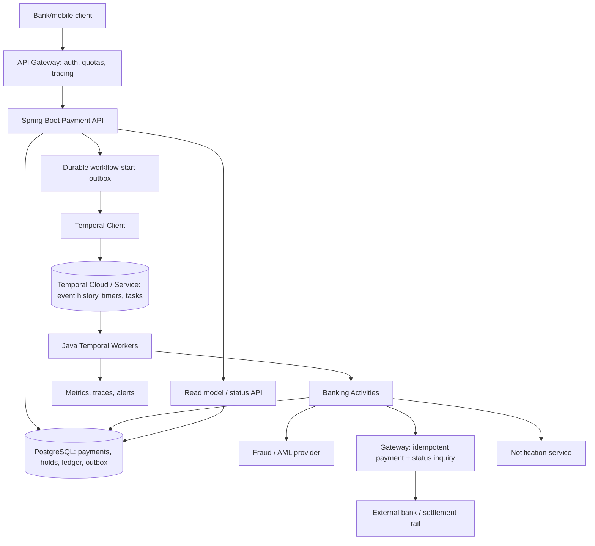
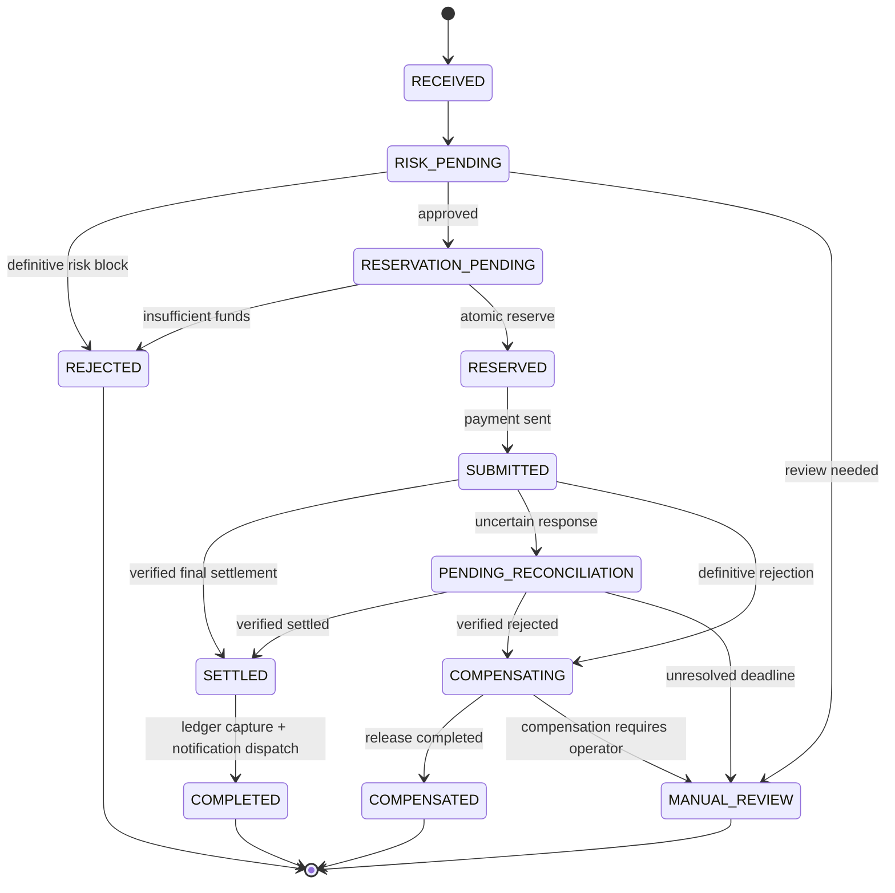
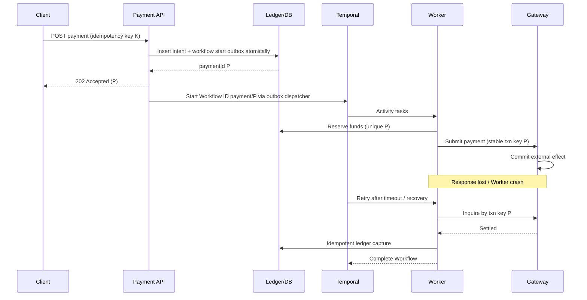

# TEMPORAL — STAFF SOLUTIONS ARCHITECT, BANKING (INDIA)
## The Self-Contained Interview Masterbook: Questions, Model Answers, Architecture Problems, Worked Solutions & Customer Conversations

**Edition:** 11 November 2026  
**Target role:** Staff Solutions Architect, Banking — India / APJ  
**Target background:** Senior Java/Spring Boot engineer with financial-services experience, moving into customer-facing technical architecture  
**Purpose:** One place to learn, rehearse, and demonstrate the knowledge, judgment, and communication expected in a senior technical pre-sales interview.

> **Honest boundary:** No document can predict *every* interview question or replace real production experience. This is designed to be a self-contained **core study guide**: all core definitions, explanations, reference architectures, model answers, trade-offs, problem-solving techniques and practice questions are written here. The source links at the end are for optional fact-checking and future API changes, not required reading to follow the handbook. Wherever vendor behavior, limits, security features or pricing may change, verify before making contractual promises to customers.

**Role-specific evidence:** [Temporal's job posting](https://jobs.ashbyhq.com/temporal/db6c81bf-1af3-4792-9473-1a8ee4518a06) emphasizes distributed systems, Java or other SDK languages, architecture advisory, cloud production operations, customer discovery, demonstrations, technical positioning, and partnership with Account Executives. It does **not** publish a guaranteed interview sequence. All interview rounds below are simulated preparation formats, not claimed inside knowledge.

---

# NAVIGATION — READ THIS FIRST

| Section | What it prepares you for |
|---|---|
| Orientation | How to answer like a Staff Solutions Architect; personal positioning |
| 1 | Temporal fundamentals and internals — Q001–Q040 |
| 2 | Advanced Temporal / Java / production — Q041–Q085 |
| 3 | Distributed systems and architecture — Q086–Q125 |
| 4 | Banking, payments, security and operations — Q126–Q160 |
| 5 | Discovery, commercial judgment and objections — Q161–Q190 |
| 6 | Behavioral, leadership and transition — Q191–Q210 |
| 7 | Problem–solution bank: 30 fully worked scenarios |
| 8 | Payment architecture, SQL, pseudocode, test plan and decisions |
| 9 | Five long-form whiteboard cases with solutions |
| 10 | Mock interviews, scorecards and rehearsal scripts |
| 11 | Rapid-recall cheat sheets, formulas and common traps |
| 12 | Glossary |
| 13 | Official source links for later verification |

## The interviewer's hidden scorecard

An excellent Staff-level answer makes **five moves**:

1. **Discover:** Clarify scale, criticality, correctness, constraints, and what the customer currently operates.
2. **Decide:** Recommend a fit-for-purpose architecture *and* identify when Temporal is not suitable.
3. **Defend:** Explain failure modes, deterministic replay, external idempotency, transactions, consistency and operational trade-offs.
4. **Demonstrate:** Use a small runnable example, trace, state machine, data model, or experiment rather than hand-waving.
5. **Drive:** Link the choice to measurable customer outcomes: recovery time, engineering effort, incident rates, time-to-production and cost.

**Answer pattern (45–120 seconds):** *Conclusion → mechanism → concrete banking example → failure case → trade-off.* Example: “I would use a Temporal Workflow to coordinate payment steps because durable execution lets the service recover orchestration state. I would keep ledger postings in ACID database transactions and make gateway calls idempotent, because Temporal does not create an exactly-once effect in the payment network. A lost response after a successful settlement needs reconciliation, not a blind refund. I would validate this with a fault-injection PoC and failure-rate metrics.”

### A three-layer answer for any technical question

- **20-second answer:** one clear recommendation and the reason.
- **2-minute answer:** mechanics, design trade-offs, and a failure scenario.
- **10-minute whiteboard:** data model, APIs, sequence, capacity, operations, tests and alternatives.

### Prioritization: what matters most

| Competency | Priority | Proof you can show |
|---|---|---|
| Temporal primitives + replay | Critical | Explain the precise effect of a Worker crash |
| External idempotency + payments | Critical | No duplicate debit under retries/timeouts |
| Architecture and failure trade-offs | Critical | Whiteboard a bank payment/loan process |
| Customer discovery + objections | Critical | Lead a diagnostic conversation, not a feature lecture |
| Java/Spring implementation | High | A real Workflow/Activity sketch and tests |
| Cloud security/operations | High | SLOs, observability, versioning, capacity and cost plan |
| Commercial qualification | High | PoC success criteria and mutual action plan |
| Algorithms/LeetCode | Secondary | Keep adequate coding fluency; not the center of this role |

---

# 0. YOUR OPENING PITCH AND ROLE POSITIONING

## 60-second “Tell me about yourself” answer

> “I’m a Java and Spring Boot engineer with enterprise financial-services experience across Morgan Stanley and Nasdaq. Much of my background is in building and improving applications in environments where reliability, operational risk, integration and change management matter. The part of engineering I increasingly want to own is the **architecture decision**: understanding a real customer problem, choosing the right technology, explaining why, and helping teams adopt it safely. Temporal is compelling because orchestration failures are easy to underestimate and expensive to fix, especially when a payment or onboarding journey involves many independent systems. I bring banking context and hands-on Java credibility. I’m consciously developing the other half of a Staff Solutions Architect role: customer discovery, persuasive whiteboarding, and converting architecture decisions into measurable business outcomes.”

**Guardrail:** Do not imply you led customer sales cycles, production Temporal deployments, or bank payment systems if you have not. Replace any example with the work you actually did. Engineering credibility is damaged more by embellishment than by an admitted learning gap.

## Why this role? (model answer)

> “I want to remain deeply technical while moving closer to customer problems and high-consequence architecture decisions. I enjoy the intersection of engineering, business constraints, explanation and long-term adoption. I’m not looking to escape coding; I want coding to be part of a broader advisory toolkit. Temporal’s banking use cases give me a relevant domain, and a pre-sales Solutions Architect role makes success visible through customer technical outcomes and adoption.”

## How to answer “You have not been a Solutions Architect — why Staff?”

> “That is the real risk in my candidacy. My strongest transferable evidence is enterprise Java engineering, financial-services context, production operations and technical problem-solving. I would not pretend those are identical to leading a commercial technical relationship. I would demonstrate the missing competencies through a working Temporal payments PoC, an architecture decision record, a customer-style presentation, and a discovery / objection-handling exercise. I’d also ask how you calibrate Staff-level autonomy, deal complexity and existing customer ownership so I can map my evidence to your bar.”

## What you should *not* claim

- “Temporal guarantees every payment happens exactly once.” **False.** It durably orchestrates; external side effects require application/gateway idempotency.
- “An Activity never runs again after success.” **Incomplete.** A *recorded* Activity completion is replayed from history, but a completed external side effect followed by a lost completion acknowledgment may cause retry.
- “All failures should retry.” **False.** Business rejection, permanent validation failures and unknown settlement must be handled differently.
- “The Saga rolls back everything.” **False.** Compensation is business logic, not a distributed ACID rollback.
- “Kafka and Temporal solve the same problem.” **False.** They overlap in some architectures but are different primitives.
- “The Cloud handles compliance for the bank.” **False.** Shared responsibility, data classification, contractual controls and jurisdictional analysis still apply.

---

# 1. TEMPORAL FUNDAMENTALS — QUESTION & ANSWER BANK

### Q001. What is Temporal in one sentence?
**Answer:** A durable-execution platform that persists workflow progress and coordinates reliable execution of application code through failures. Unlike a scheduler that merely fires a job, it tracks a multi-step execution, timers, callbacks and results so the orchestration can recover when Workers crash.

### Q002. What customer pain does Temporal solve?
**Answer:** Multi-step processes across unreliable systems create custom state machines, retry databases, cron sweepers, callback handlers, timers and recovery scripts. Temporal centralizes durable *orchestration* so application developers write workflows in general-purpose code while remaining responsible for business correctness, downstream idempotency and operational ownership.

### Q003. What are the four primary architectural components?
**Answer:** (1) **Temporal Service/Cloud** durably stores histories and schedules tasks; (2) **Client** starts Workflows and sends messages; (3) **Worker** is application-owned compute polling Task Queues; (4) **Workflow and Activity definitions** define orchestration decisions and side-effecting operations. Database, APIs and gateways remain customer services.

### Q004. What is a Workflow Definition versus a Workflow Execution?
**Answer:** Definition = code describing process behavior; Workflow Type = its registered name; Execution = one running or completed instance identified by Workflow ID plus Run ID. One definition can have millions of executions.

### Q005. Workflow ID versus Run ID?
**Answer:** Workflow ID is a business-oriented logical identifier within a Namespace; Run ID identifies a specific execution run, including runs created by Continue-As-New or retries. For `payment-123`, use a stable Workflow ID and store durable business idempotency separately.

### Q006. What is a Task Queue?
**Answer:** A named queue the Temporal Service uses to dispatch Workflow Tasks and Activity Tasks to polling Workers. It decouples durable scheduling from compute. Separate queues by execution characteristics or operational ownership; a Task Queue does not create financial transaction isolation.

### Q007. Workflow Task versus Activity Task?
**Answer:** A Workflow Task runs deterministic orchestration code to emit Commands; an Activity Task runs potentially nondeterministic side-effecting code such as SQL or HTTP. Workflow Task failures are automatically retried by the platform; Activity Tasks follow Activity retry policies.

### Q008. What is Event History?
**Answer:** The ordered durable record of state transitions and results relevant to a Workflow Execution. It lets Workers replay orchestration decisions after a crash. It is not a substitute for a regulated accounting ledger, transaction journal, or arbitrary event warehouse.

### Q009. Explain replay precisely.
**Answer:** A Worker reconstructs workflow state by re-executing deterministic Workflow code against recorded history. Completed Activities return their **recorded results**, timers resolve according to recorded events, and the code resumes generating new Commands from the recovered point. Replay does not reissue an Activity merely because the Workflow line is evaluated again.

### Q010. What is determinism and why is it essential?
**Answer:** For the same input and event history, Workflow code must emit compatible Commands in the same order. Direct wall-clock reads, random numbers, network I/O, threads and database queries may vary and must be moved to Activities or replaced with replay-safe SDK APIs. Business branching must depend on replayable values.

### Q011. What code should live in Workflow versus Activity?
**Answer:** Workflow: branching, sequencing, retry configuration, durable timers, waits and child orchestration. Activity: DB reads/writes, REST calls, risk scoring, network calls, notifications and any external side effect. Keep Workflow state modest and serializable.

### Q012. Are Workflows traditional long-running Java threads?
**Answer:** No. A Workflow may remain open for hours or years without holding a Java thread or process continuously. Execution advances through persisted tasks/events; Workers perform compute when tasks are available.

### Q013. What if every Worker crashes?
**Answer:** Durable Workflow state remains in the Temporal Service. Tasks wait until compatible Workers poll again; in-flight Activities may need timeouts/heartbeats to detect Worker loss and retry. Customer systems must still be idempotent because the external side effect might have occurred before the crash.

### Q014. What if the Temporal Service is temporarily unreachable?
**Answer:** Workers/clients cannot make new durable progress during the outage; local application work must not be mistaken for committed workflow progress. After connectivity returns, durable tasks continue if service persistence and recovery objectives are met. Architect for outage tolerance, backpressure, client retries and a defined backlog/DR plan.

### Q015. Is Temporal a message broker?
**Answer:** No. Kafka is optimized for high-volume durable event streams and consumer processing; Temporal tracks *stateful execution of an individual business process*. A workflow can consume/produce events through Activities, and many banks use both.

### Q016. Is Temporal a database?
**Answer:** It persists execution state/history but not a replacement for transactional customer data, reconciliation records, account balances or reporting. Keep business system-of-record data in the appropriate ledger/database; workflows reference IDs rather than storing sensitive account documents.

### Q017. What is an Activity retry policy?
**Answer:** Configuration for initial interval, backoff coefficient, maximum interval, maximum attempts and non-retryable errors. Activities are retryable by default; Workflows are not automatically retried end-to-end by default. In a bank, couple retries with business deadlines, idempotency, and downstream capacity.

### Q018. What is the default Activity retry behavior?
**Answer:** Temporal documentation describes exponential backoff beginning at 1 second, coefficient 2, capped at 100 seconds and unlimited attempts unless bounded by timeouts or policy. Never assume these defaults are the appropriate business SLA; state the configured policy in your design.

### Q019. Are Workflow executions retried automatically on business failure?
**Answer:** No default Workflow Execution retry policy. A Workflow Task failure is retried; that is not the same as starting a new full Workflow execution after a failed business process. Handle transient failures at Activity boundaries and deliberate retries in workflow logic.

### Q020. Explain the four major Activity timeout concepts.
**Answer:** **Schedule-to-start:** queue waiting duration; **start-to-close:** individual execution attempt maximum; **schedule-to-close:** total duration including queuing and retries; **heartbeat timeout:** allowable time between progress heartbeats for long-running Activities. Carefully choose based on expected latency, Worker failure detection and customer SLA.

### Q021. Why is start-to-close timeout essential?
**Answer:** A crashed Worker does not always send an explicit failure signal. Start-to-close lets the Service infer that an Activity attempt took too long and arrange a retry according to policy. Too short creates false retries; too long delays recovery.

### Q022. When use heartbeats?
**Answer:** Long-running Activities that periodically report progress and need reasonably quick detection of Worker loss/cancellation. Heartbeats can carry progress details so an Activity retry can resume from a checkpoint; they are not required for short RPC Activities.

### Q023. What is a durable timer?
**Answer:** A timer whose firing is tracked by the Service, so it survives Worker restarts. Use for repayment reminders, grace periods, KYC expiration, SLA deadlines and delayed retries. Do not implement these as `Thread.sleep()` in Workflow code.

### Q024. Signals versus Queries versus Updates?
**Answer:** **Signal** = asynchronous message that can modify a running Workflow without returning a handler result. **Query** = read current state without modifying it. **Update** = tracked write that can validate and return success/failure to caller. Example: `approvalGranted` Signal, `getStatus` Query, and `approveWithConfirmation` Update.

### Q025. What is Signal-With-Start?
**Answer:** An atomic start-or-signal interaction: starts a Workflow if it does not exist or signals an existing running Workflow. Useful when an event may arrive before a workflow has been started, with deliberate Workflow ID and reuse semantics.

### Q026. What is a Child Workflow?
**Answer:** A separate Workflow Execution launched from a parent, with independent history, identity and lifecycle policy. Use to decompose independently meaningful units (e.g., per-account onboarding) and contain history size; don't introduce children for every trivial helper function.

### Q027. What is Continue-As-New?
**Answer:** A Workflow intentionally closes its current run and begins a fresh run with new history while continuing the logical process. Useful for long-lived entity Workflows and repetitive loops to control event-history growth. Preserve necessary state and ensure handlers are drained at the boundary.

### Q028. Why does Event History size matter?
**Answer:** Very long histories slow replay and consume storage; enormous histories can hit platform limits. Favor compact payloads, external references and Continue-As-New before histories become unwieldy. Temporal's Worker best-practices guide recommends typically keeping histories to a few thousand events even though upper technical limits are higher.

### Q029. What is an Entity Workflow?
**Answer:** One long-lived Workflow representing a durable logical entity, often using its entity ID as Workflow ID and responding to messages over time. Examples: account lifecycle, loan application or merchant onboarding. Manage concurrency, state growth and Continue-As-New deliberately.

### Q030. How does Temporal support a human approval taking 12 days?
**Answer:** Workflow starts and awaits an Update or Signal; a durable timer enforces escalation or expiry. The Workflow does not occupy a running thread while waiting. After approval, Activities resume. Define who can approve, authentication, audit, authorization and duplicate-decision rules outside the workflow primitive.

### Q031. How does asynchronous Activity completion work?
**Answer:** When an external asynchronous service takes time, an Activity can be started and completed later using the SDK's asynchronous completion mechanism and an appropriate completion token/identifier. This avoids keeping a Worker blocked while awaiting a callback. Protect callback endpoints against duplicates and forged completion messages.

### Q032. What is cancellation?
**Answer:** A request to stop work, with propagation and cleanup behavior defined by the workflow and Activities. Cancellation cannot undo an irreversible external transfer. Use deliberate compensation/reconciliation policies; heartbeats often make long-running Activities responsive to cancellation.

### Q033. What are Search Attributes and Memo?
**Answer:** **Search Attributes** are indexed metadata for filtering Workflow executions; **Memo** is non-indexed descriptive metadata. Prefer sanitized business identifiers and operational tags; never copy secrets or full PII casually into searchable metadata.

### Q034. What is a Namespace?
**Answer:** A logical isolation and administration boundary in Temporal. Use environments, permissions and tenancy needs to determine namespace boundaries, not merely one Namespace per individual Workflow.

### Q035. Temporal Cloud versus self-hosted?
**Answer:** Cloud reduces the burden of running the Temporal Service and provides a managed operational plane; customers still run application Workers and integrations. Self-hosted gives more infrastructure control and more operational burden. Decide via residency, data governance, reliability operations, procurement, cost and team capability—not an automatic “Cloud is always better.”

### Q036. Is there a difference between Worker and Temporal Service scaling?
**Answer:** Yes. Customer-run Workers scale task execution capacity and external service calls. Cloud/Service scales scheduling/history APIs within capacity limits. Increasing Worker replicas won't fix a cloud namespace throttle; increasing namespace capacity won't fix a blocked database connection pool.

### Q037. What is a Workflow execution guarantee?
**Answer:** Durable workflow progression with recorded history and task processing; do not convert that into a blanket promise that an external bank, settlement provider or database operation happens exactly once. The latter depends on idempotency, transaction semantics and reconciliation.

### Q038. Why can an Activity run twice even if an API charge already succeeded?
**Answer:** The external API may commit the charge, then the Worker can die or lose connectivity before Temporal records Activity completion. Temporal retries the uncertain Activity. Give the external operation a stable idempotency/transaction key and inspect prior results before attempting again.

### Q039. What counts as non-deterministic Workflow code?
**Answer:** Reading external state, wall clock, true randomness, performing direct HTTP/SQL I/O, non-replay-safe concurrency, and code changes that alter previously recorded command sequencing. Some SDK primitives provide replay-safe time, randomness and markers; use documented SDK APIs rather than standard Java APIs by assumption.

### Q040. What is Temporal's core value proposition in banking?
**Answer:** It reduces hand-built orchestration complexity for multi-step, high-consequence business processes; provides durable retry/timer/state visibility; and simplifies recovery from process/Worker failures. The value comes from faster delivery, less brittle recovery code and improved operational traceability, **not** a claim that it replaces controls, ledgers or banking regulations.

---
# 2. ADVANCED TEMPORAL, JAVA, RELIABILITY — QUESTION & ANSWER BANK

### Q041. Show a minimal Temporal Java Workflow interface.
**Answer:** The conceptual typed interface is:

```java
@WorkflowInterface
public interface PaymentWorkflow {
    @WorkflowMethod
    PaymentResult process(PaymentCommand command);

    @QueryMethod
    PaymentStatus getStatus();

    @SignalMethod
    void submitReconciliationResult(ReconciliationResult result);
}
```

A Workflow implementation coordinates Activities, while Activity implementations access PostgreSQL and HTTP endpoints. Names and DTOs shown here are illustrative project types; adapt imports and APIs to the installed Temporal Java SDK version.

### Q042. How are Activities declared and invoked in Java?
**Answer:** Define an `@ActivityInterface` and use a typed Activity stub with explicit timeouts and retry behavior:

```java
@ActivityInterface
public interface BankingActivities {
    Reservation reserveFunds(String paymentId, String accountId, BigDecimal amount);
    SettlementResult settle(String paymentId, String gatewayReference);
    void releaseReservation(String reservationId);
}

// Inside a Workflow implementation:
private final BankingActivities activities = Workflow.newActivityStub(
    BankingActivities.class,
    ActivityOptions.newBuilder()
        .setStartToCloseTimeout(Duration.ofSeconds(20))
        .setScheduleToCloseTimeout(Duration.ofMinutes(2))
        .setRetryOptions(RetryOptions.newBuilder()
            .setInitialInterval(Duration.ofSeconds(1))
            .setBackoffCoefficient(2.0)
            .setMaximumAttempts(5)
            .build())
        .build());
```

The example is a **teaching sketch**, not a complete compiling application. Do not assume five retries is appropriate for an unknown settlement state.

### Q043. What does a Java Worker do?
**Answer:** It connects to Temporal, registers Workflow implementation types and Activity implementations, and polls a Task Queue. In a typical deployment, a Worker Factory creates Workers, and the service may run Workflow and Activity Workers in distinct process pools for independent scaling and safety. An unregistered Workflow Type or wrong Task Queue leads to stalled tasks despite a healthy server.

### Q044. Should you put a Spring `@Transactional` method in Workflow code?
**Answer:** No. Workflow code should be replayable without DB side effects. A Spring transactional service belongs inside an Activity; the database transaction applies only to its own local database changes, not across the entire workflow.

### Q045. How do you make a Workflow deterministic in Java?
**Answer:** Keep business branches based on recorded inputs and Activity results; use Workflow SDK primitives for waits, timers, compatible time/randomness semantics and asynchronous work; avoid direct `Instant.now()`, `Thread.sleep`, REST clients, arbitrary threads and DB access inside Workflow methods; test stored histories against new code.

### Q046. What happens if you change an Activity type/order for a long-running Workflow?
**Answer:** Old histories expect compatible commands. A code change can cause non-determinism when old executions replay. Use Worker Versioning (recommended current approach), or carefully designed version/patch gates when needed. Rollouts require attention to Workers still processing old executions; new Docker image rollout alone is not sufficient.

### Q047. What is Worker Versioning and why do banks care?
**Answer:** A supported deployment/versioning mechanism for routing existing Workflow Executions to compatible Worker code revisions while allowing new executions to use new revisions. Critical for processes that remain open while bank systems release frequently. Define the decommissioning plan and test migration/rollback; don't promise that any schema change is automatically safe.

### Q048. How do you test replay compatibility?
**Answer:** Capture representative histories from real executions (with appropriate data sanitization), replay them against the candidate Workflow code in automated checks, and fail CI on non-determinism. Add unit tests for state decisions and integration tests for Activities and failure semantics. Verify SDK-specific replay-testing APIs in the chosen version.

### Q049. What is a Local Activity?
**Answer:** An Activity executed within a Worker process with lower scheduling overhead. Good for short, low-latency and idempotent work when trade-offs are understood. Avoid relying on it for high-consequence external money movement without considering failure windows, retry behavior and recording semantics.

### Q050. When does Temporal itself retry versus when should application logic retry?
**Answer:** Temporal retries transient Activity attempt failures according to configured policy. Application logic decides whether a failure is business-retryable, whether to reconcile, escalate, compensate or end. Use typed errors: temporary service unavailability can retry; invalid bank account is terminal; unknown gateway acceptance requires inquiry before re-submission.

### Q051. What is a non-retryable Application Failure?
**Answer:** An application-classified failure indicating repeating the same Activity is pointless or unsafe, e.g., invalid beneficiary or a definitively declined transaction. In Java, an `ApplicationFailure` can carry classification metadata; exact factory methods vary by SDK version. Business rejection may alternatively be represented as a normal typed result, which often makes business state transitions clearer.

### Q052. How do you implement a Saga?
**Answer:** Execute a chain of local transactions and register compensating actions for reversible steps. For payment: reserve funds → submit to gateway → capture. If the gateway **definitively rejects before settlement**, release the reservation. Compensation must be idempotent and may itself need retries. An *uncertain* gateway outcome must enter reconciliation, not automatic release.

### Q053. What is the common Saga ordering bug?
**Answer:** Registering compensation only *after* the forward Activity returns can leave uncertainty if the forward side effect occurred but its acknowledgment was lost. Plan the compensation before initiating a side effect where appropriate, and design both forward/reverse actions to query persistent state and safely no-op when the effect never happened. Do not run compensation that could reverse settled money without verified facts.

### Q054. Temporal retries an Activity 8 times. Does Event History show eight full copies of Activity completion?
**Answer:** Not necessarily. Internal retry attempts can be represented through retry metadata rather than a full event sequence for each attempt. Inspect Activity attempt metrics and UI/SDK details; don't equate raw history-event counts with all network attempts.

### Q055. How would you implement exponential backoff with jitter?
**Answer:** Policy delay can be modeled as `min(maxDelay, initialDelay × multiplier^(attempt−1))`; jitter adds randomized variation to avoid synchronized thundering herds. Let the SDK/Temporal schedule retries where supported; control gateway-specific concurrency/rate limits independently. For an unknown financial outcome, query status before retrying the mutation.

### Q056. When should you not retry an Activity indefinitely?
**Answer:** When the business deadline expires, a downstream service has strict rate limits, retries are expensive, errors are permanent, a risk of duplicate irreversible effects exists, or an operator must decide. Bound the total wall time with schedule-to-close/business timers and have a terminal/reconciliation state.

### Q057. What is a circuit breaker? Does Temporal replace it?
**Answer:** Circuit breaker limits calls when a dependency is failing, with closed/open/half-open states. Temporal handles durable orchestration and retries; application Workers still need circuit breaking, rate limiting, concurrency control and backpressure to avoid hammering an unhealthy gateway.

### Q058. Explain the replay → side-effect boundary in a payment.
**Answer:** A Workflow calling `settle()` generates a durable Activity schedule. The Worker calls the gateway using a stable payment reference. If the gateway returns `PAID` and the Activity completion is recorded, replay uses that result. If the gateway charged but completion wasn't recorded, the Activity may retry, so the same key and gateway status inquiry must prevent double charging.

### Q059. How do you prevent duplicate Workflow starts?
**Answer:** Use a stable business-derived Workflow ID and appropriate Workflow ID conflict/reuse policies. Additionally persist an API idempotency table keyed by `(tenant, idempotency_key)` with a request fingerprint and stored result. Workflow ID policies alone do not solve duplicates across completed runs, new payment IDs or different ingress systems.

### Q060. Why can't a Query replace a business-status database?
**Answer:** Queries are valuable for live workflow state but can depend on Worker availability and retention; they are not a regulatory ledger or long-term reporting store. Project durable business state into PostgreSQL/ledger with versioned updates and use Queries for operational insight.

### Q061. What should go into Workflow payloads?
**Answer:** Stable identifiers, business decision inputs and small metadata needed for deterministic execution. Keep PANs, account secrets, KYC documents and large payloads out of ordinary histories; store protected data in authorized systems and pass opaque references. Consider payload encryption/codec and access controls as defense-in-depth.

### Q062. Does TLS prevent Temporal administrators from seeing sensitive payloads?
**Answer:** TLS protects data in transit, not necessarily how persisted payloads appear to authorized service/admin readers. For sensitive data, investigate client-side payload encryption and codec/Data Converter options, key ownership and redaction, plus which metadata is indexed or logged. Do not assume a generic encryption claim solves PII exposure end-to-end.

### Q063. What belongs in a production alert dashboard?
**Answer:** Workflow starts/completions/failures by type; age of pending/blocked workflows; Activity retry attempts and failure types; Task Queue schedule-to-start latency and backlog; Worker poller health; downstream errors; reconciliation queue; business SLA breaches; Cloud Actions/capacity and cost anomalies.

### Q064. A Workflow is stuck but there are no exceptions. Diagnose.
**Answer:** Check Workflow status/history and pending activities/timers; verify Task Queue name, registered Workflow/Activity types, Worker pollers, Worker version, namespace and auth. Inspect schedule-to-start latency, downstream timeouts, retry backoff and workflow waits awaiting Signals/Updates. Determine whether “stuck” means waiting correctly or failing to make progress.

### Q065. Why use separate Worker pools?
**Answer:** Different workload classes have different compute, security, latency and fault domains: lightweight orchestration, long-running batch, external gateway I/O and risk scoring. Separate Task Queues and pools allow independent scaling, permissions, deployment and protection from noisy neighbors.

### Q066. How do you scale Workers?
**Answer:** Observe pending tasks and schedule-to-start latency, Worker CPU/memory, Activity execution times, concurrency slots, downstream quotas and DB connection pools. Scale replicas/concurrency with bounded load testing; adding Workers can cause a downstream outage if the dependency cannot absorb the throughput.

### Q067. What is backpressure in Temporal architecture?
**Answer:** Control the rate of work accepted or dispatched so downstream systems are not overwhelmed. Combine ingress throttling, Worker limits, Task Queue controls, concurrency pools, per-bank or per-merchant quotas, bulkheads and retry backoff. Queues absorb bursts but an unbounded backlog still creates latency and cost.

### Q068. How do you measure a Worker's reliability?
**Answer:** Availability of polling Workers, task completion/timeout and retry rates, latency distributions, time since latest poll, processing throughput, replay errors, saturation, and incidents affecting a business SLO. Worker uptime alone is not the customer outcome.

### Q069. What does “time to recovery” mean for a durable workflow?
**Answer:** Time from failure until progress resumes and a safe business status is available. Break it into failure detection, Worker restore, queue wait, replay, downstream recoverability and reconciliation latency. Each component has different levers.

### Q070. A banking customer wants zero downtime releases. What is your response?
**Answer:** Define the desired availability SLO rather than promising “zero downtime.” Propose compatible Worker Versioning, blue/green Worker fleets, draining, health checks, replay-compatibility tests, canaries, rollback and traffic/capacity management. Include schema migration and downstream dependency coordination.

### Q071. What if a Worker deployment introduces non-determinism?
**Answer:** Existing Workflow Tasks can fail repeatedly while executions remain open. Compare history to code, roll back to a compatible Worker version or deploy a patch, then replay-test before release. A frantic Workflow reset or terminate can make banking correctness worse.

### Q072. What is the difference between a retry storm and a healthy retry policy?
**Answer:** Healthy retries are bounded, spread out and idempotent. A storm synchronizes huge numbers of attempts against a failing downstream dependency, increasing load and recovery time. Use jitter, budgets, circuit breakers, concurrency ceilings and status-specific retries.

### Q073. How do you handle duplicate Signals?
**Answer:** Include an event ID and deduplicate through Workflow state or durable external data depending on retention and scope. Design handlers to be idempotent and validate transitions; messages may be delivered again by upstream systems even when Temporal itself durably records messages.

### Q074. What does Workflow Update validation buy you?
**Answer:** It can reject an invalid state change before the Update is accepted into Workflow state/history. Example: approving an already rejected loan should return a conflict instead of silently overwriting a decision. Still authenticate caller and enforce the bank's authorization model outside this primitive.

### Q075. What is the right retention strategy?
**Answer:** Separate active workflow state, closed execution history retention, compliance audit records, and financial records. Temporal history retention is not necessarily equal to statutory business retention. Export or archive only as needed and apply approved privacy, encryption, location, deletion and legal-hold controls.

### Q076. What is Nexus conceptually?
**Answer:** A contract-oriented way to connect Temporal-backed operations across service/namespace boundaries. It can expose durable operations with workflow/Activity implementations behind them. For the interview, master the main Workflow/Activity model first; introduce Nexus where service ownership and cross-boundary APIs justify it.

### Q077. When would a standalone Activity be preferable to a Workflow?
**Answer:** A single independently useful side effect such as a notification or document fetch that needs retries but no multi-step orchestration, waiting or entity state. A Workflow is justified when multiple steps, long-running waits, messages or durable intermediate state matter.

### Q078. How do Temporal Cloud costs work conceptually?
**Answer:** Cloud usage is based substantially on billable **Actions** (e.g., Workflow starts, Activity attempts, Signals, Updates, Timers, queries/other operations as documented), plus applicable storage/capacity/plan components. Replay itself on a Worker does not generate billable Actions. Model workload action counts and data retention, not merely the number of workflows.

### Q079. Define an Actions-based cost estimate.
**Answer:** `monthly_actions ≈ monthly_workflows × average_actions_per_workflow + retry_actions + message_actions + heartbeat_actions + scheduled/other_actions`. Then use the applicable contract's price tiers plus storage, capacity and support. The exact unit rates and entitlements are commercial facts to verify, not to guess during a customer call.

### Q080. How can you lower Action consumption without sacrificing correctness?
**Answer:** Eliminate unnecessary steps/heartbeats, avoid excessive polling, choose appropriate workflow granularity, batch where semantics permit, reduce chatty messages, monitor retry causes and use efficient waiting/callbacks. Never suppress retries, observability or financial control just to reduce a unit bill.

### Q081. What's the failure impact of using huge payloads?
**Answer:** Greater history size, replay/memory overhead, privacy exposure and potentially payload limits. Store large documents/results in a durable external system with secure references. Use checksums, versioning and expiration rules so references remain usable for long-lived workflows.

### Q082. What is an SLO for orchestration?
**Answer:** A measurable customer outcome such as “99.9% of valid domestic payments reach a definitive settled/rejected state within 5 minutes, excluding documented external clearing windows,” and a separate “99.95% of orchestration requests accepted.” Specify numerator, denominator, exclusions, observability and error budget; do not conflate service uptime with end-to-end bank settlement.

### Q083. How do you test Worker crash safety?
**Answer:** Use a fault-injection barrier after a side-effecting operation is submitted, kill the Worker, restart with same Task Queue/version compatibility, inspect history and ledger/gateway transaction IDs, then assert exactly one **financial effect**, even if Activity execution was attempted more than once.

### Q084. How do you test eventual consistency without flaky sleeps?
**Answer:** Use bounded polling with clear deadlines, signals/latches/barriers for deterministic failure injection, instrumented state transitions, and Temporal test environment time skipping where appropriate. Assert invariants and final business state; avoid arbitrary 30-second sleeps masquerading as tests.

### Q085. What makes a Staff-level Temporal implementation different from a tutorial?
**Answer:** It handles ambiguous outcomes, duplicate submissions, cancellation after side effects, safe upgrades, operational overload, tenant isolation, security, measurable SLOs, bounded costs, and an honest “not a fit” decision. It demonstrates the system under failure rather than only running the happy path.

---

# 3. DISTRIBUTED SYSTEMS, DESIGN TRADE-OFFS — QUESTION & ANSWER BANK

### Q086. What is a distributed system?
**Answer:** Components on independent machines communicating over a network, with partial failure, uncertain latency and no reliable global clock. The hard part is reasoning about what happened when messages are delayed, duplicated or lost while some services remain available.

### Q087. What is partial failure?
**Answer:** One component fails while others keep operating. A payment gateway may commit a transfer while the calling service times out. A timeout proves that an acknowledgment wasn't received within a window, **not** that the payment failed.

### Q088. What is at-least-once delivery?
**Answer:** A system may retry a message/task until acknowledged; duplicates can occur. Design handlers with stable idempotency keys and durable deduplication. Activity retries and process restarts make this central to Temporal integrations.

### Q089. What is at-most-once delivery?
**Answer:** Attempts are not retried after uncertainty; duplicate execution is avoided at the risk of lost work. This is often unsuitable for critical payments unless paired with reliable reconciliation and recovery.

### Q090. What does “exactly once” actually mean?
**Answer:** It must be scoped. Exactly-once **observable business effect** can often be approximated/achieved through transactional uniqueness and idempotent external APIs despite at-least-once attempts. It is not a magical property across arbitrary networks, databases and gateways; define the boundary and proof.

### Q091. Explain idempotency mathematically.
**Answer:** An operation `f` is idempotent if `f(f(x)) = f(x)` for its observable final effect. `PUT resource/status=APPROVED` can be idempotent; `POST debit ₹500` usually is not unless deduplicated by a stable transaction key. Implement idempotency with persistence, not an in-memory `Set`.

### Q092. Why is a unique DB constraint stronger than “check then insert”?
**Answer:** Two concurrent requests can both pass a non-atomic existence check. A unique index enforces the invariant inside the DB transaction boundary. Handle the losing transaction by fetching and comparing stored request fingerprint, then returning the same result or HTTP 409 conflict.

### Q093. Optimistic versus pessimistic locking?
**Answer:** Optimistic locking uses version checks and retries conflicts; good for low contention. Pessimistic row locking serializes updates; useful for high-consequence account balance reservations under contention. Choose based on throughput and contention; neither replaces proper idempotency.

### Q094. What is ACID and where does it stop?
**Answer:** Atomicity, consistency, isolation, durability hold for a configured local transactional store. A transaction cannot automatically atomically commit a PostgreSQL balance update and a remote settlement API. Use an outbox, Saga, idempotent gateway calls and reconciliation across boundaries.

### Q095. Eventual consistency versus strong consistency?
**Answer:** Strong consistency makes a read reflect an appropriate committed order of writes; eventual consistency converges over time absent new writes. Payment status across bank, gateway and reporting may be eventually consistent, while balance reservations in one account database often require strong local correctness.

### Q096. What is CAP theorem in a useful interview answer?
**Answer:** Under a network partition, a replicated data system cannot guarantee both linearizable consistency and full availability for all operations. It is not a universal law that every database picks exactly two of C/A/P. Frame design choices by concrete operations: debit authorization may reject/queue rather than accept conflicting writes.

### Q097. What is a Saga versus two-phase commit?
**Answer:** A Saga composes local transactions with business compensations; it favors independent services and eventual correction. Two-phase commit coordinates a distributed atomic commit but introduces coupling, blocking/failure complexities and support requirements. Banks may use either within carefully selected boundaries; irreversible external settlement cannot be casually rolled back by either.

### Q098. What is the transactional outbox pattern?
**Answer:** In one DB transaction, write the business state change and an “event to publish” outbox row. A publisher later sends it, retrying safely; consumers deduplicate. This avoids “DB committed but broker publish failed” gaps. It does not on its own eliminate duplicates or replace all workflow state management.

### Q099. What is the inbox/dedup pattern?
**Answer:** A consumer persists an incoming event ID/command ID in the same transaction as its business effect. Repeated delivery returns the prior outcome or no-ops; persistent keys and retention must match the business risk window.

### Q100. Compare orchestration and choreography.
**Answer:** **Orchestration:** one coordinator controls a multi-step process; easier to see state and manage compensation. **Choreography:** services react to events; can improve loose coupling but distributed process state becomes harder to reason about. Both can coexist; Temporal provides workflow orchestration, Kafka can provide interservice events.

### Q101. How do you handle message reordering?
**Answer:** Use monotonically increasing version/sequence numbers, explicit state transitions and deduplication. An `APPROVED` event arriving after `CANCELLED` must be validated against allowed state transitions, not applied blindly by arrival time.

### Q102. What is a split-brain risk?
**Answer:** Two nodes or partitions independently believe they are authoritative, potentially issuing conflicting state changes. Correctness may require fencing tokens, leases with epochs, conditional writes or a single strongly consistent record. Temporal Worker redundancy alone is not a global lock for external side effects.

### Q103. What is a fencing token?
**Answer:** A monotonically increasing generation/epoch attached to operations; downstream systems reject stale generations. Useful where expired leases or replaced Workers may still execute. Idempotency is still needed for duplicate submissions with valid tokens.

### Q104. What is a dead-letter queue and when would you use one?
**Answer:** A holding area for events that cannot be processed successfully after bounded attempts. In a Temporal design, persistent failed workflow states, manual-review queues and operational escalations can serve a similar purpose; the exact design depends on whether using a message broker too. Never silently discard financial transactions.

### Q105. Why is retrying a timed-out write dangerous?
**Answer:** The server may have committed the write before the response was lost. A retry with a new transaction identity can duplicate funds movement. Reissue with same idempotency key where guaranteed, or query status and reconcile before any new mutation.

### Q106. What is a race condition in balance reservation?
**Answer:** Two concurrent reservations both read available balance of ₹1,000 and each reserve ₹800, making the total commitment ₹1,600. Solve with an atomic conditional update or account-level transactional lock, not a Workflow-only check.

### Q107. What is the difference between latency and throughput?
**Answer:** Latency is per-request elapsed time; throughput is completed work per time. Higher concurrency may increase throughput until a bottleneck saturates, at which point p99 latency and errors rise. Measure both during PoC.

### Q108. State Little’s Law and apply it.
**Answer:** `L = λ × W`, where L is average concurrent work, λ throughput per second and W average time in system. At 100 payments/sec with 3 sec active processing, average in-flight is ~300; long human waits change the number of **open workflows** but not necessarily active Worker threads.

### Q109. How do you calculate basic Worker concurrency?
**Answer:** Approximate `active_concurrency ≈ incoming_active_tasks/sec × average_task_duration_sec`, then add headroom, bursts, retries and queueing. E.g., 200 Activities/sec × 0.25sec = 50 concurrent execution slots on average. Benchmark CPU, I/O, downstream caps and p99 before sizing the fleet.

### Q110. What is a bulkhead?
**Answer:** Resource isolation that prevents one overloaded integration or customer from taking down others. Implement separate Worker pools/Task Queues, semaphores, connection pools and per-tenant quotas. Pair with clear priority and fairness requirements.

### Q111. What is the difference between Kafka offset commit and a Temporal Workflow completion?
**Answer:** Kafka tracks consumer progress in a stream partition; Temporal tracks durable progression through a business-process execution history. A consumer can use Kafka and still need a state machine to manage timers, external callback, compensation and multi-day approval.

### Q112. Does a FIFO queue guarantee business ordering across distributed services?
**Answer:** No. Ordering has scope (partition, key, producer, broker) and can be broken downstream by concurrency/retries. Enforce business invariants through state versions and transactional writes, not simply a “FIFO” label.

### Q113. What makes a service resilient?
**Answer:** Isolation, bounded resource usage, timeouts, retries with backoff, circuit breakers, immutable identifiers, idempotency, fallback/reconciliation, meaningful SLOs, fault testing and recovery playbooks. Availability is a system outcome, not a library option.

### Q114. How do you prevent retry amplification across layers?
**Answer:** Avoid multiplicative retries: five client retries × five API retries × five Activity retries can yield 125 attempts. Define one owning retry layer per failure class, use end-to-end budgets and correlation, and cap pressure on downstream systems.

### Q115. What is a compensating transaction versus a reversal?
**Answer:** Compensation is a new business action restoring a valid overall state where feasible. Reversal is one kind of financial action; it may not be instantaneous, possible or equivalent to “the prior settlement never happened.” Define the precise gateway/ledger semantics.

### Q116. Design a distributed lock for account updates — should you?
**Answer:** Prefer the database's atomic update/row lock for balance correctness. An external Redis lock creates additional expiry/fencing failure modes and does not replace the authoritative ledger transaction. Use a distributed lock only when the actual requirement crosses boundaries and fencing is designed.

### Q117. What is backpressure versus load shedding?
**Answer:** Backpressure slows/queues producers to match sustainable capacity; load shedding rejects low-priority or excess work promptly. Banks should choose which operations can reject, wait or queue under stress, with customer-visible status and auditability.

### Q118. How do you migrate from a monolith to workflow orchestration safely?
**Answer:** Identify a stable business process, map current state/retries/manual recovery, introduce orchestration on new transactions, route a limited percentage, preserve existing systems of record, compare outcomes and fall back safely. Do not put an entire legacy codebase into one giant Workflow on day one.

### Q119. When should a bank *not* adopt Temporal?
**Answer:** A single atomic DB operation, ultra-low-latency synchronous computation with no durable state, pure high-volume stream processing, short fire-and-forget notifications needing no orchestration, or a team unable to operate Workers and lifecycle controls can be better served by simpler primitives. Explicitly estimate the incremental operational/cost burden.

### Q120. What is CQRS and is it needed here?
**Answer:** Command Query Responsibility Segregation separates write models from read models. Useful when high-volume reporting requires different scaling or data shapes, but not essential for a small PoC. If used, declare eventual-consistency lag and ensure financial truth remains in the transaction/ledger store.

### Q121. What is event sourcing versus Event History?
**Answer:** Event sourcing makes business-domain events the source of truth for application state. Temporal Event History records workflow execution events for recovery. It is not automatically an event-sourced bank ledger, and its retention/access semantics may not meet financial audit needs.

### Q122. Explain timeouts versus cancellations versus failures.
**Answer:** Timeout is a bounded wait exceeded; cancellation is an explicit stop request; failure is a declared unsuccessful outcome. All three can leave an *unknown external side effect*. Handle via inquiry, finality rules and reconciliation, not by inferring “no money moved.”

### Q123. What is a reconciliation process?
**Answer:** A controlled comparison among internal payment intent, reserved/captured ledger records, gateway status and settlement/bank statements. Resolve discrepancies using stable references, timestamps, versioning, manual exceptions and auditable corrections. It is essential in payments even with reliable workflows.

### Q124. How do you model financial finality?
**Answer:** Define states such as `SUBMITTED`, `ACCEPTED`, `SETTLEMENT_PENDING`, `SETTLED`, `REJECTED`, `RETURNED`, `UNKNOWN`; distinguish provider acceptance from irrevocable settlement. The correct finality model depends on payment rail, bank and contractual rules. Never mark “settled” purely because an API returned HTTP 200.

### Q125. What is the strongest single test of your distributed-systems design?
**Answer:** Reproduce uncertainty at the worst boundary: gateway commits a transfer, then the caller loses its acknowledgment and Worker crashes. After retries and failover, assert one external settlement, one corresponding ledger capture, consistent business status and an auditable history. If you cannot prove those, the happy path isn't enough.

---
# 4. BANKING, SECURITY, CLOUD, OPERATIONS — QUESTION & ANSWER BANK

### Q126. Design the minimal money model for a payment PoC.
**Answer:** Persist `account(id, currency, posted_balance, reserved_balance, version)`; `payment(id, source, destination, amount, status, idempotency_key, fingerprint)`; `reservation(id, payment_id, amount, state)`; `gateway_transaction(idempotency_key, gateway_ref, status)`; and append-only journal/event records. Available balance = posted balance − active reservations. For a production bank use a rigorously defined double-entry ledger, GL controls and reconciliation rather than assuming these teaching tables are sufficient.

### Q127. Why use `BigDecimal` for money?
**Answer:** Binary floating point can introduce representation/rounding errors. `BigDecimal` and explicit currency scale/rounding avoid many errors but do not solve currency conversions, exchange rates, partial units, locale or balance transaction correctness. A minor-units integer with a currency code can also work if carefully specified.

### Q128. What is an atomic funds reservation?
**Answer:** In one DB transaction, ensure sufficient available funds and increase the reserved amount only if the invariant remains true. Example: conditional `UPDATE account SET reserved=reserved+:a WHERE id=:id AND posted-reserved >= :a` with expected affected-row count 1; also persist one unique reservation by payment ID in the same transaction.

### Q129. What does “double-entry bookkeeping” mean?
**Answer:** Every financial posting has balanced debit and credit entries across accounts, preserving accounting invariants. A debit to a customer's account must be offset by an appropriate clearing/settlement/receivable account entry. Operational Workflow history is separate from this ledger.

### Q130. Reserve, capture, release — what's the difference?
**Answer:** **Reserve:** reduce spendable amount without final posting. **Capture:** convert a reservation into a committed financial posting when business/rail conditions permit. **Release:** undo an unused hold, if safe. **Reverse/return:** separate compensating entries after a posted transfer; don't pretend release can undo settled funds.

### Q131. What is the cleanest example of a non-retryable business error?
**Answer:** Invalid currency, malformed beneficiary, confirmed fraud rejection or insufficient funds at time of reservation. Preserve a typed `REJECTED` state and reason; don't retry every second hoping the business rule changes. New input may require a new attempt with a new business ID.

### Q132. What if fraud service times out?
**Answer:** Treat result as unknown, not approved. Retry within budget with same request ID if appropriate, or move to `RISK_REVIEW_PENDING`; keep funds uncommitted until policy permits. False approvals carry a potentially much higher downside than increased processing latency.

### Q133. What if AML screening returns “possible match”?
**Answer:** Escalate through a defined compliance review path; preserve audit, screening version and operator decision, protect sensitive data and apply retention/access policy. Never automatically re-submit or bypass controls to make a success-rate metric look good. The exact AML obligations are jurisdiction- and institution-specific and must be set by compliance.

### Q134. What does PCI DSS have to do with this design?
**Answer:** If payment card data is processed/stored/transmitted, PCI DSS scope may apply. Prefer tokenization and strict data minimization; don't store PAN/CVV in Workflow histories, logs or Search Attributes. Obtain the bank's approved scope and controls rather than treating “cloud encryption” as PCI compliance by itself.

### Q135. What about Indian RBI requirements and data localization?
**Answer:** First identify the regulated entity, payment rail, data category and applicable RBI directions/contracts. Map storage, processing, support access, logs, backups, third parties and cross-border transfers. Do not assert that “Temporal Cloud is RBI compliant” or assume every Indian banking workload can use any region. Escalate residency decisions to bank legal/compliance and vendor assurance with written evidence.

### Q136. How do you secure access to Temporal Cloud?
**Answer:** Use supported client authentication (API keys or mTLS per Namespace), least-privilege account/namespace roles, credential rotation, managed secrets, network controls where supported, audit logs and separation of production/non-production. SAML/SCIM may apply to human access. Validate current plan and region-specific capabilities.

### Q137. How should a bank handle encrypted payloads?
**Answer:** Classify data first; minimize stored identifiers; encrypt sensitive payload content on the client with appropriate Data Converter/codec design if needed; manage keys in approved KMS/HSM; protect UI decoding and metadata; rotate keys with long-running Workflow compatibility. Encryption doesn't replace access control or retention policy.

### Q138. Does a Workflow History make the system audit-ready?
**Answer:** It helps operational traceability but is **not** a complete compliance/audit record. An audit trail also needs actor identity, authorization, bank-approved immutable financial events, retention, access logs, reconciliation, legal hold and evidence of changes to business state.

### Q139. How do you handle a production incident involving duplicate payment requests?
**Answer:** Stop unsafe re-submission, preserve evidence and identifiers, quantify potential financial effect, reconcile gateway/ledger truth, contain affected routes, communicate status through incident command, fix the idempotency gap, replay safe actions only, and perform postmortem/control improvements. Avoid impulsively cancelling all workflows, which may orphan settlements.

### Q140. What are RTO and RPO?
**Answer:** **Recovery Time Objective** = target time to restore an acceptable service level. **Recovery Point Objective** = maximum tolerable data loss window. Cloud durability does not obviate customer Worker recovery, business ledger recovery, disaster scenarios or verification of contracted service objectives.

### Q141. High availability versus disaster recovery?
**Answer:** HA reduces impact of routine node/zone failures using redundancy and failover. DR prepares for larger events such as regional loss, infrastructure compromise or operational mistake, with documented RTO/RPO and rehearsed recovery. Both require consistent external ledger and settlement state.

### Q142. How do you design a safe manual-review queue?
**Answer:** Persist reason, severity, transaction reference, last-known provider state, deadline, operator ownership and audit trail. Restrict who can make financial corrections. Use idempotent commands, two-person approval for high-risk actions where required, and explicit outcome transitions such as `RECONCILED_SETTLED` or `RECONCILED_REJECTED`.

### Q143. What if the bank demands “every payment within two seconds”?
**Answer:** Clarify whether that means API acknowledgment, internal acceptance, authorization or final interbank settlement. These are different SLAs. A durable workflow can return a fast acceptance ID while final settlement is asynchronous. Specify realistic p95/p99 and rail constraints, then benchmark.

### Q144. What is the error budget for a 99.9% SLO?
**Answer:** 0.1% of the measurement period may violate the target. Over a 30-day month that is 43.2 minutes if measuring continuous service time; for a transaction-success SLO, it is 0.1% of eligible transactions instead. Specify the SLI before translating percentages into downtime.

### Q145. How do you choose cloud region(s)?
**Answer:** Map residency and bank policy, connectivity to Workers and gateways, latency, redundancy requirements, contractual availability, cost and failure domains. Provide actual supported regions from current vendor materials rather than assuming regional presence from a sales territory.

### Q146. What is network segmentation in this context?
**Answer:** Separate Worker execution, gateway access, database and administrative networks; apply least-privilege outbound/inbound paths, service identity and secrets. Temporal Cloud may be managed while customer Workers still sit in the bank's controlled VPC/network and call bank systems.

### Q147. How do you minimize data exposure in logs?
**Answer:** Log correlation IDs, masked account identifiers, state transitions and failure categories; exclude full PAN, KYC/PII, credentials and secrets. Define log retention/access and security review. Durable history is not an excuse for placing sensitive raw payloads everywhere.

### Q148. What is a business continuity plan for a bank workflow?
**Answer:** Define manual or alternate processing for critical payments, a freeze/quarantine mode during uncertain settlements, a backlog reconciliation process, operator communication, failover drills and evidence of restored accounting invariants. Some workflows should pause rather than fail open.

### Q149. Where do fraud checks fit in orchestration?
**Answer:** Before irreversible payment execution where required, as a versioned decision with response code, model/policy version, trace reference and escalation options. A risk decision may change; the workflow should reflect the correct snapshot and authorized re-evaluation rule rather than non-deterministically querying a live mutable score inside Workflow code.

### Q150. What if a risk vendor is unavailable for four hours?
**Answer:** Classify transaction criticality, apply fail-closed or bounded pending status per bank policy, queue within SLA, route to approved alternate provider if available, manage backlog and operator communications. Never silently assume “risk passed.”

### Q151. How do you handle account-level transaction ordering?
**Answer:** Balance correctness through transactional ledger/account locks; ordering of business commands through versioning/sequence or a per-entity workflow where useful. Do not assume one workflow per payment imposes total order across all payments on an account.

### Q152. How do you prevent duplicate notification emails?
**Answer:** Persist notification intent keyed by `(paymentId, notificationType, recipient)` and use provider idempotency where possible. If provider doesn't support exact deduplication, use an outbox and accept/monitor the residual duplicate-message risk. This is lower consequence than duplicate settlement but still worth designing.

### Q153. Can Temporal replace core banking transaction processing?
**Answer:** Usually not the authoritative ledger or core banking system. It can orchestrate the surrounding process—risk, approvals, third-party calls, reconciliation triggers, document generation and status notifications—while the core ledger remains in its governed transactional architecture.

### Q154. What is a safe rollback after deployment?
**Answer:** Restore Worker code compatible with outstanding histories, preserve accepted business commands and database migrations, and avoid resetting actual financial state. Validate version-routing behavior, replay tests and data-schema compatibility. Use explicit runbooks and canary rollout.

### Q155. What is your production acceptance test?
**Answer:** Simulate crashes at every side-effect boundary, duplicate/concurrent requests, gateway ambiguous outcomes, stale callbacks, partial network partitions, slow dependencies, deployment changes, reconciliation and sustained peak load. Verify ledger invariants, auditability, p99 latency and operational alerts—not only service returns 200.

### Q156. How do you measure ROI for a bank prospect?
**Answer:** Baseline incidents/month, engineer-hours on retry/recovery plumbing, mean recovery time, failed workflow rate, delayed payment cost, release speed and infra/operation spending. Compare with PoC measurements and modeled total cost. Example: `(annual avoided engineering cost + avoided losses + faster delivery value − license/operations/migration cost) / total investment`; make assumptions explicit.

### Q157. How do you handle multi-tenant merchant workloads?
**Answer:** Define isolation by security domain/tenant; separate namespaces or Task Queues/Worker pools where justified; enforce tenant auth, quotas, fairness, noisy-neighbor protection, metadata isolation, audit and cost attribution. Don't assume all tenants need separate namespaces or that one shared namespace is universally safe.

### Q158. What is “production readiness” beyond code correctness?
**Answer:** Observability, on-call ownership, secrets, compliance, incident response, DR, runbooks, rollback, migration, capacity planning, cost attribution, data governance and a measurable adoption strategy. A PoC is evidence of technical fit, not authorization to operate production banking infrastructure.

### Q159. How should you discuss platform lock-in?
**Answer:** Acknowledge workflow SDK/API coupling, history/versioning semantics and operational investment. Mitigate with clean domain interfaces, separately owned business ledger, portable Activity APIs, export/migration plan and bounded use cases; compare lock-in with the maintenance cost of a homegrown orchestrator.

### Q160. How do you estimate SRE capacity for 10 million monthly transactions?
**Answer:** Start from peak TPS, actions per transaction, workflow lifetime, data sizes and retry distribution. `10M / (30×86400) ≈ 3.86 average TPS`; peak can be 20–100× or higher depending on workload. At 20 Actions/transaction that's ~200M monthly Actions before extra retries/messages; verify actual metering, Worker CPU, downstream caps, open workflow count, storage and on-call staffing. **Average TPS alone is a dangerous sizing number.**

---

# 5. CUSTOMER DISCOVERY, TECHNICAL SALES, OBJECTIONS — QUESTION & ANSWER BANK

### Q161. What does a Solutions Architect actually sell?
**Answer:** Technical confidence and an implementable path to customer value—not merely product features. The Account Executive typically leads commercial ownership; the SA owns technical fit, architecture credibility, risk discovery, PoC and adoption guidance. They collaborate on account strategy, not compete for control.

### Q162. What are your first five discovery questions?
**Answer:** (1) Which business process fails or moves too slowly? (2) What happens today during partial failure? (3) What systems, transactions, data classes and ownership boundaries are involved? (4) What volume, latency, correctness and regulatory requirements matter? (5) What would make a PoC successful enough for you to make a decision?

### Q163. What would you ask the bank's CTO rather than a developer?
**Answer:** Strategic initiative, operating risk, delivery bottlenecks, cost of outages, platform standardization, vendor/governance constraints, scale of adoption, accountable owner and decision deadline. With a developer, dive into Activities, replay, testing, integration effort and migration friction.

### Q164. How do you translate a technical feature into business value?
**Answer:** `Feature → failure mode eliminated/reduced → observable metric → economic consequence`. Example: durable timers replace thousands of ad hoc scheduler jobs → fewer missed customer onboarding deadlines → lower remediation effort and faster completion. Validate baseline; never claim an invented percentage improvement.

### Q165. What does a good discovery call sound like?
**Answer:** Roughly 70% customer problem and context, 30% your synthesis and solution (not a rigid rule). Recap in their language, test assumptions, expose hidden constraints, and agree on next proof step. Avoid giving a 40-slide product pitch before learning why their current system hurts.

### Q166. “We already have Kafka. Why Temporal?”
**Answer:** “Keep Kafka if it solves durable event transport and stream processing. My question is how you currently track an individual transaction over retries, timed waits, human approval, callback and compensation. If that logic already works reliably and cheaply, Temporal may add little. If you are writing a homegrown orchestrator on top of Kafka, let's quantify that complexity with a small comparison PoC.”

### Q167. “We already have AWS Step Functions. Why change?”
**Answer:** “Step Functions may be an excellent fit, especially for AWS-centric managed integrations. Temporal can be compelling for code-first workflows, complex application logic and long-lived state in supported languages. Let's compare developer productivity, latency, retries, state visibility, control-plane operations, cost, regional constraints and migration risk on *your* workload.”

### Q168. “Our custom orchestration works. Why buy?”
**Answer:** “Then replacement isn't automatically justified. Let's examine incident frequency, maintenance burden, onboarding new teams, observability, lifecycle upgrades and failure recovery. If measured total cost and risk are already low, keep it. If hidden engineering labor and correctness gaps are significant, run an instrumented pilot.”

### Q169. “Temporal sounds like a single point of failure.”
**Answer:** “It becomes a critical orchestration dependency, so we must examine service redundancy, persistence durability, regional failure modes, Worker recovery and DR objectives. In return, it replaces many fragmented failure points with an auditable durable control plane. Let's review the actual production topology and contractual SLOs rather than hand-wave.”

### Q170. “Can you promise payments happen exactly once?”
**Answer:** “I can promise a design effort and tests toward exactly one *financial effect* per unique business transaction **when the ledger and gateway supply the necessary idempotency/transaction guarantees**. Temporal cannot by itself guarantee an external bank won't execute a repeated request. We will validate the gateway behavior, stable identifiers and reconciliation under a lost-response scenario.”

### Q171. “Is it RBI compliant?”
**Answer:** “Compliance is evaluated for a specific regulated entity, data type, processing path and vendor contract. We should document the data flow, storage regions, encryption, admin access, retention and audit controls, then review Temporal's assurance evidence with your compliance and procurement teams. I would not issue a blanket compliance claim.”

### Q172. “Your platform is too expensive.”
**Answer:** “Let's estimate actual Cloud Actions, storage, Workers and migration cost under your traffic and retry distribution. Then compare with engineering time, outages, recovery workflows and current orchestration infrastructure. If the economics don't work for this process, I won't recommend it.”

### Q173. “We need 1,000 payments per second.”
**Answer:** “What's the peak and sustained profile, how many Activities/actions per payment, p99 SLA, downstream cap and open workflow lifecycle? We'll load-test a representative flow, size Worker pools and namespace capacity, then show a throughput/latency/error/cost curve. One TPS number is not a capacity plan.”

### Q174. “We don't want to rewrite our applications.”
**Answer:** “We should not. Temporal can be introduced at an orchestration boundary while existing APIs and ledgers remain intact. Start with one workflow where recovery pain is measurable, wrap existing integrations in Activities, and migrate via a controlled cohort.”

### Q175. What is technical qualification?
**Answer:** Deciding whether the architecture is genuinely suitable and feasible: business process fit, SDK compatibility, deployment, security, throughput, latency, ownership, change effort, risk, PoC success criteria and procurement blockers. A strong SA can **disqualify** an opportunity based on poor fit.

### Q176. What should a PoC contain?
**Answer:** A representative workflow, real integration constraints (or faithful mocks), failure injections, defined success metrics, a time box, named owners, a test report and a clear decision at the end. Avoid a “demo theater” PoC whose only proof is an animated dashboard.

### Q177. Give five measurable PoC success criteria.
**Answer:** E.g. (1) no duplicate gateway effect in 1,000 controlled duplicate attempts; (2) recover from Worker crash without a missed payment; (3) safely classify all simulated unknown outcomes for reconciliation; (4) meet agreed p95/p99 workflow latency at realistic peak load; (5) maintain replay compatibility during a controlled Worker version rollout. Thresholds must be mutually agreed and feasible.

### Q178. How do you work with an Account Executive?
**Answer:** AE owns commercial strategy and stakeholder plan; SA owns technical diagnosis and credibility. Together identify champions, decision criteria, blockers, milestone dates and risks. Share a concise account plan and never create competing commitments with the customer.

### Q179. What is a champion?
**Answer:** An internal customer stakeholder who believes in the proposed solution and can mobilize technical and political support. A developer who likes a demo but cannot influence the architecture committee may be an advocate, not an effective champion.

### Q180. Who are the economic buyer and technical decision-maker?
**Answer:** Economic buyer controls budget/priority; technical decision-maker or architecture board can accept/reject design; security/compliance/procurement can veto. Map all three explicitly. Do not assume the enthusiastic engineer controls purchase approval.

### Q181. How do you build trust when you don't know an answer?
**Answer:** State the known boundary, avoid pretending, explain how you'll verify, name the owner and document the decision. For example: “I know the model, but I won't guess your region's current capacity or contractual residency terms. I'll verify them from product/legal evidence before we commit.”

### Q182. What if a customer proposes an unsafe payment retry?
**Answer:** Respectfully interrupt the design: explain the double-settlement scenario; show an event timeline; propose stable transaction IDs, gateway status lookup and manual reconciliation; ask them to agree on financial correctness as a non-negotiable acceptance criterion. Disagree with the design without humiliating the engineer.

### Q183. What if a prospect wants Temporal for a single CRUD operation?
**Answer:** Say the value is probably low unless there are hidden async/recovery requirements. Recommend their existing transactional application and offer to review a more suitable process. Long-term trust and efficient pipeline beat forcing a weak technical fit.

### Q184. What if sales wants you to promise an unavailable feature?
**Answer:** Don't. Separate GA capabilities, preview/roadmap possibilities and unsupported requests; propose a supported workaround or escalate to product engineering. Make commitments only after written confirmation through appropriate channels.

### Q185. What is your 30-minute technical discovery agenda?
**Answer:** 0–5: outcomes and current pain; 5–12: architecture diagram and failure journey; 12–20: scale/security/operations constraints; 20–25: alternative options and fit test; 25–30: summarize hypotheses, agreed PoC metrics, owners and follow-up decisions.

### Q186. How would you present to a room with architects and business VPs?
**Answer:** Start with shared business pain, then a clear architecture diagram, one 60-second failure demonstration, measurable trade-offs and proposed next action. Add technical depth in the appendix. Answer the architecture lead precisely without losing the business audience.

### Q187. How do you explain Temporal to a nontechnical executive?
**Answer:** “Imagine a complex bank transfer involving several teams and systems. If one system fails mid-process, we need to know what has completed and safely continue without losing the transaction. Temporal is infrastructure that remembers and coordinates that process so teams don't build every retry and recovery mechanism from scratch.”

### Q188. How do you know when to stop a PoC?
**Answer:** Stop on time box or when agreed pass/fail evidence is sufficient, rather than endlessly expanding scope. Document remaining risks, economics and a go/no-go recommendation. An unbounded PoC is a failure of technical and commercial governance.

### Q189. How do you drive adoption after the first production workflow?
**Answer:** Identify repeatable use cases, create reference patterns, internal champions, enablement sessions, runbooks and ownership standards; measure production workflows, successful onboarding, mean time to recovery and customer-perceived value. Expansion should follow validated utility, not artificially inflated workflow counts.

### Q190. What does “Staff” mean in this pre-sales context?
**Answer:** Independent ownership of complex, ambiguous customer architecture; executive-level technical credibility; influence across customer engineers and internal sales/product teams; ability to choose trade-offs; mentoring and reusable field patterns; shaping adoption beyond one tactical demo. Being the loudest speaker is not the requirement—being dependable under challenge is.

---

# 6. BEHAVIORAL & LEADERSHIP — QUESTION & ANSWER BANK

> **Important:** The following are response **structures and example wording**, not invented achievements. Fill them only with facts from your own work. Use **STAR-L**: Situation, Task, Action, Result, Learning. Add metrics only if you can substantiate them.

### Q191. Tell me about a time you influenced without authority.
**Model approach:** Describe a technical decision where you aligned engineers or stakeholders without being their manager. Outline conflicting priorities, options considered, evidence or PoC you provided, actual decision and measurable result. Close with how you would repeat the method in a customer architecture meeting.

### Q192. Tell me about a production incident.
**Model approach:** State user/business impact and timeline; your specific role in diagnosis/mitigation; restoration and data correctness checks; communication; permanent prevention. Distinguish what the team did from what **you** did. Link the lesson to observability and failure boundaries.

### Q193. Tell me about a disagreement with a senior engineer.
**Model approach:** Quote the technical disagreement, steelman their argument, define shared evaluation criteria and describe experiment/decision. Avoid framing it as “I won”; demonstrate safe disagreement, evidence and respect.

### Q194. Tell me about an ambiguous requirement.
**Model approach:** Start with a real unclear ask, the discovery questions you posed, constraints you uncovered, how you decomposed a decision and which outcome became measurable. This is a core pre-sales skill.

### Q195. Give an example of learning a new technical domain quickly.
**Model approach:** Describe the unfamiliar component, documentation + prototype + feedback loop, a bounded timeline, what you built, how you validated and what you still didn't know. For this role, your Temporal PoC can be honest *supplementary evidence* but not prior employment experience.

### Q196. Why leave a high-paying engineering path?
**Model answer:** “I value technical work and still expect to write code. But I find the most leverage where technical decisions intersect with business needs, customer relationships and architecture. This role is a deliberate expansion of my engineering strengths, not a reaction against implementation.”

### Q197. What is your weakness as a new pre-sales SA?
**Model answer:** “I have not yet owned a full external customer sales cycle. I'm addressing that by learning disciplined discovery, structuring technical demonstrations, and working through scenarios where I must qualify and sometimes reject a solution. I intend to measure progress by the quality of customer diagnosis and technical decisions, not by confidence alone.”

### Q198. How would you handle a hostile customer architect?
**Model approach:** Stay calm, clarify which claim they dispute, ask for their failure case, draw it, test assumptions and concede where they're correct. Acknowledge unresolved concerns and agree on an experiment. Technical trust comes from precision, not dominance.

### Q199. What if you incorrectly recommend an architecture?
**Model approach:** Surface the new evidence quickly, explain impact and alternatives, correct the recommendation, document learnings and help the customer migrate safely. Never hide a material risk to protect personal image or pipeline.

### Q200. How do you prioritize five customer escalations?
**Model approach:** Rank by customer harm, security/financial correctness, severity, reversibility, contractual obligations and path to mitigation. Engage incident ownership and AE; communicate expected next update without fake certainty. A small correctness issue can outrank a loud but cosmetic complaint.

### Q201. How do you mentor a less experienced engineer?
**Model approach:** Explain the principle, pair on one representative case, let them attempt the next, give specific feedback and create reusable checklists. Demonstrate an actual situation and what changed afterward.

### Q202. How do you respond to feedback that your presentation was too detailed?
**Model approach:** Improve audience calibration: executive overview first, one diagram, three business consequences, optional technical appendix and a check for understanding. Record and time a 10-minute version; solicit feedback on clarity and decision readiness.

### Q203. Tell me about a deadline you missed.
**Model approach:** Own the miss without blaming. Explain early warning signals you missed, the trade-off you made, stakeholder communication, mitigation and a process change. Don't manufacture a heroic ending.

### Q204. What's an example of a project you intentionally did not do?
**Model approach:** Explain expected value, opportunity cost, reliability risk and alternatives. Saying no to low-fit work demonstrates Staff-level judgment when appropriately supported.

### Q205. How would you influence a customer who wants the wrong technology?
**Model approach:** Understand why they chose it, present explicit decision criteria, model two designs against their constraints, offer a small test, and leave space for a valid disagreement. Don't turn an architectural discussion into a status contest.

### Q206. What does customer empathy mean technically?
**Model answer:** “Understanding what the customer's team is accountable for—outages, audit findings, releases, late-night pages—not merely their feature request. I want to reduce the risk they carry and make our recommendation operable by the team that will inherit it.”

### Q207. How do you stay technically credible while moving into sales?
**Model answer:** “Keep a working sandbox, write runnable integrations, read incident patterns, test difficult failure cases, and translate lessons into reusable reference architectures. I want to be capable of inspecting code and helping a developer debug the actual issue, not only presenting slides.”

### Q208. Why should a customer trust you with a high-stakes system?
**Model answer:** “Not because of my title. Trust should come from precise assumptions, clear failure boundaries, tests against worst-case behavior, transparent uncertainties and follow-through. I would rather admit a limitation early than make an unsafe promise.”

### Q209. How do you manage introversion in a high-interaction job?
**Model approach:** “I prepare thoroughly, listen actively and favor focused technical conversations. I can present and challenge ideas when the situation calls for it; afterward I use documentation and deep-work blocks to sustain quality.” Do not portray introversion as a medical limitation or a reason to avoid customer accountability.

### Q210. What are your first 90-day priorities if hired?
**Model answer:** “First, become productive with the real platform and shadow customer discovery/architecture sessions; second, own a bounded technical customer engagement and reusable demo; third, co-own an adoption plan with the AE, including success metrics, escalation paths and product feedback. I would calibrate timelines to existing team onboarding rather than promise immediate independent Staff performance.”

---
# 7. PROBLEM → SOLUTION BANK (30 STAFF-LEVEL SCENARIOS)

**How to use:** For each scenario, first explain the problem aloud in 60 seconds, propose a design in two minutes, then read the worked answer. The best interviewer answers include **invariants**, failure timeline, data ownership, alternative and test evidence.

## P01. Two identical API requests arrive at the same millisecond
**Problem:** Mobile client times out and retries `POST /payments`; the second request reaches a different API pod. Payment must not happen twice.

**Required invariant:** `one idempotency key + same request fingerprint → one logical payment; same key + changed payload → conflict`.

**Worked solution:** Require client-supplied `Idempotency-Key`, authenticated tenant and canonical request fingerprint. Insert `(tenant_id, key, fingerprint, payment_id, status)` under a unique constraint in PostgreSQL; transaction winner creates `payment_id` and a start intent/outbox; loser loads persisted record and returns the same `payment_id` if fingerprint matches, otherwise HTTP 409. Use Workflow ID `payment/<tenant>/<paymentId>` and correct Temporal ID conflict/reuse options. The API–DB–Temporal start boundary needs recovery: e.g., a durable outbox that retries starting the same Workflow ID, never a fragile “DB commit then fire-and-forget start.” The gateway also sees a stable transfer key.

**Failure test:** 100 concurrent identical requests; assert one DB payment, one start intent, one logical workflow, at most one gateway effect. Repeat after workflow completion and API restart.

**Trade-off:** Key retention requires explicit business policy; never expire keys sooner than the period in which delayed client repeats can cause loss.

## P02. Gateway transfers funds but Worker crashes before Activity completion
**Problem:** Gateway accepts a payment, response is received by Worker, then process terminates before Temporal records success.

**Required invariant:** Financial transfer is not executed a second time.

**Worked solution:** Supply gateway a stable `gateway_transaction_id = paymentId` (or provider-supported idempotency key). Persist the gateway request identity before submission. On Activity retry, query gateway by that ID or submit the exact same idempotency key where provider contracts ensure deduplication. If provider status is uncertain, transition to `PENDING_RECONCILIATION` instead of starting a new transfer. Commit internal capture only after authoritative finality and with a unique ledger posting constraint.

**Timeline:** `Activity starts → gateway commits → ack lost → Worker crash → Activity StartToClose timeout → retry → gateway inquiry returns ACCEPTED/SETTLED → update business state`.

**Failure test:** Kill Worker after gateway write but before returning Activity completion; restart and assert one gateway transfer and one ledger capture.

**Trade-off:** If provider offers neither idempotency nor status lookup, application cannot guarantee safe automatic retry; process must be conservative/manual.

## P03. Two transfers overdraw the same account
**Problem:** A ₹1,000 available account receives two concurrent ₹800 transfer requests.

**Required invariant:** `posted_balance − reserved_balance ≥ 0` for authorized spending; only one ₹800 reservation may succeed.

**Worked solution:** Handle the balance reservation in one serializable/locked transaction or use a conditional update:

```sql
UPDATE accounts
SET reserved_balance = reserved_balance + :amount
WHERE account_id = :account_id
  AND currency = :currency
  AND posted_balance - reserved_balance >= :amount;
```

Check exactly one row affected; insert reservation with unique `payment_id` in same transaction. If duplicate, return previous reservation result. Avoid a separate unsecured `SELECT balance` check. Serialize/coordinate capture and release through row-level transaction controls.

**Failure test:** Burst requests across multiple API/Worker instances; verify no negative spendable balance, no duplicate reservation per payment and correct ledger invariants.

**Trade-off:** Pessimistic contention limits per-account throughput; partition accounts carefully but preserve their authoritative ordering.

## P04. Fraud vendor fails intermittently
**Problem:** Risk service returns 503 on the first three attempts and then succeeds.

**Required invariant:** No payment skips risk approval and retries must not overwhelm vendor.

**Worked solution:** Put risk call in Activity, retry with exponential backoff + bounded schedule-to-close, use request ID and vendor dedup if relevant; classify 503/timeouts as transient and a definitive fraud block as terminal. Keep a business deadline; if exhausted, `RISK_PENDING_REVIEW` or a policy-defined rejection. Rate-limit Worker calls and alert on retry rate.

**Test:** Fail exactly attempts 1–3; observe retry schedule and eventual correct progression. Separately make service permanently unavailable; verify bounded pending/escalation state.

**Trade-off:** Increased latency is preferable to silently approving a suspicious transfer, subject to bank risk policy.

## P05. Gateway times out after accepting a payment
**Problem:** HTTP client receives no response, but remote bank may have settled.

**Required invariant:** No blind duplicate debit and no wrong release of funds.

**Worked solution:** Mark submission as `UNKNOWN` with stable gateway reference. Run an inquiry/reconciliation Activity (possibly periodically with durable timer and bounded policy), compare gateway and settlement records, then classify `SETTLED`, `REJECTED` or `MANUAL_REVIEW`. Do not equate timeout with failure. Store complete request and correlation evidence, not secrets.

**Test:** Gateway commits then discards response; test inquiry returns settled, rejected and perpetually unknown variants. In none should an unnecessary second payment or unsafe refund occur.

**Trade-off:** Pending state may last longer than customers want. Communicate “processing” rather than false failure/success.

## P06. Saga compensation when an upstream step fails
**Problem:** Funds reserved successfully; gateway definitively rejects before money moves.

**Required invariant:** Unused hold must be released once, even if release retries.

**Worked solution:** Design `reserve(paymentId)` and `release(reservationId)` as idempotent local transactions. Register compensation as part of the workflow design. On verified rejection, call release with bounded retries and operator escalation if release cannot complete. Preserve `COMPENSATING` state and separate `REJECTED_COMPENSATED` terminal outcome. Never compensate solely on response timeout after possible settlement.

**Test:** Simulate definitive reject; release Activity crashes after DB release; retry must no-op and final held amount must be zero.

**Trade-off:** Business compensations may be delayed or incomplete; they are not ACID rollback across systems.

## P07. Loan approval requires manager action after 30 days
**Problem:** Loan application passes initial checks but needs an underwriter; approval may take weeks and must expire.

**Required invariant:** Decision is attributable, authorized, versioned and applied only once.

**Worked solution:** Long-lived Loan Workflow runs document/risk Activities, sends notification and waits for an Update or Signal. Authorize user at API gateway, include approval ID and decision version, validate allowed state transition, and use durable 30-day timer plus escalation. Persist regulatory decision trail separately. New policy deployment must remain replay-compatible.

**Test:** Restart Workers during wait; send duplicate/conflicting decisions; reject second approval; verify timeout escalation exactly once.

**Trade-off:** External human authorization/audit is still application responsibility.

## P08. A bank expects 1,000 peak payment requests/sec
**Problem:** Architecture must handle 1,000 TPS bursts; six external Activities each average 200 ms.

**Required invariant:** Throughput and p99 latency meet agreed targets without saturating downstream providers.

**Worked solution:** First ask whether six calls are sequential/parallel and gateway limit. Rough math for sequential active I/O: `1,000 × (6 × 0.2) ≈ 1,200` simultaneous Activity executions at peak, before retries/bursts, *if each Activity is remote and average service times hold*. Real bottleneck may be a gateway capped at 300 RPS, making 1,000 settlement TPS infeasible without queueing or different upstream commitments. Compute Actions/sec and Worker queue slots separately; load-test saturation curves, external quotas and database write throughput; decide backpressure/scope.

**Test:** Sustained and 3× burst tests, Worker crash/recovery, p95/p99, backlog drain and gateway throttle behavior.

**Trade-off:** More Worker replicas can increase failure pressure on the gateway; scale the system, not only one component.

## P09. Customer has Kafka-based payment processing
**Problem:** They ask whether to remove Kafka and replace it with Temporal.

**Worked solution:** Draw Kafka as event transport/fan-out and Temporal as per-payment state orchestration. Preserve Kafka for audit/event streams, accounting notifications and analytics; introduce Temporal for multi-step retries, callbacks, durable timers and compensation if current orchestration is costly. Document ownership boundaries and transactional outbox/inbox for event propagation.

**PoC:** Recreate a process with `debit→gateway→callback→refund`; measure custom scheduler/recovery logic removed, operational burden added and failure-case clarity.

**Say:** “Kafka is not an objection; it may be part of the reference architecture. Prove incremental value instead of pitching a rewrite.”

## P10. Customer has AWS Step Functions
**Problem:** Architect says a managed AWS-native workflow service already meets needs.

**Worked solution:** Compare real workload against Step Functions rather than generic marketing: code complexity, service integration, state-size/quotas, timers, SDK language ergonomics, operational portability, deployment versioning, security and pricing units. If AWS-centric state machines are simple and stable, recommend staying with Step Functions. If complex code-first domain processes across heterogeneous services and long-lived interactions dominate, test Temporal in one pilot.

**Test:** Implement same representative flow in both, measure developer changes, failure recovery, instrumentation and full costs.

**Risk:** Migrating live executions without a migration/cutover plan can duplicate financial operations.

## P11. Task Queue latency climbs while CPU remains low
**Problem:** Workflows wait minutes for Activities; Worker hosts appear mostly idle.

**Worked solution:** Check poller registration/Task Queue spelling, namespace, Worker versions, Activity concurrency limits, blocked thread/connection pools, rate limiting, poll failures, network path, SDK throttles and downstream timeouts. Correlate schedule-to-start latency with Worker polling metrics and external-service availability. Verify that queued work is assigned to compatible Workers.

**Test:** Intentionally exhaust DB connection pool, watch active vs pending tasks and confirm diagnosis; don't scale blindly.

## P12. Deploying new Java code breaks long-running Workflows
**Problem:** Executions started months earlier fail Workflow Tasks after rollout.

**Worked solution:** Inspect non-determinism errors/history; roll back compatible Worker deployment and restore progress; use Worker Versioning or version/patch mechanism for changes affecting emitted Commands. Create CI replay tests using representative sanitized histories; adopt safe schema/data migration policies.

**Test:** Start old Workflow waiting at a timer, deploy new code, then complete; assert replay and deterministic progression.

**Risk:** Resetting financial Workflows can replay business decisions and create unintended side effects if idempotency is broken.

## P13. Executive says “our payments must be real-time”
**Problem:** Ambiguous SLA could refer to accepted request, authorized funds, rail settlement or notification.

**Worked solution:** Draw four clocks: API acknowledgment, reservation, gateway acceptance, final settlement. Agree p99 and completeness for each, including external clearing windows. Return `202 Accepted` with a stable ID for asynchronous settlement and provide status API/webhook. Reserve strict synchronous requirements for steps the bank truly controls.

**Question to ask:** “Would a 200-ms accepted-and-tracked response meet the product requirement if final bank settlement is asynchronous?”

## P14. Security team worries about Indian banking data residency
**Problem:** Workflow inputs could expose PII through cloud history/metadata.

**Worked solution:** Make a data inventory and diagram: workflow payloads, Search Attributes, logs, backups, audit, UI, support access, Workers, database and gateway. Design opaque IDs and protected external document store, assess payload encryption/codec, manage KMS/HSM keys and authorization, verify supported region and contractual terms. Run a security review with bank compliance and the vendor; gate production approval on documented sign-off.

**Incorrect answer:** “Temporal Cloud is compliant, no issue.”

## P15. One bank's batch process delays other tenants
**Problem:** Hundreds of thousands of overnight reconciliations saturate Workflows used for customer-facing approvals.

**Worked solution:** Isolate latency-sensitive work into separate Task Queues/Worker pools, tenant-level quotas, rate limits, workload priority/fairness where appropriate, and possibly different Namespaces depending on governance. Monitor per-tenant queue latency and service quotas. Use scheduled spreading of nonurgent loads.

**Test:** Flood batch queue while measuring real-time approval p99 and error budget.

## P16. CFO asks for annual cost estimate
**Problem:** 5M workflows/month; 12 billable Actions on average plus 10% retry uplift; assume ₹0.001 **hypothetical** per Action for arithmetic only.

**Worked solution:** `5,000,000 × 12 × 1.10 = 66,000,000 Actions/month`; at illustrative ₹0.001/Action this is ₹66,000/month or ₹792,000/year *before* storage, Worker infrastructure, paid plan/minimum, capacity, engineering and support. This **is not a Temporal price quote**. Replace invented price with current contract; validate Action counting by type, burst capacity, data retention and scenario sensitivity. Show low/expected/high cases.

**Test:** Compare estimate with metered pilot usage by Workflow Type; track unexplained actions.

## P17. Cross-border transfer with FX and compliance approvals
**Problem:** Payment needs FX quote, AML screening, liquidity checks, bank execution and possible return.

**Worked solution:** Establish immutable economic terms: source/target currency, quoted rate, spread, quote expiry and settlement finality. Workflow coordinates quote reservation, compliance screening, funds hold and execution; Activities own licensed rate/ledger APIs. If quote expires before approval, re-quote with customer consent as needed. Use ledger entries per currency, explicit FX residual/fees and reconciliation across rails.

**Failure:** Gateway accepts but callback delayed. Do not refund or execute again while status is unknown.

**Trade-off:** Real-world FX/AML regulation and settlement windows vary and require bank policy expertise.

## P18. Loan origination across seven systems
**Problem:** Applicant must complete KYC, bureau, fraud, underwriting, document signature, collateral, disbursement and notification.

**Worked solution:** Use a Loan Workflow keyed to application ID; parallelize independent KYC/fraud/credit reads where policy allows; wait via durable timer/update for human underwriting and signed documents; keep signed documents in secure store by reference; disbursement Activity with bank idempotency and post-disbursement reconciliation; version long-lived workflows. Define expiry and escalation for missing documents.

**Success:** Loan decision is traceable, manually actionable and resumable without building custom cron/state tables for every wait.

**Risk:** A loan “approved” business state does not prove funds were disbursed.

## P19. KYC document upload fails after approval notification
**Problem:** Customer has been told KYC approved, but downstream storage fails.

**Worked solution:** Define the official business commit point before implementation. Treat notification as non-authoritative; do not send “approved” until required evidence is durably stored and reviewed. If document upload is pending, expose `APPROVED_PENDING_DOCUMENT_STORAGE` only if policy allows. Retry storage Activity with stable content hash and encrypted object key; reconcile audit state.

**Test:** Object store write succeeds but response drops; retry must identify same content, not make unbounded duplicate artifacts.

## P20. End-of-day reconciliation finds 37 mismatches
**Problem:** Internal payment table says SETTLED, provider statement disagrees.

**Worked solution:** Stop automated cleanup for affected references; group mismatches by type (missing provider, amount discrepancy, duplicate, returned transaction, timing delay), reconcile provider finality and ledger postings, route high-risk discrepancies to operations with audit trail, correct through explicit approved compensating postings rather than editing ledger history. Create per-class metrics and root-cause investigations.

**Test:** Seed mismatches, verify exactly one case per unique transaction and safe replay of reconciliation job.

## P21. Temporal credentials rotate while Workflows are running
**Problem:** Production Workers cannot connect after API key/certificate update.

**Worked solution:** Maintain secret versions, staged overlap where supported, test in nonproduction, update Worker secret mounts/connection pools, verify pollers from new credentials, then retire old credentials. A running Workflow's history should outlive an individual Worker identity; measure queue growth and alert on unauthorized poll failures. Include rollback and emergency access process.

**Trade-off:** Credential rotation safety is configuration and operations work, not a guarantee from durable workflow logic.

## P22. An approval Workflow is still open after 14 months
**Problem:** Workflow waits for human action and accumulates many messages/reminders.

**Worked solution:** Confirm whether long-open state is expected; inspect history growth and repeated message volume; use durable timers and Continue-As-New when appropriate, preserving approval state and dedup keys, wait for handlers to complete at boundary and apply versioning. Set retention and legal-state ownership. Avoid infinite unbounded heartbeat/signal loops.

**Test:** Simulate thousands of messages and rollover, ensure no lost or duplicated approval decisions.

## P23. Event History becomes huge and replay times out
**Problem:** Every polling result is appended to the same Worklow's history.

**Worked solution:** Stop chatty polling; switch to callbacks, appropriate Activity behavior, external result storage and Continue-As-New with compact state. Assess whether each item deserves a Child Workflow or independent execution. Monitor history size and Worker replay time.

**Trade-off:** Breaking work into too many children also increases operational overhead and Actions.

## P24. Approval event arrives twice and out of order
**Problem:** `APPROVED(v2)` arrives, followed by `REJECTED(v1)` from delayed system.

**Worked solution:** Each event carries ID, authorized actor, version, timestamp and request fingerprint; workflow accepts only allowed transition with newer expected version. Enforce underlying durable business audit; duplicate event ID no-ops; stale conflicting state is rejected/escalated. An HTTP success response alone doesn't mean an approval is policy-valid.

**Test:** Send 1,000 duplicate/out-of-order events and assert one authorized final decision.

## P25. A cloud region is unavailable during payroll batch
**Problem:** Millions of payroll Workflows cannot make progress; urgent batch cut-off is approaching.

**Worked solution:** Invoke documented incident/DR plan: identify durable state availability and supported recovery paths, pause unsafe duplicate submissions, communicate transaction acceptance/settlement status, restore compatible Workers and orchestration service according to RTO/RPO, and reconcile before replaying money movement. For payroll priority, route only transactions with verified status and approved manual fallback.

**Trade-off:** Multi-region disaster recovery is architecture-specific; don't promise instant cross-region failover without contractual design and drills.

## P26. Gateway rate-limits to 300 requests/second
**Problem:** Bank submits 800 transactions/second at peaks.

**Worked solution:** Enforce gateway-specific concurrency/rate limits, queue excess work durably, return accepted/pending status, model backlog time and cut-offs, prioritize urgent transactions only per policy. If sustained arrival > service rate, backlog grows without bound: after 10 minutes, `(800-300)×600 = 300,000` queued transactions before retries. Fix admission/rate expectations or add contracted gateway capacity.

**Test:** Prove Worker scaling cannot bypass the 300 RPS dependency cap; verify backlog alerts and drain behavior.

## P27. Customer cancels after gateway submission
**Problem:** App shows “Cancel payment” but gateway may have settled.

**Worked solution:** Cancellation is a **request**, not an undo guarantee. Before submission, release reservation if policy permits. After submission, query gateway finality and rail cancel/recall options; if settled, offer a separately governed return/reversal procedure where allowed. Reflect `CANCELLATION_REQUESTED`, `CANCELLED`, `RECALL_PENDING` or `NOT_CANCELLABLE`, never a misleading immediate “cancelled.”

**Test:** Cancel pre-reservation, after reservation, during unknown submission and after confirmed settlement.

## P28. Compensation releases funds although payment settled
**Problem:** Developer catches a timeout and automatically runs `releaseReservation()`; gateway actually transferred money.

**Worked solution:** Treat this as a **critical design defect**. Stop/contain unsafe flow, preserve evidence, reconcile actual payment status and ledger, remediate legitimate customer liability using approved bank process. Redesign transition rules so only *verified definitive rejection* permits release; `UNKNOWN` enters inquiry/manual review. Add a model/property test: “A payment with provider state SETTLED can never transition to RELEASED without a distinct authorized financial reversal.”

**Lesson:** “Compensation” is not an excuse to ignore financial finality.

## P29. PoC is running for 12 weeks without a decision
**Problem:** Developers love demos; no one owns production criteria or budget.

**Worked solution:** Requalify jointly with the AE: what business problem, sponsor, technical buyer, security gate and decision date exist? Define 3–5 measurable success metrics and a two-week decision phase, inventory blockers, and ask customer to choose go/no-go or explicit scope change. Stop building unrequested demos.

**Suggested script:** “We can add features indefinitely, but that won't answer whether this belongs in production. Let's agree on what evidence your architecture committee needs to make a decision.”

## P30. Great technical champion, no economic sponsor
**Problem:** Bank engineer wants Temporal, but procurement and architecture leadership are unengaged.

**Worked solution:** Help champion articulate a business outcome, document deployment/security risk and a narrow PoC. Map technical decision-makers, the economic buyer and legal/compliance stakeholders; collaborate with AE on a mutual action plan. Do not attempt to bypass procurement or pressure the champion into false commitments.

**Success criterion:** A named sponsor agrees to evaluate quantified business value, not only the engineer praising the tool.

---
# 8. COMPLETE REFERENCE ARCHITECTURE: BANKFLOW PAYMENT ORCHESTRATOR

This chapter is the single architecture you should be able to redraw from memory. The code fragments express **correct design decisions** but are not a substitute for a runnable repository: custom DTOs, imports, dependency versions and integrations must be implemented in the actual PoC. Do not claim the fragments are a build-verified application.

## 8.1 Business contract

**Request:** `POST /payments` with `Idempotency-Key: id-abc-123` and body:

```json
{
  "sourceAccountId": "A-100",
  "destinationAccountId": "B-200",
  "amount": "850.00",
  "currency": "INR",
  "purpose": "INVOICE"
}
```

**Response:** `202 Accepted` with `{ "paymentId":"P-1001", "status":"PROCESSING", "statusUrl":"/payments/P-1001" }`. Identical requests return the same business payment ID. Same key with changed content → `409 Conflict`. Validation error → `400/422` as documented. A successful API acceptance **is not** settled money.

## 8.2 Component diagram



**Ownership:** Temporal owns orchestration state and scheduling. The ledger/database owns funds and payment state. The gateway owns whether an external settlement actually occurred. Reconciliation establishes agreement across systems.

## 8.3 Business states and transitions



**Important simplification:** In a real system, `MANUAL_REVIEW` may remain active and later transition to a reconciled outcome rather than being terminal. Use explicit data provenance for gateway finality; if ledger capture fails after verified settlement, preserve a recoverable state, not a fake “no payment.”

## 8.4 Financial invariants (state them before drawing boxes)

1. `available = posted − reserved` in a consistent currency and authoritative account store.
2. `available >= 0` after every successfully authorized reservation, unless a bank-approved overdraft policy explicitly changes the rule.
3. `UNIQUE(tenant_id,idempotency_key)` maps one request identity to one business intent; any altered fingerprint conflicts.
4. `UNIQUE(payment_id, reservation_type)` prevents duplicated holds.
5. `UNIQUE(provider, gateway_transaction_id)` and provider idempotency prevent repeated external effect **to the extent provider contract guarantees**.
6. Ledger capture is an idempotent, balanced financial posting with unique business event reference.
7. An unknown gateway status never silently becomes `FAILED` or triggers an unsafe release.
8. Every state transition has a monotonic version and is audited.
9. A cancelled Workflow does not erase or undo a settled transfer.
10. Raw card/PII/credentials never appear in workflow logs or ordinary metadata.

## 8.5 Data model (simplified illustrative SQL)

```sql
CREATE TABLE account (
    account_id TEXT PRIMARY KEY,
    currency CHAR(3) NOT NULL,
    posted_balance NUMERIC(20, 2) NOT NULL,
    reserved_balance NUMERIC(20, 2) NOT NULL DEFAULT 0,
    version BIGINT NOT NULL DEFAULT 0,
    CHECK (reserved_balance >= 0),
    CHECK (posted_balance >= reserved_balance)
);

CREATE TABLE payment (
    payment_id TEXT PRIMARY KEY,
    tenant_id TEXT NOT NULL,
    idempotency_key TEXT NOT NULL,
    request_fingerprint TEXT NOT NULL,
    status TEXT NOT NULL,
    amount NUMERIC(20, 2) NOT NULL CHECK (amount > 0),
    currency CHAR(3) NOT NULL,
    version BIGINT NOT NULL DEFAULT 0,
    UNIQUE (tenant_id, idempotency_key)
);

CREATE TABLE reservation (
    reservation_id TEXT PRIMARY KEY,
    payment_id TEXT NOT NULL REFERENCES payment(payment_id),
    account_id TEXT NOT NULL REFERENCES account(account_id),
    amount NUMERIC(20, 2) NOT NULL CHECK (amount > 0),
    status TEXT NOT NULL,
    UNIQUE (payment_id)
);

CREATE TABLE workflow_start_outbox (
    payment_id TEXT PRIMARY KEY REFERENCES payment(payment_id),
    status TEXT NOT NULL,
    attempts INT NOT NULL DEFAULT 0
);

CREATE TABLE gateway_attempt (
    payment_id TEXT PRIMARY KEY REFERENCES payment(payment_id),
    gateway_txn_key TEXT NOT NULL UNIQUE,
    remote_status TEXT NOT NULL,
    last_checked_at TIMESTAMPTZ
);

CREATE TABLE ledger_entry (
    entry_id TEXT PRIMARY KEY,
    business_event_id TEXT NOT NULL,
    account_id TEXT NOT NULL,
    currency CHAR(3) NOT NULL,
    signed_amount NUMERIC(20, 2) NOT NULL,
    UNIQUE (business_event_id, account_id)
);
```

**SQL caveats:** This table sketch is intentionally educational. A real ledger needs durable balanced journal grouping, account/currency definitions, precision rules, immutable postings, reversal entries, schema guards, and careful journal uniqueness (multiple same-account lines may require sequence numbers). A blanket `posted_balance >= reserved_balance` check may also need refinement for permitted overdrafts, negative/credit account types and limits. No generic schema is production banking certification.

## 8.6 Atomic reserve algorithm

```sql
BEGIN;

-- Upsert/locate payment idempotency record using a unique key.
-- Load previous intent if present, compare canonical fingerprint.
-- Insert reservation only if payment has no existing reservation.

UPDATE account
SET reserved_balance = reserved_balance + :amount,
    version = version + 1
WHERE account_id = :source_account
  AND currency = :currency
  AND posted_balance - reserved_balance >= :amount;

-- Require row count == 1. Insert unique reservation in SAME transaction.
-- If the insert fails, ROLLBACK including the account update.

COMMIT;
```

**Key insight:** Idempotency is not only “same response twice.” It must ensure the **financial effect** is atomic with the dedup record and that concurrent callers cannot bypass the invariant.

## 8.7 Workflow pseudocode

```text
paymentWorkflow(command):
  status = RISK_PENDING
  risk = riskActivity(command.riskReference)
  if risk == REJECT:
      persistBusinessStatus(REJECTED)
      return
  if risk == REVIEW:
      await authorizedReviewOrDeadline()
      if not approved: return

  reservation = reserveFundsActivity(paymentId, amount)
  # reserveFundsActivity is idempotent and atomic in local DB

  try:
      outcome = submitWithStableGatewayKey(paymentId)
      if outcome == CONFIRMED_SETTLED:
          captureLedgerIdempotently(reservation)
          notifyIdempotently(paymentId)
          return COMPLETED
      if outcome == DEFINITIVELY_REJECTED:
          releaseReservationIdempotently(reservation)
          return COMPENSATED
      # UNKNOWN, not “failed”
      enterReconciliationLoopWithDeadline(paymentId)
      if final == CONFIRMED_SETTLED: captureLedgerIdempotently()
      else if final == DEFINITIVELY_REJECTED: releaseReservationIdempotently()
      else: routeToManualReview()
  catch transientTransportFailure:
      # Do NOT infer gateway non-acceptance from the exception.
      enterReconciliationLoopWithDeadline(paymentId)
```

**Design subtlety:** Treat downstream result classes explicitly; only retry the irreversible submit path when provider idempotency contract and status inquiry support that policy. Exception handling must distinguish Activities whose effects never occurred from those whose result is unknown.

## 8.8 End-to-end sequence: uncertain outcome



## 8.9 Failure injection matrix

| Failure point | What can be repeated? | Safety control | Correct business outcome |
|---|---|---|---|
| API before DB insert | HTTP request | Unique key + DB transaction | One intent |
| API after DB insert before Workflow start | Outbox dispatch | Stable Workflow ID | Workflow eventually starts |
| Worker before reservation | Activity attempt | Transactional unique reservation | One hold |
| Worker after reservation before ACK | Activity attempt | Same reservation key | No double hold |
| Gateway unavailable before accept | Submit Activity | Bounded retry | Pending / eventual success or reject |
| Gateway accepts, response lost | Submit Activity | Status inquiry + idempotency | No second debit |
| Gateway definitive reject | Release Activity | Idempotent compensation | Hold released |
| Gateway uncertain | Reconciliation Activity | No automatic release | Pending / manual review |
| Ledger capture ACK lost | Capture Activity | Unique journal business event | One posting |
| Notification ACK lost | Notification Activity | Outbox/provider dedup | One intent; delivery caveat |
| New Worker code incompatible | Workflow Task | Worker Versioning + replay tests | Safe continuation |

## 8.10 Test strategy: what to prove

| Test class | Representative cases | Assertion |
|---|---|---|
| Unit | State transitions, amount validation, classifier | Invalid transitions impossible |
| Repository integration | Unique request key, reservation race, ledger capture | ACID and uniqueness invariants |
| Temporal Workflow test | Branches, timers, messages, retry decision | Deterministic logical progression |
| Gateway contract | Same transaction key repeated; inquiry behavior | External effect not duplicated |
| Fault injection | Worker crash at every side-effect boundary | Eventually consistent, no double effect |
| Load | Steady + burst + gateway throttle | SLA, no unbounded unsafe load |
| Security | PII in logs/history/metadata, authz, secrets | No prohibited exposure |
| Upgrade | Replay old histories after code change | No nondeterminism |
| DR | Worker loss, service unavailability, restore | Tested RTO/RPO and reconciliation |

## 8.11 Temporal versus alternatives: buyer-friendly comparison

| Criterion | Temporal | Kafka + application code | AWS Step Functions | Camunda / BPMN | Custom DB state machine |
|---|---|---|---|---|---|
| Main strength | Code-first durable orchestration | Event transport + stream ecosystem | AWS-native managed state machines | Visible process models, business workflows | Full customization, simple for tiny scopes |
| Multi-step state and waiting | Native Workflow primitives | Must build/orchestrate | Native state machine features | Native process engine | Must build |
| External side-effect idempotency | Still required | Still required | Still required | Still required | Still required |
| Language developer ergonomics | SDK general-purpose code | Producer/consumer code + own state | State definitions + integrations | BPMN + task workers | Familiar application stack |
| Operational effort | Managed Service optional; Workers remain yours | Brokers + consumer operations | AWS-managed | Varies by deployment | Full state/recovery ownership |
| Best-fit warning | Overkill for trivial jobs | Not inherently a process orchestrator | Evaluate AWS dependence and quotas | Modeling complexity may be unwarranted | Reliability engineering burden grows |

**Do not claim objective “winner.”** Architecture choice = `fit to workload + team skill + compliance + lifecycle + measurable cost`.

## 8.12 Architecture Decision Records — interview-ready examples

**ADR-001: Temporal orchestrates; PostgreSQL ledger is authoritative.**  
Decision: Workflows coordinate business process; ACID local DB handles balance and journal invariants.  
Why: Temporal history is not financial ledger.  
Risk: Divergence between workflow and ledger state.  
Mitigation: Idempotent Activities, state projection and reconciliation.

**ADR-002: Use a stable gateway transaction ID.**  
Decision: Derive submission identity from unique payment intent.  
Why: Worker crash after gateway acceptance creates an ambiguous result.  
Risk: Provider may not support reliable lookup/dedup.  
Mitigation: Confirm contract and route uncertain cases to review.

**ADR-003: No automatic release after uncertain submit.**  
Decision: Compensate only after verified non-settlement.  
Why: Avoid paying beneficiary while restoring payer spendable funds.  
Risk: Longer pending state.  
Mitigation: Clear SLA and manual reconciliation.

**ADR-004: Worker Versioning for production upgrades.**  
Decision: Pin long-lived execution compatibility through supported Worker deployment/version controls.  
Why: Deterministic replay.  
Risk: Operational overhead from old versions.  
Mitigation: Drain/migration policy and replay CI.

**ADR-005: Start Workflow using durable outbox.**  
Decision: Payment intent and start-intent recorded in one DB transaction; dispatcher starts stable Workflow ID.  
Why: Avoid API crash between DB commit and Workflow start.  
Risk: Extra component and transient lag.  
Mitigation: Retriable dispatcher, dashboards and backlog alert.

---

# 9. FIVE LONG-FORM WHITEBOARD CASES WITH EXEMPLAR ANSWERS

## Case A. Design a high-volume domestic payments platform

**Prompt:** “Design domestic transfers for 5M customers, 20M payments/month, variable peak traffic, strict correctness, payment status and partner bank gateway.”

**Clarify:** Source/target rails; actual finality semantics; domestic payment cutoff; peak TPS; p99 API acceptance and settlement SLAs; same-bank vs interbank; ledger ownership; bank gateway idempotency/status query; fraud/KYC; data residency; replays/migration.

**Recommended design:** Auth/API and rate limiting → payment intent DB (unique key/fingerprint/outbox) → Temporal payment Workflow → fraud Activity → atomic reserve Activity → gateway submit Activity with stable reference → outcome query/reconciliation → ledger capture or verified release → notification. Separate immutable journal and recon feed from orchestration. Use Worker pools segregated by gateway/risk. Safe retry budgets and monitoring per business state.

**Math:** 20M/30d ≈ 7.72 average TPS. With peak multiplier 50, plan representative 386 TPS; select based on observed traffic, not assume 50 universally. If 15 Actions/payment plus 10% retry uplift, ~330M Action equivalents/month before other fees. If gateway supports only 200 RPS, add queue, cutoffs and contract changes. For 0.2s average gateway call at 386 TPS, roughly 77 concurrent gateway calls if unconstrained.

**SLOs:** API acceptance p99 < 500ms (hypothetical); valid payments settled/definitively rejected by rail-specific SLA; no duplicate financial effect in fault test; reconciliation backlog aged < agreed threshold; clear availability/error budget.

**Failure drills:** Duplicate API, double-spend, lost gateway ACK, Worker crash, credential rotation, partial regional outage, delayed settlement, bad Worker release.

**Trade-offs:** Durable orchestration adds action costs and Worker operations; a single DB transaction can handle same-bank simple transfers without a new orchestration layer. Explain explicitly which flows need it.

## Case B. Design loan origination across departments

**Prompt:** “Three-day automated steps, up to 60-day human review, bureau/fraud/KYC/vendor errors and audit trails.”

**Clarify:** Authority for credit decision, consent, applicant documents, resubmission, policy versioning, approval thresholds, data retention and changes to underwriting policy mid-workflow.

**Recommended design:** Workflow per loan application with `applicationId`; parallel independent KYC and bureau checks if policy allows; Activities for document storage and third-party services; bank-authorized Update for underwriting decision; durable timers for reminders, escalation/expiry; separate loan decision audit store; disbursement delegated to idempotent payment subworkflow or banking API. Use Worker Versioning for long waits; avoid storing sensitive docs in history.

**Hard corner:** Underwriter approves after application expired. Validator rejects stale decision; business owner decides restart/resubmit. A prior approval may have been recorded but disbursement failed—do not infer rejection. Separate loan *decision* from *funds disbursed*.

**Show:** Process diagram, pending human approval, timeout/recovery, authorized decision and audit entries.

## Case C. Migrate a legacy batch orchestrator without business interruption

**Prompt:** “Thousands of cron jobs, ad hoc retry DB tables and 5 years of Java/Spring services. How move to Temporal?”

**Clarify:** Job criticality, process inventory, repair/runbooks, business invariants, operational owner, dependencies, total backfill and existing jobs already running.

**Recommended migration:** Map one workflow with material recovery pain. Draw a precise before/after sequence, write an Activity wrapper around existing APIs, begin new transactions on Temporal while old transactions finish on existing path. Use a routing flag/cohort, stable business IDs, dual-observability (not dual-money-movement), full reconciliation and rollback plan. Avoid dual-writing two independent money transfer executions. Train on-call teams before increasing rollout.

**PoC:** Run 3 controlled failures that currently require manual recovery; compare time to diagnose, duplicate prevention and change complexity. Document new platform/Worker cost.

**Go/no-go:** Customer owns operations, security approves, end-to-end correctness proven, TCO acceptable and incident response tested.

## Case D. Cut a 30-minute service recovery time to under five minutes

**Prompt:** “A bank says payments stall whenever workers crash and take half an hour to recover.”

**Clarify:** Is the 30 minutes downtime of API, Workflow progression, gateway settlement or manual reconciliation? Gather distribution and outage examples.

**Diagnosis model:** `T_recovery = T_detect + T_restart + T_queue + T_replay + T_downstream + T_reconcile`. Quantify each: e.g., 10 minutes to detect crashed Worker, 2 to restart, 4 to drain queue, 14 to settle downstream. Improving Worker restart alone cannot achieve <5 minutes if downstream inquiry requires 14 minutes. Shorter Activity start-to-close/heartbeat timeouts, redundant Workers, queue alerts and replay sizing can reduce controllable components. Create distinct target for orchestration recovery versus financial finality.

**Evidence:** Fault injection, measured historical timeline, revised p95/p99 recovery and repeatability.

**Trade-off:** Aggressive timeouts can increase duplicate attempts; idempotency and gateway rate limits remain prerequisites.

## Case E. Persuade an architecture committee not to use Temporal

**Prompt:** “A bank wants to add Temporal to a synchronous account balance read API with one SQL query.”

**Answer:** “I would not recommend Temporal on the current facts. There is no multi-step durable business process, no long-lived wait, no compensating state and no recovery logic to simplify. A normal stateless service with a well-governed database, cache policy and SLO is more appropriate. If later the customer adds asynchronous validation, fraud checks or multi-step approvals, we can reassess. My goal is to recommend the right architecture, not introduce an extra dependency where its marginal value is negative.”

**Staff signal:** Ability to say “not a fit” is commercially mature because it protects long-term credibility.

---
# 10. MOCK INTERVIEWS, REHEARSAL SCRIPTS, SCORING

This section transforms written knowledge into interview performance. Reading the right answer is **recognition**. Answering from a blank page in front of a skeptical engineer is **recall + application**.

## Mock 1 — Temporal fundamentals and Java (45 minutes)

**Ask in order, no notes initially:**

1. Explain Temporal to a bank CTO in 45 seconds. (Q001, Q040, Q187)
2. Draw Client, Service, Task Queue, Worker, Workflow and Activity. (Q003–Q009)
3. Kill Worker after gateway accepts. What happens? (Q038, P02)
4. Show a Java Workflow/Activity interface and timeouts. (Q041–Q043)
5. Explain deterministic replay and an incompatible release. (Q010, Q046–Q048)
6. Signals, Queries, Updates; give banking examples. (Q024, Q074)
7. Activity timeouts versus Workflow execution failures. (Q019–Q022)
8. Explain Continue-As-New versus Child Workflow. (Q026–Q029)
9. What happens when downstream fails 1,000 times? (Q050, Q056, Q072)
10. When would you not use Temporal? (Q119, P30 is commercial; Case E is technical)

**Pass standard:** No correctness-breaking claim; at least eight strong explanations, one precise crash timeline, and one honest alternative recommendation.

## Mock 2 — Principal Architect technical deep-dive (60 minutes)

1. Design 1,000 TPS payments with a slow gateway. (P08, P26)
2. Demonstrate idempotency at API and gateway boundaries. (P01, P02)
3. Prove two concurrent payments cannot overspend. (P03)
4. Should a time-out trigger Saga compensation? (P05, P28)
5. Explain why Temporal isn't your ledger. (Q016, Q121, Q126–Q130)
6. Compare Temporal, Kafka, Step Functions and custom engine. (Q015, Q111, P09, P10)
7. Design Worker versioning and safe rolling deploy. (Q047, P12)
8. Diagnose a Task Queue that is apparently stuck. (Q064, P11)
9. Define p99 SLO and estimate capacity/actions. (Q078–Q082, Q108–Q109)
10. Respond to data residency and security review. (Q135–Q138, P14)

**Pass standard:** Explicit invariants, correct handling of unknown external effects, architecture trade-offs, and a feasible test/operating plan.

## Mock 3 — Customer discovery + objections (45 minutes)

**Role-play customer:** “I run a large private bank's retail onboarding platform. We have Kafka, Camunda, cron jobs and five Java teams. Engineers complain about bugs, but I'm skeptical of another vendor.”

**Your opening 90 seconds:**

> “Before I propose any platform, I'd like to understand the actual failure and operating costs. Could you walk me through one customer application from submission to final approval, especially what happens when a vendor API fails or a human approval takes days? I'd like to distinguish gaps in messaging, business process orchestration and the core systems of record.”

**Interviewer injects these objections one by one:**

- “We already have Kafka.” Respond with Q166 + P09.
- “This is a compliance risk.” Respond with Q135–Q138 + P14.
- “You haven't led implementations in banks.” Own your experience boundary and offer a bounded proof.
- “We need 10,000 TPS.” Ask for Actions/peak/latency/rail limits; don't improvise a guarantee.
- “Your tool is too expensive.” Use Q172 + P16, no invented quote.
- “I want our team to run it in two weeks.” Clarify first-production scope, readiness gates and responsible owners.
- “I want a hard guarantee no money moves twice.” Use Q170 + P02, specify provider dependencies.
- “Can you show a live demo?” Outline six demonstrations from Section 8.9.

**Close in 60 seconds:**

> “Based on what you've described, the strongest candidate seems to be the long-running onboarding process with cross-team failures and human approvals, not your single database reads. I propose a narrow PoC with three agreed criteria: crash recovery, safe retries and operational visibility. We should identify a technical owner, security reviewer, and decision date before building. If the evidence doesn't justify complexity, I'll recommend keeping your existing architecture.”

## Mock 4 — Behavioral / Staff influence (45 minutes)

Prepare six **true** stories from your past. For each, write one STAR-L paragraph and be ready for three follow-ups: “What exactly did you do?”, “How do you know it worked?”, “What would you change?”

| True story to prepare | Useful question references | Evidence you need |
|---|---|---|
| Technical design you influenced | Q191, Q193, Q205 | Diagram, stakeholders, trade-off, decision |
| Production reliability problem | Q192, Q199 | Root cause, timeline, your action, prevention |
| Ambiguous stakeholder requirement | Q194, Q206 | Discovery questions, clarified acceptance |
| New technology learned | Q195, Q207 | Prototype, validation, limitations |
| Mistake or missed expectation | Q203, Q202 | Ownership, repair and improvement |
| Mentoring / collaboration | Q201, Q200 | Behavior change and team result |

**Potentially relevant real-experience areas to evaluate truthfully:** enterprise Java/Spring engineering in financial firms, rate-limiting or reliability proof-of-concepts, integration work, production incidents, cross-team design discussions and engineering process improvements. Only include projects you personally worked on and can describe accurately.

## Universal scoring rubric (0–5 per dimension)

| Dimension | 0–1: weak | 3: acceptable | 5: Staff-level |
|---|---|---|---|
| Problem discovery | Solves guessed problem | Clarifies requirements | Uncovers hidden decision constraints and risk |
| Correctness | Unsafe assumptions | Core case works | Explicit invariants, unknown outcomes, proof |
| Architecture | Buzzwords | Coherent diagram | Justifies boundaries, rejects excess complexity |
| Temporal expertise | Terms only | Correct primitives | Accurate replay, retries, versioning and failure edges |
| Operations | Ignores production | Alerts and scaling | SLOs, capacity, cost, DR, support ownership |
| Communication | Rambles | Clear answer | Audience-adapted, persuasive, concise and precise |
| Commercial judgment | Feature pitch | PoC plan | Qualified business value, buyer mapping, honest disqualification |

**Score formula:** `Readiness = sum(7 categories) / 35 × 100%`. This is a **practice score**, not a quantified hiring probability. Try for ≥28/35 in two independent mock interviews, with **no safety-critical mistakes** on idempotency, settlement ambiguity or financial compensation.

## Self-marking answer checklist

- [ ] I stated the customer problem and what is unknown.
- [ ] I identified the source of truth and transaction boundaries.
- [ ] I named at least one invariant or safety property.
- [ ] I explained what happens after a timeout/Worker crash.
- [ ] I described observability and how to test it.
- [ ] I weighed a plausible alternative, including “do nothing.”
- [ ] I linked the recommendation to a measurable customer result.
- [ ] I did not invent features, compliance guarantees, benchmarks or experience.

## Five 2-minute whiteboard templates

**A. New process:** `Actors → business state → steps → side effects → failure cases → deadlines → operator decisions`.

**B. Integration failure:** `What the remote system may have committed → stable ID → inquiry → dedup → bounded retry → finality`.

**C. Capacity:** `Peak arrivals/sec × actions/request × retry factor → Cloud APS; Activity/sec × mean duration → Worker concurrency; compare gateway/DB caps`.

**D. Migration:** `Existing source of truth → bounded cutover cohort → dual monitoring (not dual settlement) → safe rollback → reconciliation`.

**E. Deal/PoC:** `Customer pain → decision owners → measurable pass/fail → test architecture → data/security approvals → economic comparison → go/no-go`.

## Questions to ask Temporal interviewers

1. “What distinguishes a Staff SA from a Senior SA here: depth of architecture, size/complexity of account, commercial outcomes or cross-team leadership?”
2. “What are the top two technical blockers preventing banking prospects from adopting Temporal today?”
3. “How do Sales, Solutions Architecture, Customer Success and Engineering divide responsibility after a banking customer goes live?”
4. “What are realistic examples of technical disqualification? When have you recommended against Temporal?”
5. “What would a strong first 90 days look like for someone transitioning from financial-services Java engineering into pre-sales?”
6. “Which workflows are most common in this region: payments, onboarding, lending, fraud case management or internal platform modernization?”
7. “How are customer security/residency assessments handled? Which specialists support the SA?”
8. “How do you evaluate PoC quality and outcome, beyond feature demonstration?”
9. “What are the travel, presentation, demo-building and APJ collaboration expectations?”
10. “What proportion of compensation is fixed versus variable, and how exactly is variable performance measured?”

---

# 11. RAPID RECALL SHEETS

## 11.1 The 20 sentences worth remembering verbatim

1. **Temporal coordinates durable process execution; it does not replace the financial ledger.**
2. **Workflow code makes deterministic decisions; Activities perform external I/O.**
3. **Replay reuses recorded Activity results; uncertain Activity completion may lead to retry.**
4. **At-least-once execution requires idempotent external effects.**
5. **A gateway timeout means the result is unknown, not that money did not move.**
6. **Use one stable business ID across API intent, Workflow ID, gateway transaction and reconciliation.**
7. **Use a database unique constraint and atomic reservation to prevent concurrent double spending.**
8. **A Saga compensation is a business transaction, not an automatic rollback.**
9. **Never release funds after uncertain settlement without verifying finality.**
10. **A Worker crash is a resilience test only if you inspect actual ledger/gateway effects.**
11. **Workflow Task failure differs from Workflow Execution failure.**
12. **Activities retry by default; Workflow Executions do not automatically retry end-to-end by default.**
13. **Long-running approval does not mean holding an application thread for weeks.**
14. **Worker Versioning protects long-lived workflows from incompatible deployments.**
15. **Scale Task Queue consumers and the downstream integration within their respective limits.**
16. **Temporal complements Kafka when durable process orchestration is missing.**
17. **Cloud Actions/capacity and Workers are different dimensions of scaling and cost.**
18. **Security and compliance are use-case-specific shared responsibilities.**
19. **A useful PoC proves failure recovery, economics and operational readiness, not only the happy path.**
20. **A credible SA is willing to say Temporal is not the right fit.**

## 11.2 Decision table: what mechanism should I use?

| Need | Default first choice | Guardrail |
|---|---|---|
| Durable multi-step process | Workflow | Correct business boundaries |
| HTTP/DB call | Activity | Idempotency and retry classification |
| Wait days for human action | Workflow + Signal/Update + timer | Auth, audit, expiry |
| Read Workflow status | Query | Reporting/system-of-record separate |
| Stateful write with result | Update | Validation, authorization |
| Asynchronous notification to Workflow | Signal | Dedup if upstream repeats |
| Very large/long Workflow history | Continue-As-New | Preserve required state, drain handlers |
| Decompose distinct sub-process | Child Workflow | Additional identity/cost/lifecycle |
| Release unused hold after definitive reject | Saga compensation | Never if settlement uncertain |
| Gateway acknowledgment lost | Inquiry + reconcile | Stable transaction identity |
| Duplicate client requests | Idempotency table + unique index | Fingerprint and retention |
| Concurrent account debits | Atomic DB reservation/ledger lock | Do not use in-memory balance checks |
| Legacy event streaming | Kafka/event broker | Not automatically a process manager |
| Single simple CRUD endpoint | Plain app + DB | Avoid overengineering |

## 11.3 Failure classification quick table

| Result | Retry? | Financial action | External-facing status |
|---|---|---|---|
| Validation error | No | None | Rejected |
| Insufficient funds | Not unchanged request | No reserve | Rejected |
| Fraud definite block | No | No settlement | Rejected / review |
| Fraud vendor 503 | Bounded | No settlement until cleared | Pending |
| Gateway definite rejection before money move | No resubmit | Release safe reservation | Rejected/compensating |
| Gateway accepted with finality | No duplicate submit | Capture once | Settled/completed |
| Gateway timeout after possible accept | Status inquiry | Neither automatic resubmit nor release | Pending reconciliation |
| Worker crash after DB hold | Activity may retry | Dedup existing hold | Processing |
| Ledger posting ACK lost | Retry same posting ID | Dedup journal | Pending → completed |
| Notification failure | Retry/async policy | No financial rollback | Completed with notification pending |

## 11.4 Seven formulas (inputs → output)

1. **Average TPS:** `monthly_transactions / (days × 24 × 3600)`.
2. **Peak TPS:** `average_TPS × measured_peak_multiplier` (don't guess multiplier as fact).
3. **Concurrent active tasks:** `arrival_rate_per_sec × avg_processing_seconds` (Little's Law approximation).
4. **Monthly Actions:** `transactions × base_actions_per_txn + retries + signals/updates + timers + heartbeats + other Actions`.
5. **Retry delay:** `min(max_interval, initial_interval × coefficient^(attempt−1))`, optionally jittered.
6. **Backlog growth:** `max(0, arrival_rate − service_rate) × elapsed_seconds` during a sustained overload.
7. **Value case:** `(avoided engineering cost + avoided incident impact + faster delivery value − incremental total cost) / implementation investment` (be explicit about overlapping terms and assumptions).

## 11.5 Top 15 dangerous misconceptions

| Myth | Correction |
|---|---|
| “Temporal = exactly-once bank payment” | External financial effects need idempotency and reconciliation |
| “If a payment API times out, it failed” | Outcome may be committed but unknown |
| “Every retry is safe” | Some operations are irreversible or cost-sensitive |
| “Activity completed so it can never run again” | Completion may not have been recorded before crash |
| “An entire Workflow automatically retries forever” | Distinguish task retries from execution retry policy |
| “Event History is our payment ledger” | Different purpose, retention and accounting semantics |
| “A Saga is database rollback across services” | Compensating business actions with their own failure modes |
| “Kafka is obsolete if we add Temporal” | Different complementary capabilities |
| “More Workers solves every throughput issue” | Downstream/service/DB limits matter |
| “Cloud provider handles all security” | Workers, data, auth, compliance and integrations remain shared |
| “Remote means no customer meetings/travel” | Actual job expectations require confirmation |
| “A beautiful PoC proves production readiness” | Failure, security, DR, ownership, economics must be tested |
| “99.9% equals 43 minutes lost for every metric” | Depends on metric definition, not just clock time |
| “A staff SA must know every answer instantly” | Correct qualification and evidence matter more than bluffing |
| “A solution is good because it's technically elegant” | Must fit customer risks, team, cost and business value |

## 11.6 A 15-minute customer demonstration, minute by minute

**0:00–1:30 — Problem:** “In a multi-service payment, failure occurs *between* systems. Traditional application code must remember where it stopped, decide whether to retry and avoid a second transfer.”

**1:30–3:00 — Diagram:** Show Client/API → intent/outbox → Temporal Workflow/Worker → risk → account DB → gateway → settlement → reconciliation. State that ledger remains authoritative.

**3:00–4:30 — Happy path:** Send one payment; show Workflow status, reserve, gateway submission and final verified outcome.

**4:30–7:00 — Worker crash:** Kill Worker at a controlled point; restart and show history reconstruction, progress and one financial effect.

**7:00–9:00 — Duplicate request:** Reuse exact idempotency key; demonstrate same payment ID and one gateway transaction. Change amount with same key: conflict.

**9:00–11:00 — Gateway unknown outcome:** Commit gateway action but drop acknowledgment; show `PENDING_RECONCILIATION`, status inquiry, safe settlement conclusion and no blind refund.

**11:00–12:30 — Verified rejection + Saga:** Definitive reject triggers idempotent reservation release; explain why this path differs from unknown outcome.

**12:30–14:00 — Technical trade-offs:** Kafka integration, cloud actions/Worker capacity, data controls, deployment versioning, support ownership.

**14:00–15:00 — Decision:** “The next step is your representative PoC with agreed correctness, recovery and cost thresholds. If the numbers do not work, we will say so.”

## 11.7 Six behavior stories to write in your own words

Fill the following before interviews. A blank is better than invented history.

```text
STORY 1 — Architecture influence:
Situation:
Task / constraint:
My actions (specific, not team-general):
What alternative did we reject and why:
Measured result:
What I learned:

STORY 2 — Production incident:
Situation / user impact:
My diagnosis:
My mitigation:
Correctness check:
Postmortem prevention:

STORY 3 — Stakeholder conflict:
What they wanted:
What I believed:
Evidence/test:
Decision:
How trust was preserved:

STORY 4 — Learning and delivering under ambiguity:
Unknown domain:
How I learned and validated:
Artifact built:
Result and limit:

STORY 5 — Personal mistake/feedback:
What happened:
What I owned:
Correction:
Change in process:

STORY 6 — Mentorship/leadership:
Problem:
Specific support I gave:
Outcome:
How I scaled the lesson:
```

---

# 12. GLOSSARY — BASIC TO ADVANCED

- **Activity:** Side-effecting or nondeterministic function invoked by a workflow or other supported Temporal operation; can retry.
- **Activity Task:** Scheduled attempt to execute an Activity on a Worker.
- **API idempotency key:** Stable client-defined identity mapping repeats to one logical operation.
- **ApplicationFailure:** A structured application-level failure used for classification and retry decisions.
- **APS:** Actions per second, a Cloud capacity/metering dimension.
- **Backpressure:** Slowing or bounding work to avoid overwhelming a dependency.
- **Bulkhead:** Isolation of resources to prevent cascading overload.
- **Circuit breaker:** Temporarily prevents calls to a failing dependency.
- **Compensation:** A new business action designed to reverse an earlier reversible effect where safe.
- **Continue-As-New:** Close current Workflow Run and begin another with fresh history.
- **CQRS:** Separate models for writes and reads when warranted.
- **Determinism:** Workflow code must emit compatible commands against its recorded history.
- **Event History:** Persistent record enabling Temporal Workflow replay and recovery.
- **Finality:** The business/legal/technical point at which a payment is confirmed according to rail policy.
- **Heartbeat:** Progress ping from a long-running Activity for failure detection/cancellation/checkpointing.
- **Idempotency:** Repeat operation has same observable effect as one execution.
- **Inbox:** Consumer-side durable dedup of messages/effects.
- **Ledger:** Financial books/records; separate from Workflow Event History.
- **Little's Law:** Average work in system = arrival/completion rate × average time in system.
- **mTLS:** Mutual certificate authentication of endpoints.
- **Namespace:** Logical isolation/administration boundary in Temporal.
- **Nexus:** Temporal-supported operation contract/integration capability across service boundaries.
- **Outbox:** Business transaction and publish/start intent persisted atomically, later dispatched.
- **p99:** 99th percentile latency; 99% of observed cases are at or below the number.
- **Replay:** Reconstruct Workflow state by running deterministic code against recorded history.
- **Reconciliation:** Comparing separate systems' records to resolve discrepancies.
- **RPO:** Recovery point objective: tolerated data-loss window.
- **RTO:** Recovery time objective: target restoration time.
- **Saga:** Coordination of local transactions with compensating actions.
- **Schedule-to-close:** Total Activity execution deadline including multiple attempts.
- **Schedule-to-start:** Time allowed for a task to be picked up by a Worker.
- **Search Attributes:** Indexed workflow metadata for filtering and visibility.
- **Signal:** Asynchronous message into a running Workflow.
- **SLO:** Measurable reliability/performance target for a defined service indicator.
- **Start-to-close:** Maximum time allowed for an individual Activity attempt.
- **Task Queue:** Named destination polled by Workers for Workflow/Activity tasks.
- **Temporal Cloud Actions:** Billable operation units; pricing/coverage may evolve.
- **Update:** Tracked Workflow write interaction that can validate and return a result.
- **Worker:** Customer-run process that executes Workflow Tasks and Activities.
- **Worker Versioning:** Deployment routing mechanism for safe compatibility of ongoing workflows.
- **Workflow:** Durable orchestration definition/execution, not a database or payment processor.
- **Workflow Task:** Deterministic workflow processing step that advances execution state.

---

# 13. OFFICIAL EVIDENCE & OPTIONAL VERIFY-LATER REFERENCES

The handbook aims to be understandable without opening these links. They are included to substantiate the platform-specific statements and to verify any details that may change after **11 November 2026**. Pricing, feature rollout stages, regional availability, quota numbers, SDK APIs and compliance claims must always be checked before external commitments.

1. **Target job description:** https://jobs.ashbyhq.com/temporal/db6c81bf-1af3-4792-9473-1a8ee4518a06
2. **Temporal Workflows and replay:** https://docs.temporal.io/workflows
3. **Event History:** https://docs.temporal.io/encyclopedia/event-history
4. **Workflow determinism and versioning:** https://docs.temporal.io/workflow-definition
5. **Workflow Task vs Workflow Execution failure:** https://docs.temporal.io/tasks
6. **Temporal Java SDK guide:** https://docs.temporal.io/develop/java
7. **Retry Policies:** https://docs.temporal.io/encyclopedia/retry-policies
8. **Activity timeout/heartbeat detection:** https://docs.temporal.io/encyclopedia/detecting-activity-failures
9. **Signals, Queries, Updates:** https://docs.temporal.io/encyclopedia/workflow-message-passing
10. **Temporal design patterns (Saga, child, approval):** https://docs.temporal.io/design-patterns
11. **Entity Workflow pattern:** https://docs.temporal.io/design-patterns/entity-workflow
12. **Worker deployment/performance/versioning:** https://docs.temporal.io/best-practices/worker
13. **Best practices index:** https://docs.temporal.io/best-practices
14. **Cloud Actions metering:** https://docs.temporal.io/evaluate/cloud/actions
15. **Cloud capacity modes:** https://docs.temporal.io/cloud/capacity-modes
16. **Cloud authentication options:** https://docs.temporal.io/cloud/get-started
17. **Cloud access control:** https://docs.temporal.io/cloud/manage-access
18. **Troubleshooting and size limits:** https://docs.temporal.io/troubleshooting
19. **Cloud billing context:** https://docs.temporal.io/cloud/billing
20. **Temporal glossary:** https://docs.temporal.io/glossary

## Last-page interview mindset

**Your job is not to recite product documentation. Your job is to protect the customer's architecture decision.** You succeed by understanding an actual banking process, exposing where failures produce uncertainty, proving safe recovery, and recommending the simplest solution whose value exceeds its cost and risk.

**The three questions to rehearse until automatic:**

1. **What is the authoritative source of truth?**
2. **What might already have happened when the response is lost?**
3. **How will we prove our recommended behavior under failure?**

A candidate who can answer those three questions calmly, precisely and with concrete implementation evidence is much closer to Staff-level architectural credibility than someone who merely knows the names of Temporal's APIs.

---

**End of Masterbook.**
