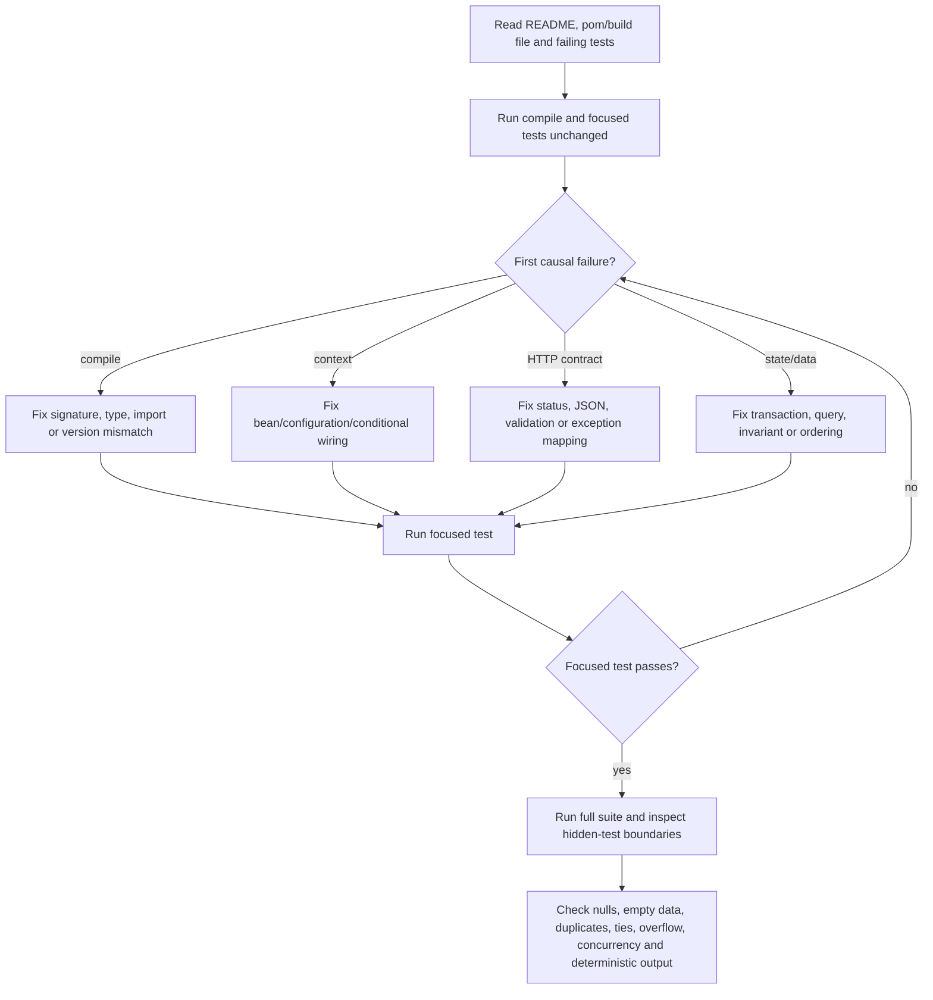
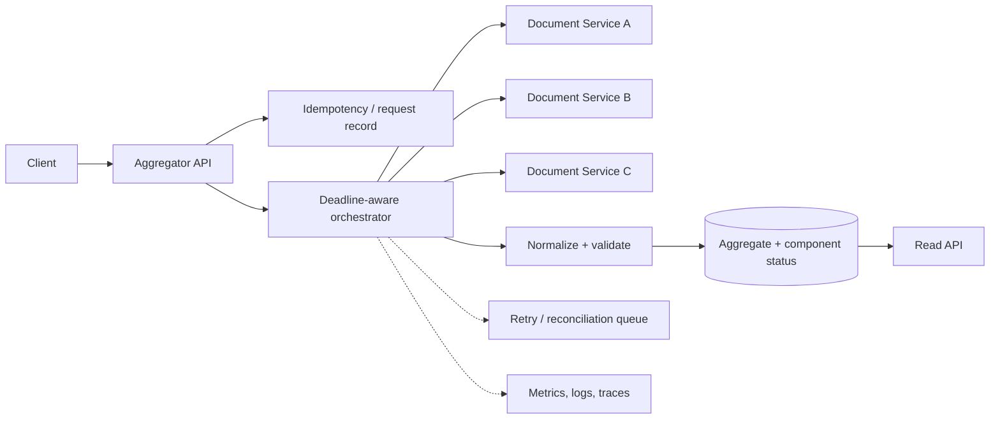
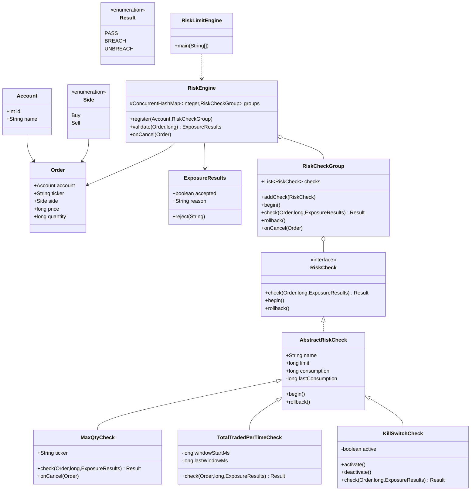
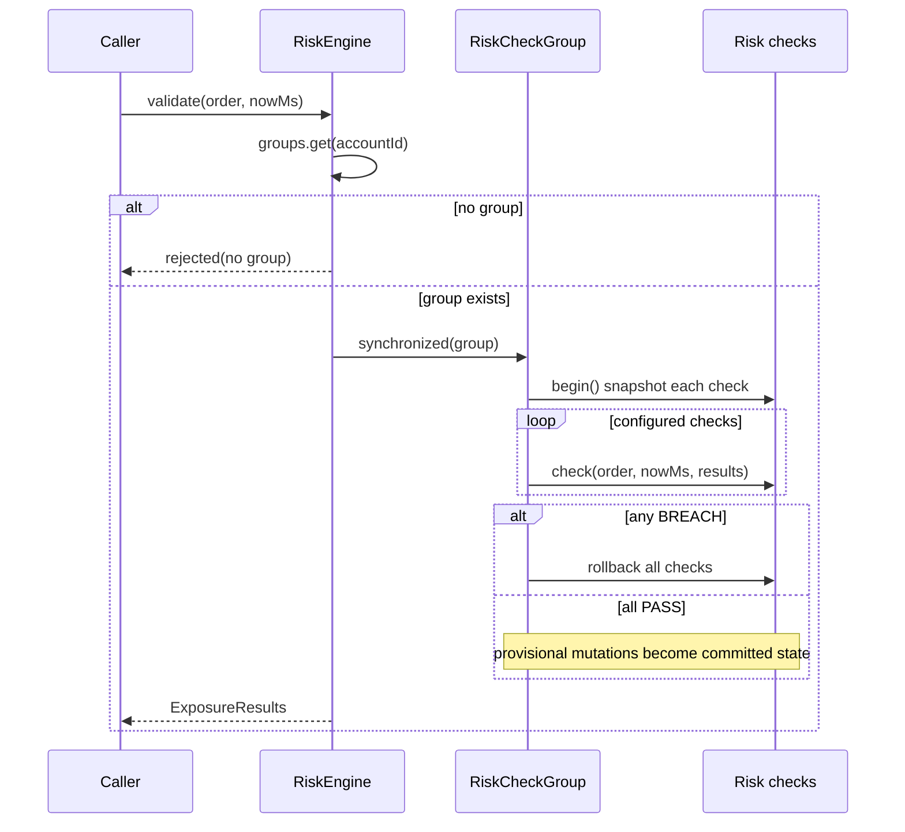
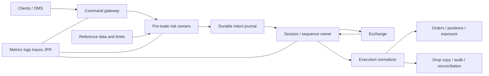
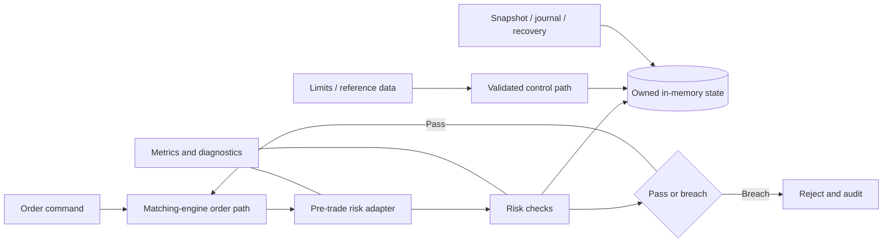
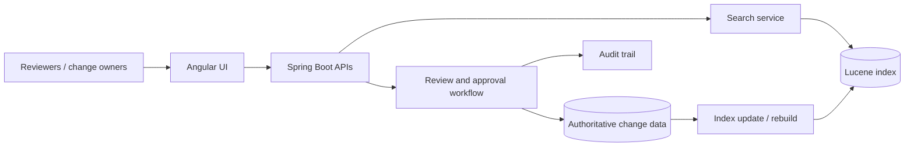

# Wells Fargo AVP Electronic Trading — HackerRank and Interview Experience Deep Dive

> **Prepared:** 23 November 2026  
> **Purpose:** one ordered, self-contained preparation book for the invited Wells Fargo 90-minute HackerRank and the likely technical/managerial rounds that follow.  
> **Role target:** AVP / Senior Specialty Software Engineer — Java, electronic trading, low-latency systems.  
> **Truth rule:** public candidate reports are useful signals, not guaranteed questions. Never describe a public report, an interview exercise, or a local Java lab as Wells Fargo internal architecture or as personal production work.

---

> **Before the OA.** Start with the [eight-hour HackerRank must-cover guide](WellsFargo_HackerRank_8_Hour_Must_Cover.md). This deep dive contains question banks, worked exercises, and later-round preparation.

---

# 0. Read this first

## 0.1 Confirmed from the supplied invitation

```text
Assessment: CMT-drive-LSE-2026_Mar
Platform: HackerRank
Duration: 90 minutes
End login: 29 Nov 2026, 11:56 PM PST
Equivalent in India: 30 Nov 2026, about 1:26 PM IST
Device: desktop browser
```

Verify the live HackerRank landing page before relying on the converted time. The invitation does **not** disclose the number or types of questions.

## 0.2 Best evidence about the likely format

| Evidence | Signal | Confidence for this AVP test |
|---|---|---:|
| Supplied invitation | 90-minute HackerRank | **Confirmed** |
| June 2026 selected Wells Fargo Senior Software Engineer report | 90-minute OA covering Java/Spring Boot backend development, SQL, Kafka, and microservices | **High relevance, unverified candidate report** |
| Another recent Senior Software Engineer report | SQL plus Spring Boot REST API tasks; Kafka and paginated-API scenarios | **High relevance, unverified candidate report** |
| Supplied 24 Nov 2026 recruiter conversation about an April candidate for the same role | Six tasks reportedly appeared: four Java coding, one REST API, one SQL; the candidate reportedly completed two Java and SQL fully, had hidden-test gaps on two Java tasks, and ran out of time on REST | **High relevance, second-hand and unverified; format may change** |
| October–November 2026 intern reports | one DSA, one SQL, and one backend repository task, sometimes Java/Spring Boot | **Useful platform practice, different level/track** |
| Supplied LeetCode company-tag screenshot | 19 DSA problems across strings, stacks, caches, intervals, graphs, sliding window, heap | **Practice signal, not a predicted OA set** |
| Supplied promotional “exact OA” article | two coding questions and claims about undetectable AI use | **Untrusted marketing content; do not rely on it** |

**Working assumption:** prepare for a mixed assessment containing Java coding, a Spring/REST repository task and SQL, with Kafka/microservices knowledge potentially tested directly or later. The six-task pattern is the strongest role-matched signal supplied so far, but it is still a second-hand report and must not be treated as a guaranteed current paper.

## 0.3 Integrity boundary — no side-channel AI

Do not use a phone, overlay, remote helper, another person, or external AI during the live assessment unless the test explicitly provides an allowed built-in AI mode and its displayed rules permit it.

HackerRank can support full-screen controls, tab monitoring, copy/paste restrictions, screenshots, code-similarity analysis, webcam/object analysis, and session review depending on the employer configuration. The exact settings are shown when the test starts; assume a closed-book test until the displayed rules say otherwise.

Legitimate AI use ends before the live test:

```text
Before test: generate drills, review code, explain failures, create mocks.
During test: follow only the assessment's displayed resource rules.
After test: review your own solution and prepare for follow-up questions.
```

Official platform references:

- [HackerRank candidate test introduction and sample-test guidance](https://candidatesupport.hackerrank.com/articles/9881337709-getting-familiar-with-hackerrank-tests)
- [HackerRank execution environments](https://candidatesupport.hackerrank.com/articles/2201684846-execution-environment)
- [HackerRank test-integrity modes](https://support.hackerrank.com/articles/1079706165-proctoring-hackerrank-tests)
- [HackerRank question types](https://support.hackerrank.com/articles/2354192461-question-types-in-hackerrank-tests)

## 0.4 Two later-round answer cues

- **Risk engine.** Read state, calculate candidates, validate every rule, then commit. Rejecting an order leaves risk state unchanged.
- **Senior technical answer.** Start with the decision, then give the invariant, mechanism, failure behavior, and evidence.

For the time-boxed Java, Spring, and SQL material, use the [eight-hour guide](WellsFargo_HackerRank_8_Hour_Must_Cover.md).

## 0.5 Minimum viable memory pack — automatic before the OA

Do not try to memorize Spring itself. Memorize the small skeleton and failure checks that let you navigate an unfamiliar repository. The runnable companion is [Booking API — Interview Learning and Defense Guide](../../../../Booking/INTERVIEW_GUIDE.md).

The [eight-hour guide](WellsFargo_HackerRank_8_Hour_Must_Cover.md) contains the essential syntax in study order. Use this section to diagnose a Spring task or prepare for deeper follow-up.

### Understand deeply; do not memorize blindly

- the complete Spring Security DSL: remember the order authentication → authorization and be able to read/modify the supplied configuration;
- Kafka producer/consumer properties: remember key-based partition ordering, offsets, duplicates, retries and DLQ; inspect the provided serializers/configuration;
- every JPA annotation option: know entity identity, owning side, fetch behavior, cascade danger, transaction boundary and N+1 diagnosis;
- framework-generated boilerplate: preserve the repository's Java/Spring version and its existing conventions instead of replacing them from memory.

### Minimum Spring OA red flags

| Severity | Red flag | Immediate response |
|---|---|---|
| P0 | Project does not compile or context does not start | Read the first causal exception, bean conditions and configuration; do not patch later symptoms |
| P0 | Public contract/signature changed to make a test pass | Restore the required DTO, method, path and status; change the smallest internal behavior |
| P0 | Mutation can partially commit | Put the invariant-changing work in one service transaction; validate before mutation |
| P0 | Default Security starter returns `401/403` unexpectedly | Read the intended contract and provide explicit security configuration; never disable security silently in production |
| P0 | Database state commits but required message can be lost | State the dual-write gap; use an outbox when durable delivery is required |
| P1 | Entity accepted or returned directly by the API | Use request/response DTOs to protect persistence and serialization boundaries |
| P1 | Field injection or mutable request state in singleton bean | Use constructor injection and method-local request state |
| P1 | `Optional.get`, null return or swallowed exception | Map absence/failure deliberately to domain or HTTP behavior |
| P1 | Unbounded list, nondeterministic sort or missing pagination | Add limit/page and a unique tie-breaker; define maximum input |
| P1 | Lazy access outside transaction or N+1 query | Map inside the boundary; use projection/fetch plan after inspecting queries |
| P1 | Cache updated without eviction/freshness contract | Make authoritative state and invalidation/staleness explicit |
| P1 | “Exactly once” claimed from Kafka configuration alone | Separate producer idempotence, Kafka transactions and end-to-end business idempotency |

### Repository-task control flow



## 0.6 Where every supplied Wells Fargo item is located

This is the navigation index. The detailed answers remain in one file; the Java implementations are linked beside the relevant problem.

| Supplied item | Location in this guide | Runnable/reference artifact |
|---|---|---|
| LeetCode Wells Fargo company page and supplied 19-problem screenshot | [All 19 problem statements, trade-offs and Java links](WellsFargo_19_LeetCode_Problems_Java_Solutions.md) | Named source links per problem |
| Four Java coding + one REST + one SQL pattern | [Six-task allocation](#if-there-are-four-java-coding-one-rest-api-and-one-sql-task) and [Section 7](#7-complete-dsa-bank-from-everything-supplied-in-this-chat) | [Booking REST practice](../../../../Booking/INTERVIEW_GUIDE.md) |
| Interface versus abstract class; Java versions | [Sections 4.1 and 4.5](#41-interface-versus-abstract-class) | Inline answer and follow-ups |
| SOLID, design patterns and Bridge | [Sections 4.7–4.8](#47-solid-with-risk-engine-examples) | Risk-engine examples inline |
| Spring/Spring Boot and Spring Security | [Sections 4.13 and 5](#413-spring-and-spring-boot-core-questions) | [Spring automatic syntax](../../../../Booking/SPRING_BOOT_AUTOMATIC_SYNTAX.md) |
| Kafka topic, partition, broker and ordering | [Section 6](#6-kafka-messaging-and-microservices) | Inline guarantee/failure answers |
| Complete CI/CD | [Section 10.2](#102-complete-cicd-of-your-current-project) | Truth-bounded project answer |
| Three-service document aggregator, circuit breaker, async orchestration, DLQ, scaling, CQRS/read replicas | [Section 2.4](#24-hands-on-task-c--three-service-document-aggregator) | Architecture, core answer and failure cross-questions |
| Filter versus interceptor; `@PreAuthorize` | [Sections 5.1–5.2](#51-filter-versus-interceptor) | Inline security answers |
| Load balancer versus API gateway | [Section 6.7](#67-load-balancer-versus-api-gateway) | Inline comparison and context |
| AI tools; LLM; RAG; fine-tuning; RAG optimization | [Section 10.3](#103-aillm-questions-reported-in-a-hiring-manager-round) | Truth-bounded concise answers |
| Maximum-salary employee using Streams | [Section 4.6](#46-employee-with-maximum-salary-using-streams) | Java variants and edge cases inline |
| New team/tech lead not helping; reason for switch | [Sections 11.1–11.2](#111-new-team-and-tech-lead-is-not-helping) | Behavioral answers and cross-questioning |
| Project architecture and résumé interrogation | [Section 10.4](#104-résumé-specific-cross-examination-map) | Verified/personalize boundaries |

The live [LeetCode Wells Fargo company page](https://leetcode.com/company/wells-fargo/?favoriteSlug=wells-fargo-all&from=discuss_company_card) may change, reorder or require account/Premium access. Section 7.1 preserves the 19-problem snapshot that was actually supplied; it does not claim that the live company list is fixed.

---

# 1. Ninety-minute OA execution playbook

## 1.1 Before clicking Start Test

1. Use the official sample test from the invitation page.
2. Verify browser, network, power, keyboard, and displayed integrity requirements.
3. Confirm the exact question count, sections, scoring, language/framework choices, and whether section navigation is allowed.
4. Prefer Java for DSA if it is your fastest reliable language; do not switch merely because another language is shorter.
5. If a Spring Boot project is offered, inspect the provided Java/Maven version instead of assuming your local setup.
6. Read every test-specific rule about external documentation, copy/paste, and AI assistance.

## 1.2 First inspection

Before coding:

```text
List all questions.
Identify: DSA / SQL / repository / MCQ / subjective.
Check independent section timers.
Open the repository tests and build file if present.
Estimate the shortest path to bank reliable points.
```

Do not spend the opening quarter of the assessment trying to perfect the hardest question without seeing the rest.

## 1.3 Adaptive allocation

### If there are DSA + SQL + Spring Boot

```text
Inspection and setup             5 minutes
SQL                             15–20 minutes
DSA                             25–30 minutes
Spring Boot repository          30–35 minutes
Full review / hidden cases       5–10 minutes
```

Change the order if one section is clearly easier, but preserve final review time.

### If there are four Java coding, one REST API and one SQL task

Use the single [90-minute six-task split in the eight-hour guide](WellsFargo_HackerRank_8_Hour_Must_Cover.md#stop-here-before-the-live-assessment). The recruiter’s prior candidate ran out of time on REST, so inspect that task during the first scan and protect time for it.

### If there are two coding questions

```text
Inspection                       5 minutes
Question A                       35 minutes
Question B                       35 minutes
Both-question adversarial review 15 minutes
```

### If the repository task dominates

```text
Run tests and inspect structure  8 minutes
Trace one failing path           7 minutes
Implement smallest correction   20 minutes
Focused tests                    5 minutes
Remaining requirements          15 minutes
Full suite and edge review       10 minutes
```

## 1.4 Hidden-test checklist

Before final submission, check:

- empty and single-element input;
- duplicate and all-equal values;
- null policy only if the contract permits null;
- integer overflow—use `long` where sums/products can exceed `int`;
- exact comparison boundary: `<` versus `<=`;
- stable tie-breaking and required sort direction;
- case/whitespace/exact error-message requirements;
- SQL null behavior, duplicate rows, grouping key, and deterministic ordering;
- HTTP status, response body shape, validation message, and content type;
- whether repository/project tests expect a named export, bean, method signature, or exception type;
- time and memory at maximum constraints.

## 1.5 Repository-task workflow

Use this sequence rather than reading every file:

```text
1. Open README/problem statement.
2. Open pom.xml/build.gradle for versions and dependencies.
3. Run tests before editing; preserve the first failure output.
4. Inspect test names and assertions.
5. Trace the failing public API inward: controller → service → repository/domain.
6. Search TODO, UnsupportedOperationException, empty methods, wrong annotations,
   mismatched names, serialization fields, and exception handlers.
7. Make the smallest coherent change.
8. Run the narrow test, then the full suite.
9. Inspect logs and exact response payloads—not only compilation.
10. Avoid broad refactoring until tests pass.
```

Useful commands when the embedded terminal permits them:

```bash
mvn test
mvn -q -Dtest=ClassNameTest test
mvn -q -Dtest=ClassNameTest#methodName test
./mvnw test
```

---

# 2. Spring Boot hands-on OA bank

## 2.1 Syntax worth being able to type without lookup

```java
@RestController
@RequestMapping("/api/documents")
class DocumentController {
    private final DocumentService service;

    DocumentController(DocumentService service) {
        this.service = service;
    }

    @GetMapping("/{id}")
    ResponseEntity<DocumentDto> get(@PathVariable long id) {
        return ResponseEntity.ok(service.get(id));
    }

    @PostMapping
    ResponseEntity<DocumentDto> create(@Valid @RequestBody CreateDocumentRequest request) {
        DocumentDto created = service.create(request);
        return ResponseEntity.status(HttpStatus.CREATED).body(created);
    }
}
```

Know why constructor injection is preferred: dependencies are explicit, required, testable, and compatible with immutable fields.

### Validation and error mapping

```java
record CreateDocumentRequest(
        @NotBlank String customerId,
        @NotBlank String type) {}

@RestControllerAdvice
class ApiExceptionHandler {
    @ExceptionHandler(DocumentNotFoundException.class)
    ResponseEntity<Map<String, Object>> notFound(DocumentNotFoundException ex) {
        return ResponseEntity.status(HttpStatus.NOT_FOUND)
                .body(Map.of("code", "DOCUMENT_NOT_FOUND", "message", ex.getMessage()));
    }
}
```

Be precise:

- malformed JSON is not the same as bean-validation failure;
- `404` means the addressed resource is absent, not a generic business rejection;
- `409` is suitable for a state conflict such as duplicate identity/version conflict;
- `422` may express a semantically invalid request if the API contract uses it;
- never return stack traces or secrets to the caller.

### Focused controller test

```java
@WebMvcTest(DocumentController.class)
class DocumentControllerTest {
    @Autowired MockMvc mvc;
    @MockBean DocumentService service;

    @Test
    void returnsDocument() throws Exception {
        when(service.get(7L)).thenReturn(new DocumentDto(7L, "READY"));

        mvc.perform(get("/api/documents/7"))
                .andExpect(status().isOk())
                .andExpect(jsonPath("$.status").value("READY"));
    }
}
```

Know the boundary:

- `@WebMvcTest`: MVC slice; mock service dependencies.
- `@SpringBootTest`: full application context; heavier integration coverage.
- real database integration: prefer an actual compatible database/container when dialect behavior matters.

Official reference: [Testing Spring Boot applications](https://docs.spring.io/spring-boot/reference/testing/spring-boot-applications.html).

## 2.2 Hands-on task A — repair a REST endpoint

Given a repository where three tests fail:

```text
POST /orders should return 201, but returns 200.
Blank accountId should return 400, but request succeeds.
Duplicate clientOrderId should return 409, but returns 500.
```

Your implementation checklist:

1. Add `@Valid` to the controller request.
2. Put validation annotations on the request DTO.
3. Return `201 CREATED` for a successful create.
4. Enforce uniqueness in the service/database—not only a pre-check vulnerable to races.
5. Translate the duplicate constraint/domain exception into `409`.
6. Add focused tests for status and response body.

Cross-question: why is `existsById()` followed by `save()` not sufficient? Because concurrent requests can both observe absence; the authoritative uniqueness constraint and exception path must close the race.

## 2.3 Hands-on task B — pagination

```java
@GetMapping
Page<DocumentDto> list(
        @RequestParam(defaultValue = "0") int page,
        @RequestParam(defaultValue = "20") int size) {
    if (page < 0 || size < 1 || size > 100) {
        throw new IllegalArgumentException("invalid pagination");
    }
    return service.list(PageRequest.of(page, size, Sort.by("id").ascending()));
}
```

Be ready to discuss:

- offset pagination becomes expensive/unstable for deep pages and changing datasets;
- keyset/cursor pagination uses a stable ordered key such as `(createdAt, id)`;
- the ordering must be deterministic;
- page size must be bounded;
- do not expose a JPA entity as the public API by accident.

## 2.4 Hands-on task C — three-service document aggregator

This is directly shaped by the selected senior-candidate report.

### Clarify first

```text
Are all three documents mandatory?
What is the end-to-end deadline?
Can results be partial?
Are upstream calls idempotent reads?
What is the identity of one aggregate request?
What must be persisted if one dependency times out?
Can the same client request retry?
How fresh must each document be?
```

### Architecture



### Core answer

> The orchestrator starts independent calls concurrently under one propagated deadline. Each dependency has a connect/read timeout and bounded concurrency. The aggregate contract explicitly defines all-or-nothing versus partial completion. A timeout is not silently converted to an empty document. Persist the request identity, each component status/version, and the final aggregate state atomically enough for the promised API. Retries occur only where the operation is safe and within the remaining deadline; unresolved work goes to reconciliation. Circuit breakers prevent repeated calls to a failing dependency but do not create capacity. Bulkheads isolate one slow service. Observability uses request and dependency correlation IDs, per-upstream latency/error/saturation, aggregate completeness, and oldest reconciliation age.

### Failure questions

- What if service B is slow? Respect the aggregate deadline; return explicit incomplete/pending behavior according to contract.
- Why not blindly retry? It can amplify an outage, exceed the deadline, and duplicate non-idempotent effects.
- What if persistence succeeds but response is lost? Stable idempotency key returns the stored outcome.
- What if persistence fails after all calls? Do not claim success; retry/reconcile under stable identity.
- Why not Kafka on the synchronous read path? It does not satisfy a request/response deadline by itself; use asynchronous work only if the product contract permits pending completion.
- CQRS? Useful only if read/write models truly diverge; not mandatory for three calls.
- Read replica? Helps eligible read load but can be stale; it does not fix upstream latency.

## 2.5 Hands-on task D — rate limiter

```java
final class TokenBucket {
    private final long capacity;
    private final double tokensPerNano;
    private double tokens;
    private long lastRefillNanos;

    TokenBucket(long capacity, double tokensPerSecond, long nowNanos) {
        this.capacity = capacity;
        this.tokensPerNano = tokensPerSecond / 1_000_000_000.0;
        this.tokens = capacity;
        this.lastRefillNanos = nowNanos;
    }

    synchronized boolean tryConsume(long requested, long nowNanos) {
        long elapsed = Math.max(0, nowNanos - lastRefillNanos);
        tokens = Math.min(capacity, tokens + elapsed * tokensPerNano);
        lastRefillNanos = nowNanos;
        if (tokens < requested) return false;
        tokens -= requested;
        return true;
    }
}
```

Follow-ups:

- Process-local state protects one instance; it is not a strict global quota.
- Use a monotonic clock for elapsed time.
- Define key, capacity, refill rate, burst behavior, fairness, memory eviction, and rejection response.
- A distributed limiter adds coordination latency and failure behavior; require it only if quota strictness justifies it.

## 2.6 Common repository bugs to recognize quickly

```text
Wrong/missing annotation
Constructor not recognized as bean dependency
DTO JSON field mismatch
Entity leaked as response
Missing @Valid
Exception swallowed and 200 returned
Wrong HTTP status
Incorrect repository method name
Optional.get() on empty value
Transaction placed on a private/self-invoked method
LazyInitializationException after transaction closes
N+1 query
Wrong sort or pagination boundary
Mutable singleton bean state
Blocking network call inside a lock/transaction
Test expects exact message or schema
Build/export/package name mismatch
```

---

# 3. SQL coding bank

## 3.1 Query-construction order

Say this before typing:

```text
What does one output row represent?
Which base rows are eligible?
Which joins preserve or eliminate missing rows?
Do I need aggregation or a window?
How are ties handled?
What ordering is required?
```

Logical processing reminder:

```text
FROM / JOIN
→ WHERE
→ GROUP BY
→ HAVING
→ SELECT / windows conceptually over the derived rows
→ ORDER BY
→ LIMIT/FETCH
```

## 3.2 Nth highest distinct salary

```sql
WITH ranked AS (
    SELECT employee_id,
           salary,
           DENSE_RANK() OVER (ORDER BY salary DESC) AS salary_rank
    FROM employee
)
SELECT employee_id, salary
FROM ranked
WHERE salary_rank = :n
ORDER BY employee_id;
```

Use `DENSE_RANK` when equal salaries share a rank and the next distinct salary is rank 2. Use `ROW_NUMBER` only when exactly one row per position is wanted and tie-breaking is defined.

## 3.3 Highest-paid employee per department

```sql
WITH ranked AS (
    SELECT e.*,
           DENSE_RANK() OVER (
               PARTITION BY department_id
               ORDER BY salary DESC
           ) AS rnk
    FROM employee e
)
SELECT department_id, employee_id, salary
FROM ranked
WHERE rnk = 1
ORDER BY department_id, employee_id;
```

## 3.4 Top three distinct salaries per department

```sql
WITH ranked AS (
    SELECT e.*,
           DENSE_RANK() OVER (
               PARTITION BY department_id
               ORDER BY salary DESC
           ) AS rnk
    FROM employee e
)
SELECT department_id, employee_id, salary
FROM ranked
WHERE rnk <= 3
ORDER BY department_id, rnk, employee_id;
```

## 3.5 Latest order per account

```sql
WITH ranked AS (
    SELECT o.*,
           ROW_NUMBER() OVER (
               PARTITION BY account_id
               ORDER BY created_at DESC, order_id DESC
           ) AS rn
    FROM orders o
)
SELECT account_id, order_id, created_at, status
FROM ranked
WHERE rn = 1;
```

The secondary `order_id` tie-break makes the result deterministic.

## 3.6 Orders with no execution

```sql
SELECT o.order_id
FROM orders o
WHERE NOT EXISTS (
    SELECT 1
    FROM executions e
    WHERE e.order_id = o.order_id
)
ORDER BY o.order_id;
```

`NOT EXISTS` avoids the null pitfalls of `NOT IN` when its subquery can return null.

## 3.7 Duplicate execution identifiers

```sql
SELECT execution_id, COUNT(*) AS occurrence_count
FROM executions
GROUP BY execution_id
HAVING COUNT(*) > 1
ORDER BY occurrence_count DESC, execution_id;
```

## 3.8 Running executed quantity

```sql
SELECT order_id,
       execution_id,
       executed_at,
       quantity,
       SUM(quantity) OVER (
           PARTITION BY order_id
           ORDER BY executed_at, execution_id
           ROWS BETWEEN UNBOUNDED PRECEDING AND CURRENT ROW
       ) AS cumulative_quantity
FROM executions
ORDER BY order_id, executed_at, execution_id;
```

## 3.9 Conditional aggregate report

Pattern for security/quarantine/report questions:

```sql
SELECT u.domain,
       t.threat_type,
       COUNT(*) AS quarantined_count,
       SUM(u.affected_users) AS affected_users
FROM url_event u
JOIN threat_type t ON t.threat_type_id = u.threat_type_id
WHERE u.status = 'QUARANTINED'
GROUP BY u.domain, t.threat_type
ORDER BY affected_users DESC, u.domain, t.threat_type;
```

Adjust names to the supplied schema. Do not assume every join is one-to-one; duplicate multiplication is a common hidden-test failure.

## 3.10 Index questions

### Clustered versus non-clustered

- A clustered organization determines the table's physical/index-organized row order according to the database implementation; normally only one such organization is possible.
- A non-clustered/secondary index is a separate access structure pointing to rows; several can exist, at write/storage cost.
- Exact terminology and behavior differ by database. Do not give SQL Server rules as universal database truth.

### Composite index

For:

```sql
SELECT status, created_at
FROM orders
WHERE account_id = ?
  AND status = ?
ORDER BY created_at DESC
LIMIT 50;
```

Candidate index:

```sql
(account_id, status, created_at DESC)
```

Explain selectivity, equality-prefix behavior, sort avoidance, covering/include options, write amplification, and the need to inspect the actual execution plan.

---

# 4. Java and object-oriented question bank

## 4.1 Interface versus abstract class

**Direct answer:** an interface defines a capability/contract across otherwise unrelated types and supports multiple interface inheritance. An abstract class shares state, constructors, protected implementation, and one inheritance lineage.

Use an interface for `RiskCheck`. Use an abstract base only when several stateful checks genuinely share snapshot/rollback mechanics. Do not create an abstract class merely to avoid three repeated lines.

Follow-ups:

- Interfaces can have default/static/private methods, but no per-instance mutable fields.
- A class can implement several interfaces but extend one class.
- Favor composition when inheritance does not represent a stable substitutable relationship.

## 4.2 Overloading versus overriding

- Overloading: same method name, different parameter list; resolved at compile time.
- Overriding: subclass supplies an implementation of an inherited instance method; dispatched at runtime.
- Return type alone cannot overload.
- Static methods are hidden, not overridden.
- An overriding method cannot reduce access and may narrow checked exceptions.

## 4.3 `final`, `finally`, `finalize`

- `final`: variable assigned once, method not overridden, class not subclassed.
- `finally`: cleanup block that normally runs after `try`/`catch`; prefer try-with-resources for `AutoCloseable` resources.
- `finalize`: obsolete/deprecated cleanup mechanism; never rely on it for resource management.

There is no Java destructor and therefore no destructor overloading question in Java.

## 4.4 Mark-and-sweep and modern GC answer

Reachability starts from GC roots. The collector identifies live objects; unreachable objects are reclaimable. “Mark and sweep” is a conceptual foundation, but modern collectors use generations, regions, concurrent marking, evacuation/compaction, barriers, and collector-specific phases. Discuss allocation rate, live set, pause distribution, safepoints, promotion, fragmentation, and evidence rather than reciting one algorithm.

## 4.5 Java-version answer

Do not list every release. Select features you can use correctly:

```text
Java 8: lambdas, streams, Optional, CompletableFuture, java.time.
Java 9–11: modules, collection factories, local var, standard HTTP client.
Java 14–17: records, switch expressions, pattern matching for instanceof,
            text blocks, sealed classes.
Java 21: virtual threads, record patterns, finalized pattern matching for switch.
```

Follow-up: virtual threads improve scalability for blocking I/O workloads; they do not make CPU-bound work faster or remove downstream capacity limits.

## 4.6 Employee with maximum salary using streams

Return the employee:

```java
Optional<Employee> highestPaid = employees.stream()
        .max(Comparator.comparingLong(Employee::salary));
```

Return only the salary:

```java
OptionalLong maxSalary = employees.stream()
        .mapToLong(Employee::salary)
        .max();
```

Deterministic tie-break:

```java
Optional<Employee> highestPaid = employees.stream()
        .max(Comparator.comparingLong(Employee::salary)
                .thenComparing(Employee::id));
```

Clarify empty-list behavior and whether null employees/salaries are allowed. Official reference: [Java `Stream.max`](https://docs.oracle.com/en/java/javase/26/docs/api/java.base/java/util/stream/Stream.html#max(java.util.Comparator)).

## 4.7 SOLID with risk-engine examples

- **S:** `RiskCheck` evaluates one rule; publishing/audit belongs elsewhere.
- **O:** add a new `RiskCheck` implementation without modifying the engine switch logic.
- **L:** every implementation must honor PASS/BREACH and state/rollback contracts.
- **I:** stateless checks should not be forced to implement meaningless snapshot behavior; split interfaces if necessary.
- **D:** orchestration depends on `RiskCheck`, `Clock`, reference-price, and publisher abstractions—not concrete infrastructure.

## 4.8 Bridge pattern

Bridge separates an abstraction hierarchy from an implementation hierarchy so both can vary independently.

```text
Notification abstraction: Alert / EscalationAlert
Delivery implementation: EmailSender / SmsSender / MessageBusSender
```

Do not call Strategy “Bridge” merely because an interface is injected. Bridge is useful when two independent dimensions need separate evolution.

Likely cross-questions:

- Bridge versus Adapter: Bridge is designed upfront to separate dimensions; Adapter makes incompatible existing interfaces work together.
- Bridge versus Strategy: Strategy selects an algorithm/behavior; Bridge separates two class hierarchies.
- Where used personally? Give a real example or state that it is a design exercise.

Pattern map for the broader “which patterns did you implement?” question:

- **Strategy:** interchangeable `RiskCheck` policies behind one contract.
- **Adapter:** translate a venue/protocol-specific message into the internal canonical command or event.
- **Factory:** choose a parser/check/client implementation from validated configuration without spreading construction logic.
- **Observer/pub-sub:** notify independent consumers of an event; define ordering, failure isolation and delivery semantics rather than merely naming the pattern.
- **Decorator:** add logging/metrics/authentication around a component while retaining its contract; distinguish this from proxy-based framework behavior.
- **Template Method:** base class fixes an algorithm skeleton while subclasses fill controlled steps; use only when inheritance is genuinely stable.
- **Circuit Breaker:** state machine around remote calls; it is a resilience pattern, not a substitute for timeout, capacity or fallback correctness.
- **Transactional Outbox:** atomically store domain state plus an event-to-publish, then relay it; handles the database/event dual-write gap but still requires idempotent consumers.

For each pattern state the problem, why a simpler function/composition was insufficient, the alternative considered, and the downside. Never claim personal implementation merely because the repository contains a rehearsal example.

## 4.9 HashMap internals

Hash the key, map to a bucket, compare hash and equality within that bucket, resize when threshold is crossed. Java 8 may treeify sufficiently large collision chains under capacity conditions. Correct keys need stable `equals`/`hashCode`; mutating a key field involved in equality after insertion can make lookup fail. `HashMap` is not thread-safe. `ConcurrentHashMap` protects its operations but not a multi-object business transaction.

## 4.10 Exceptions

```text
Checked: caller is forced to catch/declare; use selectively for recoverable contracts.
Unchecked: programming/domain/runtime failure; still document boundary behavior.
Error: serious JVM/system condition; normally not application recovery flow.
```

Preserve the original cause. Do not catch `Exception`, log, and continue with corrupt state. Map internal exceptions to stable API errors at the boundary.

## 4.11 REST versus SOAP

**Direct answer:** REST is an architectural style usually exposing resources over HTTP with standard verbs and commonly JSON. SOAP is a message protocol with an XML envelope, WSDL contracts, and mature WS-* standards. Neither is universally better.

Choose REST when browser/mobile/service clients benefit from simple HTTP semantics, cacheability, broad tooling, and lightweight payloads. Choose SOAP when a regulated or legacy integration requires a strict WSDL contract or WS-Security, reliable messaging, or other mandated WS-* features. The trade-off is REST’s simpler evolution and smaller payloads versus SOAP’s formal standardized enterprise contract and heavier complexity.

Senior follow-ups:

- `POST` is not automatically idempotent; use an idempotency key when retrying creation/payment/order commands.
- `PUT` normally replaces the resource representation and should be idempotent; `PATCH` applies a partial change and needs a defined patch format.
- HTTP success does not prove the business effect committed; define transaction and response boundaries.
- Version compatibility can use additive fields, tolerant readers, explicit versions for breaking changes, and contract tests.
- For internal low-latency binary messaging, neither JSON REST nor SOAP may be appropriate; select a protocol from the latency, compatibility, operability, and tooling requirements.

## 4.12 ACID, isolation, locking, and indexes

- **Atomicity:** a transaction’s changes commit together or roll back together.
- **Consistency:** committed state satisfies declared invariants; the application must still encode the correct invariant.
- **Isolation:** concurrent transactions behave according to the chosen isolation contract.
- **Durability:** once committed, the result survives the failures covered by the database’s durability configuration.

Isolation anomalies:

```text
read uncommitted → dirty reads possible
read committed   → prevents dirty reads; non-repeatable reads/lost-update patterns still need handling
repeatable read  → stable rereads, but exact phantom/write-skew behavior is database-specific
serializable     → strongest transaction illusion; may abort/retry and reduce concurrency
```

Optimistic locking uses a version check and works when conflicts are rare; on conflict, retry the complete business operation with a bound. Pessimistic locking blocks competitors and can be appropriate for short, highly contended critical sections, but introduces waits and deadlock risk. Never say `ConcurrentHashMap` or a database row lock alone makes a multi-entity risk invariant atomic.

Clustered/non-clustered answer: a clustered index determines or closely governs row storage order depending on the database, so there is normally one. A non-clustered index is a separate search structure containing the key plus a row locator and optional included columns. Exact terminology/behavior is engine-specific. Every index trades read speed for storage, write amplification, maintenance, and possible contention. Validate with the real execution plan and production-like cardinality.

## 4.13 Spring and Spring Boot core questions

**Spring versus Spring Boot:** Spring provides dependency injection, AOP, transactions, MVC and the wider framework. Spring Boot adds opinionated auto-configuration, starters, embedded runtime support, externalized configuration, Actuator and production-oriented conventions. Boot does not remove the need to understand the underlying beans and proxies.

**Constructor injection:** exposes mandatory dependencies, supports immutability and makes unit tests explicit. Avoid field injection. Multiple implementations require an explicit qualifier or primary choice.

**Singleton safety:** Spring singleton scope means one bean instance per application context, not thread safety. Keep request state in local variables or use explicit concurrency/ownership controls for shared mutable state.

**`@Transactional`:** normally implemented by a proxy. Self-invocation can bypass the proxy. Rollback defaults typically cover unchecked exceptions; checked-exception policy must be explicit. Keep external network calls out of long database transactions. State the propagation/isolation requirement instead of decorating every method.

**Common repository defects:** missing validation, entity leakage from controllers, N+1 queries, unbounded result sets, incorrect transaction boundary, lazy access after session close, exception swallowing, missing deterministic ordering, time-zone ambiguity and non-idempotent retry.

**Readiness versus liveness:** liveness answers whether the process should be restarted; readiness answers whether it may receive traffic. Do not report ready before required state, subscriptions, reference data and replay are complete. On shutdown, stop intake, drain or safely checkpoint, release ownership and expose clear health transitions.

## 4.14 Test strategy for a senior backend answer

```text
pure unit tests           → domain rules and boundary values
slice tests               → controller validation/serialization/security
repository integration    → real database dialect, constraints and queries
contract tests            → upstream/downstream compatibility
component tests           → service with real infrastructure substitutes
failure tests             → timeout, duplicate, reordering, crash and replay
load/soak tests            → throughput, p99/p99.9, allocation and queue growth
production verification   → canary, business invariants, rollback signal
```

Mock only the boundary you are not testing. A test that mocks the transaction manager, Kafka client, serializer and database cannot prove integration semantics. For concurrency tests, coordinate interleavings with barriers/latches rather than sleeps, repeat them, and assert invariants instead of one fortunate output.

---

# 5. Spring Security deep dive

## 5.1 Filter versus interceptor

| Filter | Spring MVC `HandlerInterceptor` |
|---|---|
| Servlet-container boundary | MVC handler boundary |
| Runs before `DispatcherServlet` and can wrap request/response | Runs around controller handler selection/execution |
| Suitable for security chain, CORS, low-level request concerns | Suitable for MVC-specific logging/context checks |
| Can block before MVC exists | Does not replace Spring Security authentication/authorization |

Spring Security's servlet support is implemented through `FilterChainProxy` and one or more `SecurityFilterChain`s. Authentication must occur before authorization. Official reference: [Spring Security servlet architecture](https://docs.spring.io/spring-security/reference/servlet/architecture.html).

## 5.2 `@PreAuthorize`

Enable method security:

```java
@Configuration
@EnableMethodSecurity
class MethodSecurityConfig {}

@PreAuthorize("hasAuthority('document:read') and #accountId == authentication.name")
DocumentDto read(String accountId, long documentId) { ... }
```

`@PreAuthorize` evaluates before the method invocation. It complements request-level authorization and is valuable when the same service method can be reached from several entry points. Spring Boot's security starter does not automatically enable method authorization; use `@EnableMethodSecurity`. Official reference: [Spring method security](https://docs.spring.io/spring-security/reference/servlet/authorization/method-security.html).

## 5.3 Authentication versus authorization

- Authentication establishes the principal/credentials.
- Authorization decides whether that principal may perform the specific operation on the specific resource.
- A valid token does not automatically authorize every account or object.
- Enforce object ownership/entitlements server-side to prevent IDOR.

## 5.4 JWT questions

Be ready to explain:

- signature verifies integrity/authenticity, not confidentiality;
- validate algorithm, issuer, audience, expiry/not-before, and key rotation;
- short-lived access token plus controlled refresh flow;
- revocation is not automatic for self-contained tokens;
- never put secrets or excessive sensitive data in claims;
- authorization uses server-controlled authorities and resource checks.

## 5.5 CSRF versus CORS

- CSRF exploits ambient browser credentials to make an unwanted state-changing request.
- CORS is a browser policy controlling which origins may read/call cross-origin resources; it is not authentication.
- Stateless bearer-token APIs not using cookies have a different CSRF profile, but XSS/token storage remain concerns.

---

# 6. Kafka, messaging, and microservices

## 6.1 Topic, partition, broker, consumer group

- Topic: named stream/log.
- Partition: ordered append-only shard and Kafka's unit of parallelism.
- Broker: server storing/serving partitions.
- Consumer group: cooperating consumers; one partition is assigned to at most one consumer in a group at a time.
- Ordering is guaranteed within a partition, not across an entire multi-partition topic.

Official reference: [Apache Kafka introduction and partition ordering](https://kafka.apache.org/documentation/#intro_concepts_and_terms).

## 6.2 How to preserve order per account/order

Use a stable key such as `accountId` or `orderId` so related records map to the same partition. This preserves per-key order only if producers, retries, partition changes, and consumer processing respect the contract. A hot key can overload one partition.

## 6.3 Delivery semantics

- At-most-once: may lose, does not redeliver.
- At-least-once: may redeliver; consumer must make state transition idempotent.
- Kafka transactions can atomically coordinate certain Kafka reads/writes, but do not automatically make a database plus external side effect exactly once.
- Exactly-once business effect requires stable identity, atomic state/outcome recording, deduplication, and recovery across the complete boundary.

## 6.4 Offset and failure

Commit after the business effect is durably recorded to avoid acknowledging unprocessed work. If the effect commits and offset commit fails, replay occurs—hence idempotency. If offset commits first and the process crashes before the effect, work is lost.

## 6.5 Dead-letter queue

A DLQ is not a dumping ground. Record original identity/payload reference, failure class, attempt count, source topic/partition/offset, first/last failure time, and replay policy. Alert on age and volume. Do not retry permanent validation errors forever.

## 6.6 Why microservices?

Good reasons: independently owned capabilities, distinct scaling/reliability needs, bounded deployment, security boundaries, organizational autonomy. Costs: network failure, latency, distributed data consistency, versioning, observability, deployment complexity. Do not split a cohesive low-latency invariant across services merely to say “microservices.”

## 6.7 Load balancer versus API gateway

- Load balancer distributes traffic among healthy instances, often at L4/L7.
- API gateway is an application-facing policy/routing boundary: authentication, authorization integration, routing, quotas, protocol adaptation, observability, and sometimes aggregation.
- They can coexist; neither replaces service-level correctness or idempotency.

## 6.8 Circuit breaker

Closed permits calls; repeated qualifying failures open it; after a cooldown, half-open allows probes. It prevents repeated pressure on a failing dependency and gives fast failure, but it does not create capacity, guarantee fallback correctness, or replace timeouts and bulkheads.

---

# 7. Complete DSA bank from everything supplied in this chat

The screenshot showed a 19-problem company-tag snapshot on 23 November 2026. Tags can change and do not prove that an item is in this assessment. The additional four reported-style questions came from supplied promotional text and are deliberately classified as **practice, not verified prediction**.

Recreate each solution before opening its Java reference. The screenshot table links dedicated DSA10days implementations where available. The [existing Wells Fargo Java bank](../../src/main/java/org/chijai/wellsfargo/WellsFargoHackerRankDsaSolutions.java) covers the remaining screenshot entries and extra practice.

## 7.1 All 19 screenshot problems — answer, invariant, complexity, Java

The [19-problem study file](WellsFargo_19_LeetCode_Problems_Java_Solutions.md) puts each full problem statement, example, derivation, trade-off, spoken answer, and existing Java link together. Use the table below for a quick scan.

Live company page: [Wells Fargo tagged problems on LeetCode](https://leetcode.com/company/wells-fargo/?favoriteSlug=wells-fargo-all&from=discuss_company_card). The table below is the supplied 19-problem snapshot and remains stable for preparation even if the live page changes.

| Problem | Solution you must articulate | Complexity / Java |
|---|---|---|
| [2904. Shortest and Lexicographically Smallest Beautiful String](https://leetcode.com/problems/shortest-and-lexicographically-smallest-beautiful-string/) | For every left boundary, extend until exactly `k` ones; compare first by length and then lexicographically. Breaking at the first valid right is safe for that left. | `O(n²)`, `O(n)` peak extra for copied strings · [WellsFargoHackerRankDsaSolutions.java](../../src/main/java/org/chijai/wellsfargo/WellsFargoHackerRankDsaSolutions.java#L28) |
| [796. Rotate String](https://leetcode.com/problems/rotate-string/) | A rotation exists iff lengths match and `goal` occurs in `s + s`. Length equality prevents accepting an unrelated substring. | `O(n)` extra for doubling, search implementation dependent · [WellsFargoHackerRankDsaSolutions.java](../../src/main/java/org/chijai/wellsfargo/WellsFargoHackerRankDsaSolutions.java#L51) |
| [1768. Merge Strings Alternately](https://leetcode.com/problems/merge-strings-alternately/) | Walk one shared index, append from each string when in range, so the longer remainder is naturally appended. | `O(n+m)`, output space · [WellsFargoHackerRankDsaSolutions.java](../../src/main/java/org/chijai/wellsfargo/WellsFargoHackerRankDsaSolutions.java#L56) |
| [703. Kth Largest in a Stream](https://leetcode.com/problems/kth-largest-element-in-a-stream/) | Keep a min-heap containing only the largest `k` observed values; its root is the kth largest. | `add O(log k)`, `O(k)` · [KthLargestInStream.java](../../src/main/java/org/chijai/day7/session1/heap/KthLargestInStream.java#L331) |
| [2696. Minimum Length After Removing Substrings](https://leetcode.com/problems/minimum-string-length-after-removing-substrings/) | Use a stack; when the top plus current character is `AB` or `CD`, pop instead of push. **The actual LeetCode pair is `AB` or `CD`, not `AB` or `BB`.** | `O(n)`, `O(n)` · [WellsFargoHackerRankDsaSolutions.java](../../src/main/java/org/chijai/wellsfargo/WellsFargoHackerRankDsaSolutions.java#L94) |
| [200. Number of Islands](https://leetcode.com/problems/number-of-islands/) | On each unvisited land cell, increment the answer and flood-fill its complete component. Mark the visited matrix when enqueuing so a cell is never queued twice. | `O(RC)`, `O(RC)` worst case · [Islands.java](../../src/main/java/org/chijai/day8/graph/session1/Islands.java#L830) |
| [2062. Count Vowel Substrings](https://leetcode.com/problems/count-vowel-substrings-of-a-string/) | Reset at consonants. Count vowel-only windows with exactly five distinct vowels as `atMost(5) - atMost(4)`. | `O(n)`, `O(1)` alphabet · [WellsFargoHackerRankDsaSolutions.java](../../src/main/java/org/chijai/wellsfargo/WellsFargoHackerRankDsaSolutions.java#L142) |
| [460. LFU Cache](https://leetcode.com/problems/lfu-cache/) | Maintain key→value, key→frequency, frequency→LRU-ordered keys, plus `minFrequency`. Promote on get/update; evict the oldest key in the minimum-frequency bucket. | Average `O(1)`, `O(capacity)` · [WellsFargoHackerRankDsaSolutions.java](../../src/main/java/org/chijai/wellsfargo/WellsFargoHackerRankDsaSolutions.java#L172) |
| [253. Meeting Rooms II](https://leetcode.com/problems/meeting-rooms-ii/) | Sort by start, remove every expired end from a min-heap, insert the current end and track the largest heap size. | `O(n log n)`, `O(n)` · [IntervalActiveMinHeap.java](../../src/main/java/org/chijai/day1/Arrays/session4/Intervals/IntervalActiveMinHeap.java#L168) |
| [844. Backspace String Compare](https://leetcode.com/problems/backspace-string-compare/) | Scan both strings backward, carrying a skip count; compare only the next visible character. | `O(n+m)`, `O(1)` · [WellsFargoHackerRankDsaSolutions.java](../../src/main/java/org/chijai/wellsfargo/WellsFargoHackerRankDsaSolutions.java#L246) |
| [160. Intersection of Two Linked Lists](https://leetcode.com/problems/intersection-of-two-linked-lists/) | When each pointer reaches its tail, redirect it to the other head. Each traverses `a+b`, equalizing unequal prefixes. Compare node identity, not value. | `O(n+m)`, `O(1)` · [Intersection.java](../../src/main/java/org/chijai/day4/LinkedList/session1/Intersection.java#L61) |
| [20. Valid Parentheses](https://leetcode.com/problems/valid-parentheses/) | Push the expected closing delimiter for every opener; each closer must equal the stack top, and the stack must finish empty. | `O(n)`, `O(n)` · [ValidParentheses.java](../../src/main/java/org/chijai/day5/stack/session3/ValidParentheses.java#L732) |
| [146. LRU Cache](https://leetcode.com/problems/lru-cache/) | Map gives node lookup; doubly linked list gives constant-time unlink/relink and least-recent eviction. Get and update both move a node to MRU. | `O(1)`, `O(capacity)` · [LruCache.java](../../src/main/java/org/chijai/day4/LinkedList/session3/LruCache.java#L114) |
| [2008. Maximum Earnings From Taxi](https://leetcode.com/problems/maximum-earnings-from-taxi/) | Sort rides by end. DP over rides: skip this ride or take it plus the best result ending no later than its start, found by binary search. | `O(n log n)`, `O(n)` · [WellsFargoHackerRankDsaSolutions.java](../../src/main/java/org/chijai/wellsfargo/WellsFargoHackerRankDsaSolutions.java#L388) |
| [696. Count Binary Substrings](https://leetcode.com/problems/count-binary-substrings/) | Track adjacent equal-character run lengths. Every boundary contributes `min(previousRun,currentRun)`. | `O(n)`, `O(1)` · [WellsFargoHackerRankDsaSolutions.java](../../src/main/java/org/chijai/wellsfargo/WellsFargoHackerRankDsaSolutions.java#L416) |
| [93. Restore IP Addresses](https://leetcode.com/problems/restore-ip-addresses/) | Backtrack exactly four components. Prune remaining length, leading zeros, component length >3 and values >255. | Bounded `O(3⁴)`, output space · [WellsFargoHackerRankDsaSolutions.java](../../src/main/java/org/chijai/wellsfargo/WellsFargoHackerRankDsaSolutions.java#L433) |
| [56. Merge Intervals](https://leetcode.com/problems/merge-intervals/) | Sort by start; extend the current end on overlap, otherwise emit the current interval and start a new one. Clarify whether touching endpoints overlap. | `O(n log n)`, `O(n)` auxiliary plus output · [IntervalSortByStart.java](../../src/main/java/org/chijai/day1/Arrays/session4/Intervals/IntervalSortByStart.java#L205) |
| [713. Subarray Product Less Than K](https://leetcode.com/problems/subarray-product-less-than-k/) | For positive numbers, grow a product window and shrink while product ≥ `k`. Each valid right endpoint adds `right-left+1` subarrays. Return zero when `k <= 1`. | `O(n)`, `O(1)` · [WellsFargoHackerRankDsaSolutions.java](../../src/main/java/org/chijai/wellsfargo/WellsFargoHackerRankDsaSolutions.java#L484) |
| [121. Best Time to Buy and Sell Stock](https://leetcode.com/problems/best-time-to-buy-and-sell-stock/) | Maintain the cheapest earlier price and best profit if selling today. Update minimum before/with each profit calculation. | `O(n)`, `O(1)` · [StockSeries1.java](../../src/main/java/org/chijai/day1/Arrays/session3/StockSeries1.java#L640) |

## 7.2 Additional questions explicitly supplied in the chat

### A. Find the Safest Path in a Grid — practice, not a verified AVP prediction

[2812. Find the Safest Path in a Grid](https://leetcode.com/problems/find-the-safest-path-in-a-grid/) appeared in promotional material supplied in the chat. The reliable derivation is:

1. Put every thief in one queue and run multi-source BFS. This produces each cell’s distance to its nearest thief in `O(n²)`.
2. The path score is a bottleneck: the minimum cell distance along that path.
3. Run a widest-path variant of Dijkstra using a max-heap. For neighbor `v`, `candidate = min(pathScore[u], distance[v])`.
4. Process the highest candidate first. When the destination is removed with its current best score, that score is optimal.

Complexity: `O(n² log n)` time and `O(n²)` space. A threshold binary search plus BFS is also correct because reachability using cells of distance at least `x` is monotone. [Java](../../src/main/java/org/chijai/wellsfargo/WellsFargoHackerRankDsaSolutions.java#L513)

Tests: thief at start/end → zero; single thief; several equal-best paths; narrow bottleneck; `n=1`; maximum-size grid.

### B. Longest substring where every character occurs at most `k`

Use a variable window and frequency map. Before adding the rightmost character the window is valid, so only that newly added character can violate the bound. Shrink from the left while its count exceeds `k`. Update the best result only on a strictly larger length so ties retain the earliest substring.

Complexity: `O(n)` time and `O(alphabet)` space. Clarify `k <= 0`, empty input, case sensitivity and whether Unicode code points—not UTF-16 `char`s—are required. [Java](../../src/main/java/org/chijai/wellsfargo/WellsFargoHackerRankDsaSolutions.java#L574)

### C. LCM of permutation-cycle lengths modulo `1_000_000_007`

Walk every unvisited permutation index to obtain disjoint cycle lengths. Do **not** repeatedly compute an ordinary LCM and then take modulo; the true LCM can overflow before modulo and modular division is invalid. Prime-factor each cycle length, retain the maximum exponent of every prime, and multiply `prime^maximumExponent mod M` using binary exponentiation.

If constraints are modest, trial division gives roughly `O(n√n)` worst-case factor work; for large constraints, precompute smallest prime factors with a sieve for near `O(n log log n)` preprocessing plus factorization. Validate that the array really is a permutation of `1..n`. [Java](../../src/main/java/org/chijai/wellsfargo/WellsFargoHackerRankDsaSolutions.java#L599)

### D. Binary-search code review

Correct inclusive-bound template: initialize `left=0`, `right=n-1`; loop while `left<=right`; use `middle=left+(right-left)/2`; set `left=middle+1` or `right=middle-1`; return `-1` when absent. Typical defects are `left < right`, failing to move past `middle`, using `right=n`, and `(left+right)/2` overflow.

Tests: empty array, one element present/absent, first, last, middle, absent between values, duplicates with clearly stated “any/first/last” contract. [Java](../../src/main/java/org/chijai/wellsfargo/WellsFargoHackerRankDsaSolutions.java#L655)

## 7.3 Canonical examples named in the supplied preparation text

- [14. Longest Common Prefix](https://leetcode.com/problems/longest-common-prefix/): start with the first string as the prefix and shorten it until every string starts with it; `O(total compared characters)`. [Java](../../src/main/java/org/chijai/wellsfargo/WellsFargoHackerRankDsaSolutions.java#L673)
- [268. Missing Number](https://leetcode.com/problems/missing-number/): XOR all indices and values with `n`; pairs cancel and the missing value remains; `O(n)` time, `O(1)` space, no sum overflow. [Java](../../src/main/java/org/chijai/wellsfargo/WellsFargoHackerRankDsaSolutions.java#L690)
- [53. Maximum Subarray](https://leetcode.com/problems/maximum-subarray/): Kadane’s invariant is the best subarray ending exactly here; either start at the current value or extend the previous result. Initialize from the first value so all-negative input works. `O(n)`/`O(1)`. [Java](../../src/main/java/org/chijai/wellsfargo/WellsFargoHackerRankDsaSolutions.java#L699)

## 7.4 Pattern and test checklist

```text
Tier 1: arrays/strings, hash map, sliding window, two pointers, stack, binary search.
Tier 2: intervals/heap, linked-list pointers, BFS/DFS.
Tier 3: cache design, weighted intervals, backtracking, cycle mathematics.
Stretch: multi-source BFS plus widest path or threshold binary search.
```

Before submitting any solution, test: empty/minimum input, one element, duplicates, all same, all distinct, boundary answer, impossible answer, maximum values, overflow, tie-breaking, mutation of input, and asymptotic behavior at maximum constraints.

For every problem: clarify → give brute force → derive invariant → code → dry-run → test → complexity → mutation. Never open the Java bank before the cold attempt.

---

# 8. RiskLimitEngine.java — exact class diagram and code defense

Full code: [RiskLimitEngine.java](../../src/main/java/org/chijai/PTR/RiskLimitEngine.java) · focused tests: [RiskLimitEngineTest.java](../../src/test/java/org/chijai/PTR/RiskLimitEngineTest.java) · repository shape/class/data-flow review: [PTR_Java_Code_Review.md](../../src/main/java/org/chijai/PTR/PTR_Java_Code_Review.md)

Current local evidence on 23 November 2026: the file compiles independently, its `main` method runs, and seven isolated JUnit tests pass for ticker scoping, signed position, absolute limits, cancel reversal, exact arithmetic/overflow, validation and group rollback. That proves the tested baseline behavior only; it does not prove production suitability, recovery/idempotency, a green repository-wide Maven build, or personal production ownership.

## 8.1 Exact current class model



## 8.2 Validation sequence



## 8.3 Core invariant

```text
One order may affect several stateful checks.
Either every applicable check passes and all mutations remain,
or a breach restores every provisional mutation.
```

This is why an `AtomicLong` per counter is insufficient: the atomic boundary spans snapshot, several checks, breach detection, and rollback.

## 8.4 Concurrency answer

> `ConcurrentHashMap` protects group lookup. `synchronized(group)` protects the compound business transaction for one account/group. Calls for the same group serialize; different groups can execute concurrently. A single global lock would be simpler but would unnecessarily serialize independent accounts. At higher scale, partition ownership can preserve one-writer semantics per key with bounded queues and explicit backpressure.

## 8.5 Current code-review findings

These are interview opportunities, not reasons to hide the file. The first three corrections are implemented and tested; the remaining design gaps stay explicit:

1. **Ticker scoping — fixed:** `MaxQtyCheck.check` now ignores orders whose ticker differs from the configured ticker. A regression test proves a large MSFT order cannot consume the AAPL check.
2. **Signed position and overflow — fixed:** BUY contributes `+quantity`, SELL contributes `-quantity`, the candidate must remain inside `[-limit,+limit]`, and exact addition/multiplication rejects numeric overflow.
3. **Cancel reversal — partially fixed:** cancellation reverses the signed contribution without clamping. Stable order identity, duplicate cancel, partial cancel and replay idempotency remain outside this interview baseline.
4. **Kill-switch visibility:** `activate`/`deactivate` are not guarded by the group lock or a volatile/atomic publication boundary. Define update ownership and visibility.
5. **Stateless/stateful mismatch:** `KillSwitchCheck` extends the stateful abstract class even though its `consumption` snapshot is meaningless. It is a good argument for interface segregation/composition.
6. **Configuration mutation:** `checks` is a mutable `ArrayList`; adding checks while evaluation runs is unsafe. Configure before publication or publish an immutable versioned group.
7. **Fixed window:** the notional rule is an epoch/processing-time-style fixed window, not an exact rolling second; boundary bursts are possible.
8. **Time contract:** caller supplies `nowMs`; tests benefit, but all checks must agree whether processing time or event time defines the rule.
9. **Reason/result design:** `ExposureResults` is mutable and `UNBREACH` is unused. Prefer an immutable decision with stable reason code and config version.
10. **Durability/recovery absent:** this is an interview-sized in-memory model. Snapshot/replay/readiness/reconciliation belong in the production discussion.

## 8.6 Corrected design direction

```text
RiskEngine resolves an immutable, versioned group.
Group owns the all-rules transaction.
Each rule calculates a candidate without externally visible mutation.
Group validates every candidate.
On PASS, group commits all candidates.
On BREACH, nothing commits.
Cancel/fill/replay use stable order/event identity and idempotent transitions.
Time and reference-price sources are injected.
Publishing/network I/O occurs after releasing the state lock.
```

## 8.7 Fixed versus rolling window

Fixed bucket:

```text
bucket = now / 1000
state = current bucket + total
O(1), simple, allows boundary burst
```

Exact rolling window:

```text
deque(timestamp, value) + running sum
evict timestamp <= now - window
add candidate if permitted
O(1) amortized, more memory/state/rollback complexity
```

Ask which semantic the business requires before coding.

## 8.8 Requirement mutations

1. Add `PriceDeviationCheck` using an injected reference-price provider and a stale/missing-price policy.
2. Dynamic limits arrive while orders flow: publish one validated immutable version; each decision uses exactly one version.
3. Two instances: define authoritative ownership and fencing; a shared map is not distributed consistency.
4. Ten-times throughput: partition by the smallest key that contains the invariant; bound mailboxes and define overload behavior.
5. Crash recovery: snapshot versioned state, replay ordered events, deduplicate effects, verify invariant/watermark before readiness.
6. Audit: record order identity, config version, inputs, decision/reason, state transition identity, and timestamp without blocking the hot-path lock on network I/O.

---

# 9. Electronic-trading and low-latency follow-ups

## 9.1 Explain PTR in 30 seconds

> A pre-trade risk engine is a stateful gate before an order can proceed toward matching. It evaluates configured limits synchronously against ready in-memory state and returns PASS or BREACH. Keeping the decision local avoids database/network jitter, but makes state ownership, initialization, configuration versioning, recovery, and readiness part of correctness.

## 9.2 Negative-exposure story [USE ONLY IF TRUE]

The deeper local notes contain a more specific causal chain than the existing generic story:

```text
DEFAULT participant-trading-limit-group work was intentionally deferred
→ cache/readiness could be declared before that deferred work completed
→ recovered GTC order arrived before its RiskCheckContainer existed
→ initial exposure increment was skipped
→ configuration later became available
→ cancel followed normal path and decremented
→ exposure became negative.
```

The investigated timing factor was reportedly widened to reproduce the ordering deterministically. Before using identifiers such as `DEFAULT PTLG`, `RiskCheckContainer`, `cacheLoadComplete`, or a configuration interval in an interview, verify that the account is accurate, permitted to disclose, and still your own recollection—not merely a generated study narrative.

Strong follow-ups:

- Why was it intermittent?
- Why was a null check not a fix?
- Why primarily an initialization/order contract defect rather than a generic Java race?
- Why did normal groups not fail?
- What evidence proved causality?
- What test and readiness invariant prevent recurrence?

## 9.3 Risk versus matching

```text
Risk engine: may this order proceed?
Matching engine: which resting order does it trade against?
```

Do not claim ownership of the full matching implementation because the résumé says matching-engine integration. Be able to model price-time priority while preserving the ownership boundary.

## 9.4 Customer API protection story [ME/VERIFY]

The repository contains a prior rehearsal account with useful technical specificity:

```text
customer needed controlled external PTR API access
→ broader need included routing, authentication, load balancing and protection
→ NGINX gateway approach investigated and prototyped
→ delivery constraints favored a smaller application-level limiter
→ request-filter counters keyed primarily by client/source identity
→ optional path-specific tracking and allow-list behavior
→ above-threshold response was HTTP 429
→ counters were process-local, not a strict global quota.
```

Prepare these challenges:

- Why was the gateway not delivered? State the real constraint without blaming.
- What did you personally prototype, document, or coordinate?
- Was the limiter fixed-window, sliding-window, or token bucket `[VERIFY]`?
- How were keys trusted if a forwarded IP header could be spoofed?
- How was memory bounded for inactive clients?
- What happened after restart?
- With `n` instances, what was the effective aggregate allowance?
- When would a shared/distributed limiter be justified?
- How were authentication, authorization, throttling, and load balancing separated?
- What result can you verify?

This can answer ownership, customer focus, technical trade-off, influencing a decision, and delivery-under-constraint questions—but only after validating the account against personal evidence.

## 9.5 Deployment boundary [ME/VERIFY]

Another prior rehearsal note distinguishes two environments:

```text
on-prem Java components on local Linux/TDE nodes accessed over SSH
versus
AWS containerized workloads on EKS with two Kubernetes Deployments
and versioned Docker images.
```

This distinction is valuable if true: never describe the on-prem runtime as EKS merely because both were part of your broader work. Be ready to draw each deployment separately and answer:

- Which application ran in which environment?
- What did the two Kubernetes Deployments represent?
- How were image version, configuration, secrets, probes, resources, and rollout controlled?
- What was your personal access/ownership boundary?
- What evidence did you use after deployment?

If any detail is stale, confidential, or not personally known, simplify it to the verified boundary rather than memorizing this note.

## 9.6 Low-latency questions

- Why p99/p99.9 rather than average?
- How did you measure—warm-up, coordinated omission, representative load, allocation, per-stage timestamps?
- Why not add threads? CPU/downstream capacity and state ownership do not increase automatically.
- Why single owner? Fewer interleavings, locks, cache-line transfers, and ordering ambiguity.
- What is false sharing? Independent variables on one cache line cause coherence invalidations.
- Why fixed-point `long`? Exact predictable arithmetic, but define scale, currency, rounding, and overflow.
- What blocks the hot path? Allocation, locks, logging, network, queueing, safepoints, serialization, external dependencies.
- How recover without hot-path DB? Durable ordered journal/snapshot plus deterministic replay and readiness verification.

## 9.7 Java Memory Model and concurrency — complete answer set

### Happens-before

Happens-before is the Java Memory Model guarantee that writes before one action become visible to reads after another action, with the required ordering. Core edges include program order within a thread, monitor unlock→later lock on the same monitor, volatile write→later volatile read of the same variable, thread start, thread completion observed by join, and safe initialization of final fields. It is transitive. Wall-clock order alone is not a visibility guarantee.

### `volatile` versus `synchronized`

`volatile` gives visibility and ordering for that variable; a write happens-before a subsequent read. It does not make a compound read-modify-write such as `count++` atomic and cannot preserve an invariant spanning several fields. `synchronized` provides mutual exclusion plus visibility at monitor boundaries. Use volatile for independent state publication/flags; use a lock, CAS state machine, immutable snapshot, or ownership model for compound transitions.

### CAS versus locks

CAS atomically changes a value only if it still equals the expected value. It is excellent for short, low-contention state transitions. Under contention, retries waste CPU and increase tail latency; multi-field invariants and fairness are difficult, and version/tagging may be needed for ABA. Locks can express larger critical sections and allow blocking, conditions and sometimes fairness, but introduce contention, scheduling and deadlock risks. Choose from contention, invariant size, latency distribution and failure behavior—not ideology.

### `AtomicLong` versus `LongAdder`

`AtomicLong` maintains one linearizable value and is appropriate when each update/read must observe an exact counter. `LongAdder` spreads hot updates across cells and aggregates on `sum()`, improving highly contended metrics but not providing an atomic snapshot suitable for sequence numbers, limits, balances or exposure decisions.

### Safe publication

Publish an object through a static initializer, volatile reference, lock-protected handoff, concurrent collection, thread-start boundary or immutable message passed by a correctly synchronized queue. Construct fully before publication. `final` fields receive special initialization guarantees, but they do not make referenced mutable objects immutable.

### Deadlock

The four conditions are mutual exclusion, hold-and-wait, no preemption and circular wait. Prevent it with global lock ordering, one lock/owner for the invariant, short critical sections, no unknown/external call under a lock, bounded `tryLock` where appropriate, and diagnostics such as thread dumps/JFR. A timeout detects/protects; it does not prove state is consistent.

### Why a single writer can beat more threads

If state can be partitioned by account/order/instrument, route all events for one key to one owner. That removes locks from the owned state, gives deterministic ordering/replay and simplifies invariants. Costs are routing, mailbox/backpressure, hot-key skew, ownership transfer and the fact that cross-partition transactions still need coordination. More threads help only when useful parallel work exists and the bottleneck is not serialization, shared state, downstream capacity or memory bandwidth.

## 9.8 JVM and low-latency engineering — complete answer set

### Average versus percentiles

Average hides the outliers customers experience. Report p50/p95/p99/p99.9 with throughput, time window, sample count and maximum. Define the latency boundary—client round trip, ingress-to-decision or stage latency. Correct for coordinated omission in load generation and separate service time from queueing time.

### G1 versus ZGC

G1 is a regional generational collector designed for predictable pause goals with broad maturity; pause cost still depends on live set, remembered-set work and allocation/promotion behavior. ZGC performs most work concurrently and targets very small pauses on large heaps, at the cost of concurrent CPU/memory overhead and version/workload considerations. Do not choose by slogan: use representative allocation/live-set data, pause distribution, throughput headroom and operational maturity.

### A p99 regression with only 45% CPU

Moderate average CPU does not exclude a latency bottleneck. Investigate deployment/config deltas, per-core saturation, throttling, GC/safepoints, lock contention, runnable/blocked threads, context switches, queue depth/age, downstream latency, connection pools, DNS/TLS, serialization size, allocation rate, page faults and noisy-neighbor effects. Compare before/after JFR, GC logs, profiles and per-stage timestamps under the same load.

### Heap versus off-heap

Heap is GC-managed, type-safe and simpler. Direct/off-heap memory can reduce heap pressure and support zero-copy/native I/O, but brings explicit lifecycle, bounds, leak, accounting, serialization and crash-debugging complexity. Off-heap does not remove allocation or automatically improve latency; benchmark the complete access path.

### Object pooling

Modern JVM allocation is cheap; pooling ordinary short-lived objects can retain memory, add synchronization, harm locality and create reset/aliasing bugs. Consider pooling only for measured expensive resources or after profiling proves allocation/GC is the problem. Prefer representation changes and fewer allocations first.

### Busy spin versus blocking

Busy spin can minimize wake-up latency when a dedicated core and latency SLO justify burning CPU. Blocking saves CPU and behaves better under consolidation but pays scheduling/wakeup latency. Hybrid spin-then-park is common. Include core isolation, thermal throttling, hyper-thread sibling interference and overload behavior in the decision.

### Correct benchmarking and diagnostics

Use JMH for microbenchmarks: warm up, multiple forks, consume results, avoid constant folding/dead-code elimination, isolate setup, and interpret a microbenchmark only for what it measures. For production use JFR, async-profiler, GC/safepoint logs, thread dumps, OS/per-core metrics, allocation/lock profiles and queue-age metrics. Change one variable, reproduce under representative load and retain before/after evidence.

## 9.9 Electronic trading, protocols, messaging, and recovery

### Order lifecycle

```text
client command
→ authentication/session validation
→ schema/reference-data validation
→ pre-trade risk
→ durable intent/audit boundary
→ exchange gateway sequencing/session
→ exchange acknowledgement/reject
→ partial/full executions or cancel/replace
→ positions/exposure/drop copy
→ reconciliation and end-of-day controls.
```

Every stage needs stable identifiers, timestamps, ownership, transition legality and replay behavior. “Sent” is not “accepted”; “accepted” is not “filled.”

### Market versus limit order

A market order prioritizes execution and accepts price uncertainty; protect it using venue-supported collars/bands and risk limits. A limit order constrains worst acceptable price but may not execute. State time-in-force: day, GTC, IOC or FOK. Explain partial fills and remaining quantity.

### FIX versus OUCH versus ITCH

- **FIX:** extensible tag-value business/session protocol widely used for order/execution workflows. Session sequence numbers, resend requests, heartbeats, logon/logout, duplicate flags and gap recovery are central. Flexible, interoperable, but larger and more complex than a venue-native binary protocol.
- **OUCH:** venue-native order-entry protocol optimized for compact deterministic order commands/responses. It is less portable and less semantically broad than FIX; exact messages are venue-specific.
- **ITCH:** venue-native outbound market-data feed carrying sequenced book/order/trade events, commonly over multicast. Consumers detect gaps and recover using venue-defined replay/snapshot mechanisms. It is not an order-entry protocol.

### TCP versus multicast UDP

TCP provides an ordered reliable byte stream per connection with congestion control; head-of-line blocking and reconnect/session recovery still matter. UDP/multicast enables efficient one-to-many market-data distribution with low protocol overhead, but the application must handle loss, duplication, gaps, reordering and snapshot/replay. Neither transport gives exactly-once business processing.

### Kafka versus Aeron versus Solace

- **Kafka:** durable partitioned log, replay, consumer groups and high throughput; excellent for asynchronous durable pipelines, generally not the first choice for the tightest deterministic order-entry hot path.
- **Aeron:** low-latency messaging transport with publications/subscriptions, term buffers, positions and backpressure; Aeron Archive/Cluster add recording/replay/consensus capabilities. Requires disciplined operational design.
- **Solace:** broker/appliance messaging with queues/topics, routing, persistence and enterprise operational features; useful where managed messaging semantics and integration matter.

Choose from latency/jitter, durability/replay, fan-out, ordering key, backpressure, operational ownership, topology and failure model. Do not say one is globally fastest/best.

### Duplicate execution and reconnect uncertainty

Deduplicate by stable venue execution identity within the correct session/venue scope. Atomically record “seen identity + position/exposure effect” so a crash cannot separate them. After disconnect, an order sent before the failure may have been accepted even without an acknowledgement. Do not blindly resend. Reconcile via session recovery, resend protocol, open-order/status query and drop copy; only retry when the venue/client idempotency contract proves safety.

### Snapshot and replay

Take a snapshot at sequence `S`, then apply only events after `S`. The snapshot and journal boundary must align; otherwise events are skipped or double-applied. Validate continuity, configuration/reference-data versions and derived invariants before announcing readiness. Replay handlers must share business semantics with live handlers and side effects must be suppressed or idempotent.

### Active/passive versus active/active

Active/passive offers simpler single ownership, ordering and duplicate prevention; failover requires fencing, state catch-up and a measurable recovery objective. Active/active improves capacity/availability only if traffic and state can be partitioned or coordinated safely; it introduces split-brain, duplicate-send and reconciliation risks. For exchange sessions, two live writers using one identity are often unsafe unless the venue explicitly supports it.

## 9.10 HLD answers explicitly named in the supplied material

### Exchange-connectivity platform



Partition by account/session/instrument where safe; keep exactly one fenced writer per exchange session. Persist intent before an irreversible send according to the recovery contract. Track command age, queue depth, session sequence, rejects, unknown order state and end-to-end percentiles. On failover, fence the old writer, restore snapshot/journal, reconcile uncertain sends, then become ready.

### Payment gateway

Clarify authorization, capture, refund, settlement, multi-provider routing, currencies, fraud/risk and PCI scope. Accept an idempotency key and atomically persist the request identity plus state-machine result. A workflow/orchestrator sends provider calls with deadlines and circuit/bulkhead controls; webhooks are authenticated, deduplicated and correlated. Use an immutable ledger for financial movements, a transactional outbox for events, and reconciliation against provider/settlement files. Never promise exactly once across the network; promise an idempotent business effect and explicit `UNKNOWN/PENDING` recovery.

### Digital wallet

The source of truth is a double-entry ledger: every transfer creates balanced debit/credit entries in one transaction, with unique command identity and no mutable “balance-only” truth. Available balance is a derived projection considering holds. Partition/lock accounts in deterministic order or use one owner per account with an explicit cross-account protocol. Handle duplicate commands, insufficient funds, reversals, chargebacks, limits, audit and reconciliation. Strong consistency is required for the money invariant; read replicas/caches may serve stale history only when labeled.

### Distributed rate limiter

Token bucket supports bursts while enforcing an average rate: refill by elapsed monotonic time, cap at capacity, and atomically consume. Decide identity, endpoint scope, global versus regional quota, burst policy, response headers and fail-open/closed behavior. A local limiter is fast but process-scoped; a centralized store gives a broader quota but adds latency/availability dependency. A hierarchical design uses coarse global allocation plus local buckets. Return `429` with retry guidance, expose allowed/rejected counts and watch hot keys. The hands-on Java design remains in Section 2.5.

## 9.11 Production incident answer bank

### p99 rises from 700 μs to 4 ms after a release; CPU is 45%

First protect customers—confirm scope, compare canary/previous version and decide rollback using error/latency and business invariants. Build a timeline and check what changed. Split latency by stage, then examine queue age, per-core saturation/throttling, GC/safepoints, allocations, locks/context switches, network/downstream calls, serialization and configuration. Use JFR/async-profiler/GC logs/thread dumps and before/after metrics. Fix the measured cause, reproduce, canary and add the missing regression guard.

### Queue grows indefinitely

Compare arrival and service rates plus oldest-message age. Determine whether consumers are slow, blocked, failed, retrying poison data, under-provisioned or downstream-limited. Bound the queue; define backpressure/admission control and overload behavior. Scaling consumers helps only when partitions/ownership and downstream capacity permit. Preserve ordering and do not convert overload into unbounded memory or retry amplification.

### Stale market data while the process is healthy

Process health is not feed health. Check last sequence/time, gap counters, packet loss, multicast membership/NIC drops, decoder errors, clock quality, snapshot alignment and downstream book-update age. Mark the book stale and block unsafe decisions, initiate defined gap recovery/snapshot, verify continuity and only then restore readiness.

### Excessive GC

Correlate pauses and allocation rate with the regression. Find allocation sites, retained live set, humongous/direct allocations, promotion and reference processing. Reduce accidental allocation or representation cost before tuning heap flags. Validate with representative load, throughput and tail latency; a larger heap can reduce frequency but increase live-set/recovery cost.

---

# 10. Technical rounds after the OA

The strongest role-matched public report describes two later technical/managerial rounds after the OA. Treat these as a question bank, not a guaranteed sequence.

## 10.1 Project introduction and contribution

Expect immediate drilling on:

```text
architecture before your change
your exact code/design/test/deployment work
critical invariant
state ownership and concurrency
failure/recovery
alternative rejected
evidence/result
what other teams owned
what you would change now
```

Never let “we built” answer “what did you implement?”

## 10.2 Complete CI/CD of your current project

Answer through evidence:

```text
commit / pull request
→ static checks + unit tests
→ dependency/security/license scans
→ package immutable versioned artifact
→ integration/contract tests
→ deploy to test environment
→ migration/config compatibility checks
→ approval/change controls
→ canary/rolling deployment
→ smoke + business/invariant signals
→ promote or rollback
→ release evidence and ownership.
```

Cross-questions:

- Which gates actually existed versus what you would add?
- How were secrets supplied?
- How did branches/releases map to artifact versions?
- What was rollback if schema was not backward compatible?
- Which signal caused a release hold?
- What did you personally do as quarterly release lead?

## 10.3 AI/LLM questions reported in a hiring-manager round

These were reported for one Senior Software Engineer loop and may reflect the interviewer rather than the electronic-trading role.

### LLM in plain language

> An LLM predicts useful sequences of tokens from patterns learned during training. It can generate and transform language/code, but it does not guarantee truth and needs grounding, constraints, evaluation, and human accountability for high-impact decisions.

### LLM versus RAG

- LLM: pretrained model generates from its parameters and prompt context.
- RAG: retrieve relevant external documents, place them in context, then generate an answer grounded in that evidence.
- RAG improves freshness/traceability but adds retrieval, ranking, permission, prompt-injection, and context-quality failures.

### Fine-tuning versus RAG

- Fine-tuning changes model behavior/style/task performance using training examples; it is not the preferred way to keep a frequently changing knowledge base current.
- RAG supplies current/private evidence at inference time.
- They can coexist: tune behavior, retrieve facts.

### RAG optimization

Improve source quality, permission filtering, chunking, metadata, hybrid search, query rewriting, reranking, context compression, citation/evidence requirements, caching with versioning, offline relevance/faithfulness evaluation, and latency/cost budgets. Defend against untrusted retrieved instructions and data leakage.

### Which AI tools do you use?

Give an honest workflow:

```text
Use AI for bounded brainstorming, code explanation, test ideas, and documentation drafts.
Never paste secrets/customer code without authorization.
Verify generated code with review, tests, static/security checks, and domain invariants.
Keep authorship/accountability with the engineer.
```

## 10.4 Résumé-specific cross-examination map

The following claims come from the supplied one-page résumé. They are interview entry points, not permission to invent confidential or unavailable detail. For every answer separate: **résumé fact → what I personally did → team/system context → measured/observable evidence → what I do not know or cannot disclose**.

### Sixty-second introduction

> I am a senior software engineer with eight years in financial systems at Nasdaq and Morgan Stanley. My current focus is Java-based, in-memory pre-trade risk integrated with matching-engine environments, including exposure, quantity, value and price-deviation controls, production issue resolution and multi-branch releases. Earlier at Morgan Stanley I worked on firm-wide change-risk tooling using Java, Spring Boot, Lucene and Angular, including an AngularJS modernization. The common thread is correctness-sensitive systems, production ownership and making complex risk workflows reliable. I am looking for broader AVP-level ownership across electronic-trading design, low-latency Java, recovery and technical leadership.

Do not recite this mechanically. Stop after the role-relevant spine and let the interviewer choose the branch.

### Nasdaq NPTR/MME — questions you must answer

1. Draw the system around the component you touched: order source, matching-engine boundary, risk request/response, state owner, configuration path, recovery path and observability.
2. Which exact risk checks did you implement or modify—exposure, quantity, value, price deviation—and what was the mathematical invariant?
3. What does “synchronous, in-memory” mean in thread/process terms? Which thread calls the check? Where is state stored and who mutates it?
4. Why is there no database access on the hot path? Where is durability obtained, and how is state rebuilt after process failure?
5. How are new orders, cancels, replaces, partial fills, busts and limit updates ordered against risk state?
6. What is the concurrency model: locks, partition owners, event loop, immutable snapshots, or something else? Why?
7. What happens when the matching engine accepts an order but the risk-side response/connection is lost?
8. How do you prevent duplicate increments/decrements during replay or reconnect?
9. Which production issue did **you** diagnose? What evidence narrowed the hypotheses? What code/configuration changed?
10. Which latency or correctness metric did you observe? If no approved numerical improvement is available, describe the measurement method and qualitative result without inventing numbers.
11. What did another team own? Where did your authority end?
12. What would you redesign now, and what migration risk would that introduce?

### “Integrated with matching-engine systems” — safe architecture rehearsal



Label this **rehearsal model**, not verified internal Nasdaq architecture. In the interview, replace each box only with details you personally know and are allowed to discuss.

### Quarterly multi-branch release ownership

Be ready for:

- How many branches/components and why were they separate?
- How did you track dependency/version compatibility?
- Which build failure did you personally resolve?
- What was the artifact promotion and change-approval path?
- How did you validate configuration/schema backward compatibility?
- What were the rollback and release-hold criteria?
- How did you coordinate without becoming a bottleneck?
- What observable result supports “on-time, disruption-free”?

Answer with one specific release. “Coordinated stakeholders” is not enough: name the decision, dependency, risk, action and evidence.

### Customer escalation

Use this sequence: stabilize impact → gather timestamps/IDs/version/configuration → reproduce or correlate evidence → classify data/code/config/dependency → communicate facts and uncertainty → fix/work around → validate → write prevention. Never expose confidential customer details; describe the technical shape.

### Mentoring and Scrum Champion

Mentoring must include a before/after capability, not “I helped juniors.” Explain the debugging/design method you taught, how you avoided taking over, and what the mentee could do independently afterward. Scrum Champion must include a real ambiguity/dependency/planning conflict and a delivery or quality outcome; ceremony definitions are not leadership evidence.

### Morgan Stanley Change Risk Assessment platform

Prepare answers to:

1. What business decision did CRA support before production deployment?
2. What were the services and their bounded responsibilities?
3. Why Lucene rather than a database `LIKE` query or another search platform?
4. What was indexed, how was it updated, and what was the stale-index/rebuild behavior?
5. How were access control, audit, approval transitions and concurrent updates enforced?
6. Which service/UI/search components did you personally design or code?
7. What failure could allow an unreviewed change through, and which control prevented it?
8. What scale/latency/availability requirements actually existed? Do not retrofit trading SLOs onto this application.



This is also a rehearsal model. State the authoritative store, index-update mechanism and actual service boundaries only from your verified experience.

### AngularJS to Angular migration

Defend incremental versus big-bang choice, routing/component coexistence, API compatibility, test coverage, build/deployment changes, user-visible regression controls and the concrete maintainability improvement. “Modernized” is not evidence; prepare one example such as component isolation, dependency support, testability or build reliability.

### Alfresco to MongoDB and real-time pub/sub chat

Expect schema mapping, attachment/comment identity, ordering, duplicate migration, reconciliation counts, rollback, access control and cutover questions. For pub/sub, state the broker/transport actually used, connection lifecycle, delivery/order behavior and what happened to messages while a user was disconnected. Do not claim durable messaging if it was only live UI notification.

### Docker, Kubernetes/EKS, SQL, Lucene and message bus keywords

For each résumé keyword, answer: where used, production or POC, your exact task, deepest operational issue, security boundary and what you have **not** done. In particular, distinguish an application deployed on-premises from one deployed on EKS; do not merge separate environments into one story.

## 10.5 Why Wells Fargo and why this AVP role

> The fit is the combination of Java engineering, electronic-trading correctness and production ownership. My current experience gives me depth in in-memory pre-trade controls and matching-engine integration; this role would broaden that into end-to-end trading architecture, recovery and senior technical leadership. Wells Fargo’s scale and regulated environment make correctness, operational evidence and risk management first-class engineering constraints. I would validate the team’s exact platform and mandate with the interviewers rather than assuming its internal architecture.

Make it personal and role-specific. Do not praise the company using generic “global leader/innovation” language or imply knowledge of confidential architecture.

---

# 11. Behavioral and managerial bank

Use `Situation → Stakes → My action/reasoning → Result/evidence → Learning`.

## 11.1 New team and tech lead is not helping

> I would first avoid assuming intent. I would make my questions specific, show what I already tried, and request a short focused checkpoint. In parallel I would read the code, run the system, inspect tickets/runbooks, and build a stakeholder/ownership map. I would seek context from appropriate teammates without undermining the lead. If the lack of access or guidance creates delivery risk, I would raise it factually with my manager: dependency, impact, attempts, and proposed resolution. My goal is independent progress plus a healthy working relationship, not escalation as a first move.

## 11.2 Why switch?

> I have learned deeply from correctness-sensitive financial systems at Nasdaq. I am moving toward broader ownership in electronic trading: hands-on Java, architecture, production reliability, recovery, and technical leadership. I am not moving away from a negative situation; I am choosing a role aligned with the next scope I want to own.

## 11.3 Stories to complete truthfully

```text
1. Negative-exposure/startup incident or another real production incident.
2. Customer API protection: NGINX gateway POC versus smaller application limiter.
3. Quarterly multi-branch release.
4. Customer escalation.
5. Change Risk Assessment feature.
6. AngularJS-to-Angular migration.
7. Mentoring outcome.
8. Technical disagreement/conflict.
9. Personal failure and changed behavior.
10. Security/configuration finding.
```

For every story answer:

- What exactly did you do?
- What did others own?
- Which alternative did you reject?
- How do you know it worked?
- What did not go well?
- What would you change now?

## 11.4 Leadership without authority candidate [VERIFY]

The repository contains a prior rehearsal story about initiating a recurring Bengaluru engineering-talk series across teams. It can be a strong influence-without-authority story only if it is accurate and you can supply purpose, participation challenge, your actions, outcome, and learning. Otherwise omit it.

## 11.5 Scrum Champion

Do not answer with ceremony definitions. Prepare one example where you:

```text
clarified an ambiguous requirement
→ exposed dependencies
→ split an epic into executable work
→ resolved a planning conflict
→ improved stakeholder visibility
→ produced a delivery/quality outcome.
```

## 11.6 Security finding story [ME/VERIFY]

Prior rehearsal material describes a container-security scan flagging redundant credential-related configuration. The defensible story shape is:

```text
scanner identified a credential/configuration concern
→ trace actual runtime usage before deleting anything
→ confirm the approved effective source
→ remove only redundant configuration
→ rerun the scan
→ deploy in a test Kubernetes environment
→ validate compatibility and absence of regression.
```

The senior lesson is not “make the scanner green.” It is to remove the security condition while understanding runtime behavior and proving compatibility. Verify the exact scanner, configuration, ownership, environment, and outcome before using the story.

## 11.7 Six-story minimum bank and cross-questioning

Complete these before the interview. Bracketed fields must be replaced with truthful facts; leaving an honest unknown is better than inventing a metric.

### Story 1 — critical production incident

```text
Situation: [system/version/customer-visible symptom and stakes]
Task:      [your responsibility during diagnosis/recovery]
Action:    [timeline, hypotheses, evidence, isolation, mitigation, root fix]
Result:    [verified behavior/metric/incident closure]
Learning:  [new test, alert, invariant, runbook or design control]
```

Cross-questions: Why was your first hypothesis wrong? Which log/metric/thread dump changed your view? Why did tests miss it? What was the rollback risk? Who made the production decision? How did you prove the fix rather than observe temporary recovery?

### Story 2 — technical initiative/customer protection

Candidate: API rate protection or another verified initiative. Explain the original risk, why the larger gateway approach was or was not selected, the smaller delivered boundary, process-local versus global semantics, failure behavior, rollout and evidence. Cross-questions: why not NGINX/Kong/Redis? What happens after restart or with ten replicas? Which clients share a quota? Is fail-open acceptable?

### Story 3 — multi-branch quarterly release

Show dependency mapping, version conflict, your decision, stakeholder coordination, validation and rollback. Cross-questions: what was late? Which defect would have stopped the release? How did you avoid heroics becoming the process? What changed for the next release?

### Story 4 — leadership/mentoring without authority

Show a real capability gap or coordination problem, how you created clarity and psychological safety, the technique you taught, and independent behavior afterward. Cross-questions: did the person agree they needed help? How did you avoid imposing your design? What feedback changed your approach?

### Story 5 — conflict or technical disagreement

Use a disagreement about an engineering decision, not a personality conflict. State the competing goals, the other position fairly, evidence/experiment used, decision owner, final decision and relationship afterward. If your option lost, explain how you committed and what you learned.

### Story 6 — failure and self-correction

Choose a meaningful mistake with bounded consequences. Own your decision; do not make the “failure” perfectionism or someone else’s fault. Explain detection, immediate containment, transparent communication, correction and the durable behavior/process change. Cross-questions: why did you make it? Who was affected? Did you disclose it before being asked? Has the prevention mechanism actually been exercised?

## 11.8 Integrity, risk judgment, diversity, and inclusion

### Integrity scenario

If asked to suppress a defect or approve without evidence:

> I would separate urgency from the control. I would document the known facts, impact and uncertainty; propose a safe containment, rollback or explicitly risk-accepted path; and escalate through the defined owner if the requested action violates a control or could misrepresent system state. I would not sign off on evidence I did not obtain. After the immediate decision, I would help remove the delivery pressure or process gap that created the conflict.

### Inclusion scenario

Use a real example where you changed participation or decision quality—not a statement that you value diversity. Good evidence includes inviting quieter domain experts before closing a design, making context accessible across locations/time zones, separating idea review from seniority, mentoring without gatekeeping, or adapting communication for someone’s working needs. Explain the observable effect and what you changed in your own behavior.

### Material defect versus release deadline

Classify severity and blast radius, preserve evidence, stop or constrain rollout when the invariant/control is at risk, present options with residual risk to the accountable owner, and record the decision. A deadline is not evidence that a material defect is safe. Conversely, do not block on a cosmetic issue without proportional reasoning.

## 11.9 Behavioral scoring rubric

A strong answer contains one specific situation, meaningful stakes, first-person decisions, a difficult trade-off, an observable result, honest ownership boundaries and learning. A weak answer says “we,” lists activities without a decision, invents numbers, demonizes another person, or claims a perfect outcome. Target two minutes initially; let follow-ups reveal depth.

---

# 12. Full practice sets

## Mock OA A — mixed senior backend

1. **Spring Boot repository:** repair create/get endpoints, validation, duplicate handling, and two failing MockMvc tests.
2. **SQL:** return the top three distinct salaries per department with ties.
3. **Java:** from `List<Employee>`, return the highest-paid active employee per department.
4. **Kafka short answer:** preserve order per account and explain replay after offset-commit failure.

Pass only if you finish under one uninterrupted 90-minute timer with no external help.

## Mock OA B — reliability

1. **DSA:** Meeting Rooms II or Merge Intervals mutation.
2. **SQL:** latest successful order per account and accounts with no executions.
3. **Spring Boot:** three-service aggregator with one timeout and idempotent retry.
4. **Review:** list hidden tests and operational failure modes.

## Mock OA C — supplied coding-report shape

1. **45 minutes:** Find the Safest Path in a Grid. Derive multi-source BFS plus widest path; implement and test in Java.
2. **25 minutes:** Longest substring with each character occurring at most `k`; return the earliest on ties.
3. **10 minutes:** Review and repair a defective binary search.
4. **10 minutes:** Review edge cases, integer overflow, complexity and hidden-test risks.

On a separate run, replace Question 1 with permutation-cycle LCM modulo `1_000_000_007`. Do not assume this coding-only shape is your actual experienced-hire OA; use the first inspection procedure in Section 1.

## Mock OA D — SQL plus Spring repository shape

1. **First 5 minutes:** inspect repository, tests, build command, schema and task scoring.
2. **45 minutes:** complete a Spring Boot REST create/get/list task with validation, duplicate handling, pagination, deterministic ordering and focused tests.
3. **25 minutes:** solve departmental top-three salaries and latest successful order per account.
4. **15 minutes:** run all tests; check empty input, status codes, transaction boundary, N+1 query, nulls/ties and SQL determinism.

## Technical round A

1. Tell me about yourself.
2. Draw the current project.
3. What exactly did you implement?
4. Explain the hardest production issue.
5. Interface versus abstract class.
6. Bridge versus Strategy versus Adapter.
7. Spring Security filter versus interceptor.
8. Kafka ordering and consumer groups.
9. Design the three-service document aggregator.
10. Explain your complete CI/CD pipeline.

## Technical/managerial round B

1. Redraw the project under questioning.
2. Load balancer versus API gateway.
3. `@PreAuthorize` and object-level authorization.
4. Employee maximum salary using streams.
5. A failure and changed behavior.
6. New team where the lead is unavailable.
7. Why Wells Fargo and why switch?
8. One mentoring story.
9. One disagreement.
10. Questions for the hiring manager.

## Electronic-trading/AVP round C

1. Draw order entry through pre-trade risk, exchange session, execution, position and reconciliation.
2. FIX versus OUCH versus ITCH; identify which is order entry, market data and broad business/session messaging.
3. Exchange connection drops after send but before acknowledgement. Do you resend?
4. Duplicate execution arrives after replay. State the atomic deduplication boundary.
5. Design ownership and failover for risk state. Why not active-active writers?
6. Explain volatile, happens-before, CAS versus locks and false sharing.
7. p99 rose from 700 μs to 4 ms while CPU is 45%. Investigate in order.
8. G1 versus ZGC, heap versus off-heap and why not object pooling by default.
9. Mutate traffic 10×, require p99 below 500 μs, then make messages duplicate and reorder.
10. Defend what you personally implemented and what remains a rehearsal design.

---

# 13. Final syntax sheet

## Collections

```java
Map<String, Integer> freq = new HashMap<>();
freq.merge(key, 1, Integer::sum);
freq.getOrDefault(key, 0);

Deque<Integer> stack = new ArrayDeque<>();
stack.push(x); stack.pop(); stack.peek();

Queue<int[]> queue = new ArrayDeque<>();
queue.offer(new int[]{r, c});
int[] cell = queue.poll();

PriorityQueue<Integer> minHeap = new PriorityQueue<>();
PriorityQueue<Integer> maxHeap = new PriorityQueue<>(Comparator.reverseOrder());
```

## Sorting

```java
Arrays.sort(intervals, Comparator.comparingInt(a -> a[0]));
list.sort(Comparator.comparingLong(Employee::salary)
        .reversed()
        .thenComparing(Employee::id));
```

## Sliding window

```java
int left = 0;
for (int right = 0; right < s.length(); right++) {
    add(s.charAt(right));
    while (!valid()) remove(s.charAt(left++));
    best = Math.max(best, right - left + 1);
}
```

## Binary search for maximum feasible answer

```java
int lo = min, hi = max, answer = min;
while (lo <= hi) {
    int mid = lo + (hi - lo) / 2;
    if (feasible(mid)) {
        answer = mid;
        lo = mid + 1;
    } else {
        hi = mid - 1;
    }
}
```

The required proof is monotonicity: if threshold `x` is feasible, every lower threshold is feasible.

## BFS grid

```java
int[] dr = {-1, 0, 1, 0};
int[] dc = {0, 1, 0, -1};
Queue<int[]> q = new ArrayDeque<>();
q.offer(new int[]{sr, sc});
seen[sr][sc] = true;

while (!q.isEmpty()) {
    int[] cur = q.poll();
    for (int d = 0; d < 4; d++) {
        int nr = cur[0] + dr[d], nc = cur[1] + dc[d];
        if (inside(nr, nc) && !seen[nr][nc]) {
            seen[nr][nc] = true;
            q.offer(new int[]{nr, nc});
        }
    }
}
```

## Streams

```java
employees.stream().max(Comparator.comparingLong(Employee::salary));

employees.stream().collect(Collectors.groupingBy(
        Employee::department,
        Collectors.maxBy(Comparator.comparingLong(Employee::salary))));

employees.stream().collect(Collectors.toMap(
        Employee::id,
        Function.identity(),
        (first, second) -> first));
```

Always define duplicate-key and empty-input behavior.

## Spring Boot minimum vertical slice

Practise the full GET, validation, pagination, error advice and MockMvc flow in the Booking repo. Start with the Spring OA rehearsal for annotated Spring MVC and OpenAPI generation. The same guide points to the blank-editor drills for security, JPA and post-commit events.

| Practice file | Start here |
|---|---|
| [Booking interview guide](../../../../Booking/INTERVIEW_GUIDE.md) | Spring OA rehearsal and exact HTTP assertions. |

## Kafka syntax and guarantees

```java
// Use the business ordering key, not a random key.
kafkaTemplate.send("order-events", order.accountId(), event);

@KafkaListener(topics = "order-events", groupId = "risk-engine")
public void consume(OrderEvent event) {
    if (processedEventRepository.existsById(event.eventId())) return;
    applyIdempotently(event);
}
```

The syntax is secondary to these guarantees:

- order exists only within a partition;
- the same key should route related events to the same partition;
- a consumer group processes one partition with at most one active consumer at a time;
- failure between side effect and offset commit can redeliver;
- retries can reorder relative to later records unless the design constrains them;
- a DLQ preserves failed data but does not repair correctness automatically;
- database plus Kafka exactly-once business processing requires more than Kafka producer settings.

## SQL syntax that must be writable without lookup

### Group and filter groups

```sql
SELECT department_id, COUNT(*) AS employee_count, MAX(salary) AS max_salary
FROM employee
WHERE active = TRUE
GROUP BY department_id
HAVING COUNT(*) >= 3
ORDER BY department_id;
```

### Rank with ties

```sql
WITH ranked AS (
    SELECT e.*,
           DENSE_RANK() OVER (
               PARTITION BY department_id
               ORDER BY salary DESC
           ) AS salary_rank
    FROM employee e
)
SELECT *
FROM ranked
WHERE salary_rank <= 3
ORDER BY department_id, salary_rank, employee_id;
```

Use `ROW_NUMBER` when exactly one deterministic row is required, `RANK` when gaps after ties are wanted, and `DENSE_RANK` for distinct ranked values without gaps.

### Anti-join

```sql
SELECT o.*
FROM orders o
WHERE NOT EXISTS (
    SELECT 1
    FROM executions e
    WHERE e.order_id = o.order_id
);
```

Prefer `NOT EXISTS` over `NOT IN` when the subquery may contain `NULL`.

### Latest row per key

```sql
WITH latest AS (
    SELECT o.*,
           ROW_NUMBER() OVER (
               PARTITION BY account_id
               ORDER BY updated_at DESC, order_id DESC
           ) AS rn
    FROM orders o
)
SELECT *
FROM latest
WHERE rn = 1;
```

The second ordering column makes ties deterministic. Always state what one output row represents before writing the query.

## Final Spring repository check before Submit

```text
COMPILE: package, Java version, method signatures, imports
CONTRACT: path, method, JSON names, status, error body
STATE: transaction, validate-before-mutate, duplicate/idempotent behavior
DATA: nulls, empty rows, joins, N+1, deterministic order, page/limit
SECURITY: unexpected 401/403, authentication versus authorization, secret leakage
MESSAGING: key/order, retry/duplicate, offset, DB-message dual write
TESTS: focused failure first, then full suite; do not weaken supplied assertions
LIMITS: overflow, maximum input, timeout, bounded memory/queues
```

---

# 14. Source and confidence ledger

## Role-matched public reports

- [Bengaluru Senior Software Engineer, 3 November 2026](https://www.glassdoor.com/Interview/Wells-Fargo-Interview-Questions-E8876.htm?filter.jobTitleExact=Sr.+Software+Engineer) — anonymous account of an October interview. The OA reportedly combined three DSA tasks, REST implementation and SQL. The account does not identify the electronic-trading AVP requisition.
- [Chandler Senior Software Engineer, 24 September 2026](https://api.glassdoor.com/Interview/Wells-Fargo-Interview-E8876-RVW105727666.htm) — anonymous report of a coding challenge, object-oriented design and Kafka in a panel. This is later-round design evidence.

- [Wells Fargo Senior Software Engineer — selected, June 2026](https://leetcode.com/discuss/post/8331139/wells-fargo-senior-software-engineer-sel-ghef/) — public candidate report; 90-minute Java/Spring Boot/SQL/Kafka/microservices OA and subsequent questions.
- [Wells Fargo Senior Software Engineer, 14 August 2026](https://leetcode.com/discuss/post/8460138/) — anonymous account reports SQL subqueries and Spring Boot GET/POST/PUT in the OA, with Kafka and paginated APIs in the technical round.
- [Wells Fargo P3 Senior Software Engineer discussion](https://www.reddit.com/r/u_Typical-Frame-5993/comments/1sl4cep/wells_fargo_interview_suggestions/) — public Reddit report; basic Java/Spring/Kafka/container/CI-CD round and project follow-up.

## Recent but different-track reports

- [Wells Fargo 2026 intern OA: DSA, SQL, backend repository](https://www.reddit.com/r/Btechtards/comments/1xpadkg/wells_fargo_technology_program_intern_oa_problems/) — platform/task-shape evidence only; not an AVP prediction.
- [Recent OA report: DSA, SQL report, backend middleware](https://www.reddit.com/r/Btechtards/comments/1xw5s01/wells_fargo_oa_update_fumbled_the_backend_over_an/) — useful exact-response/repository debugging lesson; different track.
- [Recent post-OA interview report](https://www.reddit.com/r/Btechtards/comments/1y13kx8/wells_fargo_technology_program_intern_interview/) — résumé drilling, code output, SQL, ACID, OOP, `HashMap`, scenarios; different level.

## Evidence interpretation

```text
Confirmed invitation fact
> role-matched selected-candidate report
> multiple recent different-track reports
> company-tag screenshot
> single anonymous/promotional claim.
```

No public candidate report guarantees your question set. HackerRank explicitly recognizes leaked questions as a library-integrity problem and can filter them; preparation should target transferable skills rather than stolen current assessment content.

## Complete supplied-material coverage audit

- **Invitation:** 90-minute duration, seven-day completion rule, expiration conversion, sample-test step, final-submit behavior and assessment execution plan — Sections 0–1.
- **Reported experienced-hire OA:** Java/Spring Boot repository work, SQL, Kafka and microservices — Sections 2–6 and Mock OAs A/B/D.
- **Reported later-round questions:** project contribution, Java versions, interface/abstract, patterns/Bridge, SOLID, Spring Security, Kafka ordering, CI/CD, document aggregator, filter/interceptor, `@PreAuthorize`, load balancer/gateway, Streams maximum salary, AI/LLM/RAG and behavioral questions — Sections 4–6 and 10–12.
- **All screenshot problems:** all 19 have solution invariant, complexity, edge guidance and compilation-tested Java — Section 7.1.
- **All additional pasted coding questions:** Safest Path, character-limit substring, permutation-cycle LCM and binary-search review — Section 7.2.
- **Named canonical examples:** Longest Common Prefix, Missing Number and Maximum Subarray — Section 7.3.
- **Named Java/web/database theory:** overloading/overriding, GC/mark-sweep, `final/finally/finalize`, destructor misconception, exceptions, REST/SOAP, Nth salary, departmental top salaries, indexes and ACID — Sections 3–4.
- **Named system designs:** document aggregator, rate limiter, payment gateway and digital wallet — Sections 2.4–2.5 and 9.10.
- **Electronic-trading AVP depth:** risk engine, order lifecycle, FIX/OUCH/ITCH, messaging, duplicate/replay/recovery, low latency, JMM/JVM/GC, HLD and incidents — Sections 8–9.
- **Résumé cross-examination:** Nasdaq pre-trade risk/MME, releases, customer escalation, mentoring/Scrum, Morgan Stanley CRA/Lucene/Angular, Angular migration, Alfresco/MongoDB/pub-sub and infrastructure keywords — Section 10.4.
- **Behavioral rubric:** new-team scenario, switch motivation, six STAR stories, integrity, inclusion, conflict, failure and release judgment — Section 11.

This audit means every question/problem explicitly supplied in this chat now has an answer path in this file. It does **not** mean Wells Fargo cannot ask an unseen question; no honest preparation document can guarantee a private future assessment. The coverage strategy is to make unseen variants derivable from the included principles and patterns.

---

# 15. Readiness gate

You are ready to take this assessment only when you can do all of the following without notes:

- navigate the HackerRank sample test and state the actual live-test rules;
- complete one uninterrupted 90-minute mixed mock without AI/external help;
- repair a small Spring Boot repository by reading tests and running Maven;
- implement controller validation, exception mapping, and MockMvc tests;
- write all SQL patterns in Section 3 from a blank editor;
- recreate all 19 screenshot solutions and the four supplied reported-style problems in Java; at minimum, the Tier-1 set must be automatic and the rest independently derivable;
- write `Stream.max`, grouping, comparators, and duplicate-key collectors correctly;
- explain Spring Security filter chains, interceptor distinction, and `@PreAuthorize`;
- explain Kafka partition ordering, consumer groups, offsets, duplicates, and DLQ;
- explain REST versus SOAP, ACID/isolation/locking, Spring transaction proxies, readiness and repository failure modes;
- design the three-service aggregator through deadlines, partial failure, idempotency, persistence, and recovery;
- design a payment gateway, wallet and distributed rate limiter around their actual invariants;
- draw the exact `RiskLimitEngine.java` class and sequence diagrams;
- identify the ten code-review issues instead of defending the file blindly;
- explain PTR, the hot/control boundary, JMM, GC, p99 diagnosis, FIX/OUCH/ITCH, concurrency, rollback, readiness, replay and recovery;
- defend every résumé bullet with exact personal contribution, ownership boundary and evidence;
- tell six truthful STAR stories with clear personal contribution and evidence;
- say “I do not know that production detail” instead of converting an exercise or public report into experience.

The objective is not to predict one leaked question. It is to make every likely assessment shape routine.
