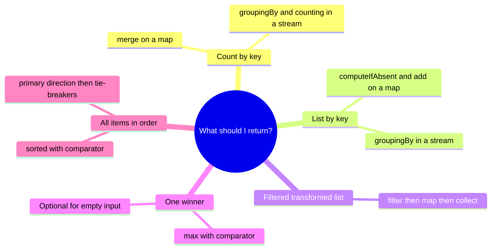
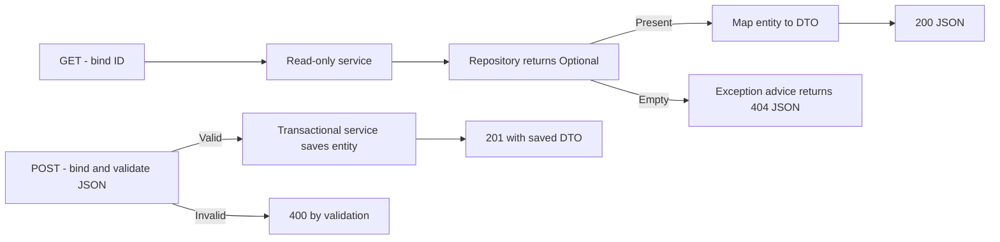
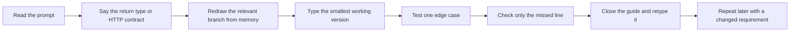
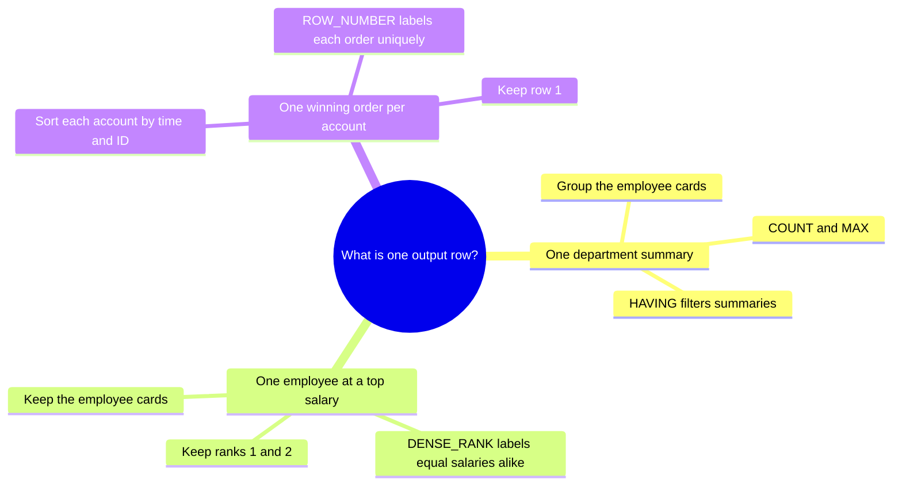
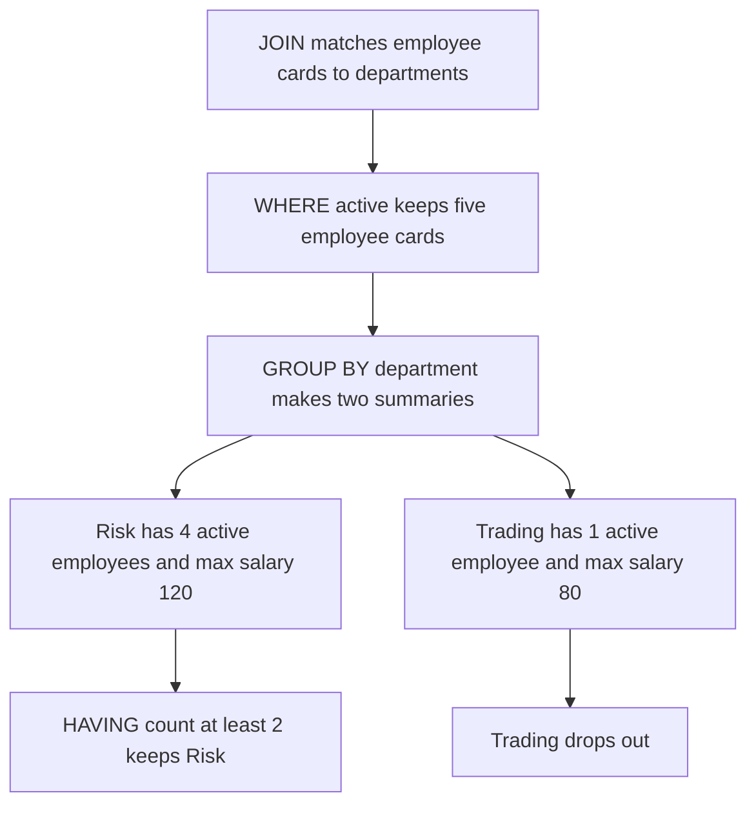
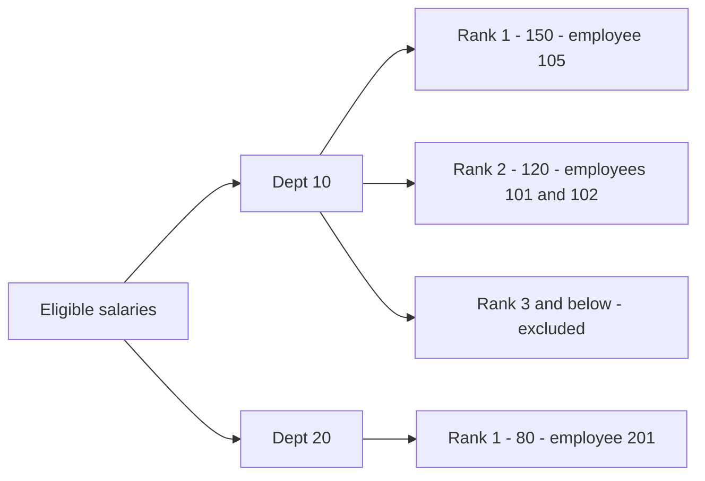
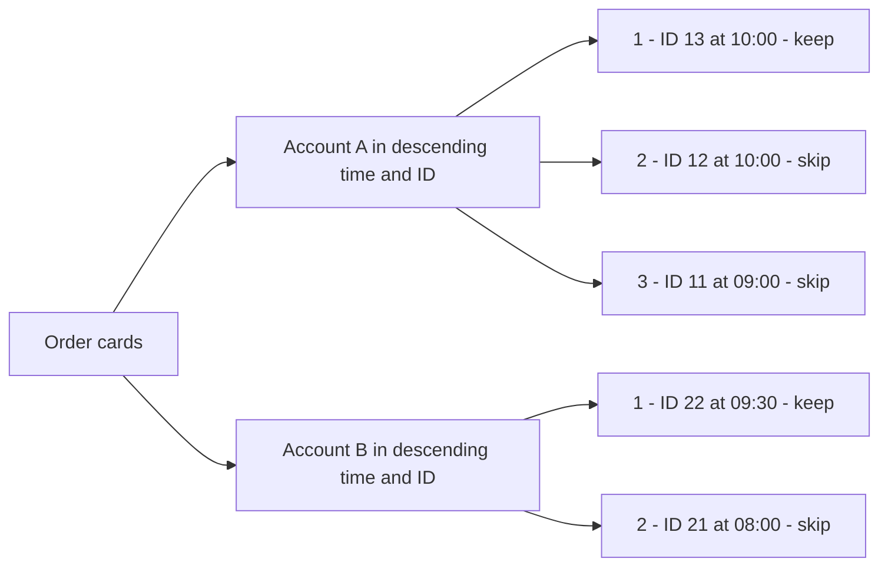

# Wells Fargo HackerRank — Eight-Hour Must-Cover Guide

**Read in order.** The invitation specifies a 90-minute HackerRank assessment. Use four Java coding tasks, one REST API task, and one SQL task as the practice format based on the recruiter’s prior same-role report. Prepare Java Streams, collections, DSA, and one small stateful class. Practise Spring endpoint implementation with Booking and check the short REST-client example if the task supplies an endpoint to call. The live test page gives the actual format and rules.

## What to cover first and why

Choose material by how many tasks it helps you solve and how much time it takes to practise. Start with a working Java baseline, an endpoint that passes its tests, and SQL that returns the expected rows. The prior candidate reports support covering all three. Practise one stateful class so you can also handle a small machine-coding prompt.

- **Rows 01–15 and the Core 10 in row 18 are the priority.** Practise Java, the Booking REST API, SQL, one stateful class, and the DSA patterns in the problem sheet.
- **Rows 16–17 deepen machine coding.** Trace rejected operations and explain the concurrency boundary once. The existing LRU implementation gives you a transfer example.
- **Stretch 9 in row 18 is optional.** Keep rows 19–23 for closed-book recall and setup.
- **Use the wider files for a specific gap or a later round.** The Java interview pack is useful for syntax repair. The Wells Fargo reference books contain résumé stories, trading, JVM/JMM, Kafka, and full designs.

## Sequential checklist

Follow the row numbers and check off each finish condition. A dash in the first column means the example or instructions are in this file. Open a source only when it helps with the task.

| Problem, answer or file | Task | Elapsed | Finish condition | Done |
|---|---|---|---|---|
| [HackerRank sample guidance](https://candidatesupport.hackerrank.com/articles/9881337709-getting-familiar-with-hackerrank-tests) · [Execution environment](https://support.hackerrank.com/articles/6693750503-execution-environment) | Setup | 0:00–0:20 | Run one Java sample. Identify the supplied method or STDIN format, select the language version and try an edge case with custom input. | ☐ 01 |
| [Java](../../src/main/java/org/chijai/java/EmployeeMaxSalary.java) | Streams max | 0:20–0:40 | Find the highest-paid active employee. Check smaller-ID tie-break and empty input. | ☐ 02 |
| [Frequency Java](../../src/main/java/org/chijai/java/FrequencyMapUsingStreams.java) · [Group Java](../../src/main/java/org/chijai/java/GroupEmployeesByDepartment.java) | Collections and grouping | 0:40–1:00 | Count items with `Map.merge` and `groupingBy`. Explain how `computeIfAbsent` builds lists. | ☐ 03 |
| [Sort Java](../../src/main/java/org/chijai/java/SortEmployeesByMultipleFields.java) | Sorting | 1:00–1:20 | Predict the order for equal salaries, equal names, and a null name. | ☐ 04 |
| — | Java edge cases and binary search | 1:20–1:40 | Recreate the `Optional`, duplicate-key, overflow and binary-search examples under **Task 05** below. | ☐ 05 |
| [Booking interview guide](../../../../Booking/INTERVIEW_GUIDE.md) | Spring GET | 1:40–2:00 | Open **Spring OA rehearsal**. Compare the Spring MVC and OpenAPI flows, explain the delegate, and recreate the GET mapping both ways. | ☐ 06 |
| — | Spring focused tests | 2:00–2:20 | Use **Run focused Booking tests** in the guide from row 06. Check the status and JSON for success, missing ID and soft deletion. | ☐ 07 |
| — | Spring POST, PUT and pagination | 2:20–2:45 | Use Booking’s **Spring repair exercise** for `201`, `400`, `409`, update and paging. Check **API client fallback** below if the REST prompt shape is unclear. | ☐ 08 |
| — | Break | 2:45–2:55 | Step away from the screen. | ☐ 09 |
| — | SQL grouped join | 2:55–3:07 | Return department counts and max salary. Explain what changes for departments with zero matches. | ☐ 10 |
| — | SQL salary ranking | 3:07–3:21 | Return the two highest distinct salaries per department and keep ties. | ☐ 11 |
| — | SQL latest row | 3:21–3:31 | Return one latest order per account, including a deterministic tie-break. | ☐ 12 |
| — | SQL anti-join | 3:31–3:41 | Find orders without executions. Explain why a null in the execution data matters for `NOT IN`. | ☐ 13 |
| — | SQL correlated subquery | 3:41–3:50 | Return employees above their own department average. Identify the outer-row reference. | ☐ 14 |
| — | Machine-coding contract | 3:50–4:05 | State the invariant, implement `reserve` and `release` from memory, then check the inline Java under **Task 15**. | ☐ 15 |
| — | Machine-coding test cases (extension) | 4:05–4:20 | Dry-run success, insufficient capacity, release and duplicate operations. | ☐ 16 |
| [RiskLimitEngine.java](../../src/main/java/org/chijai/PTR/RiskLimitEngine.java) | Machine-coding trade-off (extension) | 4:20–4:30 | Compare the reservation lock with `RiskEngine.validate`. Explain why a later rejection rolls back earlier changes under the same lock. | ☐ 17 |
| [19-problem sheet](WellsFargo_19_LeetCode_Problems_Java_Solutions.md) | DSA practice | 4:30–7:20 | Work through the **Core 10** in the sheet. Recode the two weakest, take a break, then use the **Stretch 9** if time allows. | ☐ 18 |
| — | Final Java recall | 7:20–7:25 | Redraw the **Java decision tree** from memory. Type one count, one max comparator and one tie-break test. | ☐ 19 |
| [Booking full syntax examples](../../../../Booking/SPRING_BOOT_AUTOMATIC_SYNTAX.md) | Final Spring recall | 7:25–7:30 | Use the inline **Spring recall map** closed-book. Recreate GET and its YAML route. State where `404` comes from and how POST returns `201`. | ☐ 20 |
| — | Final SQL recall | 7:30–7:35 | Recall a ranking expression and the anti-join. | ☐ 21 |
| — | Final DSA and LLD recall | 7:35–7:40 | State one algorithm invariant and what a rejected reservation leaves unchanged. | ☐ 22 |
| — | Stop and set up | 7:40–8:00 | Take a break, check the test environment, and read the displayed instructions. | ☐ 23 |

If these eight hours include the live test, skip machine-coding extensions (rows 16–17) and the Stretch 9 block. Spend 90 minutes on the Core 10 in row 18, keep the DSA break, and start recall immediately after. That leaves **6 hours 30 minutes of prep** and **90 minutes for the test**.

Open the Booking guide once for rows 06–08 and the 19-problem sheet once for row 18. The sheet has the problem statements, derivations, tests and direct Java links.

Use the prompt to pick your approach. A function over a list calls for transformation, grouping, or an algorithm. A class with several calls calls for state and transition rules. A supplied Spring project calls for tracing its test and API contract. A schema and expected result call for defining what one output row represents.

## Java coding and Streams

Read the task signature and expected output first. Match the required return type, input parsing, ordering, and empty-input rule. A frequency question usually needs a map, membership needs a set, and sorted output needs an explicit comparator. An independent lookup per item can often become one pass after building an index.

**HackerRank entry point.** If a `Result` method is supplied, implement the method with its exact signature and let the stub handle input and output. For a standalone program, use the requested main class, parse only the specified input and produce the exact expected output. Test an empty or smallest valid input, duplicates or ties, and the largest relevant value. Remove debug prints before submitting.

### Java decision tree — start with the return type



| Cue | Type this from memory |
|---|---|
| Count each value | `counts.merge(key, 1, Integer::sum)`. With Streams, `values.stream().collect(Collectors.groupingBy(Function.identity(), Collectors.counting()))` returns `Map<T, Long>`. |
| Group employees into lists | `groups.computeIfAbsent(dept, k -> new ArrayList<>()).add(employee)` or `employees.stream().collect(Collectors.groupingBy(Employee::getDepartment))`. |
| Count employees by department | `Collectors.groupingBy(Employee::getDepartment, Collectors.counting())`. The first argument chooses the group and the second decides what to produce for it. |
| Keep, then convert | `items.stream().filter(predicate).map(mapper).collect(Collectors.toList())`. `Stream.toList()` requires Java 16 or later and produces an unmodifiable list. |
| Pick one highest-paid employee | `employees.stream().max(Comparator.comparingLong(Employee::getSalary))` returns `Optional<Employee>`. Use `comparingDouble` for a `double` salary, and `mapToLong(...).max()` if only the `long` salary is required. |
| Sort all employees | `Comparator.comparingLong(Employee::getSalary).reversed().thenComparing(Employee::getName).thenComparingInt(Employee::getId)` for salary descending, name ascending and an `int` ID ascending. |

Before typing a comparator, say the keys and their directions. Put `.reversed()` immediately after the comparator whose order you want to flip. If null names belong last, use `.thenComparing(Employee::getName, Comparator.nullsLast(Comparator.naturalOrder()))`. Check a tie and an empty input. Explicitly sort map keys when the prompt requires ordering. Use `long` and cast **before** multiplying when `int` may overflow. Use `Integer.compare` or a typed comparator instead of subtraction.

### Worked Java example

For active employees, return the best-paid employee, breaking salary ties in favor of the smaller ID. Keep an empty result as an `Optional`.

```java
Comparator<Employee> bySalaryThenPreferredId = Comparator.comparingLong(Employee::getSalary)
        .thenComparing(Comparator.comparingLong(Employee::getId).reversed());

Optional<Employee> winner = employees.stream()
        .filter(Employee::isActive)
        .max(bySalaryThenPreferredId);
```

If salary 90 is shared by IDs 8 and 3, the comparison makes ID 3 the better candidate. If the prompt permits a loop, maintain the best active employee seen so far under the same comparator. If it asks for Streams only, use the pipeline. Test an empty list, a tie, and an inactive employee with a larger salary.

### Task 05 — Core Java recall

| Check | Recall from a blank editor |
|---|---|
| Empty `Optional` | `winner.orElseThrow(() -> new NoSuchElementException("No winner"))` if empty input is an error. Keep the `Optional` when empty is a valid result. `orElseGet(this::fallback)` computes the fallback only when absent. |
| Duplicate map key | With salaries represented as `long` minor units, `Collectors.toMap(Employee::getId, Employee::getSalary, Long::max)` keeps the largest salary for an ID. Use `Double::max` for a `double` accessor and the two-argument overload when duplicate keys should fail. |
| Arithmetic overflow | `long amount = (long) price * quantity` widens before multiplication when both inputs are `int`. Use `Math.multiplyExact(price, quantity)` with `long` operands when overflow must be detected. |
| Inclusive binary search | Start `lo = 0, hi = a.length - 1`. Continue while `lo <= hi`, using `mid = lo + (hi - lo) / 2`. Move to `mid + 1` or `mid - 1` when the value is unequal. Return `-1` if absent. |

Dry-run the search with an empty array, a one-item match and a target past the last element. If asked for the first duplicate, record a match and continue left with `hi = mid - 1`.

## Spring recall map — route, store and HTTP result

Use the route in the prompt consistently. The Booking lookup uses `/hotel/{id}`. In a controller with `@RequestMapping("/hotel")`, the GET method mapping is `@GetMapping("/{id}")`. Use `@GetMapping("/hotel/{id}")` with no class-level path prefix.



| Place | Syntax to recreate |
|---|---|
| Controller | `@RestController`, constructor accepting the service and assigning it to a `private final` field, `@GetMapping("/{id}")`, `@PathVariable("id") Long id`. |
| POST and DTOs | `@PostMapping`, `@Valid @RequestBody CreateHotelRequest request`. `record CreateHotelRequest(@NotBlank String name, @NotNull @Positive Long cityId) {}`. A response record carries the fields the client expects. Return `ResponseEntity.status(HttpStatus.CREATED).body(dto)`. |
| Service | `@Service`, `@Transactional(readOnly = true)` for GET and `@Transactional` for create. Use `.orElseThrow(() -> new HotelNotFoundException(id))` and map to a DTO. For creation, use `request.name()` and `request.cityId()` to build the entity, then map the value returned by `repository.save(entity)`. |
| Repository and paging | `interface HotelRepository extends JpaRepository<Hotel, Long>`. Recall `Optional<Hotel> findByIdAndDeletedFalse(Long id)` and `Page<Hotel> findByCityIdAndDeletedFalse(Long cityId, Pageable pageable)` for an entity with `cityId` and `deleted` properties. Create a deterministic page request with `PageRequest.of(page, size, Sort.by("id"))` if the contract uses that order. |
| Entity | `@Entity`, `@Id`, a protected no-arg constructor, and `this.name = name` in the value constructor. Use `@GeneratedValue(strategy = GenerationType.IDENTITY)` for a database identity column. For optimistic locking, recall `@Version private long version`. |
| Error and test | `@RestControllerAdvice`, `@ExceptionHandler(HotelNotFoundException.class)`, `record ApiError(String code, String message) {}` and `ResponseEntity.status(HttpStatus.NOT_FOUND).body(error)`. In MockMvc, check `status().isOk()` plus `jsonPath(...)` for success, `status().isNotFound()` for missing ID and `status().isBadRequest()` for invalid POST. |
| Delegate and OpenAPI | A delegate forwards the operation to the service. For a generated route, recall `paths` → `/hotel/{id}` → `get` → `operationId` → `parameters` → `responses`, with `in: path`, `required: true` and `format: int64` for the ID. Implement the generated method and check the same HTTP responses. |
| Security follow-up | `@Bean SecurityFilterChain filterChain(HttpSecurity http) throws Exception`. A stateless example uses `http.sessionManagement(s -> s.sessionCreationPolicy(SessionCreationPolicy.STATELESS)).authorizeHttpRequests(a -> a.requestMatchers("/actuator/health").permitAll().anyRequest().denyAll()).build()`. Choose endpoint access and any CSRF changes from the scaffold and its credential model. |

## Closed-book recall — draw, type, check, repeat

Use the shape of the page as a cue for the next step. Rebuild each map with the guide closed, then type from the map you drew. One correct attempt from memory plus a changed requirement gives you a better readiness check than recognizing code on the page.



| Where in this checklist | Closed-book rep |
|---|---|
| Rows 02–05 | Count `[A, A, B]`, then write max and sort. Change one tie-break and check it with two equal salaries. |
| Rows 06–08 | Draw the GET flow, then write route, lookup, DTO and `404`. Change to POST and write validation plus `201`. |
| Rows 19–20 | Repeat the weak Java and Spring branches under the existing timeboxes. Compare your output against one test. |

**If you blank while typing**, say the next operation in plain English, then write the simplest equivalent. “Read the old count or zero and add one” becomes `counts.put(key, counts.getOrDefault(key, 0) + 1)`. For Spring, write `GET /hotel/{id} → 200 or 404` as a comment, then reconstruct the handler and lookup. If the prompt requires Streams or a generated handler, use the plain-English steps to recover the required form.

## API client fallback — a supplied URL and a Java method stub

If the prompt asks you to **consume** JSON from a supplied API, start with one GET, confirm the JSON fields, then add pagination, filtering and the requested output order. A Spring project with controller tests uses the Booking path in rows 06–08.

This practice example assumes a bare endpoint URL, Java 17 with Gson available, and a one-based response with `total_pages` and `data`. Each data item has a `category` and `name`. Return matching names in ascending order.

```java
import com.google.gson.JsonElement;
import com.google.gson.JsonObject;
import com.google.gson.JsonParser;
import java.io.IOException;
import java.net.URI;
import java.net.http.HttpClient;
import java.net.http.HttpRequest;
import java.net.http.HttpResponse;
import java.time.Duration;
import java.util.ArrayList;
import java.util.Comparator;
import java.util.List;

static List<String> findNames(String endpoint, String category)
        throws IOException, InterruptedException {
    HttpClient client = HttpClient.newHttpClient();
    List<String> names = new ArrayList<>();
    int totalPages = 1;
    for (int page = 1; page <= totalPages; page++) {
        HttpRequest request = HttpRequest.newBuilder(URI.create(endpoint + "?page=" + page))
                .timeout(Duration.ofSeconds(5)).GET().build();
        HttpResponse<String> response = client.send(request, HttpResponse.BodyHandlers.ofString());
        if (response.statusCode() != 200) {
            throw new IOException("Unexpected HTTP status: " + response.statusCode());
        }
        JsonObject body = JsonParser.parseString(response.body()).getAsJsonObject();
        if (page == 1) totalPages = body.get("total_pages").getAsInt();
        for (JsonElement item : body.getAsJsonArray("data")) {
            JsonObject row = item.getAsJsonObject();
            if (category.equals(row.get("category").getAsString())) {
                names.add(row.get("name").getAsString());
            }
        }
    }
    names.sort(Comparator.naturalOrder());
    return names;
}
```

Place the method in the supplied class and adapt its signature. Use the scaffold’s Java version and JSON library. Follow its query parameters, URL encoding, null policy and ordering. Test empty data, a match on the last page and a non-success response.

## SQL — draw the rows before writing the query

A row is like a card. `JOIN` matches cards from two piles and `WHERE` keeps the cards that pass a test. A group aggregate packs a pile into one summary card. A window function writes a label on each original card so you can choose which cards to keep.

**First question to ask:** What should one output row represent? The answer tells you whether to collapse a group, keep everyone tied at a rank, or pick exactly one winner.



Use departments `10 Risk`, `20 Trading`, and `30 Operations`. These are the employee cards for the first two queries.

| Department | Employees as `id: salary` | Active status |
|---|---|---|
| 10 | `101: 120`, `102: 120`, `103: 100`, `104: 90` | Active |
| 10 | `105: 150` | Inactive |
| 20 | `201: 80` | Active |
| 20 | `202: NULL` | Inactive |
| 30 | Empty | |

### Departments with at least two active employees

```sql
SELECT d.id, COUNT(*) AS employee_count, MAX(e.salary) AS max_salary
FROM departments d
JOIN employees e ON e.department_id = d.id
WHERE e.active = TRUE
GROUP BY d.id
HAVING COUNT(*) >= 2
ORDER BY d.id;
```

**Think of it as counting the cards on each team's desk.** Match employees to departments, remove inactive employees, and make one summary for each remaining department. The threshold applies to the summary.



**Trace.** Operations has no match in the inner join. Employee `105` has the highest salary in Risk and is filtered out before `MAX`. Trading forms a group and then fails `HAVING`. The final row is `(id=10, employee_count=4, max_salary=120)`. `WHERE` asks a question about one employee. `HAVING` asks a question about a department summary.

If the question includes departments with zero active employees, put the active predicate in the `LEFT JOIN` condition and use `COUNT(e.id)` for zero. Remove the `HAVING` threshold if zero-count departments must appear.

### Top two distinct salaries with ties

```sql
WITH ranked AS (
    SELECT e.*,
           DENSE_RANK() OVER (
               PARTITION BY department_id ORDER BY salary DESC
           ) AS salary_rank
    FROM employees e
    WHERE salary IS NOT NULL
)
SELECT id, department_id, salary
FROM ranked
WHERE salary_rank <= 2
ORDER BY department_id, salary_rank, id;
```

**Think of this as salary ladders.** Build one ladder per department. Everyone with the same salary stands on the same rung. Keep everyone standing on either of the first two rungs. Each surviving row still represents an employee.



**Trace.** `WHERE salary IS NOT NULL` excludes `202`. This query includes inactive employee `105`. To rank active employees only, add `AND active = TRUE` **inside** the CTE so ranks are computed over the eligible people. The result in order is `105`, `101`, `102`, `201`. `DENSE_RANK` on `120, 120, 100` gives `1, 1, 2`. `RANK` gives `1, 1, 3`. Adding `id` to the window sort would split equal salaries into different ranks. Keep `id` in the final `ORDER BY` to make their display order deterministic.

### Latest order per account

The ID breaks equal-time ties. Match the prompt’s timestamp null policy and SQL dialect.

```sql
WITH ordered AS (
    SELECT id, account_id, created_at,
           ROW_NUMBER() OVER (
               PARTITION BY account_id ORDER BY created_at DESC, id DESC
           ) AS rn
    FROM orders
)
SELECT id, account_id, created_at
FROM ordered
WHERE rn = 1
ORDER BY account_id;
```

**Think of this as sorting each account's inbox.** Make one pile per account. Put newer orders on top. For the same timestamp, put the larger `id` on top. Number each pile from 1, then take the top card.



**Trace.** The result is order `13` for A and `22` for B. `ROW_NUMBER` assigns a different label to every row in its account. The ID resolves the A tie because `13 > 12`. `MAX(created_at)` alone gives a timestamp. Joining that maximum back to A would return both orders `12` and `13`. The outer `WHERE rn = 1` applies after the row numbers have been computed. The final `ORDER BY account_id` controls display order.

### Orders without executions

Keep one output row per unmatched order. When a subquery can produce nulls, `NOT EXISTS` avoids the null behavior of `NOT IN`.

```sql
SELECT o.id
FROM orders o
WHERE NOT EXISTS (
    SELECT 1
    FROM executions e
    WHERE e.order_id = o.id
)
ORDER BY o.id;
```

For duplicate identities, group by the identity and use `HAVING COUNT(*) > 1`.

### Employees above their department average

The inner query uses the current employee’s department from the outer query. The output still has one row per qualifying employee. Equal-to-average salaries are excluded.

```sql
SELECT e.id, e.department_id, e.salary
FROM employees e
WHERE e.salary > (
    SELECT AVG(peer.salary)
    FROM employees peer
    WHERE peer.department_id = e.department_id
)
ORDER BY e.department_id, e.id;
```

Check empty input, ties, missing matches, duplicated join rows, and requested output aliases or ordering.

Cover each query and write its join, window, or anti-join skeleton. Check one missing match and two identical salaries.

## Machine coding and low-level design

### Task 15 — LLD method

1. **State the contract.** Name the operations, valid inputs, and duplicate or failure outcomes. Keep the scaffold’s public signatures.
2. **Write the invariant and state owner.** For reservations, available capacity plus active quantities always equals total capacity. One tracker owns both the counter and the reservation map.
3. **Choose storage and the atomic boundary.** A map answers lookups by ID. A reserve or release checks and updates both fields as one operation. If calls can overlap, use a lock or single writer for that boundary.
4. **Prove it with tests.** Exercise success, rejected operations, repeated release and ID reuse. Rejection leaves state unchanged. Defend the cost of retaining released IDs and say when the retention policy needs to change.

### Worked example — in-memory reservation tracker

One item has a fixed capacity. Implement `reserve(id, quantity)` and `release(id)`. Reserve requires a new nonblank ID, a positive quantity, and enough capacity. Release requires an active reservation and restores its quantity once. A rejected operation returns `false` and leaves state unchanged. A failed reservation can be retried after capacity is freed.

**State and invariant.** Keep `available` and a map from ID to `Reservation(quantity, released)`. At all times, `available >= 0` and `available + sum(active quantities) == capacity`. Keep released entries because this version needs to reject ID reuse.

```java
import java.util.HashMap;
import java.util.Map;

final class ReservationTracker {
    private record Reservation(int quantity, boolean released) {}

    private final Map<String, Reservation> reservations = new HashMap<>();
    private int available;

    ReservationTracker(int capacity) {
        if (capacity < 0) throw new IllegalArgumentException("Negative capacity");
        available = capacity;
    }

    synchronized boolean reserve(String id, int quantity) {
        if (id == null || id.isBlank() || quantity <= 0 || quantity > available
                || reservations.containsKey(id)) {
            return false;
        }
        reservations.put(id, new Reservation(quantity, false));
        available -= quantity;
        return true;
    }

    synchronized boolean release(String id) {
        Reservation reservation = reservations.get(id);
        if (reservation == null || reservation.released()) return false;
        reservations.put(id, new Reservation(reservation.quantity(), true));
        available += reservation.quantity();
        return true;
    }

    synchronized int available() {
        return available;
    }
}
```

With capacity 5, reserve 3 for A and expect 2 left. Try to reserve 3 for B and expect rejection with 2 left. Release A and expect 5 left. A second release or reuse of A’s ID must leave 5. If threading is required, protect the checks and both updates under one service-level lock or one state owner. A concurrent map protects individual map operations, while the invariant also spans `available`. Map lookup gives average constant time per operation. Keeping released IDs costs space proportional to successful requests, so clarify the retention policy if asked about long-lived use.

**Must do.** Cover the Java and recreate both operations. After releasing A, retry B and expect success. The problem sheet has the LRU implementation for a state-ownership transfer exercise.

## Task 18 — DSA practice

- **4:30–6:10** — Work through the sheet’s Core 10 in order. For each problem, state the pattern, the invariant and one edge case before reading the answer. Recode the two weakest before checking Java.
- **6:10–6:25** — Take a break.
- **6:25–7:20** — Use the Stretch 9 for cold recognition and spend the last ten minutes repairing your biggest gap. Cut this block first if time is tight.

## Stop here before the live assessment

If six tasks appear and you can switch between them, try a first split of **5 minutes to scan, 20 for two approachable Java tasks, 12 for SQL, 23 for REST, 22 for the remaining Java tasks, and 8 for final checks**. Adjust to the actual points, task sizes, and section timers. Use the initial scan to identify the REST task shape and get a basic path working before the last stretch. If an improvement stalls, keep the working baseline and move on.

Use the final review to check **Java signatures, compile status, boundaries and overflow**, **REST path, status, body and paging**, and **SQL output grain, duplicates, nulls and ties**. Follow the assessment’s resource rules and keep the setup buffer. The later interview chapters can wait until the OA is finished.

Rows 19–22 are your final recall. Leave row 23 for rest and test setup.

## Recent candidate reports — checked 28 November 2026

These accounts describe different tracks or stages. The recruiter’s anecdote is the closest role match available here. The dated public accounts inform breadth and practice priorities. I found no public account confirming the question list for this AVP electronic-trading invitation.

| Source | What the candidate reported | What to practise |
|---|---|---|
| Recruiter conversation shared 24 Nov 2026 | Prior same-role candidate reportedly saw four Java tasks, one REST task and one SQL task. The recruiter was unsure whether the format would repeat. | Use the six-task shape for pacing. |
| [Glassdoor, 3 Nov 2026](https://www.glassdoor.com/Interview/Wells-Fargo-Interview-Questions-E8876.htm?filter.jobTitleExact=Sr.+Software+Engineer) | Senior Software Engineer, Bengaluru, interviewed in October. Described three medium-to-hard DSA tasks, an API implementation and a difficult SQL query in the OA. | Protect DSA, REST and SQL time. |
| [Glassdoor, 24 Sep 2026](https://api.glassdoor.com/Interview/Wells-Fargo-Interview-E8876-RVW105727666.htm) | Senior Software Engineer, Chandler. Described a coding challenge, object-oriented design and Kafka fundamentals in a panel. | Practise the reservation tracker. Keep Kafka for the technical round. |
| [LeetCode, 14 Aug 2026](https://leetcode.com/discuss/post/8460138/) | Senior Software Engineer. Reported a screening task with Spring GET/POST/PUT and a SQL problem involving subqueries. Discussed Kafka consumer groups and API pagination in the technical round. | Read the CRUD walkthrough and correlated subquery. |
| [LeetCode, 13 Jun 2026](https://leetcode.com/discuss/post/8331139/wells-fargo-senior-software-engineer-sel-ghef/) | Senior Software Engineer. Reported a mixed 90-minute backend OA. Employee maximum salary using Streams came up in a later round. | Practise the salary example in the Java block. |

## Open only for a gap or after the OA

| File | When to open it |
|---|---|
| [Java interview pack SQL templates](../../src/main/java/org/chijai/java/java-interview-pack/sql-database.md) | Find **Query templates** for another form of a query you could not reconstruct. |
| [Master Revision](WellsFargo_Master_Revision_DSA_LLD_HLD.md) | For technical rounds, use Java/JVM/concurrency, low latency, protocols and the trading designs. Start hands-on with position aggregation, pre-trade risk and matching. |
| [AVP Deep Dive](WellsFargo_AVP_Electronic_Trading_HackerRank_Interview_Experience_Deep_Dive.md) | Open for reported questions, alternative OA mocks, additional DSA such as Safest Path, project cross-questions and the STAR rehearsal. |
