# Wells Fargo — Sr AVP / Senior Specialty Software Engineer Master Interview Companion

> **Target:** Senior hands-on Java engineer for electronic-trading and low-latency systems.
>
> **What this is:** the one priority-ordered Wells Fargo question-and-answer bank, DSA problem-and-solution-reference bank, LLD/HLD design bank, incident/behavioral bank, and interview-performance workbook.
>
> **Inline/linked boundary:** everything you must answer, derive, draw, debug, defend, or modify is inline. Open official LeetCode prompts, audited Java solutions, or LLD/HLD project implementations only after your attempt. Linked code is labeled by its actual compile/test status—not assumed runnable.
>
> **Truth rule:** Never invent production experience, ownership, metrics, Wells Fargo facts, or internal architecture. Replace every `[PERSONALIZE]` block only with evidence you can defend.
>
> **Use rule:** Attempt first from a blank screen or blank page. Open a Java link only after the hard stop.
>
> **Operating-system boundary:** This is a company-specific interview packet, not a second everyday curriculum. Use it when preparing specifically for Wells Fargo or running a Wells Fargo mock.

---

# 0. Immediate interview activation

Read and speak this section first. It contains the minimum material required to begin the interview calmly and coherently.

## 0.1 The role in one sentence

> A senior hands-on Java engineer who can keep trading-state transitions correct, deterministic, observable, and recoverable while meeting tight latency and availability constraints—and who can explain the trade-offs clearly enough to lead technical decisions.

## 0.2 Your answer shape

Use this unless the interviewer asks for another format:

```text
Direct answer → reason/invariant → concrete example → trade-off/failure boundary.
```

For design:

```text
Requirements → scale/SLO → invariant/state owner → flow → failure/recovery → trade-off.
```

For incidents:

```text
Stabilize → establish timeline/change → compare signals → test ranked hypotheses
→ identify cause → mitigate/fix → prove recovery → prevent recurrence.
```

## 0.3 Tell me about yourself [PERSONALIZE]

Do not memorize somebody else's story. Fill these five evidence-backed lines:

```text
1. Present: I am a senior Java/backend engineer with ___ years in ___.
2. Domain: My strongest relevant domain work is ___; I personally implemented ___.
3. Depth: I work deeply in Java/concurrency/performance/distributed correctness through ___.
4. Evidence: A result I can verify is ___, measured by ___ under ___ conditions.
5. Fit: This role fits because it combines hands-on Java, trading correctness,
   low-latency reasoning, production ownership, and senior technical leadership.
```

Speak it once. Remove claims you cannot prove. Do not hide uncertainty behind buzzwords.

## 0.4 Why Wells Fargo / why this role [VERIFY]

```text
I am interested in the role because the advertised problem combines the areas in
which I can contribute most: hands-on Java engineering, electronic-trading state,
latency-sensitive processing, production reliability, and technical leadership.
I am not looking only for an architecture title; I want to remain close to code,
failure analysis, and engineering decisions. I would use the interview to verify
the exact asset class, venue/protocol mix, latency targets, team boundaries, and
the balance between new development and platform modernization.
```

Do not state unverified company architecture or culture as fact.

## 0.5 Primary project [PERSONALIZE]

```text
Problem and users:
Architecture in one breath:
Critical state/invariant:
What I personally implemented:
Hardest technical failure or decision:
Evidence/result and how it was measured:
Trade-off accepted:
What was already present or owned by others:
What I would improve now:
```

If it is a learning or simulated project, say so. Do not convert a repository exercise into a production claim.

## 0.6 Coding loop — know this verbatim

```text
1. Restate input, output, constraints, and edge semantics.
2. Give one small example.
3. State the brute force and its bottleneck.
4. Name the invariant—not merely the pattern name.
5. State the chosen data structure and why.
6. Code in small compilable steps while narrating intent.
7. Dry-run a normal case and at least two boundary cases.
8. State time and space complexity.
9. Accept a mutation by modifying the current solution, not discarding it reflexively.
```

If stuck: reduce to a smaller example, restate the invariant, and expose the exact uncertainty.

## 0.7 Ten technical truths to know cold

1. `volatile` provides visibility and ordering for that variable; it does not make compound actions such as `count++` atomic.
2. Happens-before is the Java Memory Model guarantee that one action's effects are visible to another; program order, monitor unlock/lock, volatile write/read, thread start, and join create key edges.
3. A low average does not imply a good system: trading performance is dominated by tail latency, jitter, coordinated omission, warm-up, allocation, queues, and external pauses.
4. Shared mutable state needs one clear authority. Single-writer ownership often improves determinism and latency more than adding locks around multi-writer state.
5. `ConcurrentHashMap` makes individual map operations thread-safe; it does not make a multi-object business invariant atomic.
6. An order timeout is not a rejection. After an uncertain send, resending blindly can create a duplicate order.
7. FIX is a session-oriented business protocol; OUCH is a lean order-entry protocol; ITCH is a sequenced market-data protocol. Protocol names do not remove the need for venue-specific semantics.
8. At-least-once delivery requires idempotency/deduplication. Exactly-once business effect is an end-to-end design property, not a broker checkbox.
9. Backpressure is a correctness and latency policy: bound queues, define overload behavior, preserve priorities, and avoid hiding saturation in unbounded memory.
10. Recovery is part of the state model: snapshot/replay, sequence checkpoints, duplicate handling, order uncertainty, RTO, and RPO must be designed before failure.

## 0.8 Trading invariants

```text
BUY book: higher price wins; equal price uses earlier sequence/time.
SELL book: lower price wins; equal price uses earlier sequence/time.

Incoming sequence < expected → duplicate/stale; apply policy, do not double mutate.
Incoming sequence = expected → process, then advance.
Incoming sequence > expected → gap; stop/mark stale, buffer if bounded, recover.

Order lifecycle transitions are validated and idempotent.
An execution ID changes position/exposure at most once.
Risk check and reservation/commit form one correctness boundary.
One active owner controls each ordered exchange session.
An external timeout creates UNKNOWN until reconciled.
```

## 0.9 HLD answer spine

> I will clarify instruments, order types, throughput, p99/p99.9 latency, availability, durability, compliance, and failure assumptions. I will separate the synchronous order data plane from the configuration/control plane. A gateway validates and normalizes requests; a partitioned single-writer risk/OMS path owns mutable order and exposure state; a venue session owner handles protocol sequencing, throttling, and correlation. Durable append/replay plus snapshots recover state without placing a database round trip on every hot-path decision. Market data has a separate ingest, sequence-gap, book-build, and fan-out path. I will define uncertain outcomes, idempotency, backpressure, active/standby fencing, observability, RTO/RPO, and only then discuss scaling or active-active alternatives.

## 0.10 LLD answer spine

> I will first clarify commands, events, lifecycle, concurrency, durability, and latency. I will identify the state-owning aggregate and its invariant before drawing classes. Public commands return an explicit accepted/rejected/unknown result. State transitions are centralized and tested. For a latency-sensitive mutable aggregate, I prefer one writer per partition and immutable commands/events; if multiple writers are mandatory, I make the atomic boundary explicit and test races. I will code the critical path, negative paths, duplicate handling, and a requirement mutation rather than create a large class zoo.

## 0.11 Production-incident answer spine

> First protect customers and trading state: stop unsafe traffic or roll back only if evidence supports it. Establish when the symptom began and what changed. Compare p50, p99, throughput, queue depth, allocation/GC, safepoints, runnable/blocked threads, context switches, network retransmits, downstream latency, and per-instance differences. Rank hypotheses and run the cheapest discriminating checks. After mitigation, prove state reconciliation and latency recovery, preserve evidence, identify the violated invariant, add a targeted regression/alert/runbook, and document what remains uncertain.

## 0.12 Questions to ask the interviewers

1. Which part of the order, market-data, or risk lifecycle does this team own end to end?
2. What are the important latency and availability SLOs, and how are they measured today?
3. What are the hardest current correctness or recovery problems: sequencing, failover, state reconciliation, throttling, or something else?
4. How is hands-on coding balanced with design leadership, mentoring, and cross-team decisions at this level?
5. What would strong impact in the first six months look like?

## 0.13 Resume-defense activation [RESUME-STATED / VERIFY DEPTH]

Your one-page resume is an interview contract. The statements below are resume-stated, but they do **not** prove private architecture, exact scale, metrics, or the boundary of your individual work. Prepare evidence, not embellishment.

### Sixty-second opening

> “I have about eight years in financial technology. At Nasdaq I build and enhance Java/Spring Boot pre-trade risk capabilities integrated with matching-engine systems. The latency-sensitive path performs synchronous in-memory checks for exposure, quantity, value, and price deviation without a database call on that path. My scope also includes production issues and customer escalations, quarterly release coordination across branches, and mentoring. Earlier at Morgan Stanley I built change-risk-assessment tooling, including a Java/Spring Boot, Lucene, and Angular application for search, review, and approval of change tickets, and led an AngularJS-to-Angular migration. My earliest work included an Alfresco-to-MongoDB comments migration and a real-time Angular pub/sub UI. This role fits because it joins my strongest areas: Java, stateful financial correctness, latency reasoning, production ownership, and technical leadership.”

Never add latency percentiles, order volumes, money protected, team size, or improvement percentages unless you can explain the measurement and disclosure boundary.

### Claim-to-question map

| Resume claim | Immediate probe | Must be able to defend |
|---|---|---|
| Risk integrated with matching engines | Put your component in the order lifecycle. | exact boundary/protocol `[VERIFY]`, state owner, failure policy |
| Synchronous in-memory checks; no hot-path DB | How is state correct after restart? | load/replay/readiness, versioning, stale policy, recovery |
| Exposure/quantity/value/price-deviation limits | Give concrete formulas and transitions. | reservation/commit, cancel/fill/bust/replay, precision/overflow |
| Global exchange environments | What varied by venue? | configuration versus code, protocol/semantic differences `[VERIFY]` |
| Production issues/customer escalations | Walk me through the hardest one. | symptom, hypotheses, evidence, containment, fix, prevention, communication |
| Quarterly releases | What did “lead” mean? | your authority, branch/dependency problem, gates, validation, outcome |
| Mentoring/Scrum Champion | What changed because of you? | specific intervention and observed result; not process vocabulary |
| CRA Java/Spring Boot/Lucene/Angular system | Why that architecture? | workflow, source of truth, search freshness, audit/security, failures |
| AngularJS-to-Angular migration | Why and how? | migration strategy, tests, coexistence/cutover, result `[VERIFY]` |
| Alfresco-to-MongoDB migration/pub-sub UI | How did you prove correctness? | identity mapping, ordering/duplicates, reconciliation, rollback |
| Docker/Kubernetes/EKS/message bus/C/C++/Python/SQL | Where did you use each? | production / working / exposure-only level and honest recency |

### Universal drill-down

```text
Problem and users → prior architecture → my exact work → others' ownership
→ invariant and state owner → concurrency/failure/recovery/security
→ alternative rejected and constraint → tests and rollout
→ measurable evidence → imperfection/learning → what I would change now.
```

If confidential, answer at a safe abstraction level. “I cannot share that implementation detail, but the invariant and decision trade-off were …” is stronger than invented precision.

---

# 1. Hybrid interview route and critical-red-flag gate

This file is deliberately arranged in the order you should study it. Read downward. Do not jump to a broader or more advanced section while an earlier gate is RED or ORANGE.

## 1.1 Hybrid company-interview route

The organization combines three useful principles:

1. **Immediate survival first:** opening, project, critical invariants, and answer spines stay at the top.
2. **Red flags before breadth:** dangerous correctness, trading, latency, and integrity mistakes are repaired before normal study.
3. **Company-round progression:** the detailed banks then follow the order in which hiring confidence is commonly built.

| Route | Detailed section | Interview signal being tested | Exit condition |
|---:|---|---|---|
| **Entry** | Section 0 | Communication, résumé, project, calm start | You can begin coherently without notes. |
| **Critical gate** | Section 1 | Correctness and integrity | No unsafe misconception or fabricated claim remains. |
| **Round 1** | Sections 2–3 | Coding, testing, complexity, SQL | You can produce and explain a working solution from a blank screen. |
| **Round 2** | Section 4 | Java, JVM, JMM, concurrency, backend, latency | You can explain, apply, diagnose, and compare from first principles. |
| **Round 3** | Section 5 | Trading lifecycle, protocols, messaging, recovery | You can apply technical depth to electronic-trading state and failure semantics. |
| **Round 4** | Section 6 | LLD and machine coding | You can model ownership/invariants and implement the critical path. |
| **Round 5** | Section 7 | HLD and architecture | You can construct, draw, mutate, and defend a recoverable platform. |
| **Round 6** | Section 8 | Production troubleshooting | You can investigate systematically and reconcile state after failure. |
| **Round 7** | Section 9 | Adversarial trade-off defense | You can justify choices and state when they should change. |
| **Round 8** | Section 10 | Project ownership, leadership, judgment | You can establish a truthful Senior/AVP hiring signal. |
| **Round 9** | Sections 11–12 | Integrated performance and full mock | You can move across rounds under interruption and mutation. |
| **Close** | Sections 13–15 | Consolidation, readiness, repetition | Observed weaknesses control the next practice pass. |

Within every round use the same micro-order:

```text
red flag
→ core baseline
→ production example
→ mutation/failure
→ alternative and trade-off
→ concise interview answer
```

**Rule:** attempt before reading the answer. Use the inline bank to correct an observed failure, not to reward passive familiarity.

## 1.2 Stop-the-line red flags

A red flag is not “one topic I have not read.” It is a mistake that can invalidate an otherwise strong senior interview. Repair these before expanding breadth.

### Correctness red flags

- Claiming that `volatile`, `AtomicLong`, or `ConcurrentHashMap` makes a multi-step business invariant atomic.
- Checking a risk limit and mutating exposure in separate, concurrently interleavable actions.
- Updating order, execution, position, or exposure state twice after duplicate delivery.
- Treating a timeout as proof that an external action did not happen.
- Resending an order after an uncertain socket outcome without reconciliation and venue-specific duplicate semantics.
- Allowing two unfenced owners to write the same ordered session or partition.
- Claiming exactly-once business effect from a transport/broker setting alone.

### Java and low-latency red flags

- Reciting definitions without a happens-before edge, code example, or failure mechanism.
- Optimizing average latency while ignoring p99/p99.9, jitter, queueing, and coordinated omission.
- Choosing ZGC, off-heap memory, object pooling, busy spin, or lock-free code without measured evidence.
- Treating moderate average CPU as proof that the system is not saturated.
- Using an unbounded executor queue in a latency-sensitive service without an overload policy.
- Presenting a microbenchmark result without warm-up, forks, representative data, and allocation/dead-code controls.

### Trading red flags

- Confusing FIX session sequence with business execution identity.
- Treating FIX, OUCH, and ITCH as interchangeable product names rather than protocols with different roles and semantics.
- Publishing a market-data book as healthy after a detected sequence gap.
- Ignoring partial fills, cancel/fill races, corrections/busts, throttles, and venue-specific replace priority.
- Proposing active-active for one ordered exchange session without partitioning or fencing.
- Putting a variable database/network dependency on the synchronous hot path without defending the latency and failure consequences.

### Design and production red flags

- Drawing components before clarifying state ownership, scale, latency, consistency, and failure assumptions.
- Saying “add Kafka,” “add cache,” “use microservices,” or “add threads” without identifying the invariant and bottleneck.
- Discussing HA without recovery state, fencing, RTO/RPO, replay, and uncertain in-flight work.
- Calling process liveness “system health” while data can be stale or incorrect.
- Debugging by listing tools rather than ranking hypotheses and requesting discriminating evidence.
- Fixing a symptom without reconciling state or proving recovery.

### Communication and integrity red flags

- Beginning with five minutes of caveats instead of a direct answer.
- Giving pattern names or buzzwords without the underlying invariant.
- Refusing to commit to a recommendation after assumptions are known.
- Claiming team work as personal implementation.
- Inventing metrics, scale, production exposure, Wells Fargo internals, or protocol experience.
- Hiding a mistake instead of correcting it quickly and explaining the corrected invariant.

## 1.3 Red-flag gate

Before proceeding to broad coverage, answer these without notes:

1. Why does `volatile` not make `count++` atomic?
2. Two threads pass the same exposure check. What invariant was split, and where should ownership live?
3. A venue connection drops after an order send but before ACK. Why is blind resend unsafe?
4. Market-data sequence jumps from 100 to 104. What becomes invalid, and what do you do before publishing again?
5. p99 rises fivefold while average CPU is 45%. What evidence do you request first?
6. Why is `LongAdder` unsuitable for an exact risk-limit admission decision?
7. Why does a broker's exactly-once option not guarantee exactly-once position effect?
8. What must be durable or reconstructible before a standby owns a FIX/OUCH session?
9. State one project result you personally produced and the evidence boundary around it.
10. Give a crisp answer using: direct answer → reason → example → trade-off.

**Exit:** no fabricated claim, no unsafe resend, no multi-step-atomicity misconception, no stale-book publication, and no unbounded “add more threads” answer. Any failure becomes the first RED ledger item.

## 1.4 Pass 1 activation round

```text
1. Speak the introduction, why-role answer, primary project, truths, and invariants.
2. Answer the ten red-flag questions with no notes.
3. Rapidly retrieve: volatile, happens-before, aggregate atomicity, p99,
   FIX/OUCH/ITCH, uncertain order outcome, sequence gap, and single writer.
4. Blind-code one: longest unique substring, LRU, sequence-gap detector,
   or execution deduplication. Test and state complexity.
5. Speak the HLD or LLD spine and accept one mutation.
6. Record RED/ORANGE failures and repair the failure mechanism.
```

> **PASS 1 EXIT:** You can begin the interview, explain your project truthfully, avoid critical correctness errors, and complete one representative blank-screen coding attempt.

## 1.5 Complete-file coverage contract

This file is the study source. It contains inline:

- immediate interview opening, project, recovery, and communication structures;
- Java, JVM, JMM, concurrency, low-latency, Spring, database, networking, security, testing, observability, and distributed-systems answers;
- electronic-trading lifecycle, market microstructure, FIX/OUCH/ITCH, Aeron/Solace/Kafka, order uncertainty, risk, market data, recovery, and controls;
- CORE 30 coding prompts, eighteen role-specific extensions, LAST-PASS 15, mutations, and complexity close;
- SQL schema, questions, canonical queries, and database-concurrency follow-ups;
- fourteen concrete LLD designs plus the reusable design checklist;
- ten HLD architectures plus the mutation pool;
- production incidents, why-not attacks, project/behavioral/leadership rehearsal;
- performance engine, mock routes, scoring, readiness gates, and attempt ledger.

Linked material is limited to official LeetCode problem pages, an existing `.java` implementation under `G:\TechStudyNotes\Codes\DSA10days`, or an audited implementation/project artifact under `G:\TechStudyNotes\LLDProjects` or `G:\TechStudyNotes\SystemDesignProjects`. No PDF, unrelated interview packet, or file outside those roots is a study dependency. LeetCode is only a convenient canonical prompt link—the complete attempt cue remains inline. Every invariant, answer, diagram, design decision, alternative, trade-off, mutation, and evaluation contract remains inline; project links are evidence for optional code inspection after the interview answer is produced. A link proves that the artifact exists, not that it currently builds: compile/test evidence and known defects are stated explicitly wherever they affect study priority.

## 1.6 Eight-year senior performance contract

An eight-year engineer is not expected to remember every API or know every technology. The expected signal is consistent senior judgment:

```text
correct fundamentals
× fast structured retrieval
× production reasoning
× explicit ownership
× honest evidence
× adaptability under challenge
```

### Capability bar

| Capability | Impressive Senior/AVP signal | Red flag |
|---|---|---|
| Coding | Clarifies, derives the invariant, writes clean Java, tests, states complexity, and modifies the solution under a new constraint | Pattern guessing, silent coding, no tests, or complexity stated without reasoning |
| Java/JMM | Connects language/JMM guarantee to code, failure mechanism, and correct boundary | Recites definitions or calls `volatile`/atomics/maps generally “thread-safe” |
| Concurrency | Names shared state, mutation authority, ordering scope, and aggregate atomicity | Selects a concurrent collection before identifying the invariant |
| JVM/performance | Uses measurements to distinguish allocation, GC, safepoints, contention, queueing, scheduling, network, and dependency variance | Recommends ZGC, pooling, off-heap, or more threads without evidence |
| Spring/backend | Understands proxies, transaction boundaries, rollback, validation, graceful lifecycle, and resilience semantics | Annotation memorization without explaining the actual runtime boundary |
| Database | Reasons about constraints, isolation, lost updates, indexes, plans, pooling, and retry semantics | Says only “use a transaction” or “add an index” |
| Distributed systems | Defines identity, ordering, consistency, idempotency, fencing, replay, and reconciliation for a specific operation | CAP/“exactly once” slogans without scope or failure behavior |
| Trading | Handles lifecycle, partial fills, cancel races, duplicates, gaps, drop copy, throttles, risk reservations, and uncertain outcomes | Treats timeout as rejection or sequence number as business identity |
| LLD | Derives aggregate, invariant, API, data structure, owner, persistence, tests, and mutation; can code the critical path | Draws a class zoo with no state authority or invalid-transition handling |
| HLD | Draws a small critical-path architecture and adds state, partitioning, recovery, HA, overload, observability, and trade-offs | Draws many boxes before requirements and cannot say who owns state |
| Debugging | Stabilizes, establishes timeline, ranks hypotheses, requests discriminating evidence, reconciles state, and prevents recurrence | Lists tools randomly or changes several things without isolating cause |
| Ownership | Separates personal work from team work and supports claims with artifacts, measurements, or observed outcomes | Vague “we built” claims, invented metrics, or claiming unowned components |
| Leadership | Shows decision quality, disagreement handling, mentoring, prioritization, risk communication, and learning | Generic people-management slogans without a concrete action/result |
| Communication | Gives the direct answer first, then mechanism, example, trade-off, and recommendation; stops when the question is answered | Rambling, excessive caveats, buzzword dumping, or refusing to recommend |

### Senior answer contract

For a concept:

```text
direct answer
→ mechanism/guarantee
→ concrete code or production example
→ limitation/failure
→ trading relevance when applicable
```

For a decision:

```text
workload and constraints
→ invariant and state owner
→ recommendation
→ viable alternatives
→ why rejected
→ cost/risk
→ condition that changes the decision
```

For an incident:

```text
protect customer/state
→ timeline and recent change
→ healthy-versus-affected evidence
→ ranked hypotheses
→ cheapest discriminating test
→ cause and mitigation
→ reconciliation
→ durable fix and prevention
```

For a personal project:

```text
problem and stakes
→ architecture before my change
→ what I personally implemented
→ invariant or risk addressed
→ decision and alternative
→ evidence/result
→ failure/learning
→ what I would change now
```

### Five-layer depth test

A senior topic is not complete until you can perform all five layers:

1. **Explain:** state the direct answer and guarantee precisely.
2. **Apply:** use it in code or architecture.
3. **Diagnose:** identify a realistic misuse or production failure.
4. **Choose:** compare alternatives under a concrete workload.
5. **Adapt:** survive a changed constraint and state what decision changes.

### Behaviors that create a strong hiring signal

- states assumptions briefly and proceeds rather than waiting for perfect information;
- identifies the protected invariant and authoritative state early;
- distinguishes one atomic operation from an aggregate business transition;
- predicts the most dangerous crash boundary before being prompted;
- separates authoritative state from rebuildable projections;
- commits to a recommendation and names its cost;
- states the condition under which the recommendation should change;
- tests negative, concurrency, replay, and recovery paths—not only the happy path;
- corrects a mistake explicitly by naming the violated invariant;
- says “I did not personally implement that” when appropriate, then explains the owned boundary;
- avoids invented precision, confidential details, and unverified company claims;
- finishes the answer when the requested depth has been met.

### Senior score constraint

Do not award a strong Senior/AVP signal merely because the average score is high. Any of these caps the signal below interview-ready until repaired:

- unsafe concurrency or aggregate-atomicity reasoning;
- blind retry of an uncertain external effect;
- inability to identify state authority or ordering scope;
- no crash/recovery model for a stateful design;
- no tests or validation strategy;
- fabricated ownership, metric, scale, or production claim;
- inability to commit to and defend a recommendation.

## 1.7 Local Java evidence hierarchy

Use links only **after** a cold answer or blank-screen attempt. Read them in this order when a drill requires code:

1. **TESTED:** Maven tests pass for the linked module in the current audit.
2. **COMPILES:** the self-contained Java file compiles independently in the current audit, but that is not behavioral or production proof.
3. **REFERENCE:** useful design/evolution code with an explicitly stated build limitation; do not rehearse it as a runnable module.
4. **PROJECT:** an LLD/HLD project exists for deeper inspection; its link does not prove that you personally built or deployed it.

Current audit boundary:

- **TESTED:** the exchange-lab matching-engine module compiles and its four `OrderBookTest` tests pass.
- **COMPILES:** exchange-lab L0–L4 risk interview versions, `MatchingEngineInterview`, the linked `org.chijai.java` drills, and the linked `org.chijai.trading` drills.
- **REFERENCE:** the exchange-lab multi-file risk module currently fails compilation because declarations under `risk.*` directories use the parent `org.chijai.exchange` package; study the self-contained L0–L4 ladder until that module is repaired.
- **REFERENCE:** PTR risk variants compile in their compatible baseline/evolution sets, but the entire folder is not one module because self-contained variants redeclare shared top-level types. Treat them as alternative designs, not one combined build.
- **EXCLUDE:** `CashAllocationMarginBreach.java` currently has a stream-lambda type-inference compile error; use the smaller compiling `TreasuryMarginMonitor30Min.java` for the margin-breach drill.

Interview lesson: never collapse “file exists,” “compiles,” “tests pass,” “is deployed,” and “I personally implemented it” into one claim.

---

# 2. Round 1 — DSA and HackerRank live coding

For every problem: clarify → brute force → invariant → code → test → complexity → mutation. The inline cue is sufficient; LeetCode is optional, and Java stays closed until the hard stop.

## 2.1 CORE 30 — no-red-flag coding coverage

| # | Problem · prompt link · Java | Recall trigger |
|---:|---|---|
| 1 | **Two Sum** · [LeetCode](https://leetcode.com/problems/two-sum/) · [Three3Sum2Sum.java](../../src/main/java/org/chijai/day1/Arrays/session2/Three3Sum2Sum.java)<br>Return two distinct indices whose values sum to target. | Complement map; O(n)/O(n). |
| 2 | **Binary Search** · [LeetCode](https://leetcode.com/problems/binary-search/) · [BinarySearch.java](../../src/main/java/org/chijai/day2/session1/BinarySearch.java)<br>Find target in sorted input or return `-1`. | Answer remains inside the maintained interval; O(log n). |
| 3 | **Longest Substring Without Repeating Characters** · [LeetCode](https://leetcode.com/problems/longest-substring-without-repeating-characters/) · [LongestSubString.java](../../src/main/java/org/chijai/day3/session1/LongestSubString.java)<br>Return maximum duplicate-free window length. | Last-seen/sliding window; left never retreats. |
| 4 | **Product of Array Except Self** · [LeetCode](https://leetcode.com/problems/product-of-array-except-self/) · [ProductOfArrayExceptSelf.java](../../src/main/java/org/chijai/day3/session2/prefix/suffix/ProductOfArrayExceptSelf.java)<br>Linear time, no division. | Prefix before i × suffix after i. |
| 5 | **Minimum Window Substring** · [LeetCode](https://leetcode.com/problems/minimum-window-substring/) · [MinimumWindowSubstring.java](../../src/main/java/org/chijai/day3/session1/MinimumWindowSubstring.java)<br>Smallest window covering required multiplicities. | Expand to valid, shrink while valid. |
| 6 | **Reverse Linked List** · [LeetCode](https://leetcode.com/problems/reverse-linked-list/) · [ReverseLinkedList.java](../../src/main/java/org/chijai/day4/LinkedList/session1/ReverseLinkedList.java)<br>Reverse in place. | Save next; reverse one edge at a time. |
| 7 | **Linked List Cycle** · [LeetCode](https://leetcode.com/problems/linked-list-cycle/) · [LinkedListCycle.java](../../src/main/java/org/chijai/day4/LinkedList/session1/LinkedListCycle.java)<br>Detect a cycle with O(1) auxiliary space. | Fast pointer eventually laps slow. |
| 8 | **Merge Two Sorted Lists** · [LeetCode](https://leetcode.com/problems/merge-two-sorted-lists/) · [MergeTwoSortedLists.java](../../src/main/java/org/chijai/day4/LinkedList/session4/MergeTwoSortedLists.java)<br>Merge two ordered lists. | Tail is the complete merged prefix. |
| 9 | **Valid Anagram** · [LeetCode](https://leetcode.com/problems/valid-anagram/) · [ValidAnagram.java](../../src/main/java/org/chijai/day3/session3/ValidAnagram.java)<br>Compare character multisets. | Net counts must all be zero. |
| 10 | **Valid Palindrome** · [LeetCode](https://leetcode.com/problems/valid-palindrome/) · [ValidPalindrome.java](../../src/main/java/org/chijai/day3/session3/ValidPalindrome.java)<br>Ignore case and non-alphanumerics. | Normalize while moving two pointers. |
| 11 | **Merge K Sorted Lists** · [LeetCode](https://leetcode.com/problems/merge-k-sorted-lists/) · [MergeKSortedLists.java](../../src/main/java/org/chijai/day4/LinkedList/session4/MergeKSortedLists.java)<br>Merge k ordered lists. | Heap holds one smallest unmerged head per list. |
| 12 | **Two Sum II** · [LeetCode](https://leetcode.com/problems/two-sum-ii-input-array-is-sorted/) · [Three3Sum2Sum.java](../../src/main/java/org/chijai/day1/Arrays/session2/Three3Sum2Sum.java)<br>Sorted input; return required index convention. | Low sum → left++; high sum → right--. |
| 13 | **Container With Most Water** · [LeetCode](https://leetcode.com/problems/container-with-most-water/) · [ContainerWithMostWater.java](../../src/main/java/org/chijai/day1/Arrays/session2/ContainerWithMostWater.java)<br>Maximize bounded area. | Move only the shorter limiting wall. |
| 14 | **Trapping Rain Water** · [LeetCode](https://leetcode.com/problems/trapping-rain-water/) · [TrappingRainwater.java](../../src/main/java/org/chijai/day3/session2/prefix/suffix/TrappingRainwater.java)<br>Return total trapped water. | Smaller known side determines final water. |
| 15 | **Binary Tree Level Order** · [LeetCode](https://leetcode.com/problems/binary-tree-level-order-traversal/) · [BinaryTreeTraversal.java](../../src/main/java/org/chijai/day6/trees/session1/BinaryTreeTraversal.java)<br>Return values grouped by depth. | BFS; snapshot frontier size per level. |
| 16 | **Validate BST** · [LeetCode](https://leetcode.com/problems/validate-binary-search-tree/) · [ValidateBST.java](../../src/main/java/org/chijai/day6/trees/session3/ValidateBST.java)<br>Validate strict whole-tree ordering. | Every node obeys inherited lower/upper bounds. |
| 17 | **Lowest Common Ancestor** · [LeetCode](https://leetcode.com/problems/lowest-common-ancestor-of-a-binary-tree/) · [LCA.java](../../src/main/java/org/chijai/day6/trees/session1/LCA.java)<br>Return LCA; clarify whether both nodes must exist. | Left/right recursive evidence meets at LCA. |
| 18 | **Number of Islands** · [LeetCode](https://leetcode.com/problems/number-of-islands/) · [Islands.java](../../src/main/java/org/chijai/day8/graph/session1/Islands.java)<br>Count four-directional land components. | Each unseen land cell starts one traversal. |
| 19 | **Course Schedule** · [LeetCode](https://leetcode.com/problems/course-schedule/) · [CourseSchedule.java](../../src/main/java/org/chijai/day8/graph/session2/CourseSchedule.java)<br>Can every prerequisite be satisfied? | Kahn/DFS cycle detection; processed count proves success. |
| 20 | **Course Schedule II** · [LeetCode](https://leetcode.com/problems/course-schedule-ii/) · [CourseSchedule.java](../../src/main/java/org/chijai/day8/graph/session2/CourseSchedule.java)<br>Return one valid order or empty. | Emit only zero-indegree vertices. |
| 21 | **Word Ladder** · [LeetCode](https://leetcode.com/problems/word-ladder/) · [WordLadder.java](../../src/main/java/org/chijai/day8/graph/session3/WordLadder.java)<br>Shortest one-character transformation length. | Unweighted BFS; first visit is shortest. |
| 22 | **Koko Eating Bananas** · [LeetCode](https://leetcode.com/problems/koko-eating-bananas/) · [KokoBananas.java](../../src/main/java/org/chijai/day2/session2/KokoBananas.java)<br>Minimum integer speed within allowed hours. | Binary-search first feasible speed. |
| 23 | **Search Rotated Sorted Array** · [LeetCode](https://leetcode.com/problems/search-in-rotated-sorted-array/) · [SearchRange.java — `SearchRotatedArray`](../../src/main/java/org/chijai/day2/session1/SearchRange.java)<br>Find target in distinct rotated sorted input. | One half is sorted; retain it only if target fits. |
| 24 | **First and Last Position** · [LeetCode](https://leetcode.com/problems/find-first-and-last-position-of-element-in-sorted-array/) · [SearchRange.java](../../src/main/java/org/chijai/day2/session1/SearchRange.java)<br>Return target's inclusive range. | Two boundary binary searches. |
| 25 | **LRU Cache** · [LeetCode](https://leetcode.com/problems/lru-cache/) · [LruCache.java](../../src/main/java/org/chijai/day4/LinkedList/session3/LruCache.java)<br>O(1) get/put and LRU eviction. | Map + doubly linked recency list. |
| 26 | **Copy List With Random Pointer** · [LeetCode](https://leetcode.com/problems/copy-list-with-random-pointer/) · [CopyListWithRandomPointer.java](../../src/main/java/org/chijai/day4/LinkedList/session2/CopyListWithRandomPointer.java)<br>Deep-copy next and random edges. | Old→new identity map or interleaved clones. |
| 27 | **Kth Smallest in BST** · [LeetCode](https://leetcode.com/problems/kth-smallest-element-in-a-bst/) · [KthSmallestElementInBST.java](../../src/main/java/org/chijai/day6/trees/session3/KthSmallestElementInBST.java)<br>Return kth value. | Inorder is ascending; stop at kth visit. |
| 28 | **Diameter of Binary Tree** · [LeetCode](https://leetcode.com/problems/diameter-of-binary-tree/) · [BinaryTree.java — `DiameterOfBinaryTree`](../../src/main/java/org/chijai/day6/trees/session3/BinaryTree.java)<br>Maximum path length under stated edge/node convention. | Return height; update answer with left + right. |
| 29 | **Path Sum III** · [LeetCode](https://leetcode.com/problems/path-sum-iii/) · [BinaryTreePathProblems.java — `PathSumIIIPrefixSum`](../../src/main/java/org/chijai/day6/trees/session4/BinaryTreePathProblems.java)<br>Count downward target-sum paths starting anywhere. | Current-path prefix frequencies; backtrack counts. |
| 30 | **Rotting Oranges** · [LeetCode](https://leetcode.com/problems/rotting-oranges/) · [RottenOranges.java](../../src/main/java/org/chijai/day8/graph/session1/RottenOranges.java)<br>Return simultaneous spread rounds or impossible. | Multi-source BFS frontier = one round. |

## 2.2 Trading and role-specific coding extensions

| # | Problem · prompt link · Java | Recall trigger |
|---:|---|---|
| 31 | **Sliding Window Maximum** · [LeetCode](https://leetcode.com/problems/sliding-window-maximum/) · [SlidingWindowMaximum.java](../../src/main/java/org/chijai/day3/session1/SlidingWindowMaximum.java)<br>Return max for every fixed-size window. | Monotonic deque of in-window indices. |
| 32 | **Top K Frequent** · [LeetCode](https://leetcode.com/problems/top-k-frequent-elements/) · [TopKFrequentElements.java](../../src/main/java/org/chijai/day7/session1/heap/TopKFrequentElements.java) · [trading version](../../src/main/java/org/chijai/trading/TopKFrequentElements.java)<br>Return k most frequent values; define ties. | Count, then size-k min-heap or buckets. |
| 33 | **3Sum** · [LeetCode](https://leetcode.com/problems/3sum/) · [Three3Sum2Sum.java](../../src/main/java/org/chijai/day1/Arrays/session2/Three3Sum2Sum.java)<br>Return unique zero-sum triplets. | Sort, fix one, two-pointer, skip duplicates. |
| 34 | **Missing Number** · [LeetCode](https://leetcode.com/problems/missing-number/) · [MissingNumber.java](../../src/main/java/org/chijai/day10/session2/MissingNumber.java)<br>One value from `0..n` is absent. | XOR cancellation; O(n)/O(1). |
| 35 | **Sequence Gap Detector** · Local trading drill · [SequenceGapDetector.java](../../src/main/java/org/chijai/java/SequenceGapDetector.java)<br>Classify exact-next, stale/duplicate, and missing range. | Compare with `nextExpected`; advance only after apply. |
| 36 | **Execution Deduplication** · Local trading drill · [ExecutionDeduplication.java](../../src/main/java/org/chijai/java/ExecutionDeduplication.java)<br>Apply each execution effect at most once. | Atomically claim stable identity before mutation. |
| 37 | **Price-Time Comparator** · Local trading drill · [PriceTimePriority.java](../../src/main/java/org/chijai/java/PriceTimePriority.java)<br>Prioritize buy/sell orders deterministically. | Buy price desc/sell asc, then sequence asc. |
| 38 | **Rolling VWAP** · Local trading drill · [TradingDSA147To165.java — `DSA156_RollingVWAP`](../../src/main/java/org/chijai/trading/TradingDSA147To165.java)<br>Maintain volume-weighted average price for the active trade window. | Track `sum(price × quantity)` and `sum(quantity)`; evict both together. |
| 39 | **Merge Intervals** · [LeetCode](https://leetcode.com/problems/merge-intervals/) · [IntervalSortByStart.java — `MergeIntervals`](../../src/main/java/org/chijai/day1/Arrays/session4/Intervals/IntervalSortByStart.java)<br>Merge overlaps; clarify touching boundaries. | Sort by start; merge into accumulated end. |
| 40 | **Peak Exposure Window** · Local trading drill · [PeakExposureSlidingWindow.java](../../src/main/java/org/chijai/trading/PeakExposureSlidingWindow.java)<br>Maximum sum over each contiguous n-event window. | Add entrant, subtract leaver; timestamp mutation uses deque. |
| 41 | **Moving Average From a Stream** · [LeetCode](https://leetcode.com/problems/moving-average-from-data-stream/) · [MovingAverageFromDataStream.java](../../src/main/java/org/chijai/trading/MovingAverageFromDataStream.java)<br>Expose `next(value)` for fixed capacity. | Queue + running sum; O(1) per value. |
| 42 | **Position From Executions** · Local trading drill · [RunningTotalsPositionTracking.java](../../src/main/java/org/chijai/trading/RunningTotalsPositionTracking.java)<br>Aggregate signed quantity by account/instrument; deduplicate. | Stable ID once; buy plus, sell minus. |
| 43 | **Stock Price Fluctuation** · [LeetCode](https://leetcode.com/problems/stock-price-fluctuation/) · [StockPriceFluctuation.java](../../src/main/java/org/chijai/trading/StockPriceFluctuation.java)<br>Support corrections plus current/min/max. | Timestamp map + ordered price counts. |
| 44 | **Trade Aggregation** · Local trading drill · [TradeAggregationProcessing.java](../../src/main/java/org/chijai/trading/TradeAggregationProcessing.java)<br>Aggregate quantity/notional by account in deterministic output order. | Hash aggregate; sort only final groups. |
| 45 | **Treasury Margin Breach** · Local trading drill · [TreasuryMarginMonitor30Min.java](../../src/main/java/org/chijai/trading/TreasuryMarginMonitor30Min.java)<br>Combine cash events and required margin; return shortfalls. | Aggregate by account, then compare requirement. |
| 46 | **Missing Ranges** · [LeetCode](https://leetcode.com/problems/missing-ranges/) · [MissingRanges.java](../../src/main/java/org/chijai/trading/MissingRanges.java)<br>Emit missing inclusive ranges inside bounds. | Track next candidate; guard bound overflow. |
| 47 | **Orders in the Backlog** · [LeetCode](https://leetcode.com/problems/number-of-orders-in-the-backlog/) · [NumberOfOrdersInTheBacklog.java](../../src/main/java/org/chijai/trading/NumberOfOrdersInTheBacklog.java)<br>Match incoming limit orders; return remaining quantity. | Cross best opposite repeatedly; preserve priority. |
| 48 | **Snapshot + Incremental Merge** · Local market-data drill · [TradingDSA147To165.java — `DSA164`](../../src/main/java/org/chijai/trading/TradingDSA147To165.java)<br>Align snapshot `S`, buffered increments, stale messages, and contiguous apply. | `nextExpected` frontier + sequence-keyed buffer. |

## 2.3 LAST-PASS 15

Use this subset only after the complete bank has been attempted: Two Sum, Binary Search, Longest Substring, Minimum Window, Reverse List, Linked-List Cycle, Merge K Lists, LRU, Level Order, Validate BST, Islands, Course Schedule, Sequence Gap, Execution Deduplication, and Price-Time Comparator.

## 2.4 Mutations

Apply one after a baseline solution:

- Longest substring: return the substring; then process a stream with bounded history.
- Sliding maximum: values arrive continuously; expose a rolling API.
- Top K: updates are continuous; exact versus approximate answer.
- Gap detector: out-of-order messages, duplicates, bounded buffer, snapshot recovery.
- Execution dedup: restart-safe state, bounded retention, correction/bust events.
- LRU: concurrent access; then explain why one global lock may or may not be acceptable.
- Price-time: cancel/replace; deterministic tie-break; order IDs can repeat across sessions.
- Position aggregation: executions arrive out of order; a bust reverses an earlier fill; ownership is partitioned by account.
- Stock price: corrections arrive concurrently; replace exact extrema with approximate bounded-memory extrema.
- Trade aggregation: input becomes an unbounded stream; emit top accounts every second without a full sort.
- Margin breach: requirements update while cash events are processed; require a version-consistent decision.
- Snapshot merge: snapshot acquisition races with live increments; buffer is bounded and a second gap appears during recovery.
- Course schedule: return an order; then report a cycle path.
- Islands: grid too large for recursion; then rows stream in.

## 2.5 Complexity close

Always say:

```text
Let n = __ and k = __. Time is __ because __. Auxiliary space is __ because __.
The hidden production cost is __ (allocation, sorting, boxing, recursion, contention,
or external state). Under the mutation, the changed bound is __.
```

---

# 3. Round 1 — SQL follow-up

Assume:

```sql
orders(order_id, account_id, symbol, side, quantity, price, status, created_at)
executions(execution_id, order_id, quantity, price, executed_at)
risk_limits(account_id, max_notional, version, effective_at)
```

## 3.1 Latest order per account

```sql
SELECT *
FROM (
  SELECT o.*,
         ROW_NUMBER() OVER (
           PARTITION BY account_id
           ORDER BY created_at DESC, order_id DESC
         ) AS rn
  FROM orders o
) x
WHERE rn = 1;
```

State the deterministic tie-break and useful index beginning with `(account_id, created_at DESC)`.

## 3.2 Accounts whose executed notional exceeds a threshold

```sql
SELECT o.account_id,
       SUM(e.quantity * e.price) AS executed_notional
FROM executions e
JOIN orders o ON o.order_id = e.order_id
GROUP BY o.account_id
HAVING SUM(e.quantity * e.price) > :threshold;
```

Clarify decimal precision, currency conversion, corrections/busts, and reporting window.

## 3.3 Orders with no execution

```sql
SELECT o.*
FROM orders o
WHERE NOT EXISTS (
  SELECT 1 FROM executions e WHERE e.order_id = o.order_id
);
```

Explain why `NOT EXISTS` avoids null pitfalls associated with careless `NOT IN` use.

## 3.4 Duplicate execution identifiers

```sql
SELECT execution_id, COUNT(*) AS occurrences
FROM executions
GROUP BY execution_id
HAVING COUNT(*) > 1;
```

Then discuss why the production database should normally enforce the relevant uniqueness scope.

## 3.5 Running executed quantity per order

```sql
SELECT execution_id,
       order_id,
       executed_at,
       SUM(quantity) OVER (
         PARTITION BY order_id
         ORDER BY executed_at, execution_id
         ROWS BETWEEN UNBOUNDED PRECEDING AND CURRENT ROW
       ) AS cumulative_quantity
FROM executions;
```

Clarify tie ordering and whether late/corrected events make event time mutable.

## 3.6 Transaction and locking follow-up

If two transactions update exposure, do not answer only “use a transaction.” Define the invariant, isolation level, lost-update risk, optimistic version/pessimistic lock/single-writer alternative, retry semantics, and how the database boundary relates to the low-latency hot path.

---

# 4. Round 2 — Java, JVM, concurrency, backend, and low latency

Attempt each question aloud before reading its answer contract.

## 4.1 Java Memory Model and concurrency

### What is happens-before?

It is a visibility and ordering guarantee: if A happens-before B, B observes A's effects. It does not mean wall-clock execution immediately follows. Important edges include program order, monitor release/acquire, volatile write/read, start, join, and safe publication through correctly synchronized constructs.

### `volatile`

A volatile write happens-before a subsequent read of the same variable. It prevents problematic reordering around that access and gives visibility, but `x++` remains read-modify-write and can lose updates. Good uses include shutdown flags and safely published immutable snapshots.

### `synchronized` versus `ReentrantLock`

Both provide mutual exclusion and visibility. `synchronized` is simple, structured, and JVM-optimized. `ReentrantLock` adds timed/interruptible acquisition, multiple conditions, and optional fairness but requires disciplined `try/finally`. Select by required semantics and contention evidence.

### CAS versus locks

CAS enables optimistic atomic state transitions and can be excellent under low contention. Under contention it may spin, retry, starve, and suffer ABA or multi-field invariant problems. Locks can be clearer and more efficient when work is longer or contention is high.

### `AtomicLong` versus `LongAdder`

`AtomicLong` provides a single linearizable value suitable for sequence or correctness decisions. `LongAdder` spreads contention and is good for statistics where `sum()` need not be an instantaneous linearizable snapshot. Do not use `LongAdder` for order IDs, limits, or exact admission decisions.

### Safe publication

Publish through final-field construction, static initialization, volatile, synchronized/locks, or concurrent collections. Placing a partially initialized object in an unsynchronized shared field can expose default or stale state.

### False sharing

Independent variables on the same cache line cause cores to invalidate each other's cache copies despite no logical sharing. The result is coherence traffic and tail-latency degradation. Diagnose with hardware counters/profiling and mitigate by ownership, layout/padding where justified, batching, or reducing writes.

### Thread pools and bounded queues

Size from workload and blocking behavior, but measure. Bound queues; define rejection/backpressure; isolate critical workloads; expose queue age/depth and active count. An unbounded queue converts overload into memory growth and extreme latency.

### Virtual threads

They make large numbers of blocking tasks cheaper, especially I/O-bound request workloads. They do not accelerate CPU-bound work, remove shared-state races, or guarantee low jitter. Pinning/blocking behavior, downstream limits, and backpressure still matter.

### Deadlock conditions and prevention

Mutual exclusion, hold-and-wait, no preemption, and circular wait are the four conditions. Prevent with global lock ordering, smaller ownership boundaries, timed acquisition where appropriate, and avoiding calls to unknown code while holding locks. Diagnose with thread dumps/wait graphs.

### Single writer versus multi-writer

A single writer per partition serializes mutation, reduces coordination, and makes replay deterministic. It trades away intra-partition parallelism and requires partitioning, queue/backpressure, failover fencing, and careful long-running work isolation.

## 4.2 Low-latency engineering

### Average versus p99/p99.9

Average hides rare pauses; percentiles expose user/order tail behavior. Always include traffic volume and measurement window. Percentiles are not additive across services, and coordinated omission can under-report stalls.

### Jitter sources

Allocation/GC, safepoints, locks, scheduling, context switches, CPU frequency/power management, NUMA/affinity, cache misses, page faults, network buffering/retransmits, logging, serialization, queue bursts, dependency variance, and deployment noise.

### Correct JMH usage

Use warm-up, measurement iterations, multiple forks, a consumed result, representative data, appropriate state scope, and profilers for allocation/assembly when necessary. Avoid timing with ad hoc loops, constant folding, dead-code elimination, or unrealistic micro-inputs.

### Object pooling: why not by default?

Modern allocation is cheap; pools add lifecycle bugs, retention, contention, stale data, and complexity. Pool only measured expensive resources or when allocation/GC evidence proves benefit, and define ownership/reset rules.

### Busy spin versus blocking

Busy spin can minimize wake-up latency when a dedicated core and power budget exist; it consumes CPU and can harm colocated work. Blocking is resource-efficient but adds scheduling latency. Hybrid strategies depend on latency SLO and deployment isolation.

### Serialization choices

Text formats maximize interoperability/debuggability but add bytes and parsing. Binary/fixed schemas can reduce allocation and latency but require compatibility/versioning discipline. Measure end-to-end; copying and buffer ownership can dominate codec choice.

---

## 4.3 JVM and memory

### Heap, thread stack, metaspace, direct/off-heap

The heap stores managed objects; each thread stack stores frames/local state; metaspace stores class metadata in native memory; direct buffers/off-heap structures consume native memory outside the Java heap. RSS can grow even with stable heap, so inspect all memory pools and native allocations.

### When is an object collectible?

When it is unreachable from GC roots, not merely when a local variable appears finished. Reachability can be extended by static references, thread locals, listeners, caches, JNI, or JIT liveness decisions.

### G1 versus ZGC

G1 is a region-based collector balancing throughput and pause targets across common server heaps. ZGC is designed for very low pauses and large heaps using concurrent work, with possible throughput/CPU/memory trade-offs. Choose using supported JDK, heap, allocation rate, pause SLO, CPU budget, and measured workload—not fashion.

### What causes high p99 with moderate CPU?

Queueing, lock contention, safepoints, GC, context switching, CPU throttling, page faults, network retransmission, DNS/TLS, slow dependencies, synchronized logging, serialization, cache misses, or uneven instances. Moderate average CPU can hide a saturated core or short bursts.

### JIT warm-up and deoptimization

Hot methods progress through compilation tiers; profiles guide optimization. Benchmarks must include warm-up and forks. Class loading, uncommon traps, changed profiles, or invalidated assumptions can deoptimize code and create latency transitions.

### Safepoints

Safepoints let the JVM perform operations requiring a stable view of threads, including some GC phases, deoptimization, and stack inspection. Investigate safepoint time and time-to-safepoint separately; a non-GC JVM operation can still pause progress.

### Heap versus off-heap

Off-heap can reduce GC pressure and support shared/native buffers, but adds lifecycle, bounds, fragmentation, debugging, serialization, and crash-safety complexity. Use only when profiling shows a material managed-heap problem and ownership is explicit.

## 4.4 Core Java

### `==` versus `equals`

`==` compares primitive values or object references. `equals` expresses logical equality when overridden. Equal objects must have equal hash codes; mutable fields used in equality can corrupt hash-based collection lookup.

### `HashMap` versus `ConcurrentHashMap`

`HashMap` is not safe for concurrent mutation. `ConcurrentHashMap` provides thread-safe individual operations and atomic combinators such as `compute`, but a business invariant spanning multiple keys or structures still needs ownership, locking, versioning, or transactional coordination. It rejects null keys/values, avoiding ambiguous concurrent absence.

### Why prefer immutability on message boundaries?

Immutable commands/events are safely shareable, easier to reason about, and prevent post-publication mutation. Construction still must validate invariants, and an immutable container can still reference mutable components unless copied or constrained.

### Records: what is and is not immutable?

A record makes component references final and supplies value-style members; it does not deep-freeze referenced lists, maps, arrays, or domain objects. Use defensive copies where deep immutability is required.

### `ArrayList` versus `LinkedList`

`ArrayList` normally wins due to compact memory and cache locality; indexed reads are O(1), append amortized O(1). `LinkedList` has O(1) insertion only when the node/iterator position is already known, plus allocation and pointer-chasing cost. Choose from access and mutation behavior, not Big-O alone.

### Checked versus unchecked exceptions

Checked exceptions can represent recoverable conditions callers must address; unchecked exceptions suit programming errors or failures that cannot be meaningfully handled at every boundary. Translate exceptions at architectural boundaries, retain causes, and avoid exceptions on a latency-critical expected-control path.

### Streams versus loops on a hot path

Streams can improve composition and readability, but may add allocation, boxing, abstraction, and difficult-to-predict performance. Do not claim loops are always faster: measure with representative JMH benchmarks after warm-up and inspect allocation/generated behavior.

### Why `BigDecimal` for money, and what is the latency caveat?

It provides explicit decimal arithmetic and rounding; compare with `compareTo` when scale-insensitive equality is desired. On a constrained hot path, scaled integer/fixed-point values may reduce allocation and improve predictability, but require explicit overflow, scale, currency, and rounding rules.

### Java Streams and Collections — blank-screen implementation drills

First solve each with ordinary loops and collections, then express a stream version only where it remains readable. Be ready to state encounter-order behavior, duplicate-key policy, empty-input contract, null policy, comparator tie-breaks, boxing/allocation cost, and whether parallel execution would preserve correctness. Streams are an API choice, not an automatic low-latency optimization.

| Drill | What the interviewer is really testing | Java after attempt |
|---|---|---|
| Frequency map | `merge`/`groupingBy`, key equality, deterministic output needs | [Java](../../src/main/java/org/chijai/java/FrequencyMapUsingStreams.java) |
| First non-repeating character | stable encounter order and frequency/index separation | [Java](../../src/main/java/org/chijai/java/FirstNonRepeatingCharacterUsingStreams.java) |
| Find duplicates | frequency versus seen-set approach, output uniqueness/order | [Java](../../src/main/java/org/chijai/java/FindDuplicateElementsUsingStreams.java) |
| Flatten nested collections | `flatMap`, null/empty policy, one-level versus recursive flattening | [Java](../../src/main/java/org/chijai/java/FlattenNestedCollections.java) |
| Group employees by department | `groupingBy`, mutable result lists, output ordering | [Java](../../src/main/java/org/chijai/java/GroupEmployeesByDepartment.java) |
| Highest paid per department | downstream collector, empty groups, salary ties | [Java](../../src/main/java/org/chijai/java/HighestPaidEmployeePerDepartment.java) |
| Partition by predicate | two-way classification and ownership of returned collections | [Java](../../src/main/java/org/chijai/java/PartitionEmployeesByPredicate.java) |
| Sort by multiple fields | comparator composition, null handling, deterministic final tie-break | [Java](../../src/main/java/org/chijai/java/SortEmployeesByMultipleFields.java) |
| Maximum salary | `max`, `Optional`, comparator correctness without sorting | [Java](../../src/main/java/org/chijai/java/EmployeeMaxSalary.java) |

## 4.5 Spring and Spring Boot

### Spring versus Spring Boot

Spring supplies dependency injection, transactions, web/data abstractions, and the application model. Spring Boot supplies opinionated auto-configuration, dependency starters, externalized configuration, embedded runtime support, and production conventions. Boot does not remove the need to understand which beans, proxies, threads, and transactions actually exist.

### Constructor injection

Constructor injection makes required dependencies explicit, supports immutable fields, and simplifies tests. Field injection hides requirements and complicates construction. Optional dependencies should be modeled deliberately rather than made nullable accidentally.

### Are singleton beans thread-safe?

No. Singleton means one bean instance per application context, not serialized access. Stateless services are usually safe; mutable fields need ownership or synchronization. Request data must not be stored in singleton instance fields.

### Proxy-based AOP and self-invocation

Features such as `@Transactional`, caching, retry, or method security are commonly applied through proxies. A call from one method to another on the same object can bypass the proxy, so the annotation may not take effect. Move the boundary to another bean, use an explicit programmatic mechanism, or redesign the transaction boundary.

### Transaction propagation

`REQUIRED` joins or creates a transaction; `REQUIRES_NEW` suspends the existing transaction and starts another; `MANDATORY`, `SUPPORTS`, and others express different contracts. Choose from the business atomicity boundary, not as a workaround for unclear design.

### Transaction isolation

Isolation controls anomalies such as dirty reads, non-repeatable reads, phantoms, and lost updates, but exact behavior depends on the database and access pattern. A transaction does not automatically prevent application-level check-then-act races; use constraints, versions, locks, or ownership appropriate to the invariant.

### Rollback behavior

Spring normally rolls back unchecked exceptions by default; checked-exception behavior is configurable. Catching and swallowing an exception can allow commit. Do not rely on defaults without testing the actual boundary and failure path.

### Validation and error mapping

Validate syntax and simple constraints at the API boundary, then enforce domain invariants in the domain/application layer. Return stable error codes and safe messages; do not leak stack traces, credentials, internal SQL, or venue-sensitive data.

### Readiness, liveness, startup, and graceful shutdown

Liveness asks whether restart may help. Readiness asks whether the instance can safely receive traffic. Startup protects slow initialization. During shutdown: reject new work, stop intake, drain or persist accepted work within the contract, close sessions in order, publish unhealthy state, and expose incomplete recovery requirements.

### Resilience annotations

Timeout, retry, circuit breaker, and bulkhead settings must reflect idempotency, deadlines, dependency behavior, and capacity. Retrying an uncertain non-idempotent order command can duplicate the business effect. Libraries implement policy; they do not choose it.

## 4.6 Database, persistence, and SQL reasoning

### Optimistic versus pessimistic locking

Optimistic locking uses a version and works well when conflicts are uncommon; a conflict must be retried or surfaced with correct business semantics. Pessimistic locking prevents concurrent modification by holding a database lock but can block, deadlock, and reduce throughput. Single-writer ownership can remove the database from the contention path when architecture permits.

### Lost update

Two transactions read the same value, independently compute updates, and one overwrites the other. Prevent with atomic SQL updates, version checks, appropriate row locking/isolation, constraints, or serialized ownership. Merely wrapping each transaction separately does not guarantee safety.

### Index design

Indexes accelerate selected predicates/orderings at the cost of write amplification, storage, cache pressure, and maintenance. Lead with equality/selectivity and required ordering, validate with the actual execution plan, and avoid assuming a composite index supports every suffix predicate.

### Reading an execution plan

Compare estimated versus actual rows, access path, join order/algorithm, sorts, spills, key lookups, filters, and time per operator. A slow query may reflect stale statistics, skew, parameter sensitivity, missing/unused index, non-sargable expression, or excessive returned data.

### Connection pools

The pool bounds database concurrency; making it huge can overload the database and increase queueing. Monitor acquisition wait, active/idle count, query latency, timeout, leak indicators, and database capacity. Keep transactions short and never hold a connection while waiting on unrelated network work.

### Normalization versus denormalization

Normalize for clear ownership and update integrity; denormalize for measured read paths with explicit synchronization/rebuild semantics. In trading, authoritative state and read projections often differ; never let a stale projection silently become the authority.

### Transactional outbox

Write domain state and an outbox record in one local database transaction; a relay publishes the outbox with retry. Consumers remain idempotent because publication can repeat. This solves atomic state-plus-intent recording, not global exactly-once delivery.

### Event sourcing versus audit log

Event sourcing makes events the source of truth and reconstructs state by replay. An audit log records history but may not be sufficient to rebuild authoritative state. Event sourcing adds schema evolution, replay cost, snapshot, correction, and tooling complexity; use it only when its benefits justify those obligations.

### Cache-aside hazards

Read miss loads the database and populates cache; writes update the database then invalidate/update cache. Races can reinsert stale data. Define TTL, versioning, ownership, stampede control, failure behavior, and whether stale reads are acceptable. Risk limits need explicit version semantics rather than generic cache folklore.

## 4.7 Distributed-systems correctness

### CAP and PACELC without slogans

During a network partition, a distributed system must choose which operations remain available versus which consistency guarantee is preserved. PACELC adds the normal-case latency/consistency trade-off. Apply these to a specific operation and state owner; do not label an entire architecture with one word.

### Linearizability versus serializability

Linearizability is a real-time guarantee for operations on an object/system: completed writes appear immediately in later reads. Serializability makes concurrent transactions equivalent to some serial order but not necessarily real-time order. They solve different correctness questions.

### Consensus and leader election

Consensus lets nodes agree on ordered decisions despite failures under stated assumptions. Leader election alone does not prevent a paused old leader from writing; fencing tokens/epochs must be checked by the resource receiving writes.

### Split brain and fencing

Leases reduce concurrent ownership but clocks, pauses, and partitions can leave a stale owner. Monotonic fencing tokens make downstream resources reject earlier epochs. For exchange sessions, the venue connection and durable state transition also require explicit ownership semantics.

### Delivery semantics

At-most-once can lose but does not retry; at-least-once retries and can duplicate; exactly-once transport processing has a defined scope. Business exactly-once effect requires stable identity, idempotent/atomic effect handling, durable recovery, and reconciliation.

### Ordering

Global ordering is expensive and often unnecessary. Define the smallest ordering scope—session, account, instrument, order, or partition—and select a key that co-locates the state requiring serialization. Cross-key invariants need a separate coordination strategy.

### Retry policy

Retry only transient failures when the operation is idempotent or has a stable idempotency key. Bound attempts by a deadline, add jittered backoff, respect server throttling, and prevent retry storms. An external timeout can be uncertain, not retry-safe.

### Circuit breaker and bulkhead

A circuit breaker stops repeated calls to an unhealthy dependency and probes recovery. A bulkhead isolates resources so one dependency/workload cannot exhaust all capacity. Neither replaces backpressure, capacity planning, or correctness handling for accepted work.

### Saga and compensation

A saga coordinates local transactions with later compensation. Compensation is a new business action, not a database rollback, and can fail or become impossible. Trading orders/executions often require reconciliation/correction rather than pretending the external effect can be undone.

### Clock and time

Wall clocks can jump; use monotonic time for elapsed durations. Distributed timestamps do not prove causal order without a protocol. Business event time, receive time, exchange sequence, and processing time must be named explicitly.

## 4.8 Networking, observability, testing, and security

### TCP realities

TCP is an ordered reliable byte stream, not a message protocol. Applications need framing, size limits, timeouts, connection lifecycle, partial-read/write handling, keepalive/heartbeat semantics, and backpressure. A successful write to a local socket buffer does not prove the peer processed the business command.

### UDP/multicast realities

UDP preserves datagram boundaries but can lose, duplicate, and reorder. Multicast enables efficient one-to-many distribution; consumers need sequence detection, recovery, staleness state, socket-buffer monitoring, and loss-aware testing.

### Metrics, logs, traces, and profiles

Metrics reveal trends/distributions; logs provide discrete evidence; traces connect causal request paths; profiles show where CPU/allocation/locks occur. Use stable correlation IDs and bounded-cardinality labels. Never log credentials, full sensitive payloads, or unbounded order/account identifiers as metric labels.

### Golden signals for this role

Throughput, p50/p99/p99.9, error/reject rate, saturation, queue depth and age, allocation/GC/safepoints, blocked/runnable threads, network loss/retransmits, session state, sequence gaps/resends, config version skew, replay lag, unknown orders, and reconciliation breaks.

### Testing pyramid for stateful trading components

Use unit/property tests for invariants, state-machine transition tests, deterministic concurrency tests, protocol conformance tests, component/integration tests with real serialization/storage, replay/recovery tests, fault injection, performance/regression tests, and production-safe canaries. A passing happy-path unit suite is not recovery evidence.

### Concurrency-test discipline

Coordinate starts with barriers/latches, run many interleavings, assert invariants rather than exact scheduling, use timeouts only as guards, and add model/property-based tests where possible. Stress tools can reveal races but cannot prove their absence.

### Secrets and least privilege

Use managed secret references, short-lived credentials, rotation, audit, and least privilege. Keep secrets out of source, logs, images, command history, and metrics. Separate human and service identities and test denial paths.

### Secure API boundary

Authenticate identity, authorize the specific resource/action, validate input, limit size/rate, use idempotency where needed, encrypt in transit, redact logs, return stable errors, record audit evidence, and defend tenant/account boundaries at both API and data layers.

---

# 5. Round 3 — Electronic trading, protocols, messaging, and recovery

## 5.1 Order lifecycle

Client command → validation/auth → idempotency → pre-trade risk/reservation → OMS state → venue gateway/session → ACK/reject/execution → OMS → position/exposure → client/drop copy/audit. A timeout at any external boundary creates uncertainty, not automatic failure.

## 5.2 Market order versus limit order

A market order prioritizes execution and accepts price uncertainty/liquidity limits. A limit order constrains price but may not execute. State venue rules for market protection, partial fill, time-in-force, and residual quantity.

## 5.3 Price-time priority

Best price wins; within the same price level, earlier accepted sequence/time wins. Cancel removes priority; replace behavior is venue-specific and can lose priority, especially for price changes or size increases.

## 5.4 FIX

FIX carries business messages over a stateful session with sequence numbers, logon/logout, heartbeats, TestRequest, ResendRequest, gap fill, and duplicate semantics. Separate session recovery from business-order reconciliation; `PossDupFlag` does not by itself make application processing idempotent.

## 5.5 OUCH

OUCH is a compact order-entry protocol with venue-specific commands/responses designed for deterministic low-overhead interaction. It is not universally “better than FIX”; choose based on venue support, required semantics, certification, operations, and latency needs.

## 5.6 ITCH

ITCH is a sequenced market-data feed representing order/book events. Consumers detect gaps, recover via venue mechanisms/snapshot, rebuild state deterministically, and do not publish a knowingly invalid book as healthy.

## 5.7 TCP versus multicast UDP

TCP provides ordered reliable byte-stream delivery and congestion control, suitable for many order sessions. Multicast UDP efficiently fans one market-data feed to many consumers but requires application sequencing, loss detection, recovery, and duplicate/reordering handling. Requirements and venue design decide—not slogans.

## 5.8 Aeron versus Solace versus Kafka

- **Aeron:** high-performance transports/logs for low-latency messaging; application owns substantial topology, recovery, and operational semantics.
- **Solace:** managed enterprise/event-broker capabilities, routing, queues, topics, and operational tooling; latency and guarantees depend on configuration/topology.
- **Kafka:** durable partitioned log with replay and ecosystem strength; usually better for asynchronous streams/audit than the synchronous order-decision hot path.

Choose from latency/jitter, durability, ordering scope, replay, fan-out, operations, topology, certification, and failure semantics.

## 5.9 Duplicate execution

Deduplicate by a stable venue/business execution identity before mutating position/exposure. Persist or reconstruct dedup state across restart; define retention and correction/bust semantics. A process-local unbounded set is only a demonstration.

## 5.10 Order uncertainty after disconnect

Do not blindly resend. Preserve client order identity/correlation, reconnect and recover session sequence, query/reconcile where supported, process drop copy/executions, expose `UNKNOWN/PENDING_RECONCILIATION`, and apply venue-specific duplicate rules.

## 5.11 Active/passive versus active/active

Active/passive simplifies ordered session ownership but adds failover time and standby freshness concerns. Active/active can improve capacity/availability only when traffic/state can be safely partitioned or fenced; two writers to one ordered venue session risk duplicates and sequence corruption.

## 5.12 Idempotency, deduplication, and exactly-once effect

Idempotency makes repeated commands converge on one logical result. Deduplication recognizes repeats. Exactly-once business effect requires stable identity, atomic state/effect boundary or reconciliation, durable recovery, and downstream cooperation; transport delivery guarantees alone are insufficient.

## 5.13 Backpressure and overload

Bound queues, measure queue age, reserve capacity for cancels/risk controls if justified, reject/throttle before saturation, propagate deadlines, isolate slow consumers, and make overload behavior observable. Dropping an order command is not equivalent to dropping a replaceable telemetry sample.

## 5.14 Snapshot and replay

Persist an ordered event/log boundary, take versioned consistent snapshots, restore snapshot, replay events after its offset, verify invariants/checksums, and suppress duplicate external effects. Test recovery continuously; a backup never restored is not evidence.

## 5.15 Order types and time in force

Know market, limit, stop/stop-limit only to the extent supported by the venue, plus IOC, FOK, day, and good-till-cancelled semantics. Clarify whether unfilled quantity rests, expires, or rejects; how price protection works; and which modifications lose priority.

## 5.16 Cancel and replace races

A cancel request can cross an execution already in flight. Model cancel as a command with acknowledged/rejected/pending result, not an immediate local deletion. Replace may be atomic, cancel-new, or venue-specific. OMS transitions must accept valid late events idempotently.

## 5.17 Partial fills

Track original, cumulative filled, remaining, average execution price, and terminal status with exact quantity conservation. Multiple executions can arrive before/after other acknowledgments; each execution identity applies once. Cancel affects only remaining quantity.

## 5.18 Execution busts and corrections

A bust reverses a prior execution under a stable reference; a correction usually reverses/adjusts then applies corrected economics. Preserve lineage and audit rather than deleting history. Position, exposure, cash, downstream reports, and reconciliation must converge.

## 5.19 Drop copy

Drop copy is an independent stream of order/execution activity used for risk, reconciliation, surveillance, and recovery. It can duplicate main-session events and can itself gap; correlate by business identity and sequence/recover it independently.

## 5.20 Pre-trade risk checks

Typical checks include quantity/notional, price collars, credit/exposure, restricted instruments, fat finger, duplicate command, market/session state, throttle, and kill switch. Checks need consistent state/version and an atomic reservation boundary; a list of rules alone is not a design.

## 5.21 Kill switch

Define scope—user, strategy, account, instrument, venue, or firm—and whether it blocks new orders, cancels resting orders, or both. It must propagate quickly, be authorized/audited, expose applied version, survive/recover correctly, and avoid depending solely on a failing control plane.

## 5.22 Market-data normalization

Normalize common concepts while retaining source venue, sequence, timestamps, precision, action type, and feed-specific fields needed for correctness. Over-normalization can erase semantics; under-normalization pushes protocol complexity to every consumer.

## 5.23 Book freshness and health

Health combines connection, last sequence, gap state, source timestamp age, processing lag, snapshot alignment, and invariant checks. A running process or open socket is not a healthy book. Publish freshness/version so consumers can reject stale input.

## 5.24 Aeron concepts to defend

Publications write to streams; subscriptions consume; channels define transport; term buffers and positions support flow; an Archive can record/replay; a Cluster can provide replicated state-machine behavior under its contract. Discuss backpressure, image/session lifecycle, loss recovery, buffer ownership, and operational complexity rather than saying only “Aeron is fast.”

## 5.25 Solace concepts to defend

Understand topics versus queues, direct versus guaranteed messaging, acknowledgments/redelivery, durable endpoints, flow control, selectors/routing, high availability, and replay where configured. Match the service class to message criticality; broker guarantees do not replace application idempotency or state reconciliation.

## 5.26 Trading security and controls

Authenticate sessions and users, authorize account/venue/order actions, protect keys/certificates, encrypt where required, segregate duties, audit configuration and kill-switch changes, rate-limit abuse, validate reference data, and preserve non-repudiable operational evidence without leaking sensitive order data.

---

# 6. Round 4 — Low-level design and machine coding

## 6.0 First-principles derivation and decision discipline

For every LLD and HLD, derive the design in this order:

```text
Requirement and workload
→ correctness invariant
→ authoritative state
→ single mutation authority
→ ordering scope
→ atomicity/consistency boundary
→ partition key
→ data structure and API
→ persistence/publication boundary
→ overload policy
→ crash point and recovery
→ HA/fencing
→ observability
→ alternatives and trade-offs
→ evidence or condition that changes the decision
```

Use this decision record instead of jumping from requirements to a technology name:

```text
Decision:
Problem and forces:
Invariant protected:
Chosen option:
Alternatives:
Why selected:
Benefits:
Costs/risks:
Failure behavior:
Operational consequences:
Reconsider when:
```

A technology is the end of the derivation, not the beginning. “Use Kafka,” “use Redis,” “use microservices,” “add threads,” or “use active-active” is incomplete until the state, ordering, failure, and recovery logic makes it necessary.

### One-hour interview whiteboard contract

The Mermaid blocks are **draw-from-scratch baselines**, not production deployment inventories. In one interview, draw only the diagram for the selected prompt; do not reproduce the entire atlas.

Use four drawing passes:

```text
PASS 1 — Skeleton
Write requirements/invariants in the corner. Draw client/input, critical processor,
authoritative state owner, and external/output boundary.

PASS 2 — Critical flow
Add arrows for the happy path. Number the important state transitions.

PASS 3 — Correctness and recovery
Add durable log/store, duplicate/ordering boundary, recovery path, and HA fence.

PASS 4 — Senior defense
Mark overload, observability, one failure mutation, and the key rejected alternative.
```

Whiteboard rules:

- keep the baseline to roughly five to ten primary boxes or states;
- use role names such as `Risk Owner`, `OMS`, `Journal`, and `Venue`, not framework classes;
- draw the synchronous critical path left-to-right;
- put durability/replay below the critical path;
- put control/configuration above it;
- add HA, fencing, and observability at the boundary rather than redrawing the system;
- state the invariant before drawing a data structure or broker;
- expand only the area the interviewer chooses for a deep dive;
- use the failure sequence diagrams in Section 7.12 only as follow-up diagrams.

The complete explanation stays in prose. The drawing is intentionally smaller so you can reconstruct it while speaking and still leave room for requirements, failure analysis, and trade-offs.

For each: clarify → invariant → model/API → critical flow → concurrency → persistence/recovery → tests → mutation → why-not defense.

## 6.1 Pre-trade risk engine

**Implementation evidence:** [LLD project](../../../../LLDProjects/pre-trade-risk-engine/README.md)

**Blank-screen code ladder — all five self-contained files compile:**

1. [L0 single owner](../../src/main/java/org/chijai/exchange-systems-interview-lab/risk-engine/interview-versions/L0_RiskLimitEngineSingleOwner.java) — establish the invariant with ordinary owned maps first.
2. [L1 concurrent shared state](../../src/main/java/org/chijai/exchange-systems-interview-lab/risk-engine/interview-versions/L1_RiskLimitEngineConcurrent.java) — introduce per-account coordination and explain aggregate atomicity.
3. [L2 synchronous bus](../../src/main/java/org/chijai/exchange-systems-interview-lab/risk-engine/interview-versions/L2_RiskLimitEngineOnBus.java) — separate submission from routing without pretending synchronous dispatch creates isolation.
4. [L3 partition organization](../../src/main/java/org/chijai/exchange-systems-interview-lab/risk-engine/interview-versions/L3_RiskLimitEnginePartitioned.java) — make the ownership key and partition boundary explicit.
5. [L4 bounded partition owner](../../src/main/java/org/chijai/exchange-systems-interview-lab/risk-engine/interview-versions/L4_RiskLimitEnginePartitionedOwner.java) — add a bounded mailbox and one state owner per partition.

**Deeper source map:** [single-owner engine](../../src/main/java/org/chijai/exchange-systems-interview-lab/risk-engine/src/main/java/org/chijai/exchange/risk/engine/SingleOwnerRiskEngine.java), [concurrent engine](../../src/main/java/org/chijai/exchange-systems-interview-lab/risk-engine/src/main/java/org/chijai/exchange/risk/engine/ConcurrentRiskEngine.java), and [partition-owner engine](../../src/main/java/org/chijai/exchange-systems-interview-lab/risk-engine/src/main/java/org/chijai/exchange/risk/partition/PartitionedOwnerRiskEngine.java) are **REFERENCE pending package repair**, not current runnable evidence.

**PTR evolution comparisons:** [baseline](../../src/main/java/org/chijai/PTR/RiskLimitEngine.java) → [async owner](../../src/main/java/org/chijai/PTR/RiskLimitEngineAsync.java) → [partitioned](../../src/main/java/org/chijai/PTR/RiskLimitEnginePartitioned.java) → [partitioned async](../../src/main/java/org/chijai/PTR/RiskLimitEnginePartitionedAsync.java). These compile in compatible baseline/evolution sets. [Extensible variant](../../src/main/java/org/chijai/PTR/RiskEngineExtensible.java) compiles independently and redeclares shared model types, so it is a separate comparison rather than another file in the same build.

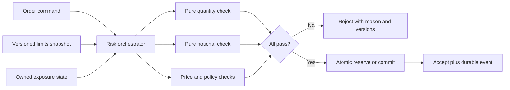

**API:** `evaluate(OrderCommand, RiskSnapshot) -> RiskDecision`; explicit reason codes and versions.

**Checks:** quantity, notional, price deviation, exposure, credit, restricted instrument, kill switch, rate limits.

**Critical invariant:** check and reservation/commit cannot allow concurrent orders to consume the same remaining limit. Avoid each rule independently mutating shared state.

**Architecture:** pure/pluggable checks over a consistent snapshot; orchestration owns aggregate reservation; dynamic limits arrive over a versioned control path.

**Mutations:** limits change mid-flight; duplicate order; crash after accept; multiple account writers; p99 below 500 μs.

**Why not DB per check?** Network/storage variance and contention harm latency/availability. Use in-memory authoritative ownership with durable event/recovery boundaries where requirements permit.

## 6.2 FIX session manager

**Implementation evidence:** [LLD project](../../../../LLDProjects/fix-session-manager/README.md)

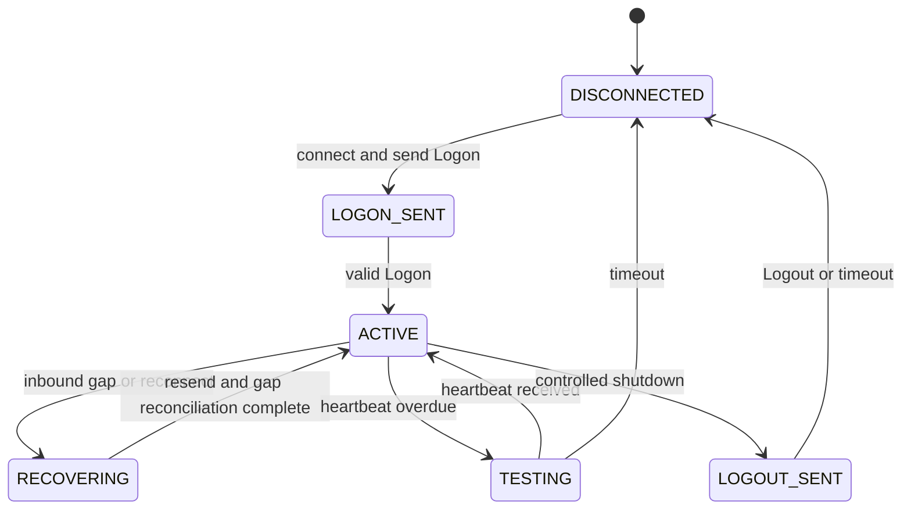

**Separate:** session sequence/heartbeat/recovery from business-order lifecycle.

**State:** disconnected, connecting, logon, active, logout/recovering; next inbound/outbound sequence; persistent message store.

**Flow:** validate sequence; low sequence applies duplicate policy; high sequence triggers gap recovery; ResendRequest/SequenceReset obey counterparty rules; business handler remains idempotent.

**Concurrency:** one outbound sequencer/session owner; bounded command mailbox; slow persistence/network behavior is visible.

**Tests:** missed heartbeat, TestRequest, reconnect, gap, duplicate, resend, crash after sequence allocation, corrupt store.

## 6.3 Exchange gateway

**Implementation evidence:** [LLD project](../../../../LLDProjects/exchange-gateway/README.md)

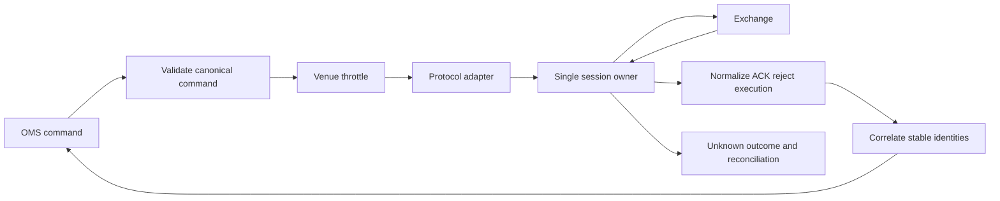

**Responsibilities:** canonical command validation, venue adapter, session ownership, throttle, correlation, normalization, metrics, uncertain-outcome reconciliation.

**Boundary:** gateway knows venue protocol; OMS owns business lifecycle; risk owns admission/exposure.

**Mutations:** add OUCH venue beside FIX; venue throttle changes; primary dies after socket send; ACK arrives after client timeout.

**Why not generic adapter only?** Canonical interfaces help, but must not erase venue-specific order types, reject semantics, sequence rules, and certification requirements.

## 6.4 OMS

**Implementation evidence:** [LLD project](../../../../LLDProjects/order-management-system/README.md)

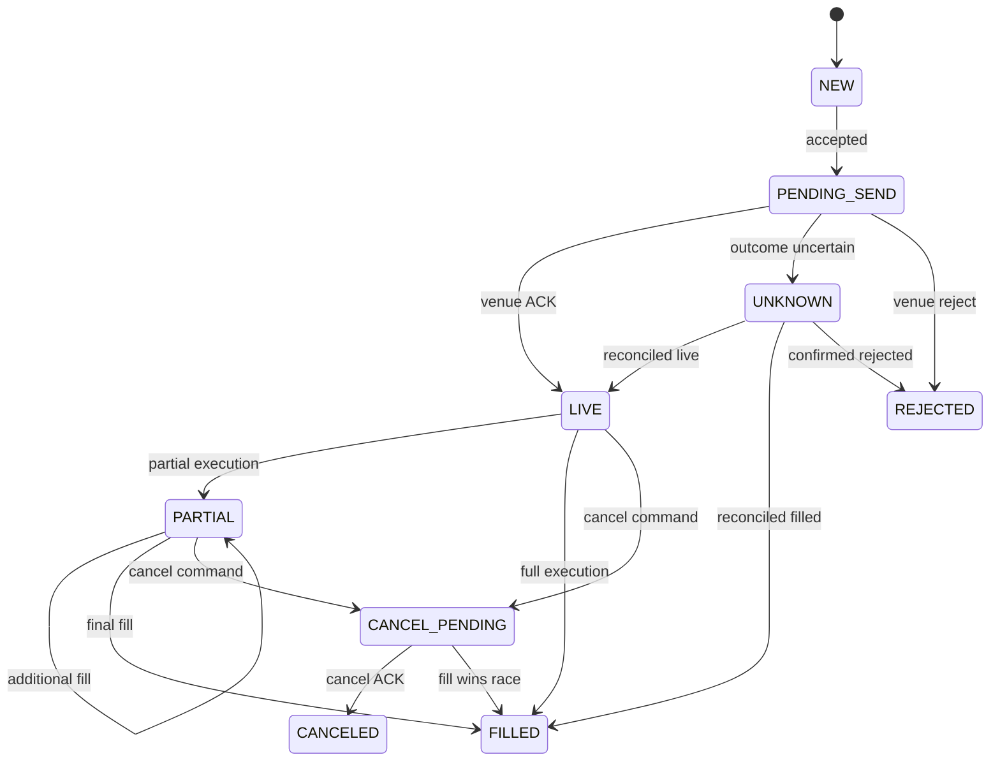

**State machine:** `NEW → PENDING_SEND → SENT → ACKED/PARTIALLY_FILLED/FILLED`; cancel/replace/reject/unknown paths must be explicit. Exact states are venue/product-specific.

**Invariant:** every event causes at most one valid transition and execution effect; terminal transitions do not silently reopen an order.

**Model:** `OrderAggregate`, commands, venue events, transition validator, repository/event journal, outbox/publisher.

**Tests:** duplicate ACK/execution, fill before ACK, cancel/fill race, reject, replace, restart replay, unknown outcome reconciliation.

## 6.5 Order book

**Implementation evidence:** [LLD project](../../../../LLDProjects/DesignOrderBook/README.md) · [TESTED exchange-lab `OrderBook`](../../src/main/java/org/chijai/exchange-systems-interview-lab/matching-engine/src/main/java/org/chijai/exchange/matching/OrderBook.java) · [compiling price-time drill](../../src/main/java/org/chijai/java/PriceTimePriority.java) · [compiling backlog-to-book progression](../../src/main/java/org/chijai/trading/NumberOfOrdersInTheBacklog.java)

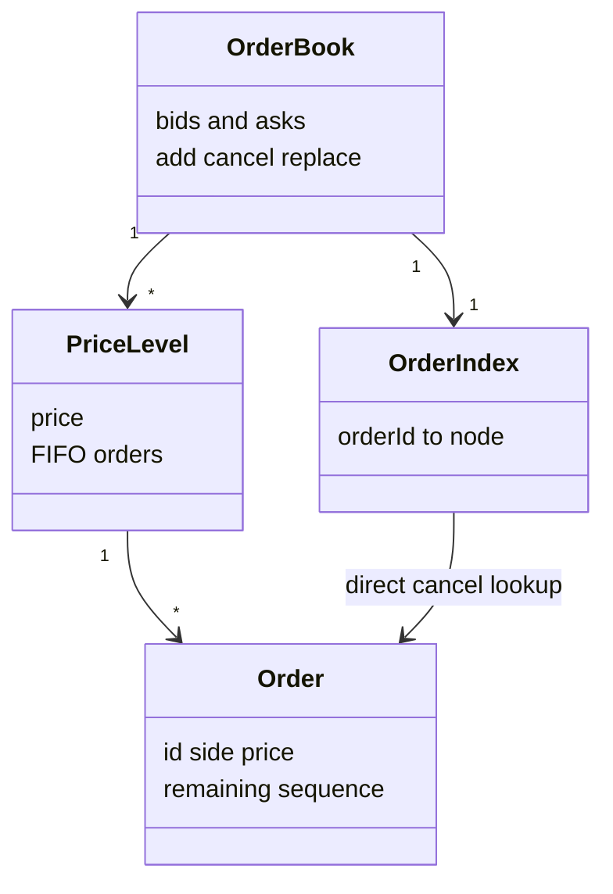

**Requirements:** add, cancel, replace, best bid/ask, price-time priority, partial fill; clarify supported order types and single instrument versus many.

**Model:** `Order`, `PriceLevel`, `OrderBook`, `OrderIdIndex`; sorted bid/ask price maps; FIFO at each level. A production O(1) cancel needs an index to the order/node, not a linear queue scan.

**Invariant:** sorted best price and FIFO within price; remaining quantity never negative; each live ID appears once.

**Concurrency:** prefer one writer per instrument/partition. Readers consume immutable snapshots/events or carefully published views.

**Tests:** same-price FIFO, better price, partial fill, cancel head/middle/tail, replace priority, empty side, duplicate ID.

**Mutations:** 1M events/sec; snapshot/replay; add iceberg; remove global lock.

**Why not `PriorityQueue` alone?** Efficient best order but arbitrary cancel/replace and maintaining FIFO groups/indexes become awkward; lazy deletion complicates memory and observability.

## 6.6 Matching engine

**Implementation evidence:** [LLD project](../../../../LLDProjects/matching-engine/README.md) · [TESTED exchange-lab book core](../../src/main/java/org/chijai/exchange-systems-interview-lab/matching-engine/src/main/java/org/chijai/exchange/matching/OrderBook.java) · [compiling one-file interview version](../../src/main/java/org/chijai/exchange-systems-interview-lab/matching-engine/interview-version/MatchingEngineInterview.java) · [compiling PTR comparison](../../src/main/java/org/chijai/PTR/MatchingEngine.java) · [compiling 60-minute integrated rehearsal](../../src/main/java/org/chijai/trading/TradingSystemInterview60Min.java)

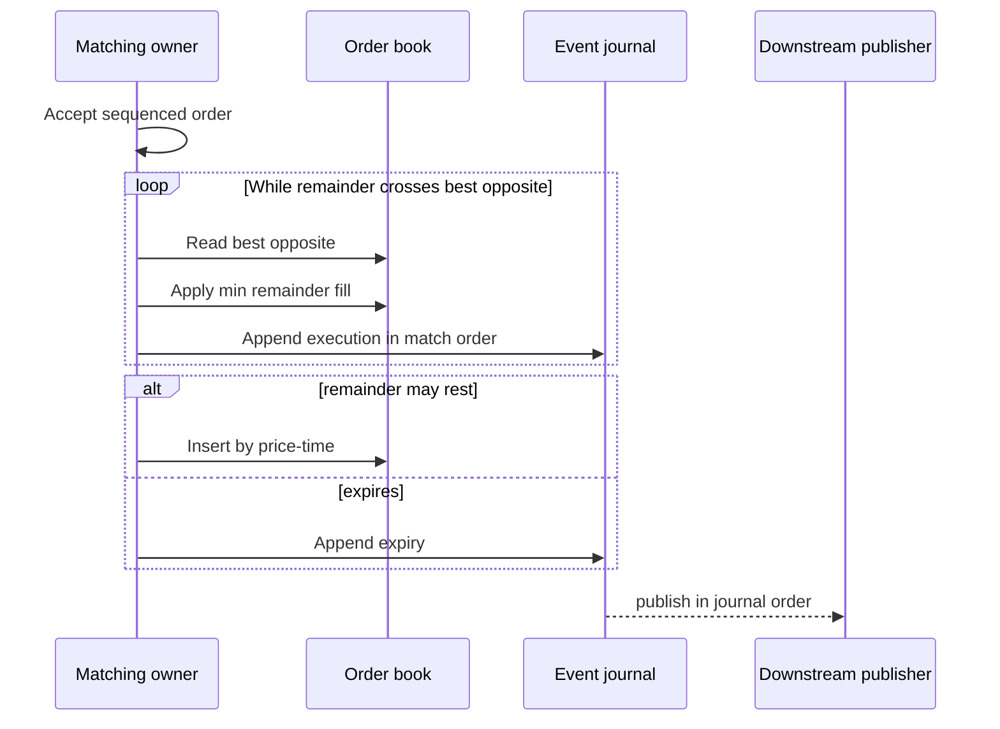

**Flow:** choose best opposite → check crossing → execute `min(remaining)` at defined passive/venue price → update/remove orders → repeat → rest or expire remainder.

**Clarify:** limit/market, IOC/FOK, self-match prevention, price bands, trading halts, deterministic sequence source.

**Invariant:** total filled quantity is conserved; book mutation and execution emission have one deterministic order.

**Concurrency:** single matching owner per book; scale across instruments. Never call slow external services inside the matching loop.

**Recovery:** ordered command/event log, snapshots, deterministic replay, downstream deduplication.

## 6.7 LRU/configuration cache

**Implementation evidence:** [LLD project](../../../../LLDProjects/lru-cache/README.md)

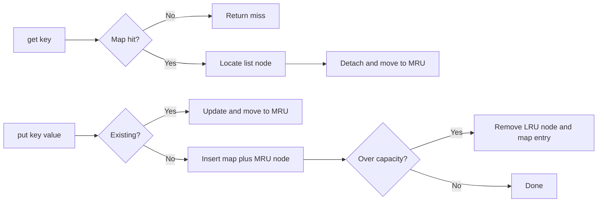

Start with map + doubly linked list, clear capacity/update semantics, and O(1) operations. Add thread safety only after workload is specified. For dynamic risk configuration, versioned immutable snapshots and explicit staleness rules may be safer than access-order eviction.

## 6.8 In-memory exposure tracker

**Compiling code evidence:** [position/running totals](../../src/main/java/org/chijai/trading/RunningTotalsPositionTracking.java) · [execution deduplication](../../src/main/java/org/chijai/java/ExecutionDeduplication.java) · [integrated 60-minute rehearsal](../../src/main/java/org/chijai/trading/TradingSystemInterview60Min.java)

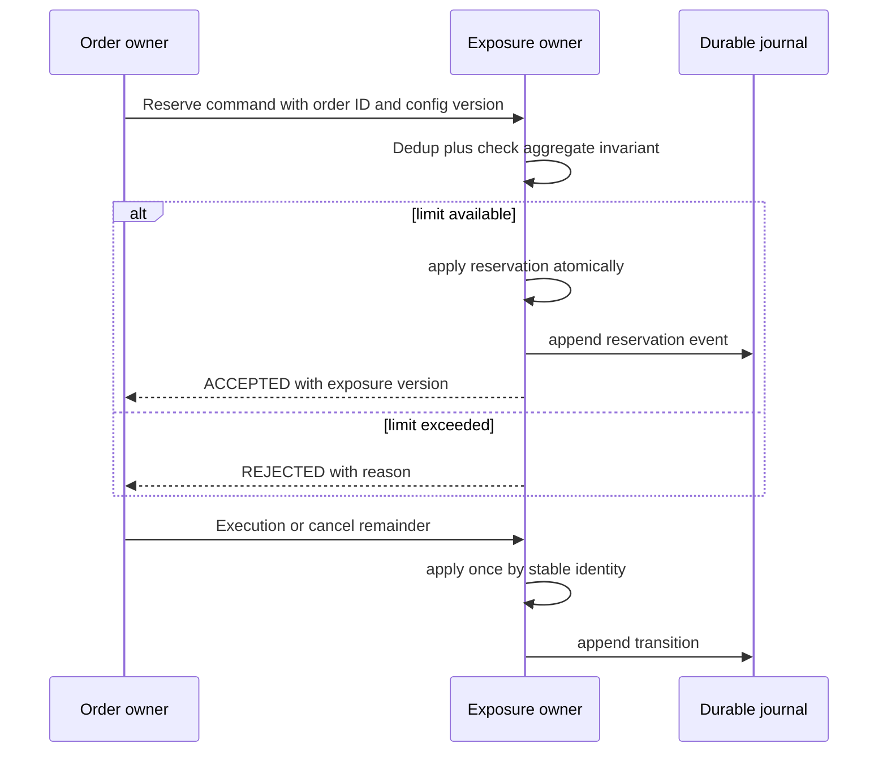

**Commands:** reserve, release, apply execution, cancel remainder, and query exposure. Clarify gross/net exposure, account hierarchy, instrument/currency, and whether reservations survive restart.

**Invariant:** accepted exposure plus outstanding reservations never exceeds the effective limit; one execution identity changes exposure at most once.

**Concurrency:** prefer one owner per account/portfolio; otherwise protect the complete aggregate transition with a lock or versioned CAS. Independent atomic fields do not preserve a multi-value rule.

**Tests:** simultaneous reserves, duplicate execution, cancel/fill race, dynamic limit reduction, overflow, replay, and snapshot restore.

## 6.9 Token-bucket rate limiter

**Implementation evidence:** [LLD project](../../../../LLDProjects/token-bucket-rate-limiter/README.md)

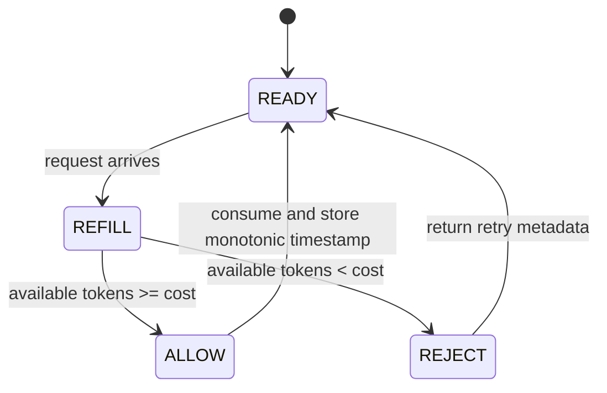

State is capacity, available tokens, refill rate, and last-refill monotonic timestamp. Refill lazily under one atomic boundary, cap at capacity, then consume if enough tokens exist. Clarify per-user/session/venue key, burst semantics, fairness, distributed authority, clock behavior, and rejection response.

For multiple instances, a local limiter is only per-instance. Alternatives include deterministic routing, a partitioned authority, leased quotas, or deliberately approximate global enforcement.

## 6.10 Ordered gap-recovery buffer

**Compiling code evidence:** [sequence-gap detector](../../src/main/java/org/chijai/java/SequenceGapDetector.java) · [out-of-order and snapshot-merge drills](../../src/main/java/org/chijai/trading/TradingDSA147To165.java)

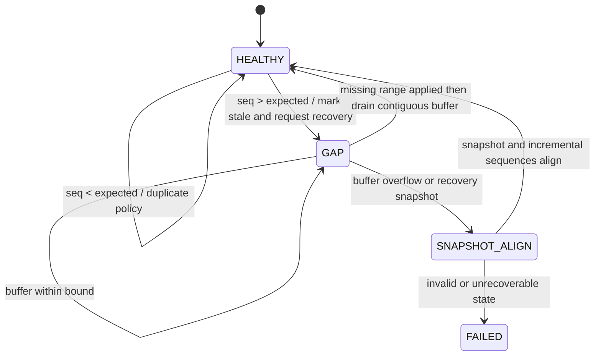

Maintain `nextExpected`, a bounded ordered buffer, recovery state, and last-known-good snapshot/version. Exact-next processes and drains contiguous buffered messages; lower sequence follows duplicate policy; higher sequence enters gap state and buffers only within limits.

Define duplicate identity, buffer overflow, recovery request coalescing, snapshot-plus-incremental alignment, stale publication policy, and restart behavior.

## 6.11 Bounded event pipeline

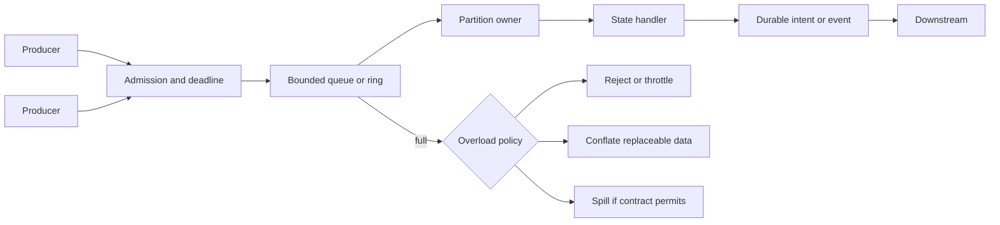

Model immutable events, bounded queues/ring buffers, producer admission, consumer ownership, shutdown, error handling, and metrics. Choose single versus multiple producers/consumers from ordering and state constraints. Define overload policy—reject, block, shed, conflate, spill, or disconnect—per message type.

Tests must prove the promised delivery/ordering behavior, correct shutdown/drain, and visible saturation.

## 6.12 Idempotency store

**Related implementation evidence:** [Reliable order project](../../../../SystemDesignProjects/reliable-order-platform/README.md) · [compiling execution-dedup drill](../../src/main/java/org/chijai/java/ExecutionDeduplication.java)

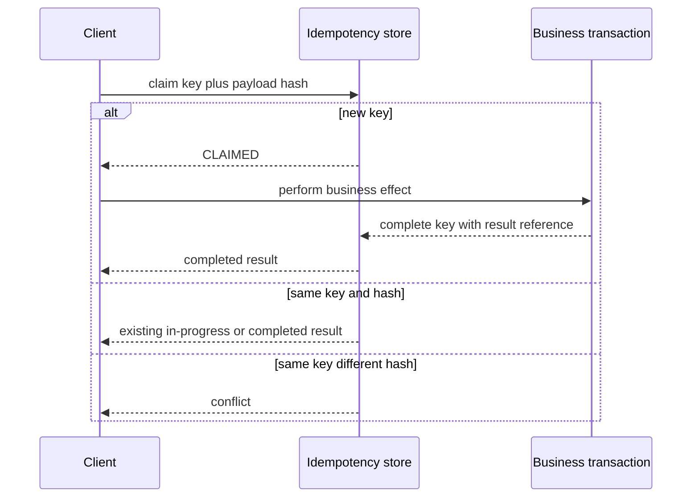

Atomically claim a stable request key with payload hash, return the existing in-progress/completed result, complete with a response reference, and expire under a defined retention policy. A repeated key with a different payload is a conflict.

Clarify crash after claim, crash after business commit, transaction boundary, concurrent duplicates, durable recovery, storage growth, and downstream effects. An in-memory map is only a single-process demonstration.

## 6.13 Market-data book builder

**Related implementation evidence:** [Order-book project](../../../../LLDProjects/DesignOrderBook/README.md) · [TESTED exchange-lab book core](../../src/main/java/org/chijai/exchange-systems-interview-lab/matching-engine/src/main/java/org/chijai/exchange/matching/OrderBook.java) · [compiling snapshot/incremental drill](../../src/main/java/org/chijai/trading/TradingDSA147To165.java)

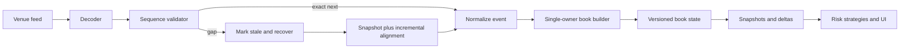

Own one ordered stream/partition, validate sequence, apply add/modify/delete/trade semantics, maintain price levels/orders as the feed requires, publish versioned snapshots/deltas, and mark state stale on gaps. Separate feed-specific decoding from canonical state without erasing venue semantics.

Tests include duplicate, reordering, gap, crossed/locked book rules, delete unknown order, snapshot alignment, replay equivalence, and slow subscriber.

## 6.14 Position service

**Compiling code evidence:** [position/running totals](../../src/main/java/org/chijai/trading/RunningTotalsPositionTracking.java) · [execution deduplication](../../src/main/java/org/chijai/java/ExecutionDeduplication.java)

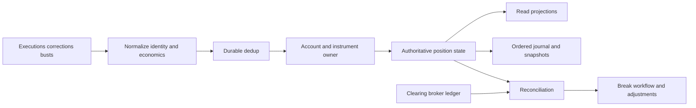

Consume normalized executions/corrections, deduplicate by stable identity, apply signed quantities and cash, maintain account/instrument/currency views, publish versioned positions, and reconcile against authoritative external records.

Clarify trade date versus settlement, bust/correct, corporate actions, FX, late events, hierarchy, snapshot/replay, and current versus as-of reads.

## 6.15 State-machine and design checklist

```text
[ ] Commands, events, identities, lifecycle, and invalid transitions clarified
[ ] Aggregate/state owner and invariant named
[ ] Public API returns explicit success/reject/unknown result
[ ] Data structure chosen from required operations
[ ] Atomic/concurrency boundary stated
[ ] Persistence, publication, idempotency, and recovery boundary stated
[ ] Happy path plus negative/failure path implemented
[ ] Deterministic unit, transition, race, and replay tests listed
[ ] One requirement mutation absorbed without replacing the whole design
[ ] Complexity and operational trade-offs defended
```

---

# 7. Round 5 — High-level design and system architecture

## 7.1 Pre-trade risk platform

**Implementation evidence:** [System-design project](../../../../SystemDesignProjects/trading-risk-platform/README.md)

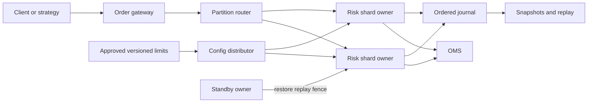

**Clarify:** checks, account hierarchy, throughput, p99, stale-limit tolerance, consistency, availability, regulatory/audit, RTO/RPO.

**Data plane:** gateway → partition router → single-owner risk shard → decision/reservation → OMS. Hot state is in memory; commands/events carry stable IDs and config versions.

**Control plane:** authorized limit updates → validation/approval → versioned durable store → distribution → shard acknowledgment/health.

**Recovery:** snapshots + ordered replay; reconcile accepted reservations/orders; fence old owner on failover.

**Scale:** partition by state authority such as account/portfolio; identify cross-account rules before promising horizontal scaling.

**Observe:** decision/reject counts, config version skew, queue age, p99/p99.9, replay lag, snapshot age, failover state, invariant violations.

**Attack:** Why not Kafka/DB/more threads/active-active? Answer from synchronous latency, state ownership, ordering, failure, and operational constraints.

## 7.2 Exchange-connectivity platform

**Implementation evidence:** [System-design project](../../../../SystemDesignProjects/exchange-connectivity-platform/README.md)

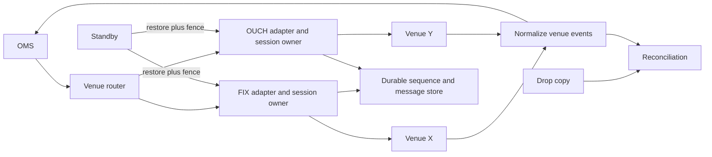

**Components:** internal command API, routing, per-venue adapters, session owners, throttle, durable sequence/message store, normalized event bus, reconciliation, drop-copy consumer, operations console.

**Critical failure:** primary crashes after send before ACK. Do not blindly resend; recover sequence/session, reconcile venue/drop copy, preserve stable identity, expose uncertainty, and apply venue-specific duplicate rules.

**HA:** active/standby per session with fencing and current durable state; scale across venue/session partitions.

**Observe:** logon state, sequence gaps, resend volume, ACK latency, throttle headroom, pending/unknown orders, socket/network health.

## 7.3 Market-data platform

**Related implementation evidence:** [Electronic-trading project](../../../../SystemDesignProjects/electronic-trading-platform/README.md)

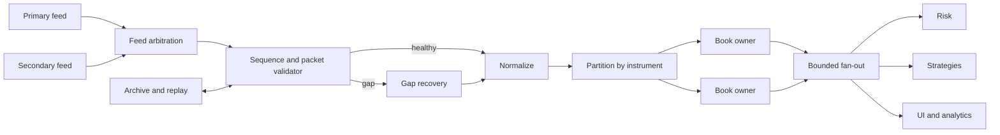

**Flow:** redundant feed ingest → packet/sequence validation → gap detector → normalization → partitioned book builders → derived views → bounded fan-out/replay.

**Correctness:** a gap marks dependent state stale until recovered; snapshot plus incremental alignment must avoid double application.

**Performance:** avoid per-message allocation/copy where evidence justifies it; partition by instrument; isolate slow consumers; choose drop/conflate/disconnect policy by product.

**HA:** redundant feeds and independent builders, but define arbitration and prevent mixing inconsistent streams.

## 7.4 End-to-end electronic-trading platform

**Implementation evidence:** [System-design project](../../../../SystemDesignProjects/electronic-trading-platform/README.md)

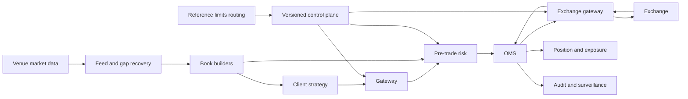

Draw separate paths:

```text
Order: client → gateway → risk → OMS → venue gateway → exchange
Events: exchange/drop copy → gateway → OMS → position/exposure → client/audit
Market data: venue feed → gap/recovery → normalize/book → strategies/UI/risk
Control: limits/reference/config → approval/version → distribution
```

Deep dive into identity, state ownership, sync/async boundaries, duplicates, uncertain outcomes, replay, backpressure, HA, and observability. Do not claim all components need the same consistency or latency.

## 7.5 Deadline-bound multi-service aggregator

**Implementation evidence:** [System-design project](../../../../SystemDesignProjects/multi-service-aggregator/README.md)

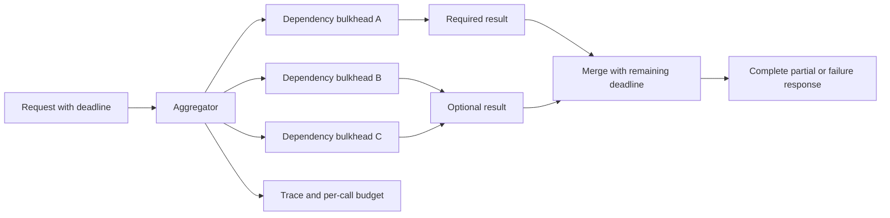

Establish one overall deadline; run independent calls concurrently; allocate per-call budgets; distinguish required/optional data; use bounded retries with remaining-time and idempotency checks; isolate dependencies with bulkheads; return explicit partial/stale data when allowed; trace fan-out. Persist business effects idempotently rather than equating concurrent calls with a transaction.

## 7.6 OMS, position, and exposure platform

**Implementation evidence:** [Risk-platform project](../../../../SystemDesignProjects/mini-risk-management-platform/README.md)

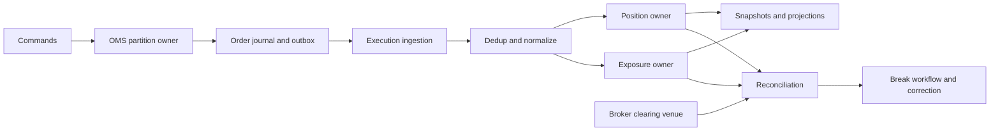

Separate command authority from read projections. OMS owns order lifecycle; execution ingestion normalizes/deduplicates events; position/exposure shards own account/portfolio state; read models serve dashboards and downstream consumers. Use stable IDs, ordered partitioning, durable journal/outbox, snapshots, reconciliation, and explicit correction flows.

Deep dive into cancel/fill race, execution before ACK, duplicate drop copy, cross-account limits, historical as-of queries, and recovery after partial publication.

## 7.7 Low-latency messaging platform

**Implementation evidence:** [Exchange-lite project](../../../../SystemDesignProjects/exchange-lite/README.md) · [Message-queue project](../../../../SystemDesignProjects/message-queue-lab/README.md)

```mermaid
flowchart LR
    P1[Publisher] --> T[Transport channel]
    P2[Publisher] --> T
    T --> S1[Subscriber]
    T --> S2[Subscriber]
    T --> A[Archive or durable log]
    A --> R[Replay]
    R --> S1
    R --> S2
    S1 --> B1[Bounded consumer buffer]
    S2 --> B2[Bounded consumer buffer]
    B1 --> O[State owner]
    B2 --> O2[State owner]
    M[Schema lifecycle and metrics] --> T
```

Clarify topology, message sizes, producers/consumers, ordering scope, durability, replay, fan-out, loss tolerance, and p99/jitter. Separate transport, schema, buffer ownership, flow control, discovery, security, and operations.

Compare Aeron, Solace, Kafka, TCP, and ring-buffer/shared-memory options against measured requirements. Define slow-consumer policy, schema evolution, fragmentation, reconnect, duplicate handling, and observability.

## 7.8 Trade audit and surveillance platform

**Related implementation evidence:** [Reliable-order project](../../../../SystemDesignProjects/reliable-order-platform/README.md)

```mermaid
flowchart LR
    O[Orders and lifecycle] --> I[Immutable evidence ingest]
    E[Executions and corrections] --> I
    M[Market and reference data] --> I
    U[User and config changes] --> I
    I --> R[Raw append-only evidence]
    R --> N[Versioned normalization]
    N --> Q[Rules and analytics]
    Q --> C[Cases and alerts]
    C --> W[Investigation workflow]
    R --> L[Lineage replay and audit access]
```

Ingest immutable order, execution, cancel/replace, market-data/reference, user/configuration, and session events with provenance. Preserve event time, receive time, source sequence, corrections, and retention; build versioned rule/analytics pipelines and case-management outputs without rewriting raw evidence.

Cover completeness reconciliation, late data, replay, access control, tamper evidence, lineage, explainability, and separation from the latency-critical order path.

## 7.9 Reconciliation platform

**Related implementation evidence:** [Risk-platform project](../../../../SystemDesignProjects/mini-risk-management-platform/README.md)

```mermaid
flowchart LR
    I[Internal orders executions positions cash] --> N[Canonical normalization]
    X[Venue broker clearing ledger] --> N
    N --> E[Exact identity match]
    E -->|unmatched| T[Tolerant and aggregate match]
    E -->|matched| OK[Reconciled]
    T -->|matched| OK
    T -->|unmatched| B[Break classification]
    B --> W[Investigation and approval]
    W --> A[Correction or accepted exception]
    A --> AU[Immutable audit]
```

Compare internal orders/executions/positions/cash against venue, clearing, broker, and ledger records. Normalize identities, match exact then tolerant/aggregate cases, classify breaks, support investigation/approval, and record every adjustment.

Handle late/duplicate files or streams, reruns, versioned rules, deterministic output, batch/stream mixes, evidence retention, and `UNKNOWN` rather than forced false matches.

## 7.10 Reference-data and configuration distribution

**Related implementation evidence:** [Risk-platform project](../../../../SystemDesignProjects/trading-risk-platform/README.md)

```mermaid
flowchart LR
    A[Author] --> V[Validate]
    V --> P[Approval and segregation of duties]
    P --> S[Versioned authority]
    S --> D[Snapshot and delta distributor]
    D --> C1[Risk consumer]
    D --> C2[Gateway consumer]
    D --> C3[Market-data consumer]
    C1 --> ACK[Applied-version acknowledgments]
    C2 --> ACK
    C3 --> ACK
    ACK --> H[Skew freshness and rollout health]
    H --> F[Forward fix or controlled rollback]
```

An authoritative control plane validates and approves instruments, sessions, limits, calendars, and routing configuration; publishes immutable versioned snapshots/deltas; and records consumer acknowledgment, skew, and freshness. Hot paths read local snapshots.

Handle invalid rollout, partial distribution, rollback versus forward fix, effective time, dependency order, entitlement, audit, stale-state policy, and recovery of a newly started node.

## 7.11 Cross-design decision and trade-off matrix

Use the full decision-record template when speaking. This matrix is the recall surface for the most important choices.

| Design | Invariant / driving force | Chosen decision and reasoning | Rejected alternatives | Cost, risk, and reconsideration trigger |
|---|---|---|---|---|
| Pre-trade risk engine | Check and reservation must consume one consistent limit state | One orchestration owner performs pure checks then an atomic aggregate reservation | Independent mutating rules; DB call per rule; unrelated atomics | Partition can become hot; reconsider partition/decomposition only after measured owner saturation |
| FIX session | One ordered outbound sequence and deterministic inbound gap handling | One fenced session owner with persistent sequence/message state | Multiple writers; memory-only sequence; business logic inside session state | Failover pauses the session; reconsider only if venue supports independently partitioned sessions |
| Exchange gateway | Venue semantics and uncertain outcomes must not corrupt OMS state | Canonical boundary plus venue-specific adapters and explicit UNKNOWN reconciliation | One generic adapter that erases semantics; blind retries | Adapter/certification cost; add abstraction only for genuinely common semantics |
| OMS | Each event causes at most one valid lifecycle transition/effect | Aggregate state machine with idempotent events and durable journal/outbox | CRUD status updates from many services; implicit transitions | Aggregate ownership can bottleneck hot keys; repartition without splitting one order's authority |
| Order book | Best price and FIFO within price must remain deterministic | Sorted price levels, intrusive/FIFO nodes, and order-ID index under one owner | Priority queue alone; global scanning; multi-writer book | Per-book throughput bound; shard by instrument, never by mutable half of one book |
| Matching engine | Quantity conservation and execution order | Single matching owner per book with journal-before-publication order | Parallel mutation of one book; external calls inside loop | Dedicated owner/core cost; reconsider only with a decomposable matching domain |
| LRU/cache | Lookup and recency changes must remain O(1) | Map plus doubly linked list; configuration instead uses versioned immutable snapshots | Map alone; linear list; generic LRU for correctness-critical config | Lock/contention and staleness risk; choose snapshot model when recency is not the real requirement |
| Exposure tracker | Exposure plus reservations never exceeds effective limit | One owner per account/portfolio or atomic aggregate transition | Independent counters; check then decrement; eventual reconciliation only | Cross-hierarchy rules complicate partitioning; introduce coordination only where invariant crosses owners |
| Token bucket | Burst and refill semantics must be deterministic | Monotonic-time lazy refill under one atomic boundary | Wall-clock refill thread; uncoordinated per-instance “global” limit | Distributed exactness adds latency; use leased/approximate quotas only when business permits |
| Gap buffer | No post-gap state is published as healthy until aligned | Bounded ordered buffer plus snapshot/incremental recovery state | Unbounded buffering; continue applying after gap; discard silently | Buffer/recovery memory and stall; change policy based on feed recovery contract |
| Event pipeline | Overload must be bounded and visible | Bounded queue/ring with message-specific admission policy | Unbounded queue; universal blocking; silent drop | Rejection or shedding is explicit; capacity/policy changes require semantic evidence |
| Idempotency store | One stable key maps to one payload and business result | Atomic claim with payload hash and durable result reference | Process-local set; key without payload validation; transport dedup only | Retention/storage cost; change scope only when business identity/retention changes |
| Market-data builder | Book state follows one valid sequence | Single owner per partition, stale-on-gap, snapshot alignment | Multi-writer book; connection health as data health | Instrument skew; repartition instruments while preserving per-instrument order |
| Position service | Each execution/correction affects position exactly once | Stable-identity dedup plus ordered account/instrument ownership and reconciliation | Sequence-only dedup; destructive history rewrite | Correction/as-of complexity; add richer event model as products require |
| Risk platform | Low-latency decisions need local consistent state and durable recovery | In-memory shard owners, versioned control plane, journal/snapshot, fenced failover | DB hot path; global lock; active-active on same state | Operational recovery complexity; use simpler DB authority if latency/availability requirements allow |
| Exchange connectivity | Session sequence and uncertain orders need one authority | Active/standby per venue session with durable state and reconciliation | Unfenced active-active; stateless retry gateway | Failover time and standby freshness; active-active only across independent sessions/partitions |
| Market data platform | Gaps invalidate derived state | Redundant ingest, sequence validation, recovery, single-owner books, bounded fan-out | Mix feeds without arbitration; publish through gap; unbounded subscribers | Recovery/fan-out complexity; simplify only if feed/product tolerates loss/staleness |
| End-to-end trading | Each state belongs to one bounded authority | Separate order, event, market-data, and control paths with explicit sync/async boundaries | One shared database workflow; undifferentiated event bus | More components and reconciliation; collapse only where SLO and ownership permit |
| Aggregator | Overall deadline and partial-failure semantics | Concurrent calls within remaining budget, required/optional classification, bulkheads | Sequential fan-out; unrestricted retry; pretend distributed transaction | Partial response complexity; simplify when dependency count/latency is small |
| OMS/position/exposure HLD | Command authority and projections must not conflict | Separate authoritative aggregates from rebuildable read models | Every service writes shared tables; projection as authority | Eventual read lag; use stronger read path only for operations requiring authority |
| Messaging platform | Ordering, durability, and latency scopes differ by message | Choose transport/service class per semantic channel; bound consumers; archive where needed | One broker for every workload; unbounded buffering; “fast” without recovery | Operational diversity; consolidate only after measured semantics align |
| Audit/surveillance | Raw evidence must remain immutable and explainable | Append-only provenance plus versioned normalization/rules and lineage | Rewrite raw events; run surveillance on order hot path | Storage/replay cost; tier retention without losing mandated evidence |
| Reconciliation | False matches are worse than explicit breaks | Exact match, then controlled tolerant/aggregate stages, then human workflow | Force every record to match; destructive adjustments | Operational break volume; improve rules from labeled evidence, not hidden heuristics |
| Reference/config distribution | Consumers must know exactly which approved version they apply | Versioned authority, snapshot/delta distribution, acknowledgment and skew health | Shared mutable config DB on hot path; unaudited push; timestamp-only version | Rollout complexity; simplify only when stale/mixed versions cannot violate correctness |

## 7.12 Critical failure and recovery sequences

These are follow-up diagrams. Begin with the selected baseline architecture, then draw only the failure sequence the interviewer asks you to analyze. Do not draw all four during one interview.

### Risk-owner crash and fenced takeover

```mermaid
sequenceDiagram
    participant R as Router
    participant P as Primary risk owner epoch 41
    participant J as Journal and snapshot
    participant S as Standby epoch 42
    R->>P: Command at offset n
    P->>J: Append accepted transition n
    P--xR: Crash before response
    S->>J: Restore snapshot and replay through n
    S->>S: Validate invariants and acquire epoch 42
    R->>S: Route only after epoch 42 active
    P-->>J: Stale write attempt with epoch 41
    J-->>P: Reject fenced owner
    S-->>R: Reconciled result for stable command ID
```

### Exchange crash after send before acknowledgment

```mermaid
sequenceDiagram
    participant O as OMS
    participant G as Gateway primary
    participant V as Venue
    participant S as Gateway standby
    participant D as Drop copy or query
    O->>G: Submit stable client order ID
    G->>V: Venue order send
    G--xO: Crash before ACK
    O->>O: Mark UNKNOWN not rejected
    S->>S: Restore session sequence and acquire fence
    S->>V: Logon and protocol recovery
    V-->>S: Resend ACK or execution state
    D-->>S: Independent reconciliation evidence
    S-->>O: Resolve ACKED FILLED REJECTED or still UNKNOWN
```

### Market-data gap and snapshot alignment

```mermaid
sequenceDiagram
    participant F as Feed
    participant G as Gap detector
    participant R as Recovery service
    participant B as Book owner
    participant C as Consumers
    F->>G: Sequence 100
    G->>B: Apply 100
    F->>G: Sequence 104
    G->>C: Mark book stale at expected 101
    G->>R: Request 101 to 103 or snapshot
    R-->>G: Snapshot at 102 plus incremental from 103
    G->>B: Restore snapshot and apply 103 then 104 once
    B->>B: Validate checksum and book invariants
    B-->>C: Publish healthy version at 104
```

### State commit before event publication

```mermaid
sequenceDiagram
    participant A as Application service
    participant DB as State plus outbox transaction
    participant P as Outbox publisher
    participant B as Broker
    participant C as Idempotent consumer
    A->>DB: Commit business state and outbox row atomically
    A--xP: Process crashes before publish
    P->>DB: Poll unpublished outbox after restart
    P->>B: Publish event with stable event ID
    B-->>C: Deliver event
    C->>C: Dedup and apply effect once
    P->>DB: Mark published or retain retry metadata
```

## 7.13 HLD mutation pool

- 100K events/sec becomes 1M.
- p99 becomes <500 μs with strict jitter.
- Messages duplicate, reorder, or drop.
- Database is unavailable for 30 minutes.
- Process crashes after state mutation but before publication.
- Venue disconnects with 500 in-flight orders.
- Risk limits update during evaluation.
- Slow consumer grows queue indefinitely.
- Add another exchange/protocol.
- Add multi-AZ; then demand multi-region active-active.

Modify the existing design. State which components remain unchanged, which invariant is stressed, and what new trade-off appears.

---

# 8. Round 6 — Production debugging and incident response

Do not read the diagnosis until after producing hypotheses, evidence requests, tools, and first safe action.

## 8.1 p99 rises from 700 μs to 4 ms; CPU is 45%

Evidence: p50 changes little; queue age rises in bursts; GC pause totals look normal; release changed structured logging and executor configuration.

Investigate per-core saturation, runnable/blocked threads, executor queue/rejection, logging I/O/serialization, safepoints, allocation, context switches, network/downstream percentiles, and per-instance skew. Compare before/after profiles/config. CPU average does not clear contention or a saturated core.

## 8.2 Exposure occasionally becomes negative

Evidence: two order-processing workers handle the same account; each checks available exposure before decrement; individual counters are atomic.

Likely violated invariant: check-plus-reserve across related values is not one atomic transition. `AtomicLong` fields do not make the aggregate rule atomic. Repair with account ownership/single writer, aggregate CAS/version, or a lock/transaction around the invariant; add deterministic race tests and reconciliation.

## 8.3 Duplicate execution after reconnect

Evidence: execution is delivered on the main session and drop copy; reconnect triggers resend; position consumer keys deduplication by message sequence.

Sequence identifies transport position, not necessarily business execution identity across channels. Deduplicate by the venue's stable execution identity/scope, persist/rebuild it, handle correction/bust semantics, and reconcile positions.

## 8.4 Market-data book is stale but feed process is healthy

Evidence: packet counter gap occurred; process kept publishing; checksum divergence appears minutes later.

The health model ignored data correctness. Mark book stale on gap, stop or label publication according to contract, recover snapshot/incremental alignment, validate, then republish. Add sequence-gap and book-freshness alerts—not only process liveness.

## 8.5 Queue grows indefinitely

Evidence: producer rate exceeds consumer during venue slowdown; queue is unbounded; heap and p99 rise before OOM.

Bound the queue, expose age/depth, propagate backpressure/admission control, preserve critical command policy, isolate slow work, and decide whether to reject, throttle, conflate, spill, or disconnect based on message semantics.

## 8.6 Deadlock after new feature

Evidence: thread dump shows risk thread holding account lock waiting for order lock, while cancel thread holds order lock waiting for account lock.

Restore global lock order or redesign ownership to avoid nested locks; never simply increase pool size. Add concurrency tests, lock diagnostics, and a design rule for callbacks/external calls while locked.

## 8.7 Excessive GC and allocation

Evidence: allocation rate doubled after adding JSON diagnostics on every accepted order; old-gen occupancy is stable but young pauses and CPU increased.

Prove allocation sources with profiler/JFR; sample/rate-limit diagnostics, avoid constructing disabled log payloads, reuse appropriate immutable metadata or buffers only if safe, and remeasure latency/allocation. Do not jump directly to a new collector.

## 8.8 Incident evaluation checklist

```text
[ ] Protected customers/state first
[ ] Timeline and recent change established
[ ] Baseline versus affected signals compared
[ ] Hypotheses ranked, not brainstormed endlessly
[ ] Cheapest discriminating evidence requested
[ ] Cause separated from symptom
[ ] Mitigation and durable fix separated
[ ] State reconciled after recovery
[ ] Regression, alert, runbook, and ownership added
[ ] Unknowns stated honestly
```

---

# 9. Round 7 — Why-not and trade-off defense

For each, answer: workload/constraint → meaningful difference → failure/operational trade-off → recommendation.

1. `synchronized` versus `ReentrantLock`.
2. CAS loop versus lock.
3. `AtomicLong` versus `LongAdder`.
4. `ArrayBlockingQueue` versus `ConcurrentLinkedQueue`.
5. G1 versus ZGC.
6. Heap versus off-heap.
7. Kafka versus Aeron versus Solace.
8. FIX versus OUCH.
9. Single-threaded ownership versus multi-threaded shared state.
10. Active/passive versus active/active.
11. Why not store risk state in a database?
12. Why not add more threads?
13. Why not use `ConcurrentHashMap` for all exposure state?
14. Why not object pooling?
15. Why not split the order path into more microservices?

Do not say “X is better” without saying better under which workload and constraints.

---

# 10. Round 8 — Project, leadership, and behavioral

## 10.1 Evidence labels

- `[RESUME-STATED]`: present in the supplied resume; exact depth, architecture, metrics, and personal scope still require truthful verification.
- `[ME/VERIFY]`: answer only from personal evidence; verify details and metrics.
- `[DESIGN]`: hypothetical senior response; do not present it as past experience.
- `[KNOWLEDGE]`: technical explanation.
- `[PERSONALIZE]`: incomplete until you fill it truthfully.

## 10.2 Project deep-dive card [PERSONALIZE]

Prepare one primary and one backup project using this exact card:

```text
Problem and users:
Constraints and scale:
Architecture before my change:
What I personally implemented:
Critical invariant:
Hardest failure/incident:
Evidence/metric and measurement method:
Alternatives considered:
Trade-off accepted:
What was already there:
What I would change now:
```

The interviewer may ask: “What exactly did **you** implement?” Answer in first-person verbs with repository, ticket, design, test, deployment, or operational evidence. If work was simulated or a learning project, say so.

## 10.3 Leadership questions

Prepare concise evidence-backed answers:

1. Tell me about a technical decision you drove without formal authority.
2. Tell me about a disagreement with another senior engineer.
3. When did you choose correctness over delivery speed—or the reverse?
4. How did you mentor an engineer without becoming the bottleneck?
5. Describe an incident you owned from detection through prevention.
6. Describe a design you changed after evidence disproved your first idea.
7. How do you prioritize when several production problems are urgent?
8. How do you communicate risk to non-specialists?
9. Tell me about a failure. What changed in your behavior afterward?
10. How would you earn trust in a new trading-platform team?

Use `Situation → Stakes → My action → Reasoning → Result/evidence → Learning`. Do not turn `Action` into “we” unless team action is specifically asked.

## 10.4 Judgment scenarios

### Incorrect report already sent [DESIGN]

State the impact and certainty, notify the right owner quickly, correct the record visibly, preserve auditability, determine affected decisions, and prevent recurrence. Never silently replace the report.

### Asked for data you cannot access [DESIGN]

Do not bypass controls. Clarify the purpose, identify an authorized owner or approved aggregate, record the request if required, and provide only the minimum permitted information.

### Teammate receives credit [DESIGN]

Protect the team outcome first, then clarify contribution privately and factually with artifacts. Avoid public scorekeeping; fix recurring attribution through explicit ownership and review records.

### Material defect versus release deadline [DESIGN]

Classify customer/regulatory/correctness impact, make the residual risk explicit, propose the smallest safe release boundary, obtain accountable acceptance where appropriate, and preserve rollback/reconciliation paths.

## 10.5 Senior recovery scripts

```text
I do not recognize the problem:
“I do not recognize a memorized solution, so I will derive it from the constraints
and a small example.”

My first approach is not optimal:
“This baseline is correct at O(...). The bottleneck is ...; I can remove it by ...”

I need thinking time:
“Let me take twenty seconds to establish the invariant before I code.”

The interviewer challenges an assumption:
“Good challenge. My answer assumed ___. If that is false, the design changes at ___.”

I receive a hint:
“Thank you. I will restate how that changes the invariant, then continue.”

Code fails:
“I will not patch randomly. Expected was ___, actual is ___; I will trace the state
at the smallest failing example.”

Asked about work I did not own:
“I understand the surrounding design, but I did not personally implement that part.
My contribution was ___. I can explain how I would approach the other part.”

Asked for an unverifiable/internal metric:
“I do not want to invent precision or disclose internal data. The measured direction
was ___; the method and boundary I can discuss are ___.”
```

## 10.6 Resume-specific project cross-examination

### Nasdaq pre-trade risk — primary project [ME/VERIFY]

Prepare a three-minute baseline using only truthful details:

```text
Users and decision protected:
Where the risk component sits in the order lifecycle:
Inputs and accept/reject output:
State held in memory and its owner:
Exposure / quantity / value / price-deviation semantics:
Configuration and recovery path:
What I personally implemented:
Hardest failure or trade-off:
Test and release evidence:
Result I can substantiate:
What the matching-engine/platform/other teams owned:
What I would improve now:
```

Expect these follow-ups:

1. What is the consequence of a false accept versus a false reject?
2. Is the check before matching, within a matching-engine call, or elsewhere? What is the actual call direction and protocol `[VERIFY]`?
3. Why is the decision synchronous? What happens if the risk component is slow or unavailable?
4. What latency target was measured, where was it measured, and did it include coordinated omission, warm-up, and tails `[VERIFY]`?
5. What exactly does “no database on the hot path” improve, and which durability/consistency problems move elsewhere?
6. How is state loaded, snapshotted, replayed, reconciled, and proven ready after restart?
7. Can a risk decision observe a mixed limit/configuration version? How are dynamic updates published?
8. Who mutates exposure: one owner, multiple threads under a lock, atomics, or another model? What is the full atomic invariant?
9. Is exposure checked then updated, reserved then committed, or derived from accepted/executed events? Why?
10. What happens on reject, cancel, replace, partial fill, duplicate event, reconnect, execution bust, and replay?
11. How are monetary value and price deviation represented? What are the reference price, currency, rounding, overflow, stale-data, and missing-data policies?
12. How do venue differences enter the system without turning the core into conditionals?
13. What failure did you personally diagnose? Give the first signal, ranked hypotheses, discriminating evidence, cause, fix, and prevention.
14. Which class/module/test/release action was yours? Which parts pre-existed or were owned by other teams?
15. What result can you prove without disclosing confidential data?

### Negative-exposure incident — preferred technical STAR only if true [ME/VERIFY]

```text
Situation: exposure was intermittently incorrect/negative after startup [VERIFY].
Stakes: an authoritative risk state could no longer be trusted.
My task: isolate whether arithmetic, concurrency, duplicate events, or initialization order violated the invariant.
My action: improve observability; reconstruct the event/config timeline; widen one timing factor;
           reproduce; identify recovered orders processed before required risk state was ready;
           move/protect the readiness boundary; replay the original and synthetic sequences.
Result: [state exact validation and outcome; do not invent a number].
Learning: correct arithmetic over incomplete state is still an incorrect system.
```

Cross-question defense:

- Why was the later cancellation able to decrement from zero?
- Why was this an ordering/readiness defect rather than necessarily a Java data race?
- What other hypotheses did you eliminate and with what evidence?
- How did the reproduction preserve semantics rather than create a new bug?
- What test prevents recurrence: deterministic startup/replay test, invariant assertion, readiness gate, or all applicable `[VERIFY]`?
- Could the fix deadlock startup or make readiness permanently false? How is failure visible?
- What exactly did you personally change and validate?

If this is not a real, defensible incident, delete it from your spoken bank and substitute a real production issue.

### Morgan Stanley CRA platform — backup project [ME/VERIFY]

Prepare:

```text
Who submitted/reviewed/approved a technology change:
Decision and regulatory/audit stakes:
System of record and service boundaries:
Lucene indexing and query path:
Authorization and audit boundary:
What I built in Java/Spring Boot:
What I built in Angular:
Failure/reconciliation behavior:
AngularJS migration strategy:
Evidence/result:
```

Expect:

1. What makes a change high risk, and did the tool recommend, enforce, or record the decision?
2. Why microservices? Where were consistency and transaction boundaries?
3. Why Lucene rather than database search, Elasticsearch/OpenSearch, or a simpler query model?
4. What analyzer/query behavior mattered? How were fields, tokenization, sorting, and pagination designed?
5. Was Lucene the source of truth? How did updates reach it, and what did users see while the index lagged?
6. How did you reindex, reconcile missing documents, and handle schema changes?
7. How did authorization prevent search results/snippets from leaking restricted tickets?
8. What audit evidence was retained for review and approval actions?
9. Why migrate AngularJS? Was the strategy big-bang, route-by-route, component-by-component, or another approach `[VERIFY]`?
10. How did you test behavioral equivalence, API compatibility, routing, browser support, and rollback?
11. What exactly did “led” mean: design, planning, implementation, delegation, review, stakeholder decision, deployment?
12. What measurable maintainability or delivery result can you safely support?

### Earlier migration/pub-sub project — lower-priority backup [ME/VERIFY]

Expect:

- Why move comments from Alfresco to MongoDB, and what was the document/key/index model?
- How were author, timestamp, thread/reply relationships, attachments, permissions, and malformed records preserved?
- Was the migration offline, dual-write, or incremental? What was the cutover and rollback plan?
- Which counts, checksums, samples, or reconciliation queries proved completeness?
- How did the pub/sub chat handle identity, authorization, ordering, duplicates, reconnect, slow clients, and history?
- Which parts were yours and which were team/platform capabilities?

## 10.7 STAR coverage bank

One story may answer several behavioral questions, but the bank must contain distinct evidence—not the same incident renamed eight times.

| Story to prepare | Covers | Required proof slot |
|---|---|---|
| Negative exposure/startup or another real incident | hardest problem, ambiguity, debugging, prevention | timeline, your diagnostic actions, recurrence control `[VERIFY]` |
| Customer API protection/gateway-versus-limiter decision | trade-off, influence, changing course, customer need | POC, constraints, final decision, result `[VERIFY]` |
| Quarterly multi-branch release | leadership, delivery, prioritization, risk communication | exact conflict/build issue, go/no-go, validation, outcome `[VERIFY]` |
| Customer escalation | customer focus, communication, operational ownership | impact, containment, update cadence, trust-restoring action `[PERSONALIZE]` |
| CRA feature | end-to-end ownership, regulated judgment, cross-functional work | exact feature, users, audit/security, result `[PERSONALIZE]` |
| Angular migration | modernization, planning, technical debt, disagreement | migration unit, compatibility, rollout, result `[PERSONALIZE]` |
| Alfresco/Mongo migration | data correctness, testing, recovery | mapping, reconciliation, cutover, rollback `[PERSONALIZE]` |
| Mentoring | influence without authority, raising quality | engineer baseline, intervention, later independence `[PERSONALIZE]` |
| Real failure | accountability, learning, self-correction | your decision, missed signal, consequence, changed behavior `[PERSONALIZE]` |
| Conflict | senior communication, commitment after disagreement | issue, decision criteria, your position, resolution, relationship `[PERSONALIZE]` |

For each story, rehearse three lengths:

- **30 seconds:** direct outcome and your role.
- **90 seconds:** `Situation → Stakes → My action/reasoning → Result → Learning`.
- **10 minutes:** architecture, state, alternatives, failure modes, evidence, and cross-questions.

Do not bury your work in “we.” Use “we” for team context and “I” for the design, code, test, coordination, or decision you personally performed.

## 10.8 Resume diagrams — draw from scratch, then defend

These diagrams are **rehearsal models**, not claims about Nasdaq or Morgan Stanley internal architecture. Replace `[VERIFY]` boundaries with the truth and remove anything that did not exist. In an interview, draw only the diagram needed for the current question.

### Diagram 1 — pre-trade risk context [REHEARSAL MODEL]

```mermaid
flowchart LR
    O[Order flow] <-->|direction / protocol VERIFY| M[Matching-engine boundary]
    M <-->|synchronous decision VERIFY| R[Pre-trade risk]
    R --> CH{Exposure / quantity /<br/>value / price deviation}
    CH <--> S[(In-memory state)]
    CP[Control + recovery plane] -->|limits / recovered state<br/>version + readiness VERIFY| S
    R -->|accept / reject + reason| M
    R -.-> OB[Metrics / audit / diagnostics]
```

Narrate: business decision → latency boundary → state owner → configuration/recovery → readiness → failure policy → observability. State explicitly what the resume does not reveal: exact protocol, topology, latency, volume, and deployment model.

### Diagram 2 — state readiness and recovery [REHEARSAL MODEL]

```mermaid
stateDiagram-v2
    [*] --> Loading
    Loading --> Replaying: required configuration/state loaded
    Replaying --> Ready: watermark and invariants proven
    Ready --> Applying: accepted command/event
    Applying --> Ready: atomic transition complete
    Ready --> Degraded: gap / stale input / dependency loss
    Degraded --> Reconciling
    Reconciling --> Ready: authoritative state proven
    Ready --> Fenced: authority or readiness lost
    Fenced --> [*]
```

Defend which states and transitions were actually implemented. Explain who publishes readiness, what completeness means, how an operator sees failure, and whether the real system fails open or closed `[VERIFY]`.

### Diagram 3 — startup-ordering incident [USE ONLY IF TRUE]

```mermaid
sequenceDiagram
    participant C as Config / recovery loader
    participant R as Risk service
    participant E as Replayed order stream
    participant S as Exposure state
    C->>R: Startup begins
    E->>R: Recovered live order arrives too early [VERIFY]
    R-->>S: Increment skipped because state absent [VERIFY]
    C->>S: Required risk state becomes available
    E->>R: Later cancel
    R->>S: Decrement follows normal path
    S-->>R: Exposure becomes negative
    Note over C,R: Corrective boundary: do not serve/replay until required state is proven ready
```

Explain the violated invariant before the code change. If the actual event sequence differs, correct the diagram; never memorize an inaccurate story.

### Diagram 4 — CRA search/review/approval platform [REHEARSAL MODEL]

```mermaid
flowchart LR
    U[Reviewer / approver] --> UI[Angular UI]
    UI --> A[Java / Spring Boot APIs]
    A --> W[Search / review / approval workflow]
    W --> SR[(Change-ticket source of truth<br/>VERIFY)]
    W <--> L[(Lucene index)]
    W -.-> AU[Authorization + audit<br/>VERIFY]
    SR -->|index/update path VERIFY| L
```

Defend: source of truth, index freshness, permissions, audit trail, reindex/reconciliation, service boundaries, and your personal code ownership.

### Diagram 5 — quarterly release ownership [REHEARSAL MODEL]

```mermaid
flowchart TD
    BR[Release branches + dependencies] --> CI[Build / integration gates]
    CI -->|failure| TR[Root cause + owner + release impact]
    TR --> CI
    CI --> V[Regression / environment validation]
    V --> D{Evidence supports go?}
    D -->|no| H[Hold / remediate / reduce scope]
    D -->|yes| P[Coordinated deployment]
    P --> O[Smoke checks + business/technical signals]
    O -->|material regression| RB[Rollback / recovery]
```

Defend the actual branch strategy, decision authority, dependency/build incident, evidence, stakeholder communication, and the distinction between merged, built, deployed, and validated.

## 10.9 Resume skill-keyword defense

Mark every listed skill before the interview:

```text
P = production depth: design + implementation + failure + test + operation + trade-off.
W = working depth: can implement/use it, but did not own the surrounding production design.
E = exposure only: encountered it; do not imply current hands-on mastery.
```

Minimum probes:

- **Java:** JMM/concurrency, collections, memory/GC, exceptions, profiling, tests, modern language features.
- **Spring/Spring Boot:** bean/thread safety, transactions, configuration, validation/errors, readiness, API tests.
- **Low latency/in-memory:** latency distribution, warm-up, allocation, state ownership, backpressure, benchmarking, recovery.
- **Lucene:** inverted index, analyzer, refresh/commit, query/index design, reindex, authorization leakage.
- **SQL:** joins, window functions, index selection, transactions/isolation, one real schema/query.
- **MongoDB:** document/key/index model, consistency, migration proof, when a relational database is better.
- **Message bus/pub-sub:** delivery, ordering, duplication, slow consumers, reconnect, replay, observability.
- **Docker/Kubernetes/EKS:** image/config/secrets, probes, resources, rollout/rollback, logs, one diagnosed failure.
- **Angular/JavaScript:** component/API/state boundaries, migration strategy, testing, actual personal depth.
- **Python/C/C++:** concrete use, recency, and limitations. If exposure-only, say so immediately.

## 10.10 Resume-defense readiness gate

Pass only when, without notes, you can:

- deliver the opening in 60 seconds and the primary project in three minutes;
- draw Diagrams 1 and 4 in under five minutes each and survive ten minutes of follow-up;
- answer all fifteen Nasdaq probes and twelve CRA probes without inventing details;
- tell at least six distinct truthful STAR stories, including a failure, conflict, and mentoring outcome;
- separate personal contribution, team action, and pre-existing architecture every time;
- name one rejected alternative and one present-day improvement per major project;
- explain how each claimed result was measured—or state honestly that no safe number is available;
- classify every resume skill `P/W/E` and respond at that depth;
- correct yourself calmly when the interviewer exposes an inaccurate assumption.

---

# 11. Round 9 — Performance-engine contract

## 11.1 Core philosophy

```text
RECALL → PRODUCE → DEFEND → MODIFY
```

Reading is preparation, not evidence of mastery. A topic counts only after an unaided attempt.

## 11.2 Commands

```text
PERFORMANCE SHORT / STANDARD / DEEP / INTENSIVE
PERFORMANCE JAVA / TRADING / DSA / LLD / HLD / DEBUG / LOW-LATENCY
PERFORMANCE WEAKNESS / RANDOM
FULL MOCK INTERVIEW
FINAL CONSOLIDATION
LAST PASS
WARMUP
NO HINTS
```

Interactive rule: ask **one drill at a time**, do not reveal future questions, and do not reveal an answer before the attempt.

## 11.3 Drill types

1. Rapid fire: concise first answers without extended monologues.
2. Crisp explanation: direct answer, one reason, one example/trade-off.
3. Deep dive: definition, mechanism, example, consequence, mitigation, trading relevance.
4. Blind coding: clarify, derive, code, test, complexity, mutation.
5. Speed recreation: rebuild a component from memory.
6. Debugging: hypotheses, evidence, tools, cause, fix, prevention.
7. Whiteboard recreation: architecture, flow, state/failure, scaling/trade-offs.
8. Requirement mutation: change one material assumption; modify the existing solution.
9. Why not?: defend a rejected alternative.
10. Compare and choose: workload, constraints, trade-offs, recommendation.
11. Production incident: systematic diagnosis with realistic evidence.
12. Project deep dive: exact personal contribution, evidence, alternatives, learning.

## 11.4 Difficulty

- **L1 Recall:** define and explain.
- **L2 Application:** use in code or design.
- **L3 Diagnosis:** find a bug or failure mechanism.
- **L4 Trade-off:** compare viable alternatives under constraints.
- **L5 Adversarial senior:** reconcile correctness, latency, recovery, and organizational constraints.

## 11.5 Hint ladder

- H0: no hint.
- H1: direction only.
- H2: concept/pattern.
- H3: concrete structure.
- H4: near-solution.

Record the highest level used. In `NO HINTS`, give no help until explicitly requested.

## 11.6 Performance state

- **RED:** cannot answer independently; repeat very soon.
- **ORANGE:** knows the idea but implementation/reasoning is weak.
- **YELLOW:** mostly correct but hesitant or incomplete.
- **GREEN:** independent baseline performance.
- **BLUE:** automatic baseline plus mutation and defense; retain occasionally.

Do not permanently mark anything mastered.

## 11.7 Failure codes

```text
R    retrieval/start hesitation        P    pattern-recognition miss
REQ  requirement-clarification miss    DS   wrong data structure
I    invariant miss                    C    coding/syntax/compile miss
E    edge-case/test miss               CX   complexity miss
CON  concurrency/ownership error       JMM  memory-model error
TRD  trading-domain error              FR   failure/recovery gap
HA   availability/failover gap         OBS  observability gap
DBG  unsystematic debugging            MUT  mutation failure
COM  vague/rambling communication      OWN  unverified/vague ownership
SC   successful self-correction        T    exceeded target time
```

## 11.8 Scoring

Score only relevant dimensions from 0–5:

`Knowledge, Retrieval, Speed, Reasoning, Coding, Debugging, Design, Explanation, Adaptability, Seniority`.

Overall:

- 0 — not interview ready
- 1 — major gaps
- 2 — significant dependence on hints
- 3 — borderline/inconsistent
- 4 — interview ready
- 5 — strong Senior/AVP performance

Do not average blindly. A serious correctness, integrity, or recovery gap can cap the overall signal.

## 11.9 Mastery test

A topic reaches interview-ready status only after three different forms:

1. Explain/derive the core invariant.
2. Produce code/design from nothing.
3. Diagnose, mutate, or defend it under a changed constraint.

## 11.10 Attempt ledger

Copy one row per attempt at the bottom of this file:

| Date | Item | Form | Lvl | Start latency | Completion | Hint | Scores | State | Failure | Repeat |
|---|---|---|---:|---:|---:|---:|---|---|---|---|
| YYYY-MM-DD | Example | explain/code/mutate | 1–5 | observed | observed | H0–H4 | K/R/... | RED–BLUE | code | pass/session |

---

# 12. Round 9 — Full-mock routes and evaluation

## 12.1 Standard mixed session

| Round | Selection | Exit evidence |
|---:|---|---|
| 1 | Blind DSA/live coding plus SQL follow-up where useful | Compiling solution, tests, complexity, mutation |
| 2 | Java/JVM/concurrency and trading-domain chain | Concise unaided answers, production application, recorded misses |
| 3 | LLD or debugging | Invariant, critical flow/cause, tests/prevention |
| 4 | HLD plus one mutation/why-not attack | Architecture, failure/recovery, defended trade-off |
| 5 | Project/leadership probe and review | Evidence boundary, scores, failure mechanism, repeat bias |

## 12.2 Session depths

- **SHORT:** rapid retrieval, one production task, one mutation, review.
- **STANDARD:** complete the five standard rounds.
- **DEEP:** standard rounds plus project deep dive and leadership probe.
- **INTENSIVE:** full mock with coding, LLD, HLD, incident, project, leadership, and recovery; never turn it into passive reading.

## 12.3 Full mock route

Do not show this agenda during an actual mock. Ask one question at a time and follow the answer naturally.

1. Tell me about yourself and give the concise primary-project answer.
2. Blind coding, tests, complexity, and requirement mutation.
3. SQL follow-up if the role/round introduces persistence or data reasoning.
4. Java/JMM/concurrency chain.
5. JVM/low-latency diagnosis.
6. FIX/ITCH/OUCH, order lifecycle, or uncertain-outcome reasoning.
7. LLD with one concurrency/recovery mutation.
8. HLD with one failure and one why-not attack.
9. Production incident and systematic investigation.
10. Detailed project ownership, leadership, and judgment.

Final report:

```text
HIRING SIGNAL: STRONG YES / YES / BORDERLINE / NO / STRONG NO
Scores with evidence
Strongest evidence
Red flags
Missing depth
What to repair before the interview
```

## 12.4 End-of-session report

Include only tested categories:

```text
SCORECARD
TOP 3 STRENGTHS
TOP 3 WEAKNESSES
MOST IMPORTANT FAILURE PATTERN
REPEAT SOON
DEFER
NEXT SESSION BIAS (percentages)
```

The failure pattern must identify the mechanism, for example: “You know concurrency definitions; the gap is locating the aggregate state that must change atomically.”

---

# 13. Consolidation, last-pass, and warmup

## 13.1 FINAL CONSOLIDATION

Do not expand the syllabus. Use:

- core Java/JVM/concurrency/trading questions in this file;
- the CORE 30, role-specific coding extensions, and LAST-PASS 15;
- the fourteen LLD and ten HLD designs;
- project/leadership stories;
- RED/ORANGE/YELLOW failures;
- full mocks and targeted correction.

## 13.2 LAST PASS

Use only:

1. RED/ORANGE high-ROI gaps that can realistically be repaired.
2. YELLOW core questions.
3. A few GREEN confidence activators.
4. Tell-me-about-yourself, primary project, and two leadership stories.
5. Trading invariants, JMM, uncertain order outcome, latency diagnosis.
6. One easy/medium coding task and one compact architecture recreation.

No obscure new topic. Stop early enough for logistics and sleep.

## 13.3 WARMUP

1. Five rapid-fire core questions.
2. One familiar easy/medium coding problem.
3. One concise project explanation.
4. One compact architecture recreation.
5. One low-latency/trading question.

Purpose: activation, not confidence destruction.

---

# 14. Readiness gates

## 14.1 Coding gate

```text
[ ] Clarify before coding
[ ] State brute force and bottleneck
[ ] State invariant in one sentence
[ ] Produce compiling Java without a revealed pattern
[ ] Test normal and boundary cases
[ ] State complexity accurately
[ ] Handle one mutation without discarding everything
[ ] Recover calmly from a mistake
```

## 14.2 Java/low-latency gate

```text
[ ] Explain happens-before and volatile precisely
[ ] Locate aggregate atomicity beyond atomic fields/maps
[ ] Compare locks/CAS/single-writer under a workload
[ ] Explain p99/jitter and benchmark pitfalls
[ ] Diagnose high latency with moderate average CPU
[ ] Choose GC/off-heap/pooling only from evidence
```

## 14.3 Trading gate

```text
[ ] Explain order lifecycle and price-time priority
[ ] Distinguish FIX, OUCH, and ITCH without slogans
[ ] Handle sequence gaps, duplicates, and replay
[ ] Handle crash-after-send without blind resend
[ ] Explain risk reservation atomicity
[ ] Define session ownership and failover fencing
```

## 14.4 LLD/HLD gate

```text
[ ] Clarify functional and non-functional requirements
[ ] Identify state owner and invariant early
[ ] Separate hot data path and control path
[ ] Define identity, ordering, consistency, and backpressure
[ ] Cover failure, recovery, RTO/RPO, HA, and observability
[ ] Defend rejected alternatives
[ ] Modify design under one significant requirement change
```

## 14.5 Senior/AVP gate

```text
[ ] Direct, structured answers without buzzword dumping
[ ] Core Java/JMM/concurrency guarantees are precise, not slogan-level
[ ] Shared state, mutation authority, ordering scope, and aggregate invariant identified
[ ] Recommendation follows from workload and constraints rather than technology preference
[ ] Viable alternatives, rejected reasons, costs, and reconsideration trigger stated
[ ] Stateful designs include crash points, replay/reconciliation, HA, and fencing
[ ] Production diagnosis ranks hypotheses and requests discriminating evidence
[ ] Tests include negative, concurrency, duplicate, replay, and recovery paths where relevant
[ ] Exact personal contribution separated from team work
[ ] Metrics/evidence boundaries stated honestly
[ ] Technical decisions include operational and organizational trade-offs
[ ] Leadership stories show judgment, communication, and learning
[ ] Self-correction is fast and explicit
[ ] Can commit to a recommendation after stating assumptions
[ ] Can handle an unfamiliar mutation without discarding the entire solution
[ ] Knows when to stop: concise first answer, deeper detail only when useful
```

## 14.6 Final success standard

You are interview ready only when you can take a random prompt such as “design and implement an in-memory exposure tracker” and, without a script:

1. clarify requirements;
2. model state and invariant;
3. choose data structures;
4. code the baseline;
5. test it;
6. state complexity;
7. identify races;
8. make the atomic boundary correct;
9. question whether multi-writer shared state is appropriate;
10. redesign with ownership/single-writer if justified;
11. discuss latency and jitter;
12. handle duplicates;
13. handle snapshot/replay and crash recovery;
14. add observability;
15. absorb a changed requirement;
16. defend the trade-offs clearly.

---

# 15. Attempt ledger

| Date | Item | Form | Level | Start | Finish | Hint | Scores | State | Failure | Repeat |
|---|---|---|---:|---:|---:|---:|---|---|---|---|
|  |  |  |  |  |  |  |  |  |  |  |

## Current weakness distribution

```text
Java/JVM/concurrency: __%
Low latency:          __%
Trading/protocols:    __%
DSA/coding:           __%
LLD:                  __%
HLD:                  __%
Debugging:            __%
Communication:        __%
Leadership/projects:  __%
```

Update these percentages from observed failures, not feelings or passive familiarity.
