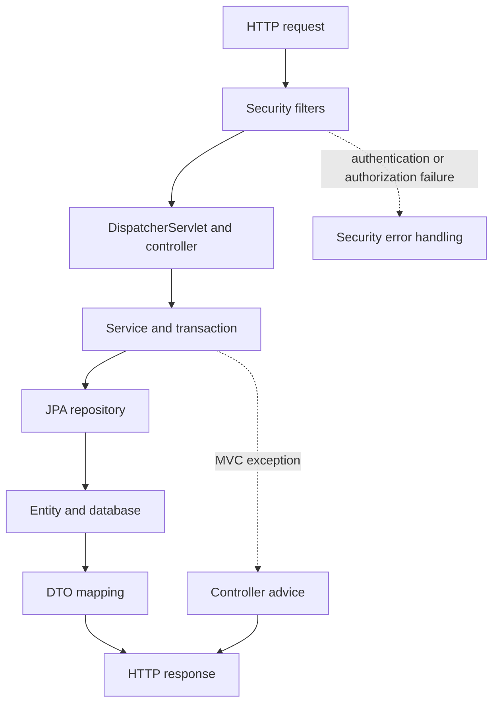

# Java & Spring Boot — Syntax Memory Palace

> **Goal:** Reconstruct the patterns from a blank editor, explain the types and failure cases, and adapt them under interview pressure. Java 17+ / Spring Boot 3.x. This is a recall companion to the existing interview pack, not a new syllabus.

## 0. The daily memory sheet (read once, then hide)

```text
MAP                    STREAM                         COMPARATOR
merge → count          source → filter → map → list  comparingX(primary)
computeIfAbsent        source → max → Optional          .reversed() [optional]
  → create → add       source → collect → groupingBy    .thenComparingX(tie)
                                         └ counting

HTTP → SECURITY FILTERS → CONTROLLER → SERVICE → REPOSITORY → ENTITY/DB
                           DTO ↔ mapping   │
                           ERROR ← exception

Controller = Mapping + Constructor + Input + Service + HTTP output
Service    = Constructor + Transaction + Find/Save + Map/Throw
Repository = JpaRepository<Entity, ID> + derived queries
Entity     = @Entity + @Id + @GeneratedValue + fields + @Version + no-arg
Advice     = @RestControllerAdvice + @ExceptionHandler + status + body
Security   = @Configuration + @Bean + HttpSecurity + rules + build
```

**Mug-up rule:** memorise the method/annotation grammar, not employee or hotel names. Always predict the return type. Use one consistent example first; then change the domain to trades, orders or bookings.

## 1. The Map memory tree

```text
Map<K,V>
├── Already have a value? → get / getOrDefault
├── Insert or combine?    → merge(key, newValue, combine)
│   └── frequency        → merge(key, 1, Integer::sum)
└── Create missing value? → computeIfAbsent(key, factory)
    └── group            → factory makes List → add(value)
```

```java
Map<String, Integer> counts = new HashMap<>();
counts.merge(key, 1, Integer::sum);

Map<String, List<Employee>> groups = new HashMap<>();
groups.computeIfAbsent(employee.getDepartment(),
        ignored -> new ArrayList<>()).add(employee);
```

**Mental picture:** `merge` is a counter: absent → 1, existing 2 → 3. `computeIfAbsent` is a cupboard: find the department drawer, create it if missing, put the employee in it.

| Method | Inputs | Returns |
|---|---|---|
| `merge` | key, supplied value, `(old, incoming) -> result` | new value (or null if removed) |
| `computeIfAbsent` | key, `key -> value` | existing/computed value, possibly null |
| `getOrDefault` | key, fallback | value, does not insert fallback |

Trap: a `HashMap` is not thread-safe. A concurrent map does not make its mutable list values thread-safe.

## 2. Stream memory tree

```text
source.stream()
├── intermediate (lazy)
│   ├── filter(Predicate<T>)       T → boolean
│   ├── map(Function<T,R>)        T → R
│   ├── sorted(Comparator<T>)      T stays T
│   └── distinct(), limit(n)
└── terminal (one per stream)
    ├── toList() / collect(...)    List / collection / result
    ├── max(comparator)            Optional<T>
    ├── count()                    long
    └── collect(groupingBy(...))   Map<K, ...>
```

Mnemonic: **Source → Select → Shape → Finish.** Intermediate operations are optional; a stream is consumed by a terminal operation.

```java
List<R> result = items.stream()
        .filter(predicate)
        .map(mapper)
        .collect(Collectors.toList());
// Java 16+: .toList() returns an unmodifiable list.
```

Assume `Employee` has `String getDepartment()`, `String getName()`, `long getSalary()` (minor currency units) and `long getId()`. For a double-valued salary accessor, use `comparingDouble` instead. Avoid floating-point money for financial calculations.

```java
public static Optional<Employee> findHighestPaidEmployee(List<Employee> employees) {
    return employees.stream()
            .max(Comparator.comparingLong(Employee::getSalary));
}
```

Memory hook: MAX needs a **ruler** (Comparator); it returns the **employee**, not the salary. Empty stream → `Optional.empty()`.

```java
// Alternative only if getSalary() returns double:
// .max(Comparator.comparingDouble(Employee::getSalary));
```

## 3. Collectors: classifier + downstream

```text
collect(
  groupingBy(    WHERE does it belong?     classifier
    keyFunction,
    counting()   WHAT to do inside group?  downstream
  )
)

No downstream supplied → List<T> per group
counting()              → Long per group
Function.identity()     → element itself becomes the key
```

```java
public static <T> Map<T, Long> frequencyMap(List<T> values) {
    return values.stream().collect(Collectors.groupingBy(
            Function.identity(), Collectors.counting()));
}

public static Map<String, List<Employee>> groupByDepartment(List<Employee> employees) {
    return employees.stream().collect(
            Collectors.groupingBy(Employee::getDepartment));
}

public static Map<String, Long> departmentCounts(List<Employee> employees) {
    return employees.stream().collect(Collectors.groupingBy(
            Employee::getDepartment, Collectors.counting()));
}
```

Trace `[A, B, A]` through frequencyMap: classifier puts A in group A and B in group B, downstream counts A=2L, B=1L. `Collectors.counting()` yields boxed `Long`; `merge(..., 1, Integer::sum)` uses `Integer`. These are different types.

## 4. Comparator: the tie-break ladder

```text
Comparator
  .comparingX(PRIMARY)
  .reversed()              ← optional: reverses everything built so far
  .thenComparing(SECONDARY)
  .thenComparingX(TIE_BREAKER)
```

```java
Comparator<Employee> salaryThenId = Comparator
        .comparingLong(Employee::getSalary)
        .reversed()
        .thenComparingLong(Employee::getId);

List<Employee> sorted = employees.stream()
        .sorted(Comparator.comparingLong(Employee::getSalary)
                .reversed()
                .thenComparing(Employee::getName)
                .thenComparingLong(Employee::getId))
        .toList();
```

`comparingInt` for int, `comparingLong` for long, `comparingDouble` for double, `comparing` for Comparable keys. Use `thenComparingInt(Employee::getId)` instead if the ID accessor is int. Avoid subtraction-based comparisons (overflow). For secondary descending only, pass a separately reversed comparator into `thenComparing`.

Visual dry run: `(salary 100, A, id 3)`, `(100, A, id 2)`, `(90, B, id 1)` → IDs 2, 3, 1. Moving `.reversed()` to the end reverses the entire chain, not just salary.

## 5. Spring Boot — draw this flow from memory



If Mermaid is unavailable, use the ASCII tree in section 0. Security failures in the filter chain generally use security handlers, not MVC controller advice.

### 5.1 Controller — route, bind, delegate, respond

```java
@RestController
@RequestMapping("/hotels")
class HotelController {
    private final HotelService service;

    HotelController(HotelService service) {
        this.service = service;
    }

    @GetMapping("/{id}")
    public HotelDto get(@PathVariable("id") long id) {
        return service.get(id);
    }

    @PostMapping
    public ResponseEntity<HotelDto> create(
            @Valid @RequestBody CreateHotelRequest request) {
        HotelDto created = service.create(request);
        URI location = URI.create("/hotels/" + created.id());
        return ResponseEntity.created(location).body(created);
    }
}
```

The original `.status(HttpStatus.CREATED).body(created)` also works; `created(location)` adds a Location header. Explicit path variable name avoids compiler parameter-name dependency. One constructor needs no `@Autowired`.

### 5.2 DTOs — input constraints and output shape

```java
record CreateHotelRequest(
        @NotBlank String name,
        @NotNull @Positive Long cityId) {}

record HotelDto(Long id, String name, Long cityId) {}
```

Record accessors: `request.name()`, `request.cityId()`, not JavaBean getters. `@Positive` alone permits null; combine with `@NotNull`. Controller `@Valid` triggers validation with the validation dependency configured.

### 5.3 Service — find, map, throw; create, save, map

```java
@Service
class HotelService {
    private final HotelRepository repository;

    HotelService(HotelRepository repository) {
        this.repository = repository;
    }

    @Transactional(readOnly = true)
    public HotelDto get(long id) {
        return repository.findByIdAndDeletedFalse(id)
                .map(this::toDto)
                .orElseThrow(() -> new HotelNotFoundException(id));
    }

    @Transactional
    public HotelDto create(CreateHotelRequest request) {
        Hotel saved = repository.save(new Hotel(request.name(), request.cityId()));
        return toDto(saved);
    }

    private HotelDto toDto(Hotel hotel) {
        return new HotelDto(hotel.getId(), hotel.getName(), hotel.getCityId());
    }
}
```

Mental hook: `Optional<Entity> → map(Entity→DTO) → orElseThrow(Supplier<Exception>) → DTO`. `findById(id)` is the basic JPA form; the soft-delete version is used consistently here. Read-only is a hint, not an enforcement guarantee. In standard proxy mode, self-invocation does not apply new transactional advice; unchecked exceptions normally roll back.

### 5.4 Repository — entity + ID, filter + return type

```java
interface HotelRepository extends JpaRepository<Hotel, Long> {
    Optional<Hotel> findByIdAndDeletedFalse(Long id);

    Page<Hotel> findByCityIdAndDeletedFalse(Long cityId, Pageable pageable);
}
```

```text
findBy | CityId | And | DeletedFalse
        argument       literal false (no argument)
Page<T> + Pageable → paginated results and total metadata
Optional<T>       → zero or one row expected
```

### 5.5 Entity — identity, state, version

```java
@Entity
@Table(name = "hotels")
class Hotel {
    @Id
    @GeneratedValue(strategy = GenerationType.IDENTITY)
    private Long id;
    private String name;
    private Long cityId;
    private boolean deleted;
    @Version
    private long version;

    protected Hotel() {}

    Hotel(String name, Long cityId) {
        this.name = name;
        this.cityId = cityId;
    }

    public Long getId() { return id; }
    public String getName() { return name; }
    public Long getCityId() { return cityId; }
}
```

`@Version` enables optimistic concurrency checking on managed entity updates; bulk JPQL updates bypass automatic version checks. The no-arg constructor is required for portable JPA. The deleted field matches the derived repository methods; changing it and filtering reads are both needed for soft deletion.

### 5.6 Exception advice — exception → status + body

```java
class HotelNotFoundException extends RuntimeException {
    HotelNotFoundException(long id) {
        super("Hotel not found with id: " + id);
    }
}

record ApiError(String code, String message) {}

@RestControllerAdvice
class ApiExceptionHandler {
    @ExceptionHandler(HotelNotFoundException.class)
    public ResponseEntity<ApiError> notFound(HotelNotFoundException exception) {
        return ResponseEntity.status(HttpStatus.NOT_FOUND)
                .body(new ApiError("HOTEL_NOT_FOUND", exception.getMessage()));
    }
}
```

For interviews, be able to extend this to validation (400), conflict (409), and safe unexpected failure (500). Do not leak internal stack traces or arbitrary exception messages to clients.

### 5.7 Security — configuration, bean, rules, build

```java
@Configuration
class SecurityConfig {
    @Bean
    SecurityFilterChain bookingSecurityFilterChain(HttpSecurity http) throws Exception {
        return http
                .csrf(csrf -> csrf.disable())
                .sessionManagement(session -> session
                        .sessionCreationPolicy(SessionCreationPolicy.STATELESS))
                .authorizeHttpRequests(authorize -> authorize
                        .requestMatchers(HttpMethod.GET, "/hotels/**", "/search/**",
                                "/actuator/health").permitAll()
                        .anyRequest().denyAll())
                .build();
    }
}
```

**Variant A:** a public read-only API; POST is deliberately denied. Your pasted version used `/hotel/**` and allowed all HTTP methods matching it. I aligned the plural route with the canonical controller and limited public access to GET. CSRF disabling assumes no cookie-based authentication and a suitable threat model.

**Variant B:** real authenticated write endpoint using bearer JWT; replace `denyAll()` with `authenticated()` and add `.oauth2ResourceServer(oauth -> oauth.jwt(Customizer.withDefaults()))` before `.build()`. Requires the resource server dependency and issuer/decoder configuration. Stateless alone does not enable JWT. Add role/authority rules as required.

## 6. Alternative delegate-based architecture (your second example)

Do not memorise it as a different framework; it is the same flow with an extra delegation layer. This is a separate variant, not a second controller registered alongside the canonical one.

```java
@RestController
class HotelController {
    private final HotelApiDelegate hotelApiDelegate;

    HotelController(HotelApiDelegate hotelApiDelegate) {
        this.hotelApiDelegate = hotelApiDelegate;
    }

    @GetMapping("/hotel/{id}")
    public HotelResponse getHotel(@PathVariable("id") Long id) {
        return hotelApiDelegate.getHotel(id);
    }
}
```

```java
// Inside @Service; repository and mapper are injected fields.
@Transactional(readOnly = true)
public HotelResponse getHotel(Long id) {
    Hotel hotel = hotelRepository.findByIdAndDeletedFalse(id)
            .orElseThrow(() -> new ResourceNotFoundException(
                    "Hotel not found with id: " + id));
    return hotelMapper.toResponse(hotel);
}
```

```java
// Inside @RestControllerAdvice.
@ExceptionHandler(ResourceNotFoundException.class)
public ResponseEntity<ErrorResponse> handleResourceNotFound(
        ResourceNotFoundException exception, HttpServletRequest request) {
    HttpStatus status = HttpStatus.NOT_FOUND;
    ErrorResponse response = new ErrorResponse(Instant.now(), status.value(),
            status.getReasonPhrase(), exception.getMessage(), request.getRequestURI());
    return ResponseEntity.status(status).body(response);
}
```

`HotelApiDelegate`, `HotelResponse`, `HotelMapper`, `ResourceNotFoundException`, and `ErrorResponse` are application-specific types. The snippets show their call pattern, not complete implementations. Use `/hotel/**` in security rules if choosing this singular-route variant.

## 7. Blank-page recall test — no looking, no IDE autocomplete

Write all answers into a scratch file. Only after attempting a question, open the corresponding section. Score each: 0 = missing/wrong; 1 = correct after a hint; 2 = independently correct with types; 3 = correct and can explain a trap.

| # | Prompt | Time cap | Answer section | Score 0–3 |
|---:|---|---:|---|---|
| 1 | Frequency map using merge | 30s | 1 | |
| 2 | Group values using computeIfAbsent | 30s | 1 | |
| 3 | Filter, transform, collect | 30s | 2 | |
| 4 | Highest paid employee, empty-list safe | 45s | 2 | |
| 5 | Generic stream frequency map | 45s | 3 | |
| 6 | Group employees by department | 30s | 3 | |
| 7 | Count employees per department | 30s | 3 | |
| 8 | Salary DESC, name ASC, ID ASC | 60s | 4 | |
| 9 | Draw request flow and name boundaries | 60s | 5 | |
| 10 | GET and POST controller + constructor | 2m | 5.1 | |
| 11 | Request record with validation and DTO | 1m | 5.2 | |
| 12 | Transactional get + create + mapper | 2m | 5.3 | |
| 13 | Repository with optional and paginated queries | 1m | 5.4 | |
| 14 | Entity with optimistic locking and soft-delete flag | 2m | 5.5 | |
| 15 | Exception + global advice | 1m | 5.6 | |
| 16 | Security chain: public GET, deny others; JWT variant | 2m | 5.7 | |
| 17 | Delegate-based GET + structured error | 2m | 6 | |

Target: 34/51 minimum (all 17 independently correct, not just aggregate), 45+/51 stretch. Retest failures, compile and run representative code in a real project. These are practice targets, not validated hiring thresholds.

## 8. Fill-in-the-blank drills (cover the answer sections)

```java
counts.____(key, ____, Integer::____);
map.____(key, k -> new ____<>()).____(value);
items.stream().____(predicate).____(mapper).____(Collectors.toList());
employees.stream().____(Comparator.____(Employee::getSalary));
Collectors.____(Function.____(), Collectors.____());
Comparator.comparingLong(Employee::getSalary).____().____(Employee::getId);
```

```java
@____Controller
@____Mapping("/hotels")
// GET method: @____Mapping, @____Variable
// POST method: @____Mapping, @____ @____Body
@____(readOnly = true)
// repository.findByIdAndDeletedFalse(id).____(this::toDto).____(...)
// interface HotelRepository extends ____<Hotel, Long>
// entity identity: @____, @____Value; concurrency: @____
// advice: @____ControllerAdvice; method: @____Handler(...)
// security: @____, @____, HttpSecurity → ... → .____()
```

Answer key: merge, 1, sum; computeIfAbsent, ArrayList, add; filter, map, collect; max, comparingLong; groupingBy, identity, counting; reversed, thenComparingLong; Rest, Request, Get, Path, Post, Valid, Request, Transactional, map, orElseThrow, JpaRepository, Id, Generated, Version, Rest, Exception, Configuration, Bean, build.

## 9. Mistake log (the only thing to expand)

| Date | Failed prompt | What I wrote | Correct pattern | Why wrong | Retest |
|---|---|---|---|---|---|
| | | | | | |

Example: wrote `Map<String, Integer>` for `groupingBy(..., counting())` → collector returns Long → retest tomorrow with a different domain.

## 10. Bounded spaced-repetition plan

- Day 0: draw both trees, type the patterns, run examples; correct mistakes.
- Day 1: blank-page test, then repair failures.
- Day 3: redo failed patterns and mix in new domain names.
- Day 7: timed 17-prompt test; explain each failure mode aloud.
- Day 14: reconstruct the mini hotel API in a runnable project, including positive/negative tests.
- Day 30: cold retest. If a prompt fails, revisit it the next day; otherwise review only as needed.

Daily 20-minute micro-session: 2 min draw trees; 10 min closed-book coding; 5 min compile/test and correction; 3 min explain a trap. Stop adding notes unless an actual failure exposes a missing pattern. Do not simply reread or copy-paste.

**Evidence:** Practice testing and distributed practice have high utility in learning research (Dunlosky et al., 2013, https://doi.org/10.1177/1529100612453266). Trees and visual cues organise information; they are not a guarantee of photographic memory. The specific schedule and thresholds here are practical heuristics.

## 11. Reference and setup

The snippets omit package declarations and imports for recall efficiency; they are not a single compilable application. Typical imports: `java.util.*`, `java.util.function.*`, `java.util.stream.*`, `java.net.URI`, `java.time.Instant`, `jakarta.persistence.*`, `jakarta.validation.Valid`, `jakarta.validation.constraints.*`, `jakarta.servlet.http.HttpServletRequest`, Spring MVC, Spring Data JPA, `org.springframework.transaction.annotation.Transactional`, Spring configuration and security classes. Use Boot web, validation, data JPA and security starters and a database driver; JWT variant additionally needs the resource server starter. Compile and test with your chosen project setup.

- Java Stream: https://docs.oracle.com/en/java/javase/17/docs/api/java.base/java/util/stream/Stream.html
- Java Map: https://docs.oracle.com/en/java/javase/17/docs/api/java.base/java/util/Map.html
- Java Comparator: https://docs.oracle.com/en/java/javase/17/docs/api/java.base/java/util/Comparator.html
- Spring Framework: https://docs.spring.io/spring-framework/reference/
- Spring Data JPA: https://docs.spring.io/spring-data/jpa/reference/
- Spring Security: https://docs.spring.io/spring-security/reference/
