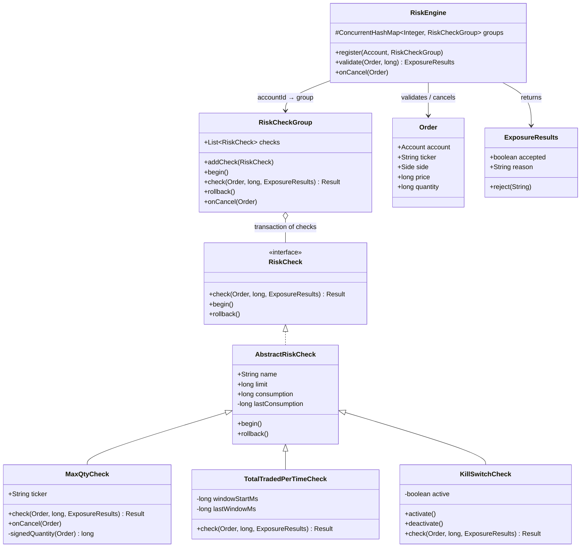
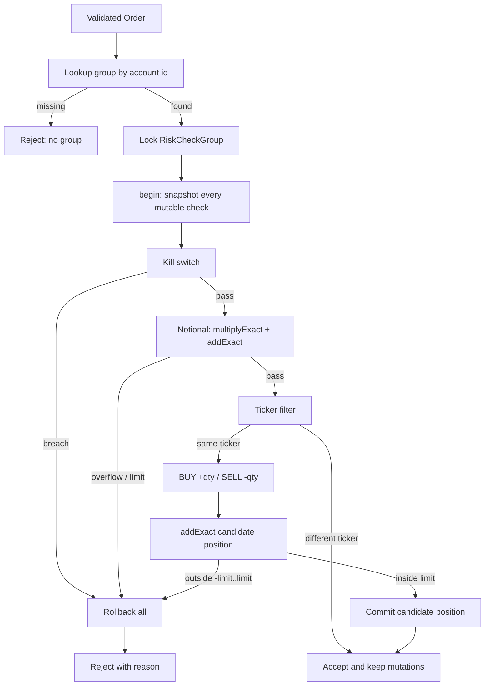
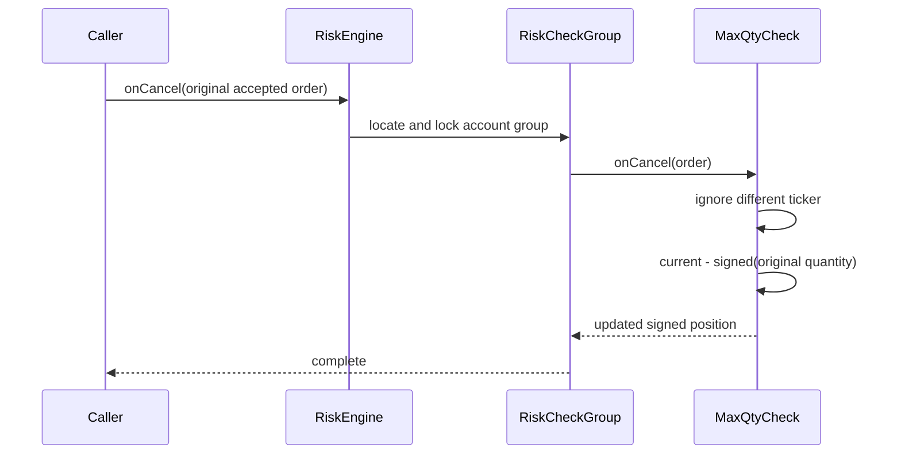

# PTR Java Code Review, Repository Shape, Class Model, and Data Flow

The primary baseline and its compatible evolution set are compiled with Java 17. `RiskLimitEngine.java` now has focused JUnit coverage for ticker scoping, signed BUY/SELL position, absolute limit enforcement, exact notional arithmetic, cancellation reversal, validation, and group rollback.

That means the review below is about **semantic correctness, concurrency guarantees, interview clarity and design claims**, not basic syntax.

---

# Executive Verdict

| File | Compile/Run | Interview Use | Verdict |
|---|---|---|---|
| `RiskLimitEngine.java` | PASS + focused tests | Primary risk-engine answer | KEEP; ticker, signed position and overflow fixes implemented |
| `RiskLimitEngineAsync.java` | PASS | Integration/event-bus follow-up | KEEP, rename/clarify synchronous semantics |
| `RiskLimitEnginePartitioned.java` | PASS | Partitioning bridge | KEEP, correct the concurrency claims |
| `RiskLimitEnginePartitionedAsync.java` | PASS | Advanced concurrency follow-up | CONCEPT GOOD, implementation currently violates strict single-owner state |
| `MatchingEngine.java` | PASS | Separate trading-domain drill | KEEP, fix aggressor/resting-price + market-order behavior |

---

# 0. Repository Decision and Current Module Shape

## Keep two representations for two different jobs

Do **not** mechanically split `RiskLimitEngine.java` and break the interview evolution files that reuse its package-accessible foundation classes. Keep:

```text
RiskLimitEngine.java
    one-file, blank-screen, 30–40 minute interview implementation

RiskLimitEngineAsync.java
RiskLimitEnginePartitioned.java
RiskLimitEnginePartitionedAsync.java
    compatible evolution/comparison files

RiskLimitEngineTest.java
    executable regression evidence for the corrected baseline

PTR_Java_Code_Review.md
PTR_Risk_Engine_Mermaid_Diagrams.md
    design, evidence boundary and production-shaped decomposition
```

For a real deployable module, split by responsibility rather than leaving many package-private top-level classes in one file:

```text
org.chijai.ptr.risk
├── model
│   ├── Account.java
│   ├── Order.java
│   ├── Side.java
│   └── RiskDecision.java
├── check
│   ├── RiskCheck.java
│   ├── PositionLimitCheck.java
│   ├── NotionalPerSecondCheck.java
│   └── KillSwitchCheck.java
├── engine
│   ├── RiskCheckGroup.java
│   └── RiskEngine.java
├── owner
│   ├── PartitionRouter.java
│   ├── PartitionEvent.java
│   └── PartitionWorker.java
├── config
│   └── VersionedRiskConfiguration.java
└── recovery
    ├── RiskSnapshot.java
    └── RiskJournal.java
```

That is a production repository target, not something to reproduce before the core invariant works. The interview file intentionally stays compact; the production shape adds stable public types, immutable decisions/configuration, ownership events, persistence/recovery, metrics and integration tests.

## Exact corrected baseline class diagram



## Validation data flow



## Cancellation data flow and remaining limitation



The baseline has no order identifier or lifecycle state. It therefore cannot detect duplicate cancel, cancel-before-new, partial cancellation or replay. Production evolution requires stable order identity and an idempotent order-state transition inside the same ownership/transaction boundary.

## Current verification evidence — 23 November 2026

- `RiskLimitEngine.java`: standalone compile and demo execution pass.
- `RiskLimitEngineTest.java`: seven focused JUnit tests pass in an isolated Maven compilation.
- Baseline + async: compile pass.
- Baseline + partitioned: compile pass.
- Baseline + async + partitioned + partitioned-async: compatible-family compile pass.
- `RiskEngineExtensible.java`: separate standalone compile pass.
- Baseline + `MatchingEngine.java`: compile pass.
- `TradingSystemInterview60Min.java`: separate standalone compile pass.

The repository-wide Maven build is **not** green: a separate production-shaped PTR file currently redeclares several package-level model names, and `CashAllocationMarginBreach.java` has a pre-existing compilation failure. Those unrelated conditions are not evidence against the isolated risk-engine tests, but they must not be hidden or described as a repository-wide passing build.

---

# 1. RiskLimitEngine.java

## What is good

The core class model is strong for an interview:

```text
RiskEngine
  -> RiskCheckGroup
      -> List<RiskCheck>
          -> MaxQtyCheck
          -> TotalTradedPerTimeCheck
          -> KillSwitchCheck
```

`ConcurrentHashMap<Integer, RiskCheckGroup>` plus `synchronized(group)` is a simple concurrency story:

```text
different account/group -> can progress concurrently
same account/group      -> compound mutation serialized
```

The `begin() / rollback()` mechanism also gives a clear group-level invariant: if an earlier check mutated consumption and a later check breaches, prior mutations are restored.

## Fixed — `MaxQtyCheck` is scoped by ticker

The check now exits before touching state when the order belongs to another ticker:

```java
if (!order.ticker.equals(ticker)) {
    return Result.PASS;
}
```

The regression test sends a large `MSFT` order through an `AAPL` check and verifies that AAPL consumption remains zero.

## Fixed — signed BUY/SELL position with an absolute limit

The baseline now uses:

```java
BUY  -> +quantity
SELL -> -quantity
candidatePosition = exactAdd(currentPosition, signedQuantity)
accept iff -limit <= candidatePosition <= limit
```

The comparison does not call `Math.abs(candidatePosition)` because `Math.abs(Long.MIN_VALUE)` overflows. A breach never commits the candidate. Cancellation subtracts the original signed contribution, so cancelling a BUY reduces the position and cancelling a SELL increases it. The baseline still lacks order identity/deduplication; duplicate cancel protection remains a later-round requirement.

## Fixed — exact position and notional arithmetic

The baseline now uses exact arithmetic for both multiplication and accumulation:

```java
long notional = Math.multiplyExact(order.price, order.quantity);
long candidate = Math.addExact(consumption, notional);
```

An arithmetic overflow becomes an explicit risk breach rather than a wrapped negative value or a silent acceptance. Cancellation overflow is treated as an illegal state because it indicates inconsistent state/event history. The `Order` constructor now rejects null/blank identifiers and non-positive price/quantity.

## P1 — Config replacement is not serialized with an in-flight order

`register()` does:

```java
groups.put(account.id, group);
```

while an order can already be processing the previous group.

That is fine if registration is startup-only.

If you claim safe intraday config changes, define semantics:

```text
immutable versioned group replacement
or
route config through the same ownership boundary as orders
```

## P2 — `UNBREACH` is currently unused

It adds mental load without value in these five files. Remove it unless you plan to demonstrate unbreach semantics.

## P2 — Naming

`TotalTradedPerTimeCheck` is applied before a trade occurs.

If the requirement is "submitted order notional per second", a clearer name is:

```text
NotionalPerSecondCheck
```

If it genuinely represents traded notional, then it should update from trade events, not order validation.

---

# 2. RiskLimitEngineAsync.java

## What is good

The integration boundary is easy to explain:

```text
MatchingEngine  -> OrderEvent
Config/RDM      -> ConfigEvent
Operator        -> CommandEvent
                  ↓
               MessageBus
                  ↓
            RiskEngineListener
                  ↓
               RiskEngine
```

The file itself correctly says the bus is synchronous and in-process.

## P1 — Name "Async" can mislead

`MessageBus.publish()` calls handlers directly:

```java
subscribers.forEach(handler -> handler.accept(event));
```

Therefore this is event-driven/message-bus-style integration, but not asynchronous execution.

For an interview, say:

> "This version introduces an event boundary, not thread-level asynchrony."

A clearer filename/class concept would be `RiskLimitEngineOnBus`.

## P1 — Kill-switch visibility is not protected for concurrent publishers

`KillSwitchCheck.active` is a plain boolean, and commands mutate it outside the `synchronized(group)` section used by validation.

If command and order publishing can happen from different threads, visibility/ordering is not guaranteed.

Simplest fix:

- mutate kill switch while holding the same `RiskCheckGroup` lock; or
- route command through the same owner thread in the single-owner version.

`volatile` fixes visibility but not broader ordering semantics.

## P1 — Config mutation can race with validation

`event.group.addCheck(killSwitch)` and `engine.register(...)` happen directly in the handler.

Again, fine if config is startup-only and no orders run concurrently.

Otherwise define an ownership/atomic replacement rule.

## P2 — `CompletableFuture` is not creating asynchrony here

It is acceptable as a request/reply carrier, but because `publish()` is synchronous, the result is normally already complete before `get()`.

That is not wrong. Explain it precisely.

## P2 — Handler exceptions can escape before the `get()` try/catch

`submitOrder()` calls:

```java
bus.publish(event);
```

before entering the `try` around `event.reply.get()`.

If a subscriber throws, it escapes directly.

If resilience is part of the exercise, wrap publish + wait together or complete the future exceptionally.

---

# 3. RiskLimitEnginePartitioned.java

## What is good

The ownership mapping is visually useful:

```text
accountId % N -> Partition
```

and it prepares the mental bridge toward partition-owned event loops.

## P1 — The "4 lock domains instead of 1" claim is inaccurate

Level 1 already uses:

```java
synchronized(group)
```

which means it already has one lock domain per `RiskCheckGroup`, not one global lock.

Adding four `Partition` objects does not itself reduce those group locks by 4x.

A more accurate statement:

> "Partitioning introduces an explicit ownership/sharding boundary. In this direct-call version the caller still executes the check and each group still provides its own synchronization."

That is defensible.

## P1 — Partition `HashMap` assumes registration is not concurrent with reads

Each partition owns:

```java
Map<Integer, RiskCheckGroup> groups = new HashMap<>();
```

Multiple caller threads can read it.

If it is completely built before concurrent processing begins and safely published, this can be an interview simplification.

If registration continues concurrently, use a safe configuration ownership rule.

## P2 — Inheritance leaves the base `RiskEngine.groups` unused

`PartitionedRiskEngine extends RiskEngine`, but its effective state lives in `Partition[]`.

This is not incorrect, but for a scratch interview implementation composition could be cleaner than inheritance.

Do not spend time fixing it unless the interviewer asks about design cleanliness.

---

# 4. RiskLimitEnginePartitionedAsync.java

This is the file with the biggest gap between the **stated concurrency model** and the **actual concurrency model**.

## Good intended design

The intended architecture is strong:

```text
accountId
  -> partition
  -> bounded queue
  -> one worker
  -> partition-owned state
```

That is a strong answer for deterministic per-key ordering plus parallelism across independent partitions.

The bounded `ArrayBlockingQueue` and explicit overload rejection are also good interview signals.

## P0 — Not all partition state mutations go through the worker

The worker processes orders without `synchronized` because the comment says:

```text
worker is the only thread touching groups
```

But configuration does this on the bus publisher thread:

```java
p.register(event.account, event.group);
```

Kill-switch commands directly mutate:

```java
ks.activate();
ks.deactivate();
```

and cancellation eventually calls the inherited direct `onCancel()` path.

Therefore the worker is **not** the only thread mutating state.

## P0 — Cancel can race with order evaluation

The inherited partition cancel path uses:

```java
synchronized(group)
```

but the worker order path intentionally does **not** take that same lock.

So synchronization on cancel does not protect against the worker.

This breaks the central single-owner guarantee.

## Correct single-owner rule

Route every state-changing event for an account/partition into the same queue:

```text
OrderEvent
ConfigEvent
CancelEvent
KillSwitchEvent
      ↓
partitionFor(account)
      ↓
bounded partition queue
      ↓
ONE worker
      ↓
all mutations
```

Then remove the group lock inside that partition.

That is the version worth memorizing as the advanced follow-up.

## P1 — The bus broadcasts every OrderEvent to every partition

Each partition subscribes to every `OrderEvent` and filters:

```java
if (partitionIndex != id) return;
```

For four partitions this is fine as a demo.

A cleaner partitioned design routes once:

```java
partitionFor(account).offer(event);
```

This gives O(1) routing rather than O(number of partitions) handler dispatch.

## P1 — Worker failure can strand callers forever

The worker catches only `InterruptedException`.

If `g.check(...)` throws a runtime exception, the worker can die and the corresponding `CompletableFuture` may never complete.

For a robust demo:

```text
catch exception per event
-> completeExceptionally / reject
-> decide whether worker continues or process fails fast
```

Also consider a timeout for caller waits if you want to discuss operational behavior.

## P1 — `validate(order, nowMs)` ignores `nowMs`

The override creates a new `OrderEvent(order)`, whose constructor captures `System.currentTimeMillis()`.

That means the supplied test timestamp is lost.

Either pass `nowMs` into `OrderEvent`, or remove the misleading parameter in this layer.

## P1 — "REAL SYSTEM" comments should be treated cautiously

Statements equating these exact toy levels with specific real Gen3/Gen4 implementations should remain only if your actual source/code establishes them.

For interview safety, label them:

```text
analogy / simplified model
```

rather than architectural fact.

---

# 5. MatchingEngine.java

## What is good

For a 30-minute trading drill, the basic data structures are excellent:

```text
bids -> TreeMap descending price
asks -> TreeMap ascending price
same price -> FIFO Queue
```

That clearly demonstrates price priority and FIFO within a price level.

Partial fills are handled naturally by decreasing `qty`.

## P0 — Execution price is wrong for an aggressive BUY crossing a resting ASK

The code says for two limit orders:

```java
else execPrice = bid.price;
```

That happens to be correct for the included aggressive-SELL example because the bid is the resting order.

But if:

```text
resting ask = 100
new aggressive buy = 105
```

the execution should normally occur at the resting ask's price (100), while this code produces 105.

The algorithm lost the information about which order is the aggressor because it adds the incoming order to the book before matching.

## Best 30-minute fix

Use the incoming order as the aggressor:

```text
enterOrder(incoming)
    -> validate
    -> match incoming against opposite resting book
    -> if incoming still has quantity:
           add remainder to its own book
```

Then:

```text
execution price = resting order's price
```

This is both simpler to explain and semantically cleaner.

## P1 — Market orders can incorrectly rest on the book

Current code adds every order before matching.

If a market order arrives and the opposite side has insufficient/no liquidity, the remaining market order can remain stored at the synthetic extreme key.

Normally a market order should consume available liquidity and any unmatched remainder should be cancelled/rejected according to the chosen semantics, not rest as a market order.

## P1 — Market-vs-market can produce price 0

If both best orders are market orders, there is no valid reference price in this toy model.

State the assumption that market orders require opposite-side priced liquidity, or omit market orders from the first interview version.

## P2 — Keep market orders as a follow-up if time is tight

For a 30-minute exercise, the highest-return core is:

```text
limit orders
TreeMap price levels
FIFO per level
partial fills
resting-price execution
```

Then add market order semantics only if asked.

---

# Recommended Interview Hierarchy

Do not attempt to reproduce all five files in one interview.

```text
1. RiskLimitEngine.java
   Corrected ticker + exact arithmetic + signed position baseline.
   This is the primary code; recreate it before reading the answer.

2. Explain RiskLimitEngineAsync
   only if asked about event integration.

3. Explain partition ownership.

4. If asked for high-throughput deterministic concurrency:
   describe/fix PartitionedAsync so ALL mutations use the owner queue.

5. MatchingEngine.java
   practice separately as another domain problem.
```

---

# Core Senior-Level Concurrency Sentence

> System concurrency does not require multiple threads mutating the same state. I parallelize independent ownership domains and serialize mutations that share an invariant.

But only claim a true **single-owner partition** when orders, cancels, config updates and commands all obey that ownership boundary.

---

# Fix Status and Remaining Order

Implemented and regression-tested in the primary baseline:

1. **DONE:** ticker filtering in `MaxQtyCheck`.
2. **DONE:** signed BUY/SELL position and absolute position limit.
3. **DONE:** exact position/notional arithmetic and explicit overflow behavior.
4. **DONE:** positive price/quantity and non-blank ticker validation.

Remaining evolution work, kept explicit rather than hidden:

1. Correct Level-3a comments about lock domains.
2. Route **all** Level-3b mutations through the partition owner queue.
3. Add stable order identity and idempotent cancel/replay semantics.
4. Define versioned intraday configuration replacement.
5. Fix `MatchingEngine` to match the incoming aggressor before resting it.
6. Make execution price the resting order price.
7. Do not allow unfilled market orders to rest.

The baseline is now coherent for the primary interview exercise. Do not claim the advanced single-owner or matching-engine files are corrected until their corresponding items are implemented and tested.
